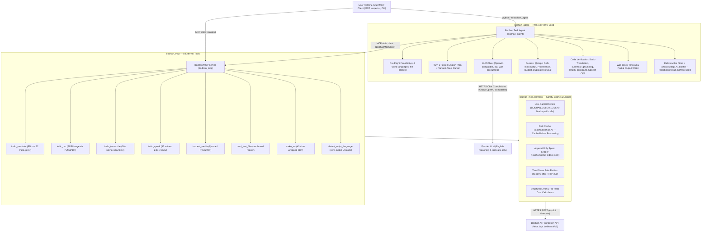

# System Architecture: Bodhan Tool Server and Task Agent

## 1. High-Level System Architecture

The project is organized under `examples/bodhan_tool_agent` as two decoupled packages under `src/`: a standalone MCP tool server (`bodhan_mcp`) and an autonomous task agent (`bodhan_agent`).

---

## 2. Component Subsystems

### 2.1 Bodhan MCP Server (`src/bodhan_mcp`)
Implements the Model Context Protocol over standard input/output (`stdio`) using MCP Python SDK `2.3.0` (`MCPServer`).
- Exposes **8 model-agnostic tools** for both the Task Agent and third-party MCP clients:
  1. `indic_translate`: Translation between English and 22 scheduled Indian languages (automatic English pivot for Indic-to-Indic pairs).
  2. `indic_ocr`: Multi-page PDF/image document OCR rendered via PyMuPDF (150 DPI) with Markdown/LaTeX preservation.
  3. `indic_transcribe`: Audio transcription with silence-based `<= 30s` chunking via `ffmpeg`/`ffprobe`.
  4. `indic_speak`: Text-to-speech across 45 voices with sentence-aware 250-char chunking and `ffmpeg` assembly into 24 kHz mono 16-bit PCM WAV.
  5. `inspect_media`: Sandboxed media inspector (duration, format, PDF page count).
  6. `read_text_file`: Sandboxed text reader (`.txt`, `.md`, `.csv`, `.srt`) with path-traversal protection.
  7. `make_srt`: Deterministic SubRip (`.srt`) generator with 42-char line wrapping and millisecond cues.
  8. `detect_script_language`: Zero-model Unicode script block and language-cluster classifier.
- Internal agent orchestration tools (`finish`) are excluded from the MCP server surface.

### 2.2 Bodhan Task Agent (`src/bodhan_agent`)
Coordinates multi-step workflows using an OpenAI-compatible tool-calling LLM (evaluated with Groq `openai/gpt-oss-20b` and `openai/gpt-oss-120b`):
- **Pre-Flight Feasibility**: Rejects unsupported world languages (48-language catalog, distinguishing topic mentions from target/audio languages), missing files, unsupported extensions, 0-byte files, and corrupt media in `0.00s` at `Rs 0.0000`.
- **Plan Turn & Planned-Tools Hints**: Turn 1 runs with `tools=None` to produce a concise English plan; declared tool names are parsed into `planned_tools` and remaining unexecuted tools are appended to tool responses (`Remaining planned tools: ...`).
- **Guards & Context Compaction**: Enforces strict `@stepN.field` resolution, Indic-script blocking, provenance verification (`TextProvenanceRegistry`), pre-flight budget caps, duplicate refusal with valid references, and history compaction of large English OCR previews (1,200 chars on the next turn, ~180-char stub thereafter).
- **Code-Driven Verification**: Runs automatically outside LLM discretion — back-translation + coverage checks, deterministic `summary_grounding` (content-word overlap) and `length_constraint` checks for LLM-authored summaries, OCR/transcript integrity checks, and speech round-trip CER via `indic_transcribe`.
- **Wall-Clock Budget & Partial Output**: Every LLM call, MCP tool call, and verification call is wrapped in `asyncio.wait_for` against the real wall-clock deadline (including HTTP 429 rate-limit sleeps, reported separately as `rate_limit_wait_ms`). On timeout or failure, partial `report.json`, `result.md`, `trace.jsonl`, and artifacts are still written.
- **Filtered Deliverables & Long-Text Artifacts**: Writes full `indic_ocr` and `indic_transcribe` outputs to `artifacts/step_N_<tool>.txt`, shows only a 300-char preview plus relative link in `result.md` unless OCR/transcript is the final output, excludes failed-grounding / failed-verification candidates, and lists only final verified text outputs plus any text passed to `indic_speak`.

### 2.3 Safety, Cache, and Spend Layer (`src/bodhan_mcp/common.py`)
- **Live-Call Guard**: Real HTTP calls to `api.bodhan.ai` are allowed by default when API keys are configured and refused (`LIVE_CALLS_DISABLED`) whenever `BODHAN_ALLOW_LIVE=0` (or `false`). Tests force `BODHAN_ALLOW_LIVE=0` via `tests/conftest.py`, and `scripts/run_matrix.ps1` retains an explicit `BODHAN_ALLOW_LIVE=1` confirmation check.
- **Append-Only Spend Ledger**: Logs every dispatched call to `.cache/spend_ledger.jsonl` (`dispatched` -> `completed` / `failed`) keyed by `run_id`.
- **Cache-Before-Processing**: Commits raw HTTP 200 bytes to `.cache/bodhan_*` immediately before post-processing and never retries after a 200 response.
