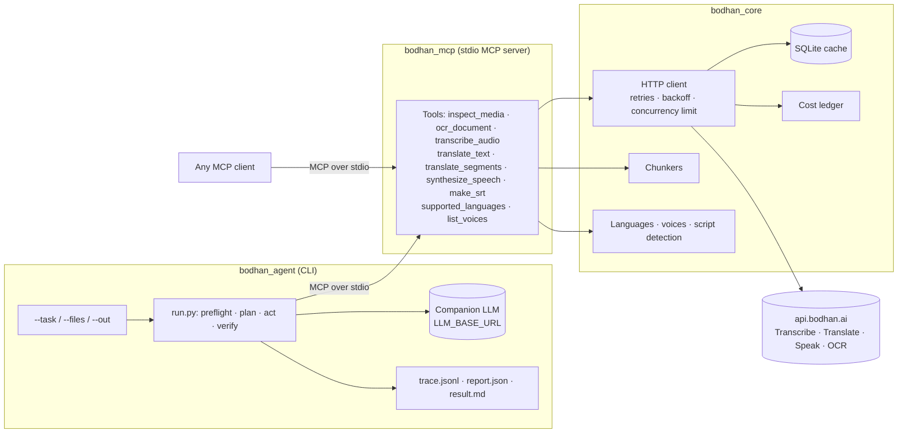

# Architecture

- **bodhan_agent:** plans and drives the task. It talks to the server over MCP, exactly like a third-party client.
- **bodhan_mcp:** typed tools with model limits handled internally. Media is passed by file path.
- **bodhan_core:** shared plumbing (HTTP, cache, cost, chunking, language data) with no MCP or LLM dependency.
