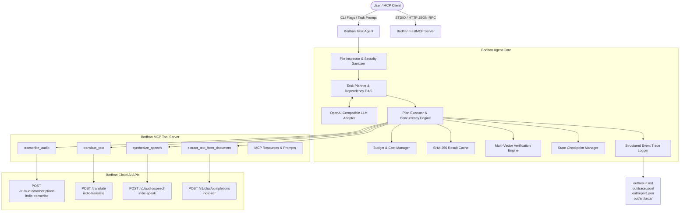

# Architecture: Bodhan MCP Tool Server & Autonomous Task Agent

## High-Level System Architecture

## Architectural Design Principles

1. **Decoupled Tool Services**: The MCP Server and the Agent share the same resilient tool implementations (`bodhan_mcp.tools.*`), ensuring identical validation, chunking, and error handling whether invoked via CLI or by external MCP desktop clients.
2. **Deterministic Fallbacks**: While the companion LLM provides task reasoning and English summarization, all Indic translation, transcription, speech, and OCR operations are strictly routed through official Bodhan models.
3. **Defense-in-Depth Security**: File paths are validated against boundary traversal, extracted text is scanned for prompt injection markers, and credentials are automatically redacted from execution logs.
4. **Idempotency & Cost Defense**: Input files and arguments are hashed using SHA-256 to eliminate redundant API calls. Budgets are checked prior to every step execution.
