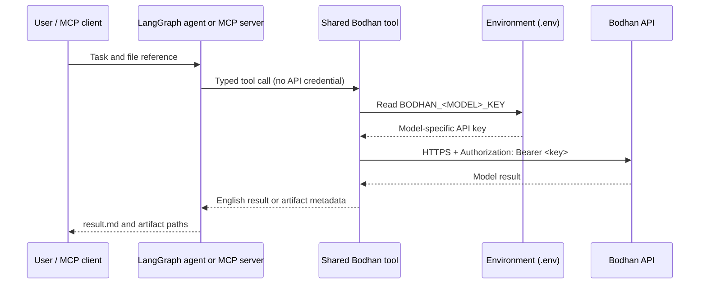

# Authentication and token handling

## Request flow

## Bodhan credentials

The CLI and stdio server call `load_dotenv()` before creating a `Run`. For a request, `Run._request` selects one of `BODHAN_TRANSCRIBE_KEY`, `BODHAN_TRANSLATE_KEY`, `BODHAN_SPEAK_KEY`, or `BODHAN_OCR_KEY`, then sends it in the standard `Authorization: Bearer …` HTTP header over TLS to `https://api.bodhan.ai`. Each key is used only for its corresponding model. A missing key returns a structured `missing_api_key` error. The blank `BODHAN_API_KEY` line in `.env.example` exists only to satisfy the Cookbook's generic recipe validator and is not read by this implementation.

The repository `.gitignore` excludes `.env` and `API/`; tool file discovery also skips the `API/` directory and filenames beginning with `bodhan-api-key` or `api-key`. `.env.example` contains placeholder values. Do not commit key files. Keys are not passed to the LangGraph state, LangChain tools, MCP tool arguments, prompts, traces, or reports. The cache key includes only a SHA-256 digest of the key to prevent reusing cached output across credentials; the key itself is not stored in the cache key.

## Planner credentials

`LLM_BASE_URL`, `LLM_MODEL`, and `LLM_API_KEY` configure a separate OpenAI-compatible planner endpoint. The recipe defaults to Gemini's OpenAI-compatible endpoint and `gemini-3.5-flash-lite`; put the Google AI Studio key in `LLM_API_KEY`. The CLI passes it to `ChatOpenAI`; it is independent of Bodhan credentials. The planner is used for English planning, tool selection, and English summaries. OCR, transcription, translation, and speech requests go to the corresponding Bodhan model through the shared tool layer.

For Google's OpenAI-compatible endpoint, completed tool calls and results are sent on later model turns as ordinary assistant/user messages. LangGraph retains its structured tool-call history internally. Other OpenAI-compatible providers receive the standard tool-call messages.

## LangSmith tracing

Set `LANGSMITH_TRACING=true`, `LANGSMITH_API_KEY`, and `LANGSMITH_PROJECT` in `.env`. LangChain automatically traces the agent and LLM calls. The stdio MCP server wraps each shared operation in a LangSmith `tool` span, so MCP calls are visible in the same project. Set `LANGSMITH_ENDPOINT` only for a non-default region or self-hosted instance. Both entry points wait for pending LangChain traces before exit.

## MCP transport

The required MCP transport is local stdio. The server does not add a second MCP bearer token or expose Streamable HTTP, so access control is provided by the local process and MCP host. The optional Streamable HTTP token-auth stretch goal is not implemented. Bodhan API requests made by MCP tools still use the model-specific Bodhan bearer key above.

## Data in traces and cache

LangSmith receives LLM prompts and responses, which include the task and the model's English outputs. MCP tool spans record the tool name and safe output metadata; tool arguments and text/media content are redacted. API keys are never included. Use LangSmith's privacy and retention controls for trace data. The local trace records summarized arguments, artifact names, and estimated Bodhan cost; planner cost is omitted because provider pricing is external. The persistent response cache may contain Bodhan responses, but it lives in a mode-0700 local directory, is excluded from Git, and is namespaced by a digest of the model key. Remove `.bodhan-cache/` and the run output directory to erase cached responses and generated artifacts.
