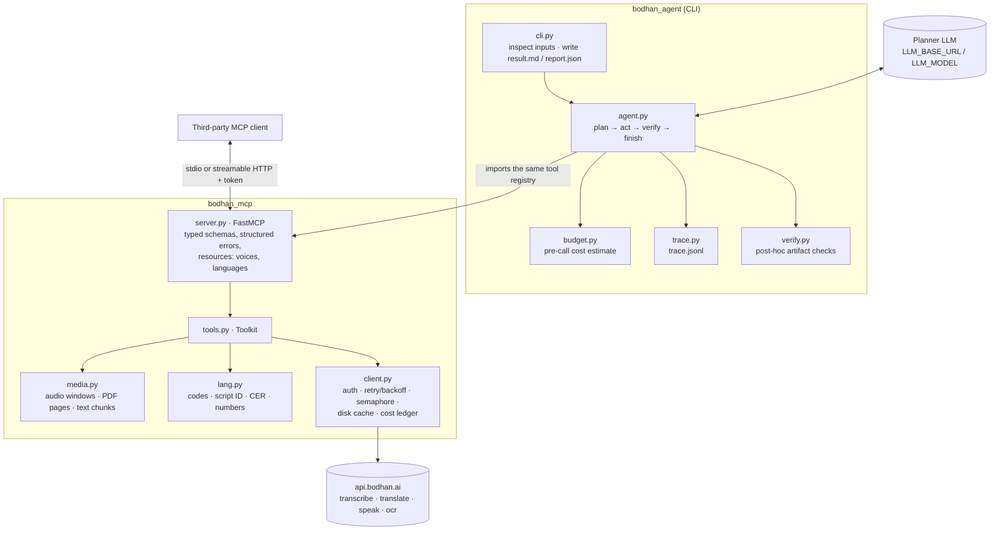
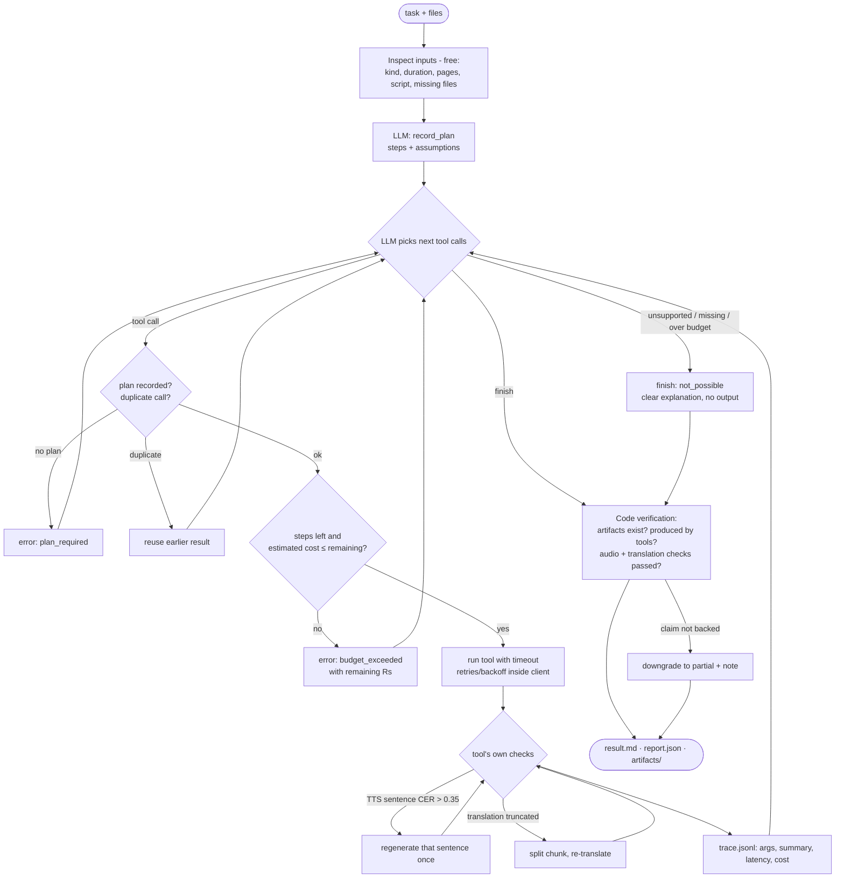

# Design notes

## Architecture

| Part | Responsibility |
|---|---|
| `client.py` | The only code that talks HTTP. Per-model keys, exponential backoff with jitter on 429/5xx/timeouts (4xx is never retried), a process-wide concurrency limit, a content-addressed cache (sha256 of model + params + input bytes, atomic writes, per-key locks so concurrent identical requests are paid once), and a ledger of cost/latency per call. |
| `media.py` | Deterministic plumbing: ffmpeg decode to 16 kHz mono, silence-aware windowing, PDF → PNG pages, image normalisation, sentence and paragraph chunking. Unit-tested without any model. |
| `lang.py` | Language codes/names, unsupported-language errors, script-based language ID, normalisation (Indic digits, ZWJ, NFC), CER and number extraction. |
| `tools.py` | The tool set: each tool = one capability with its limits, checks and artifact files. |
| `server.py` | FastMCP wrapper: pydantic-typed parameters with descriptions, JSON errors with `code`/`hint`, cost per call in each result, voice library and language table as MCP resources, a starter prompt. |
| `agent.py` | The loop. Uses the server's own schemas so the LLM sees exactly what a third-party client sees. |

## Agent flow

## Tool design

**Granularity: one tool per capability, not per endpoint and not per task.** A tool per raw endpoint would push chunking, retries and verification onto the planner, which is exactly where LLMs are unreliable and expensive. Task-level tools ("make_audio_summary") would hide control and fail on unseen tasks. Capability tools sit in between: the planner decides *what* (transcribe, translate, speak, OCR, subtitle), the tool guarantees *how* (limits, checks, files). `create_subtitles` is the one composite tool, because timing alignment is deterministic work an LLM should not do.

**Media by reference.** Inputs and outputs are file paths. Every tool writes its full output to `out/artifacts/` and returns at most a ~600-character preview, the path, and its checks. The planner chains tools with `text_path` / `transcript_path`. Pages of long text can be read with `read_text` (paged, max 12k chars) when the LLM must understand content, e.g. to write an English summary.

**Model limits handled inside tools**

| Limit | Handling |
|---|---|
| ~30 s audio per transcription | ≤28 s windows cut at the quietest 50 ms frame after 8 s, so words are not split; near-silent windows are dropped (no hallucinated speech) |
| Short TTS inputs | sentence split on `। ॥ . ! ? ; :` and newlines, long sentences at commas then spaces, ≤220 chars |
| Translation context | paragraph-aware chunks ≤6,000 chars, tables and code fences never split; a truncated chunk is halved and retried |
| Multi-page documents | PDFs rendered at 170 DPI with pypdfium2 (text layer never used), one OCR call per page in parallel, optional page ranges |
| Unknown language | audio: first window transcribed without a hint, script of the text gives the language, used as a hint for the rest; text: Unicode-script ID with candidate list |

**Errors are actionable.** Stable codes (`invalid_input`, `file_not_found`, `unsupported_language`, `unsupported_media`, `missing_api_key`, `rate_limited`, `upstream_error`, `timeout`, `budget_exceeded`, `policy_violation`) plus a `hint` telling the caller what to do next, and `retryable`. Over MCP these come back as `isError` results with the JSON body; the server never crashes on bad input.

## Where the LLM is used, and why

| Decision point | What it decides | Fallback if it fails |
|---|---|---|
| Planning | which tools, in which order, with which parameters; assumptions for unstated languages/voices/length | LLM unreachable → run ends with status `failed` and the reason in `result.md` |
| English writing | summaries and explanations, written with `write_text` (refuses Indian scripts) | — |
| Judging | reading tool checks and deciding retry / report | code verification after `finish` overrides an unbacked "completed" |
| Impossible tasks | recognising unsupported languages, missing files, small budgets | tools return explicit errors (`unsupported_language`, `file_not_found`, `budget_exceeded`) that make the honest answer the easy one |

**Never by the LLM:** speech recognition, translation, TTS, OCR, or any Indian-language text. This is enforced, not just prompted: `write_text` rejects Indian scripts, and in agent mode any inline Indian-language text passed to a tool must be a substring of text that came from a Bodhan model or an input file (provenance check); otherwise the call fails with `policy_violation`.

**Untrusted content.** OCR, transcripts and file contents are returned wrapped in `<untrusted_document>` tags with an explicit note; the system prompt tells the planner to treat embedded instructions as data and to mention ignored injections. The demo chapter contains such an injection on page 6.

## Verification

- **Audio:** every sentence of synthesised speech is back-transcribed with Indic-Transcribe in its language; CER > 0.35 → that sentence is regenerated once (cache bypassed only for this case); CER > 0.5 after retry → verification fails and is reported.
- **Translation:** truncation flag, all source numbers present (Indic digits normalised), length ratio 0.35–3.5, ≥50 % target script, same number of table rows.
- **OCR:** empty pages and blocks with confidence < 0.6 are reported.
- **Run level:** `verify.py` checks every artifact the LLM lists exists, was produced by a tool, and passed its checks.

## Budgets and cost control

- `--max-steps` counts tool calls; `--max-cost-inr` is checked **before** every call using a per-tool estimate (TTS chars × Rs 6/10k + 15 % headroom + verification; translation output-token estimate; audio duration; page count). A call that would overspend is refused with the remaining budget so the planner can do less or stop.
- `--tool-timeout` bounds each tool call; HTTP calls also have their own timeout.
- Cache: identical model inputs are served from `.bodhan_cache/` (also across runs); duplicate tool calls inside a run reuse the previous result. `report.json` shows calls made vs cache hits.

## Trade-offs and known limitations

- Script-based language ID cannot separate languages that share a script; the agent records the assumption instead of guessing silently.
- No diarisation or word timings from the ASR, so subtitle timing inside a window is proportional to text length.
- Translation between two Indian languages pivots through English inside Indic-Translate; we do not add a second pivot.
- The planner's own token cost is outside the rupee budget.
- With more time: resumable runs keyed on the trace, a voice-per-speaker mode, and a small web UI that streams the trace.
