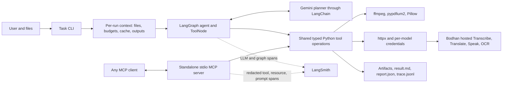
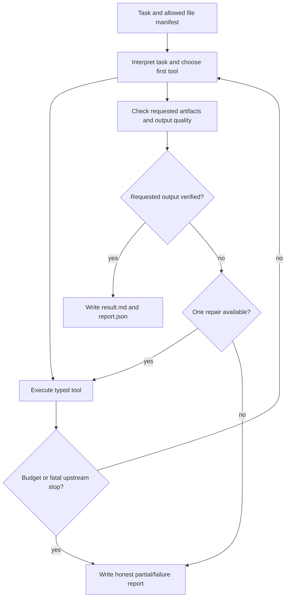

<!-- Suggested title: [Agentic Eng Assignment] Tool server and agent — <Your Name> -->

## Summary

This recipe adds a standalone stdio MCP server for Bodhan's Indic models and a LangGraph command-line agent that composes the same typed Python tools for multi-step tasks. The shared tool layer handles media limits, budgets, caching, artifact checks, and redacted run records while keeping Indic OCR, transcription, translation, and speech inside Bodhan.

## How to run

From a clean clone of this repository:

```bash
git clone <your-fork-url> Bodhan-AI-Cookbook
cd Bodhan-AI-Cookbook
make check

cd examples/bodhan_tool_agent
python3 -m venv .venv
source .venv/bin/activate
pip install -r requirements.txt
pip install -e .
cp .env.example .env
```

Set the four model-specific Bodhan keys, `LLM_BASE_URL`, `LLM_MODEL`, `LLM_API_KEY`, and optional LangSmith settings in `.env`. The default planner uses Gemini's OpenAI-compatible endpoint; the endpoint and model are configurable for evaluation.

Run the task agent from `examples/bodhan_tool_agent`:

```bash
python -m bodhan_agent \
  --task "Make a two-minute Tamil audio summary of this chapter" \
  --files path/to/inputs/ \
  --out ./out \
  --max-steps 30 \
  --max-cost-inr 20
```

Run the MCP server independently over stdio, from the same directory:

```bash
python -m bodhan_mcp
```

## Architecture



- **CLI and run context:** scopes input files and enforces per-run step/cost limits.
- **LangGraph and LangChain:** let the planner choose typed tools, loop over results, and verify requested artifacts.
- **Shared Python tools:** perform media processing, Bodhan calls, caching, validation, and reporting for both entry points.
- **MCP server:** exposes the shared operations over stdio, plus a language/voice resource and task-guidance prompt.
- **Bodhan API:** performs all OCR, Indic speech recognition, translation, and speech synthesis.
- **Observability:** local JSONL/JSON run records complement LangSmith's LLM/graph traces and redacted MCP spans.

See the full [architecture design](architecture.md) and [agent flow](agent-flow.md).

## Agent flow



The first model response can include a tool call, so there is no separate planning-only request. Verification allows one focused repair; budget exhaustion, fatal API errors, unsupported tasks, or a missing required deliverable stop with an honest status.

## Tool design

The tools are capability-level: each direct tool maps to a Bodhan operation, while a small number of composite tools keep private Indic text inside the tool layer.

- **Discovery and helpers:** `list_files`, `inspect_media`, `read_text`, `list_languages_and_voices`, and `write_english`.
- **Recognition and OCR:** `transcribe_audio`, `ocr_document`, and `make_subtitles`.
- **Translation:** `translate_text`, `translate_file`, and `translate_transcription`.
- **Speech:** `synthesize_speech`, `translate_and_synthesize`, and `speak_file`.

Limits are handled in Python so the planner does not need to manage media payloads or chunking:

- Audio and video are converted to mono 16 kHz WAV and sent in 25-second windows, within Bodhan Transcribe's 30-second limit.
- Translation uses 4,000-character chunks and splits a truncated chunk once.
- Speech uses at most 350 characters per request and joins returned chunks with ffmpeg.
- OCR renders PDFs page-by-page. On a reported truncated block, it raises the token allowance and recursively splits only the affected image region; successful responses are cached.
- Requests use a 90-second timeout, concurrency limit, and one bounded retry for selected 429/5xx responses. Dispatched timeouts are not retried automatically because the provider may already have billed them.

## Where the LLM is used, and why

The configurable planner interprets the English task, selects tools and parameters, writes English summaries/explanations, and decides whether to make the single verification repair. It does not read image/audio bytes, transcribe, translate, or create Indic text or speech; those operations go to Bodhan. If planning or a tool fails, the run records the error and does not invent an artifact. Unsupported-language requests should end with a clear explanation and no fabricated output.

## Bodhan models used

All four models are called through the **hosted Bodhan API** at `https://api.bodhan.ai/v1`, with one environment key per model:

- `indic-transcribe` — speech recognition for audio/video, in 25-second WAV windows.
- `indic-translate` — translation, in bounded text chunks.
- `indic-speak` — speech synthesis, in short text chunks.
- `indic-ocr` — page OCR with Markdown or HTML table output; request limit and page-region fallback are handled in the OCR tool.

The planner defaults to Gemini using `LLM_BASE_URL=https://generativelanguage.googleapis.com/v1beta/openai/` and `LLM_MODEL=gemini-3.5-flash-lite`. The evaluator can supply its own OpenAI-compatible planner settings. No non-Bodhan model is used for Indic OCR, transcription, translation, or speech.

## Results

The six local demo reports are mixed. `out/` is gitignored, so the paths below are local references; replace the link placeholders with shareable artifact and LangSmith URLs before submitting.

- **Tamil chapter summary — PASS.** Completed OCR, English summary, Tamil translation, and MP3. Audio back-transcription similarity: 1.00. Local run: `out/check_01_tamil_pass/`; outputs in `artifacts/`; trace: `trace.jsonl`; report: `report.json`. Output link: [add hosted link]. Trace link: [add LangSmith share URL].
- **Hindi voice note to English subtitles — PASS.** Generated an 11-segment English SRT. Local run: `out/check_02_hindi/`. Output link: [add hosted link]. Trace link: [add LangSmith share URL].
- **Worksheet to Marathi — NEEDS REVIEW.** OCR and Marathi translation artifacts exist, but `result.md` says only that `list_files` was called, so the final response does not accurately describe the completed work. Local run: `out/check_03_marathi/`. Output link: [add hosted link]. Trace link: [add LangSmith share URL].
- **Select Telugu clips and translate to English — INCOMPLETE.** Five transcripts were created, but the run did not identify the Telugu clips or create the requested English translations. Local run: `out/check_04_telugu/`. Trace link: [add LangSmith share URL].
- **Bengali read-aloud — PASS.** Generated a Bengali translation and speech artifact using voice Ishita. Local run: `out/check_05_bengali/`. Output link: [add hosted link]. Trace link: [add LangSmith share URL].
- **Video to French — PARTIAL.** The tool returned a structured `unsupported_language` error and produced no fake artifact, but the final result did not clearly explain that French is unsupported. Local run: `out/check_06_french/`. Trace link: [add LangSmith share URL].

## Demo video

Not recorded yet. Add a public link to a recording of five minutes or less showing several end-to-end tasks, including the unsupported-language case.

## Trade-offs and known limitations

- Only stdio MCP transport is included; there is no Streamable HTTP endpoint or server-side token authentication.
- Subtitle timestamps are approximate 25-second windows, not word-level alignment.
- Script checks and back-transcription are useful automated checks, not native-speaker quality review.
- OCR region splitting can repeat text at overlapping crop boundaries; scans with complex layouts still need review.
- Bodhan cost estimates are in `report.json`; Gemini planner cost is not included because the provider sets its own pricing.
- Demo coverage is not submission-ready: Telugu selection/translation and the French user-facing refusal need correction, and the Marathi final response needs to match its artifacts. Public output/trace links and the demo video are also still needed.

## Cost and runtime

These are the per-run estimates recorded in each report. Later runs may have served cached Bodhan responses, so a reported ₹0.00 is not a fresh, uncached estimate. Planner-provider cost is excluded.

- Tamil summary: **₹1.7379**, **229.21 s**; 11 cache hits.
- Hindi subtitles: **₹0.5099**, **24.51 s**; no cache hits.
- Marathi worksheet: **₹0.00**, **5.11 s**; 4 cache hits.
- Telugu clips: **₹0.00**, **6.15 s**; 5 cache hits.
- Bengali read-aloud: **₹0.00**, **6.09 s**; 3 cache hits.
- French unsupported-language case: **₹0.00**, **9.15 s**; no Bodhan API request.

## AI assistance

Codex was used to inspect the assignment and related PRs, implement and debug the recipe, run the requested live demos, review their reports/traces, and draft the architecture and this PR description. API keys were supplied through the local `.env` file and were not added to the repository.
