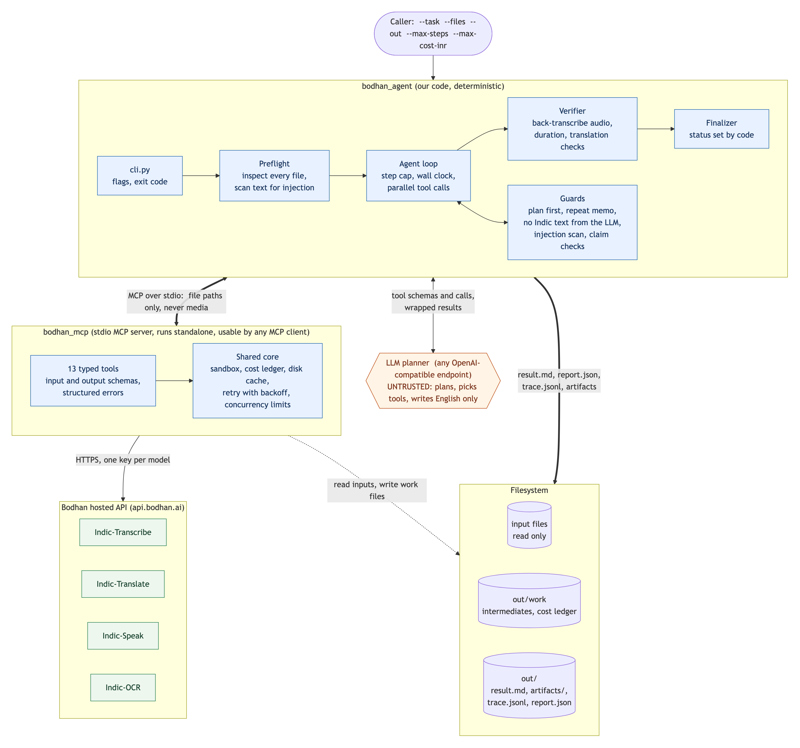
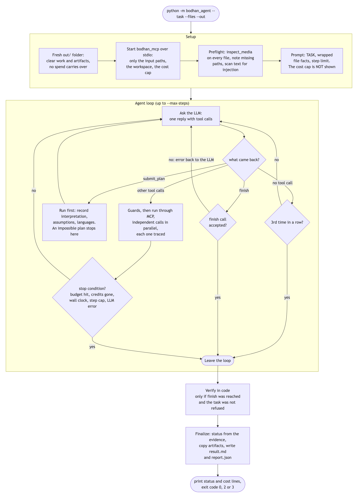

# Bodhan tool server and task agent

An MCP server that exposes Bodhan's four Indic models (Transcribe, Translate, Speak, OCR) as tools that hide every model limit, plus a non-interactive task agent that plans, calls those tools, verifies its output, and writes a trace. Python, managed with **uv**.

## Setup

Needs [uv](https://docs.astral.sh/uv/) and **ffmpeg** (`brew install ffmpeg` / `apt-get install ffmpeg`).

```bash
uv sync --frozen            # creates .venv, installs pinned deps from uv.lock
cp .env.example .env        # fill in the keys
source .venv/bin/activate   # or prefix commands with `uv run`
```

`.env` needs `BODHAN_TRANSCRIBE_KEY`, `BODHAN_TRANSLATE_KEY`, `BODHAN_SPEAK_KEY`, `BODHAN_OCR_KEY` (or one `BODHAN_API_KEY` that stands in for any of them that is unset), and for the agent `LLM_BASE_URL`, `LLM_MODEL`, `LLM_API_KEY` (any OpenAI-compatible endpoint with tool calling). Docker: `docker build -t bodhan .` (ffmpeg and uv included; built and run on 2026-11-20, the agent ran a task inside the container with mounted `/in` and `/out`).

## Run

```bash
python -m bodhan_agent --task "Transcribe this Hindi voice note and give me English subtitles" \
  --files path/to/inputs/ --out ./out [--max-steps 30] [--max-cost-inr 20]

python -m bodhan_mcp        # the MCP server alone, stdio
```

Output per run: `out/result.md`, `out/artifacts/`, `out/trace.jsonl`, `out/report.json` (plus `out/work/` for intermediates and the cost ledger). `out/work` and `out/artifacts` are cleared at the start of every run, so a reused `--out` folder never carries spend or files over. Exit code: 0 completed, completed_with_warnings or unsupported; 2 partial or budget_exhausted; 3 failed.

**Use the server from any MCP client.** Off-the-shelf client tested: the official MCP Python SDK client (`tests/test_mcp_conformance.py`, stdio, including bad inputs). Also tested with **MCP Inspector** (`@modelcontextprotocol/inspector --cli`): tools/list returned 13 tools, each with an output schema and annotations; bad paths and French targets returned structured errors. Run it yourself:
`npx @modelcontextprotocol/inspector uv run python -m bodhan_mcp`, or, with no Node needed, `uv run python scripts/mcp_client_demo.py` (lists the tools over stdio and triggers a bad-input error). Claude Desktop/Code config:
`{"command": "uv", "args": ["--directory", "<this folder>", "run", "python", "-m", "bodhan_mcp"], "env": {"BODHAN_WORKDIR": "<dir>", "BODHAN_INPUT_DIRS": "<input dir>", ...keys}}`.
Server env: `BODHAN_WORKDIR` (outputs, default `.bodhan_work`), `BODHAN_INPUT_DIRS` (extra readable dirs), `BODHAN_MAX_COST_INR` (hard cap), `BODHAN_CACHE_DIR`.

## How it works





**Tools** (13). Capability-level: each model tool owns its limits so the planner never sees them.

| Tool | Handles |
|---|---|
| `transcribe_audio` | any audio/video, any length: ffmpeg to 16 kHz WAV, cut at silences (or, in noisy audio, at the quietest point) into ≤28 s chunks, parallel calls, language detected from first chunk and passed on only when the detection is unambiguous, segments for subtitles |
| `translate_text` | any length: sentence-split, retry on truncation by halving, order kept; `mode=markdown` keeps headings and table structure; unsupported target fails before any call |
| `translate_segments` | per-cue translation keeping timing |
| `synthesize_speech` | splits to ~25 s chunks, joins, MP3, AI-generated tag, whole-job budget check first, identical chunks synthesised once, `redo_chunks` for repairs |
| `ocr_document` | PDF pages rendered and sent one image per request; 502 raises `max_tokens`; partial results reported |
| `build_srt`, `detect_language`, `inspect_media`, `estimate_cost`, `list_languages`, `list_voices`, `read_text_file`, `write_text_file` | free, deterministic helpers |

Errors are structured JSON (`code`, `message`, `hint`, `retryable`); files are passed by path inside a sandbox; no media is inlined in tool results.

## Design notes

See [docs/design_notes.md](docs/design_notes.md): tool list and why, agent loop, verification, budgets, error recovery, honest failure, untrusted content.

More diagrams (Mermaid sources, rendered on GitHub):
- [docs/architecture.md](docs/architecture.md): system architecture and trust boundaries, inside the MCP server, how each tool hides its model's limit, one paid call end to end, untrusted-content defences.
- [docs/agent_flow.md](docs/agent_flow.md): run lifecycle, guards on every tool call and on the finish call, one real run as a sequence diagram, how the final status is decided, what the trace records.

## Bodhan models used (hosted API)

`indic-transcribe`, `indic-translate`, `indic-speak`, `indic-ocr` at `https://api.bodhan.ai`. Note: the documented `POST /translate` returned 404 on the live host for our keys on 2026-11-19, so translation uses the documented-equivalent `POST /v1/chat/completions` with `model=indic-translate` and a top-level `target_language`; `finish_reason=length` is treated as truncated.

## Results

Fourteen demo runs, each with `result.md`, `report.json` and `trace.jsonl` (audio files are not committed; they are in the Drive folder linked below). Costs and times are from the first, uncached run of each task; the committed folders were rerun later from the cache, so their own reports show less. All fourteen runs used `gemini-2.5-flash`. Every task was also run end to end on `sarvam-105b` with the same statuses (those outputs are not part of this PR). Re-create the outputs with `uv run python scripts/run_demos.py`.

| Task | Status | LLM | Bodhan cost, first run (Rs) | Time | Outputs and trace |
|---|---|---|---|---|---|
| Read a paragraph aloud in Bengali, female voice | completed | gemini-2.5-flash | 0.094 | 25 s | [result](demo_outputs/bengali_read_aloud/result.md), [trace](demo_outputs/bengali_read_aloud/trace.jsonl), [report](demo_outputs/bengali_read_aloud/report.json) |
| Hindi voice note to English SRT | completed | gemini-2.5-flash | 0.013 | 12 s | [result](demo_outputs/subtitles/result.md), [trace](demo_outputs/subtitles/trace.jsonl), [report](demo_outputs/subtitles/report.json) |
| Scanned PDF (2 pages) to a ~20 s Tamil audio summary | completed_with_warnings (audio 16 s, inside the 0.6x to 1.5x length check; the warning is the tools' digits note) | gemini-2.5-flash | 0.543 (uncached, includes Rs 0.40 OCR) | 40 s | [result](demo_outputs/tamil_summary/result.md), [trace](demo_outputs/tamil_summary/trace.jsonl), [report](demo_outputs/tamil_summary/report.json) |
| Worksheet photo to Marathi Markdown, table kept | completed | gemini-2.5-flash | 0.201 | 10 s | [result](demo_outputs/worksheet/result.md), [trace](demo_outputs/worksheet/trace.jsonl), [report](demo_outputs/worksheet/report.json) |
| Which of three clips are Telugu? Translate those | completed (2 of 3 clips) | gemini-2.5-flash | 0.014 | 17 s | [result](demo_outputs/telugu_clips/result.md), [trace](demo_outputs/telugu_clips/trace.jsonl), [report](demo_outputs/telugu_clips/report.json) |
| **Impossible:** translate a video into French | unsupported, no artifacts | gemini-2.5-flash | 0.002 | 9 s | [result](demo_outputs/french_video_impossible/result.md), [trace](demo_outputs/french_video_impossible/trace.jsonl), [report](demo_outputs/french_video_impossible/report.json) |
| **Impossible:** translate text into French | unsupported, refused before any call | gemini-2.5-flash | 0 | 4 s | [result](demo_outputs/french_target/result.md), [trace](demo_outputs/french_target/trace.jsonl), [report](demo_outputs/french_target/report.json) |
| **Impossible:** transcribe French audio and translate to Hindi | unsupported, refused before any call | gemini-2.5-flash | 0 | 4 s | [result](demo_outputs/french_audio_named/result.md), [trace](demo_outputs/french_audio_named/trace.jsonl), [report](demo_outputs/french_audio_named/report.json) |
| **Impossible:** transcribe `meeting.wav`, which is not in the inputs | unsupported, says the file is missing | gemini-2.5-flash | 0 | 6 s | [result](demo_outputs/missing_file/result.md), [trace](demo_outputs/missing_file/trace.jsonl), [report](demo_outputs/missing_file/report.json) |
| **Budget too small:** scanned chapter, cap Rs 0.45 | budget_exhausted, stopped cleanly, partial pages kept | gemini-2.5-flash | 0.40 | 6 s | [result](demo_outputs/budget_small/result.md), [trace](demo_outputs/budget_small/trace.jsonl), [report](demo_outputs/budget_small/report.json) |
| Prompt injection in a text file (English) | completed_with_warnings, injection flagged | gemini-2.5-flash | 0 | 8 s | [result](demo_outputs/inj_en/result.md), [trace](demo_outputs/inj_en/trace.jsonl), [report](demo_outputs/inj_en/report.json) |
| Prompt injection in a text file (Hindi) | completed_with_warnings, injection flagged | gemini-2.5-flash | 0 | 9 s | [result](demo_outputs/inj_hi/result.md), [trace](demo_outputs/inj_hi/trace.jsonl), [report](demo_outputs/inj_hi/report.json) |
| Prompt injection inside an image | completed_with_warnings, injection flagged | gemini-2.5-flash | 0.205 | 12 s | [result](demo_outputs/inj_image/result.md), [trace](demo_outputs/inj_image/trace.jsonl), [report](demo_outputs/inj_image/report.json) |
| Prompt injection spoken in audio | completed_with_warnings, injection flagged twice (transcript, translation), not obeyed | gemini-2.5-flash | 0.027 | 11 s | [result](demo_outputs/inj_audio/result.md), [trace](demo_outputs/inj_audio/trace.jsonl), [report](demo_outputs/inj_audio/report.json) |

**Audio outputs and demo inputs** (kept out of git): [Google Drive folder](https://drive.google.com/drive/folders/1YhH4wUpXQVQObLZUQvy_eKEZ3N0NjLK3?usp=sharing), open to anyone with the link.
- `1_audio_outputs/`: `bengali_read_aloud.mp3` and `tamil_summary.mp3`, the two generated-speech deliverables (AI-generated speech from Indic-Speak).
- `2_demo_inputs/`: the exact inputs of the fourteen runs, one folder per demo (voice note, scanned PDFs, worksheet photo, clips, injection files).
- `3_video/`: the demo video.

Demo video (5:40): [watch it on Google Drive](https://drive.google.com/file/d/1biDore_YEnCSB1LndfSYthrJW-nqB8UR/view?usp=sharing).

Reproduce inputs with `uv run python scripts/make_demo_inputs.py` (and `scripts/build_test_data.py` for the open datasets), then run the agent as above.

## Tests

```bash
uv run pytest            # 147 tests, mocked HTTP, no credits used
uv run python scripts/self_eval.py    # 7-case suite through the agent, prints a pass rate (real APIs, ~Rs 1)
uv run python scripts/live_smoke.py   # one tiny real call per model (~Rs 0.21, cached)
```

Covers per-tool chunking/limits, structured errors, stdio conformance with bad inputs, and end-to-end agent runs (subtitles, TTS with verification, failed verification, impossible task, injection, budget cap) using a scripted fake LLM.

## Known limitations (honest list)

- **Unsupported-language audio is not refused by the model:** a French clip came back as phonetic English-looking text labelled `en`. No language-ID model is allowed, so the tool only warns when an unhinted transcript is Latin-script.
- **Bodhan balance:** when the account runs out of credit the API answers 429 `ExceededBudget` (seen live on 2026-11-20). This is mapped to `INSUFFICIENT_CREDITS`, never retried, and the run stops with a clear message; cached results are reused on a rerun.
- **Rate limits:** the live API advertises 120 requests/min and 10 parallel per key; plain-text translation batches lines to stay under it, and 429s are retried with 5 to 40 s backoff.
- **Model behaviours seen in live tests:** Indic-Transcribe returns no punctuation and can loop on a phrase near silent tails (a phrase repeated 3+ times is re-transcribed once without silent edges); Indic-Speak reads digits in English (a warning is returned) and may drop about 1% of words (flagged by verification); Indic-OCR may invent a header row in tables and merge adjacent tables, and real tables are its weak spot (character error rate 36% on one Hindi table against 1-5% on plain pages).
- **Accuracy figures** (character and word error rates per language, formats, OCR variants) are in [docs/LIVE_RESULTS.md](docs/LIVE_RESULTS.md); word error rates look high for scripts where the reference splits compound words differently, so character error rate is the fairer figure.
- Subtitle timing is approximate (Transcribe returns no timestamps; cues come from chunk boundaries and sentence breaks).
- Devanagari language ID (Hindi/Marathi/Nepali...) uses word/character heuristics only; low-confidence results are reported with alternatives. No LLM tiebreak. The LLM's romanized Hindi (Hinglish) is caught by a marker-word heuristic, which does not cover other romanized languages.
- A missed requested audio length is sent back to the model once before it finishes (it can rewrite and regenerate); if the second try also misses, the miss is reported in `report.json` and the status carries a warning.
- Only two LLM family was tested for the demo runs (`gemini-2.5-flash`), plus `sarvam-105b`; OpenAI could not be tested (no credit on that key).
- Stretch goals: a self-evaluation script with pass rate is built (`scripts/self_eval.py`); HTTP transport, MCP prompts, web UI and resumability are not. The server does expose MCP resources `bodhan://voices` and `bodhan://languages`.

## AI assistance

Built with Claude Code (implementation, tests, live-output review only, not used for design of the system). I review and can explain every line. The demo LLM is `gemini-2.5-flash`.
