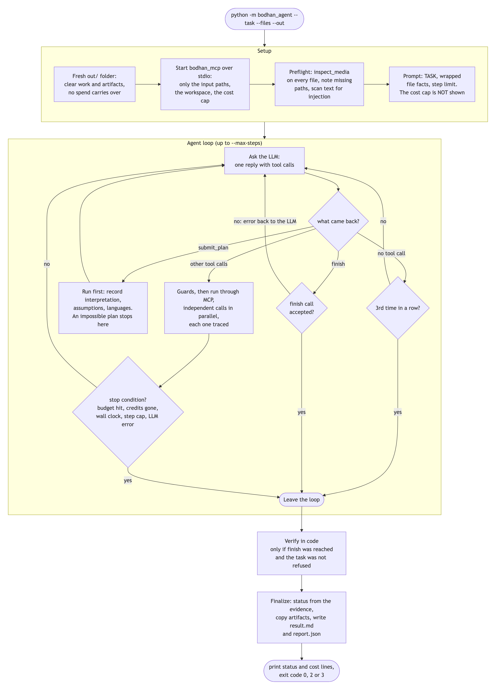
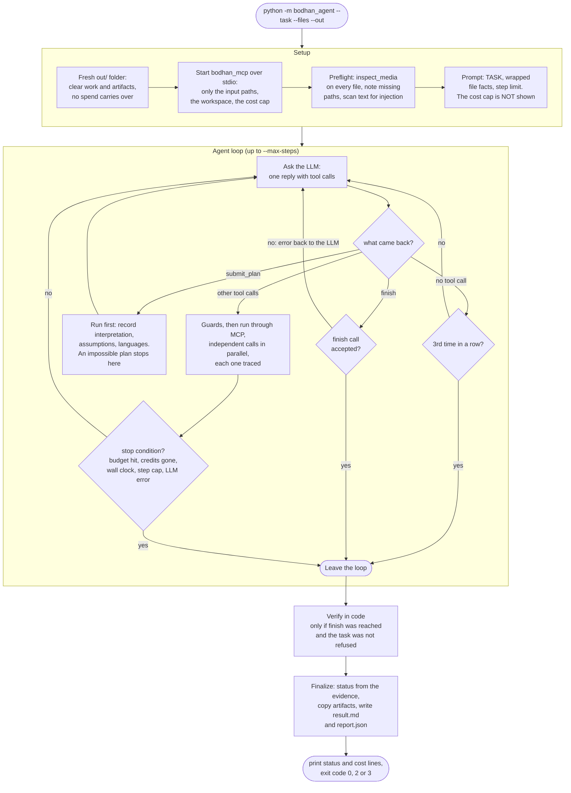
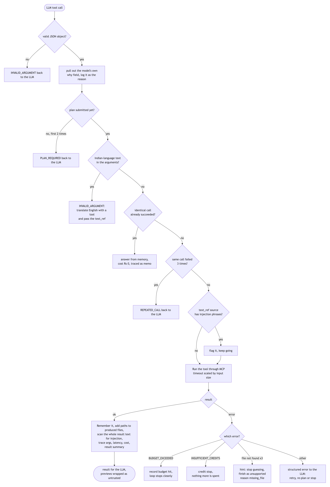
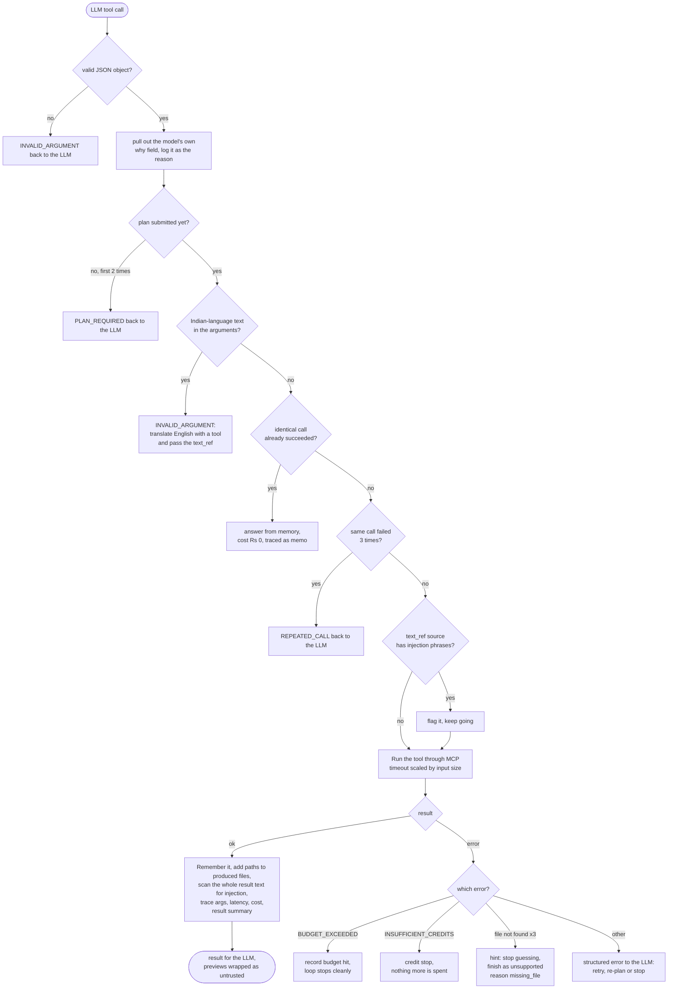
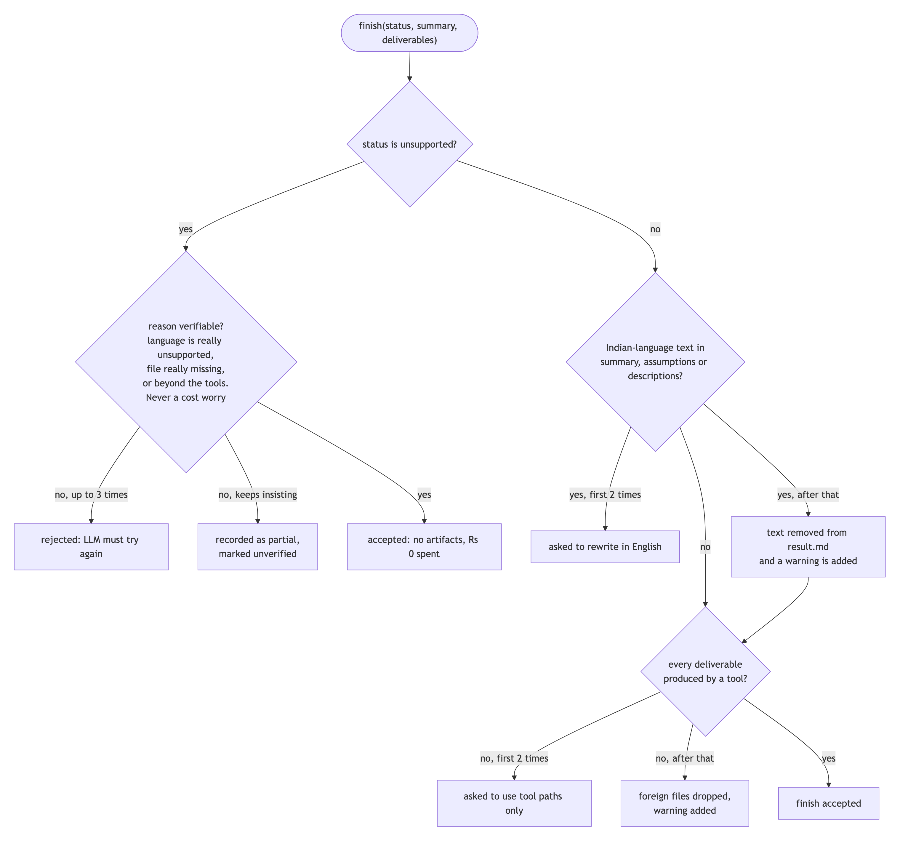
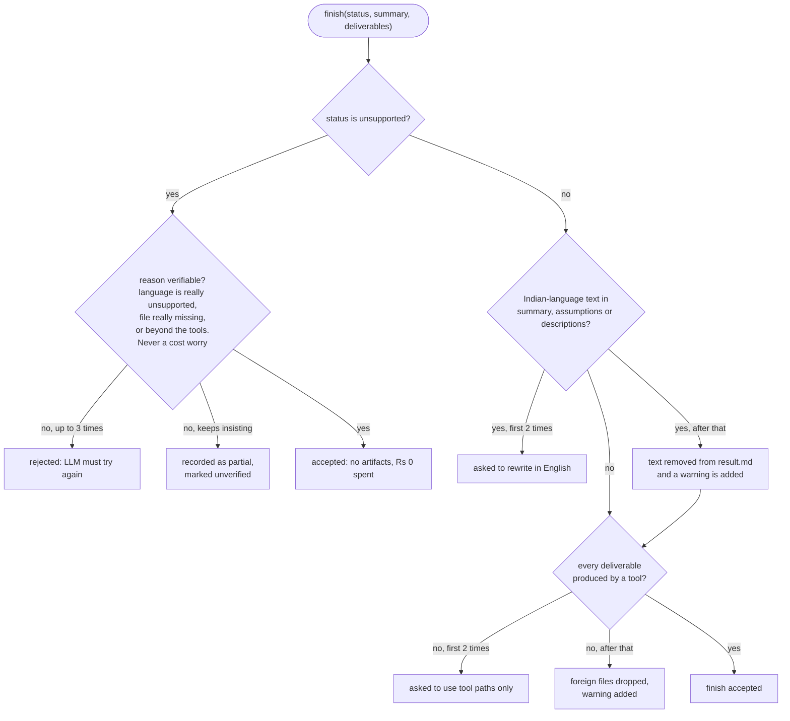
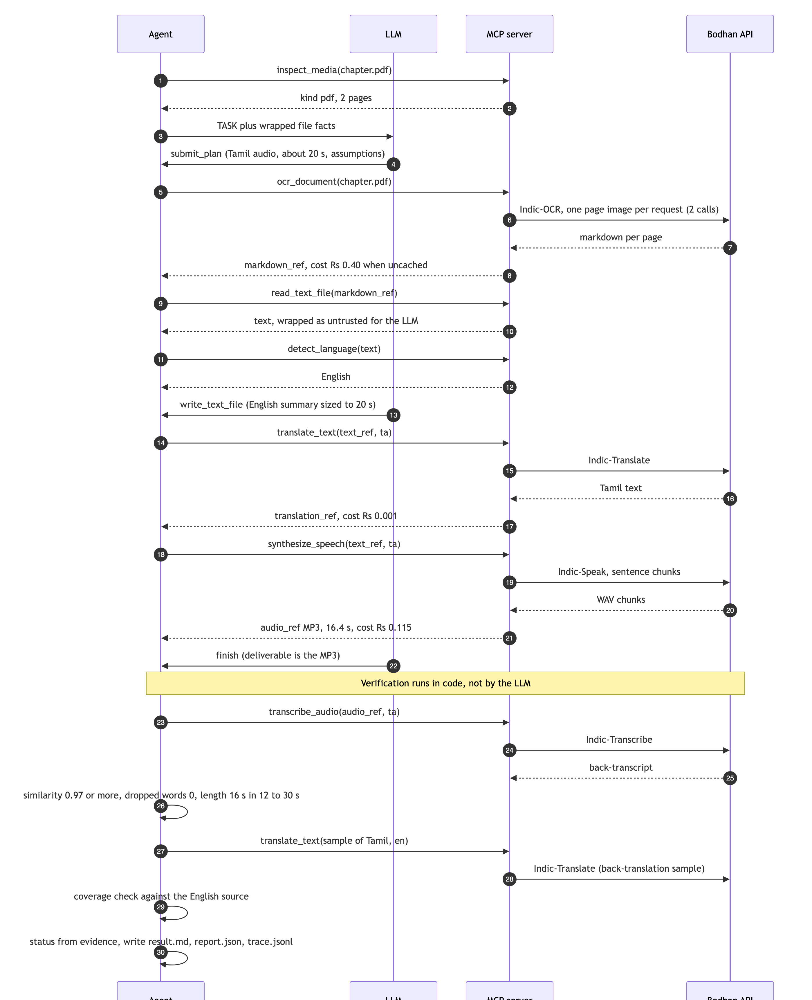
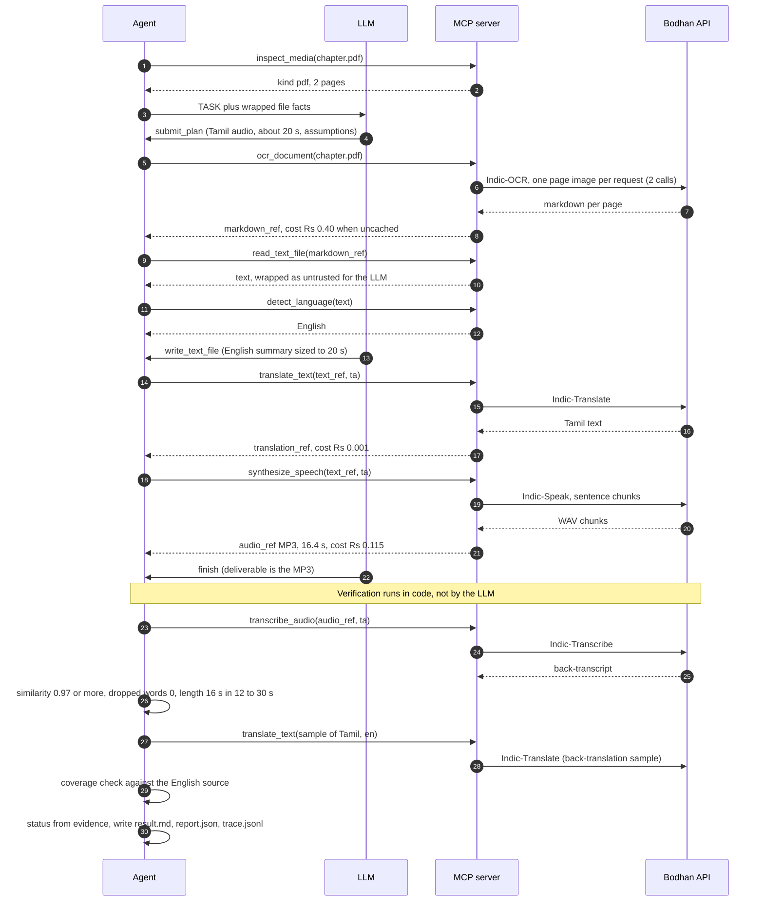
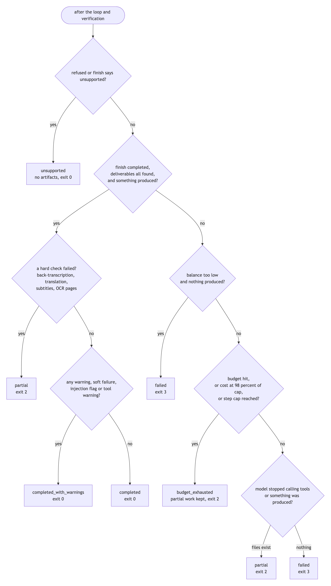
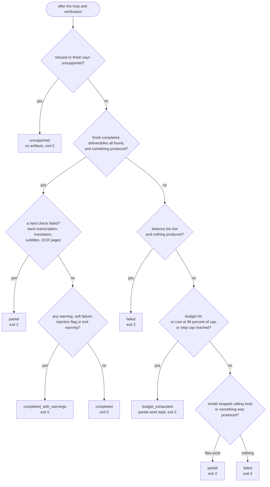

# Agent flow

How one task runs, from the command line to `report.json`. Component view: [architecture.md](architecture.md).

## 1. Run lifecycle

Mermaid source for this diagram (GitHub draws it; VS Code needs a Mermaid extension)

Every `except` in `run()` still reaches the finalizer, so a crash leaves a readable `result.md` and `report.json` with status `failed` instead of nothing.

## 2. Guards on every tool call

Mermaid source for this diagram (GitHub draws it; VS Code needs a Mermaid extension)

### The finish call is checked too

Mermaid source for this diagram (GitHub draws it; VS Code needs a Mermaid extension)

## 3. One real run as a sequence

Task: "Make a short Tamil audio summary (about 20 seconds) of this chapter", input is a 2-page scanned PDF. Names and order come from `demo_outputs/tamil_summary/trace.jsonl`.

Mermaid source for this diagram (GitHub draws it; VS Code needs a Mermaid extension)

## 4. How the final status is decided

Mermaid source for this diagram (GitHub draws it; VS Code needs a Mermaid extension)

## 5. What the trace and report record

`trace.jsonl` is one JSON line per event, written and flushed as it happens, so it can be followed live with `tail -f`. Secrets are scrubbed before anything is written.

| Event `type` | Carries |
|---|---|
| `preflight` | the facts for every input file, missing paths |
| `plan` | interpretation, assumptions, steps, target languages |
| `tool_call` | step, tool, arguments, the model's `reason`, latency, cost, cumulative cost, cached flag, result summary, error, status (`ok`, `error`, `memo`) |
| `verify` | artifact, check, ok, scores, and for paid checks their cost and latency |
| `repair` | which speech chunks were re-synthesised, cost, latency |
| `injection_suspected` | where the text came from and which phrases matched |
| `refusal`, `llm_retry`, `llm_error`, `assistant_text`, `error`, `out_dir_reset` | recovery and failure events |
| `finish`, `final` | the accepted finish call, the end status |

`report.json` holds: `status`, `task`, `interpretation`, `assumptions`, `deliverables`, `steps`, `tool_calls_by_tool`, `verification`, `cost_inr` (total, cap, by model), `duration_s`, `llm` (model, tokens), `target_misses`, `warnings`, `injection_flags`, `tool_warnings`, `budget` and `unsupported_reason`.
