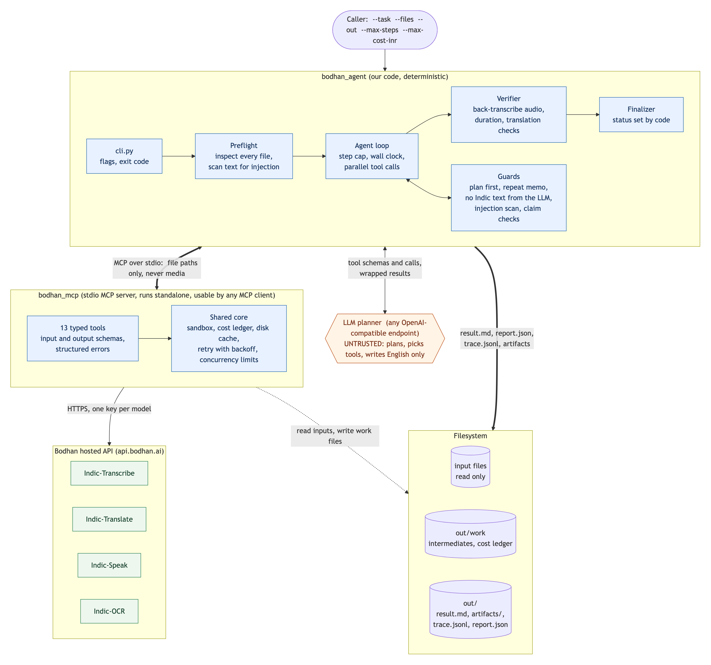
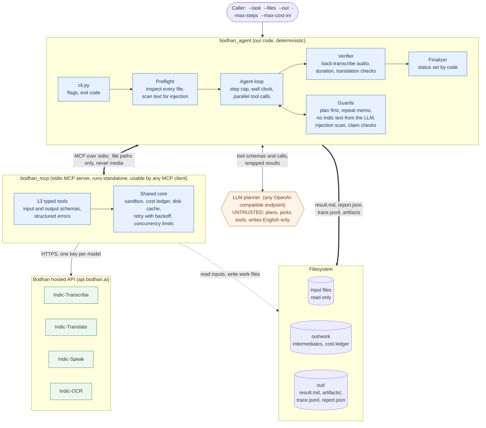
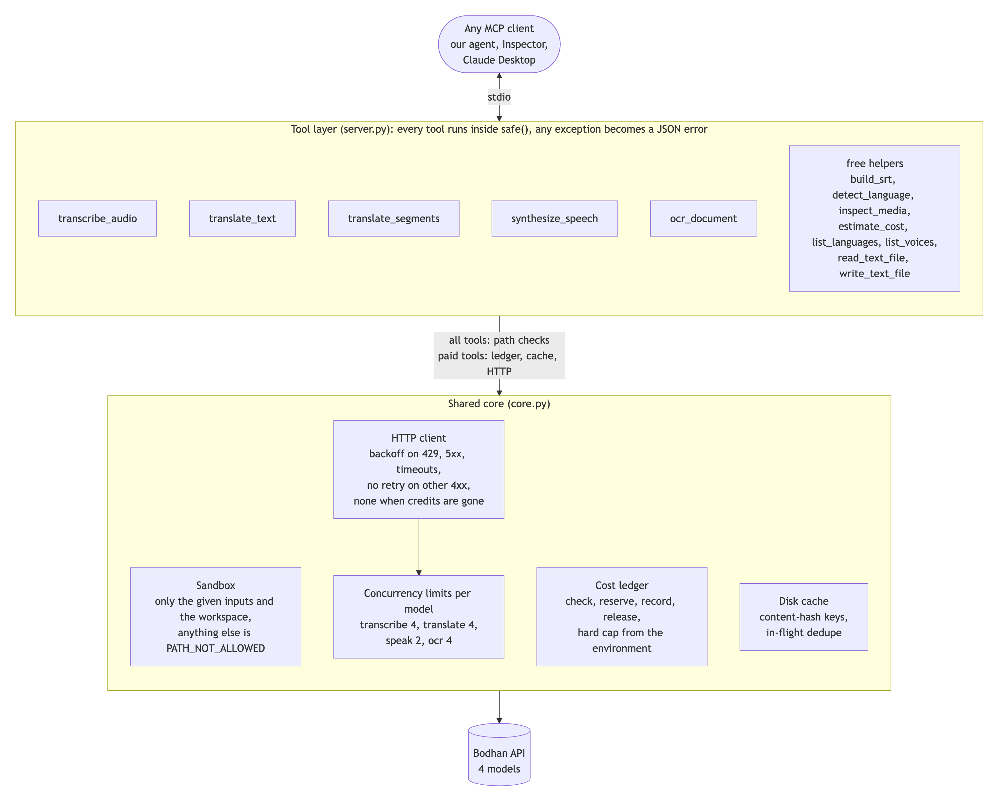
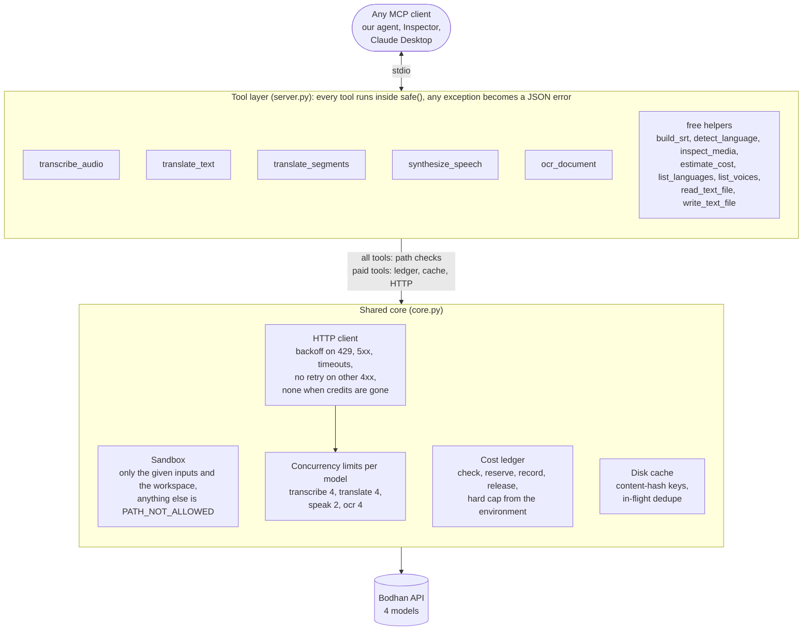
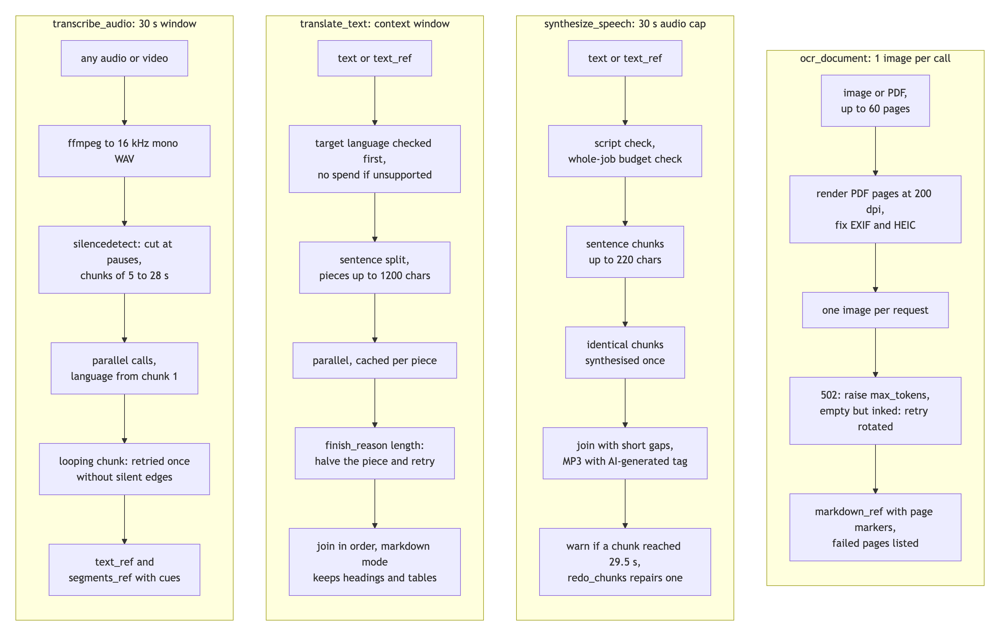
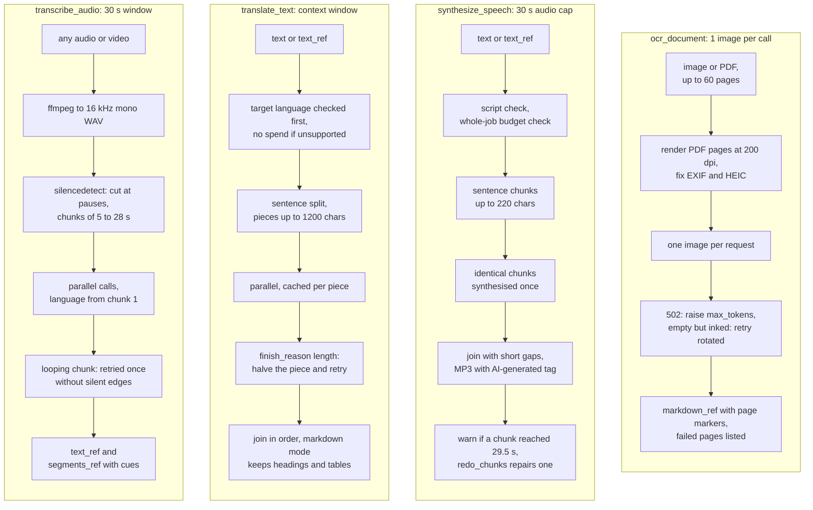
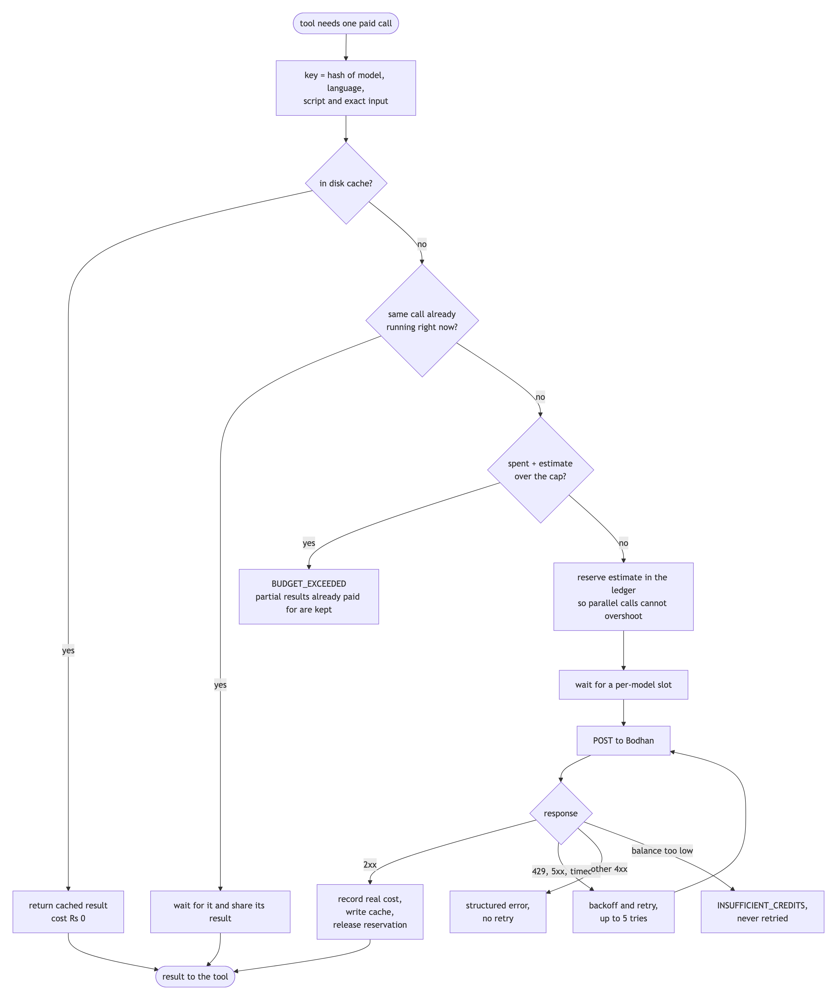
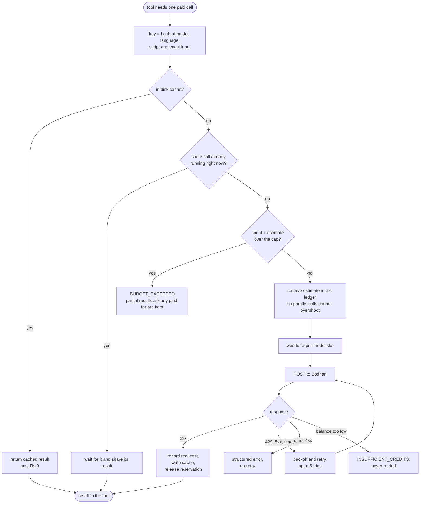
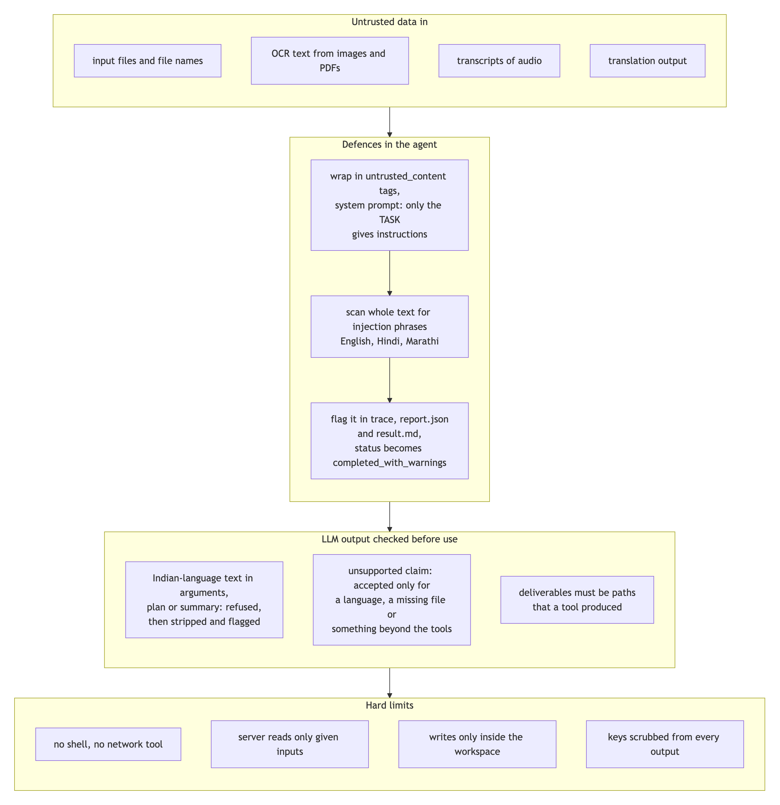
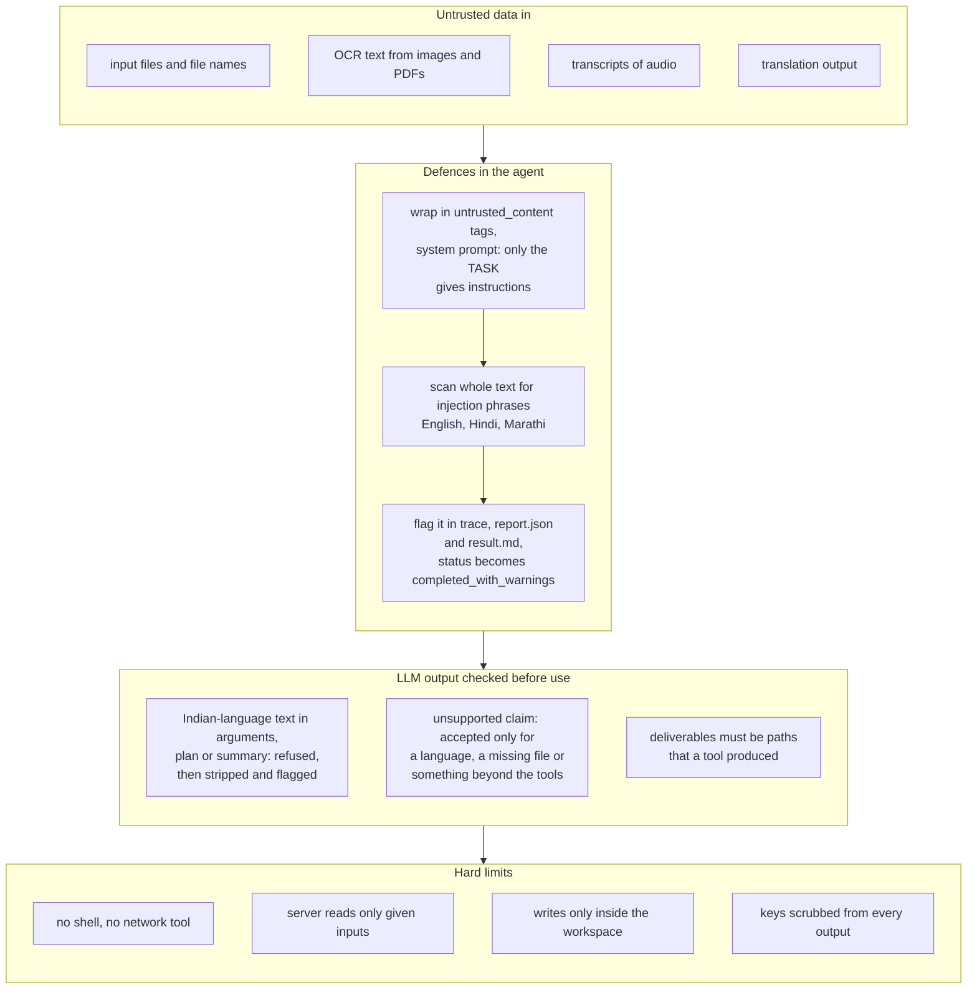

# Architecture

Two programs that talk over MCP stdio. The **server** (`bodhan_mcp`) owns the four Bodhan models, every model limit, the money and the cache. The **agent** (`bodhan_agent`) owns planning, guards, verification and the final status. The LLM is a replaceable, untrusted planner in the middle.

Companion page: [agent_flow.md](agent_flow.md) (the run lifecycle, guards, a real sequence and the status rules). Prose reasoning: [design_notes.md](design_notes.md).

## 1. System architecture

Mermaid source for this diagram (GitHub draws it; VS Code needs a Mermaid extension)

**Reading the diagram.** Blue is code we wrote and trust. Orange is the LLM: it can plan and choose tools, but it cannot set the status, spend past the cap, write Indian-language text, or list a file no tool produced. Green is Bodhan's hosted models. Media never enters the LLM's context; only file paths and short previews do.

## 2. Inside the MCP server

Mermaid source for this diagram (GitHub draws it; VS Code needs a Mermaid extension)

Typed outputs are pydantic models, so every tool publishes an MCP `outputSchema`. Errors are JSON with `code`, `message`, `hint` and `retryable`, for example `FILE_NOT_FOUND`, `UNSUPPORTED_LANGUAGE`, `TOO_LARGE`, `BUDGET_EXCEEDED`, `INSUFFICIENT_CREDITS`.

## 3. How each tool hides its model's limit

Mermaid source for this diagram (GitHub draws it; VS Code needs a Mermaid extension)

The limits in boxes C and B were measured against the live API (`scripts/probe_limits.py`): speech audio is silently cut at 30.5 s, and a 2,737-character text translated in one request without truncation, so 1200 characters is a safe margin.

## 4. One paid call, end to end

Mermaid source for this diagram (GitHub draws it; VS Code needs a Mermaid extension)

The agent never sees the cost cap. It is passed to the server as `BODHAN_MAX_COST_INR` and enforced there, because a model that can see the cap starts refusing tasks on cost by itself (observed in an early run).

## 5. Trust boundaries and untrusted content

Mermaid source for this diagram (GitHub draws it; VS Code needs a Mermaid extension)

Live runs on English, Hindi, image and spoken-audio injection files all translated the text as data, flagged it, and obeyed none of it.
