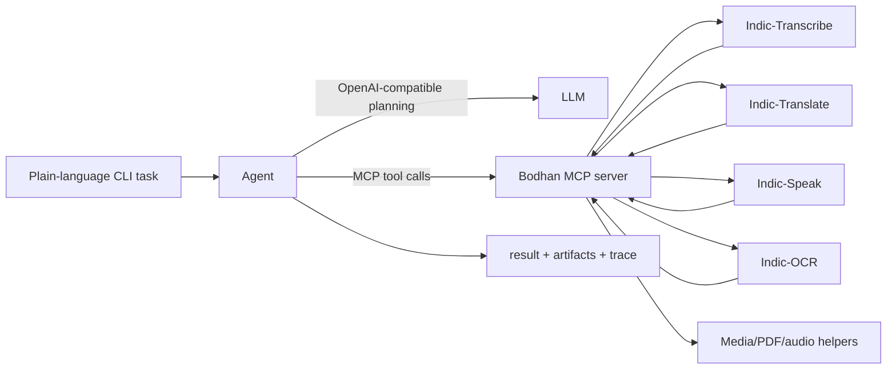
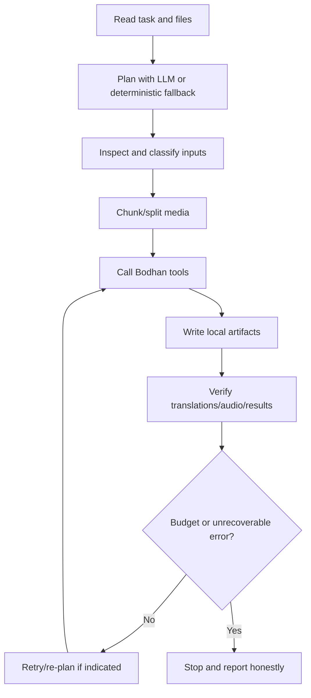

# Bodhan Tool Server and Task Agent

A self-contained recipe that exposes Bodhan Indic-Transcribe, Indic-Translate, Indic-Speak and Indic-OCR through MCP, plus a command-line task agent.

## Setup

Requires Python 3.11+ and `ffmpeg`/`ffprobe`.

```bash
python -m venv .venv
# Windows: .venv\Scripts\activate
pip install -e ".[dev]"
cp .env.example .env
# Add keys to the environment
pytest -q
```

Windows container setup: install `ffmpeg`, or use Docker:

```bash
Dockerfile build is documented below:
docker build -t bodhan-agent .
```

## Run

```bash
python -m bodhan_agent --task "Transcribe this Hindi voice note and give me English subtitles" --files path/to/audio --out ./out --max-steps 30 --max-cost-inr 20

python -m bodhan_mcp
```

The MCP server is stdio-only. It can be registered by VS Code, Claude Desktop, or another MCP client that supports stdio.

## Output

Each run creates:

- `result.md`: English result, assumptions and artifact links.
- `artifacts/`: generated media, text and Markdown files.
- `trace.jsonl`: plan and tool-call trace.
- `report.json`: status, step count, cost, runtime and verification results.

## Architecture



## Agent flow



## MCP tools

| Tool | Model/helper | Limit handling |
|---|---|---|
| `bodhan_inspect_media` | Media inspection | Detects size, kind and PDF/image/audio metadata |
| `bodhan_render_pdf_pages` | PDF helper | Renders one PNG per PDF page |
| `bodhan_chunk_audio` | ffprobe/ffmpeg | Converts to 16 kHz mono WAV and creates ≤30-second chunks |
| `bodhan_transcribe_audio` | Indic-Transcribe | One chunk per call; optional language code |
| `bodhan_translate_text` | Indic-Translate | Validates target/script and surfaces `truncated` |
| `bodhan_synthesize_speech` | Indic-Speak | Validates fixed voice library and instructs caller to send short chunks |
| `bodhan_ocr_image` | Indic-OCR | Accepts only PNG/JPEG and processes one page per call |

Media is passed by local path. OCR temporarily base64-encodes the image only inside the Bodhan API request, never in the MCP context or LLM prompt.

## Design decisions

- Model tools are granular, while PDF/page and audio chunk helpers keep media limits inside the MCP server.
- The LLM plans and writes English summaries only. Indian-language text must come from Bodhan outputs.
- OCR text and transcripts are untrusted data and are never interpreted as agent instructions.
- Unknown languages use script or task hints; assumptions are recorded in `result.md`.
- Responses are cached by input hash to prevent repeated paid calls.
- API calls retry 429/408/5xx failures with bounded exponential backoff and concurrency limiting.
- Impossible, missing and unsupported tasks stop without fake artifacts.
- Generated WAV is marked `ai_generated=true`; consumers should label it as AI-generated.

## Verification

Translations are checked for non-empty output and the `truncated` flag. Generated speech is back-transcribed through Indic-Transcribe where possible. OCR pages and transcription output are checked for non-empty text.

## Known limitations

- The API key or hosted endpoint for each Bodhan model is required for real results.
- MP4 translation is unsupported: extract the spoken track only with a user-approved workflow if needed.
- LLM planning falls back to deterministic routing if the configured endpoint fails.
- Indic-Speak can repeat or omit content; back-transcription reports verification failures honestly.

## Tests

```bash
pytest -q
make check
```

Tests cover missing files, image metadata, audio helper errors and honest CLI failure. Live API tests require keys and are not mocked into successful results.
