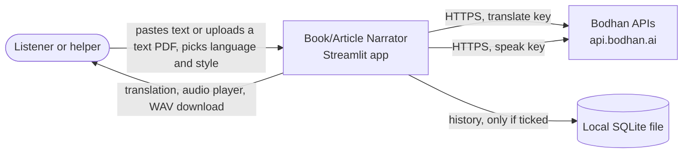
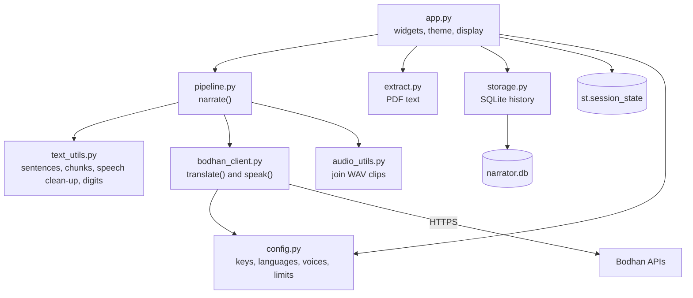
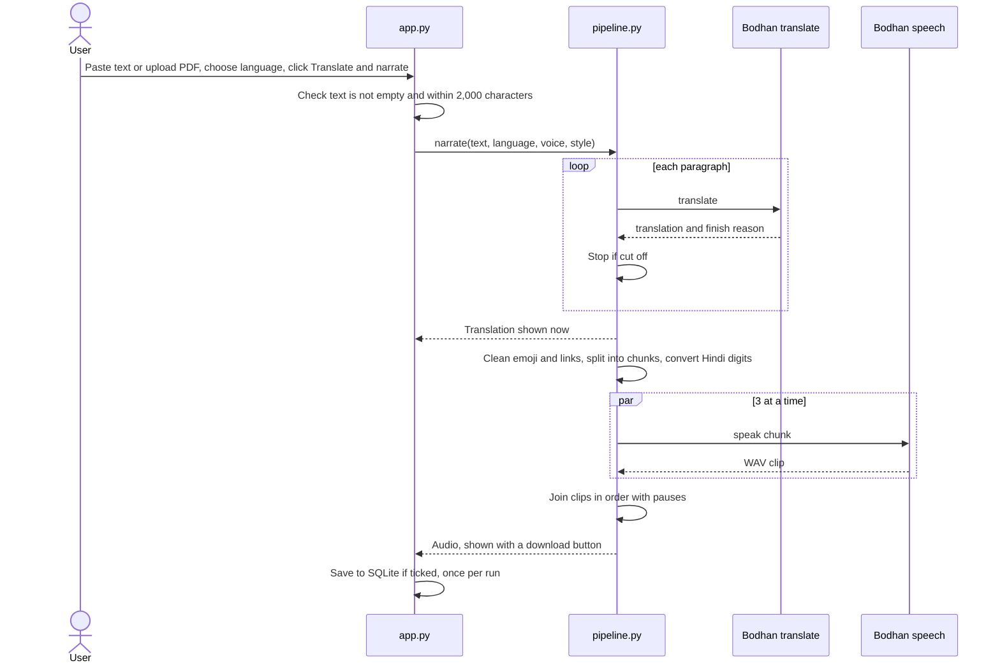

# Book/Article Narrator — Architecture

> Written to the Bodhan AI Cookbook architecture template (worked example: `examples/AndroidSpeak`).
> Version 0.3 describes the built V0. Read it after [SOFTWARE_SPECIFICATION.md](SOFTWARE_SPECIFICATION.md).

## 1. Document details

| Field | Value |
| --- | --- |
| App name | Book/Article Narrator (`examples/book_article_narrator`) |
| Approved spec | [SOFTWARE_SPECIFICATION.md](SOFTWARE_SPECIFICATION.md), version 0.3 |
| Authors | Renuka (RenukaPatil07) |
| Bodhan reviewers | Ishvinder Sethi |
| Status | V0 built, in review |
| Version | 0.3 |
| Last updated | 30 Oct 2026 |

## 2. Overview and architectural drivers

**Summary.** A single Python application with a Streamlit interface and an optional local SQLite history. A UI-independent core (`pipeline.py`) splits the text into paragraphs, translates each one with Bodhan, checks that nothing was cut off, splits the translation into sentences, cleans emoji and links out of the speech text, converts sentences to speech three at a time, and joins the clips into one WAV. The page only collects input and shows results. All requests go from the server to `https://api.bodhan.ai`; keys are read from environment variables and never reach the browser.

| Driver | What it forces in the design |
| --- | --- |
| Translation output feeds speech input | Two ordered stages, orchestrated in `pipeline.py` |
| Speech handles about 30 s per request and does not split text | Sentence splitter and a 250-character chunk limit |
| A truncated translation reads fluently and just stops | Check `finish_reason` after every translate call and fail closed |
| Keys must never reach the browser | All calls are server-side; keys from environment variables; one key per model |
| Speech runs at about real time, so a long text is slow | Run 3 speech requests at a time, keep order, show progress |
| Speech sometimes returns 429 on rapid calls | Capped retries that honour `retry-after`; only 3 workers |
| A speech failure must not lose the translation | Show the translation before speech starts |
| Streamlit re-runs the script on every interaction | Keep results in `st.session_state` |
| Users reopen and delete past narrations | `storage.py` with SQLite, opt-in, newest 20 kept |
| Output is read by people in 23 languages | Chips from one language table, right-to-left aware, Noto fonts |
| Readable code for other developers | Thin UI over a UI-independent core, few dependencies |

**Quality attributes, ranked:** correctness (never narrate a failed translation), simplicity, safety of keys and stored text, time to first audio with clear progress, robustness.

## 3. System context



| Outside system | Purpose | Data sent |
| --- | --- | --- |
| Bodhan APIs | Translation (`POST /v1/chat/completions`, model `indic-translate`) and speech (`POST /v1/audio/speech`, model `indic-speak`) | One paragraph at a time, then one translated chunk at a time |
| Browser | Shows the page, plays audio | Page, translation, WAV |
| Local disk | Optional history | Saved narrations only |

## 4. Containers and components

One container: the Streamlit process, which also reads and writes a local SQLite file.



`app.py` is the only file that imports Streamlit. `pipeline.py` and everything below it work without a UI, so the same core can be wrapped later as a command-line tool, an API or an extension.

```
examples/book_article_narrator/
├── README.md  SOFTWARE_SPECIFICATION.md  ARCHITECTURE.md
├── requirements.txt  .env.example  .gitignore
├── app.py
├── .streamlit/config.toml     (light and dark theme)
├── narrator/  config.py  text_utils.py  extract.py  bodhan_client.py
│              audio_utils.py  storage.py  pipeline.py  errors.py
├── tests/     (91 offline tests)
├── sample_data/   (empty: the repo ignores sample files; .gitkeep only)
└── outputs/       (git-ignored)
```

### Tech stack

| Layer | Choice | Why |
| --- | --- | --- |
| Language | Python 3.10+ (developed on 3.13) | Matches the Cookbook tooling; readable for a teaching recipe |
| UI | Streamlit 1.66.1 | One Python project; key stays server-side. FastAPI with React would need two codebases for a single-page flow |
| HTTP | `requests`, with `ThreadPoolExecutor` for speech | Simple POSTs; threads give 3 parallel speech calls without async complexity |
| PDF text | `pypdf` | Pure Python; text PDFs only in V0 |
| Audio | Standard-library `wave` | All clips share one format, so no ffmpeg |
| Config | Environment variables with `python-dotenv` | Meets the Cookbook key rule |
| Storage | `sqlite3` (standard library), audio kept as a BLOB | One local file, no server. At 20 narrations of a few MB, a BLOB is simpler than files plus paths |
| Tests and lint | `pytest` with mocks, `ruff` | No real API calls in tests |
| Hosting | None; local only | V0 |

## 5. Bodhan API integration design

| Concern | Design |
| --- | --- |
| Key custody | `BODHAN_TRANSLATE_API_KEY` and `BODHAN_SPEAK_API_KEY` (one `BODHAN_API_KEY` is accepted as a fallback). Placeholder values count as missing. Never logged or shown |
| Base URL | `https://api.bodhan.ai`, overridable with `BODHAN_BASE_URL` |
| Input | Reject empty or over-2,000-character text before any call. PDF text is trimmed to the cap with a notice |
| Translate | `POST /v1/chat/completions`, model `indic-translate`, `target_language_code`. The documented `/translate` returned 404 for our key, so this route is used (to confirm with Bodhan) |
| Truncation | A reply whose `finish_reason` is not `stop` is treated as truncated; the run stops and names the paragraph |
| Speech | `POST /v1/audio/speech`, model `indic-speak`, `instructions` as a JSON string with `lang` and optional `style` |
| Speech text | Emoji and links removed for speech only. Hindi ASCII digits become Devanagari digits so they are read in Hindi |
| Response check | The speech reply must start with `RIFF`. Bodhan labels the WAV `audio/mpeg`, so the label is ignored |
| Voices | Per-language table, default is the first voice listed |
| Timeouts | Connect and read timeouts on every call |
| Retries | At most 3 attempts on 429, 5xx and network errors, honouring `retry-after`. A 401 is retried only if that key has already worked |
| Concurrency | 3 speech workers (`SPEAK_WORKERS`). Progress is reported from the main thread only, and clips are kept in text order |
| Request id | Read from `x-request-id`, then `llm_provider-x-request-id`. Speech sends none, and the error box says so |
| Cost guard | The 2,000-character cap bounds the number of calls. Session state prevents repeat calls |
| Model ids | `indic-translate` and `indic-speak`, lower case |

## 6. Data architecture

| Store | What it holds | Retention |
| --- | --- | --- |
| `.env` | Keys | Developer's machine, git-ignored |
| `st.session_state` | Current text, translation, audio, settings | Until the session ends |
| `narrator.db` (SQLite) | Saved narrations, only if the user ticked the box (off by default) | Until deleted; newest 20 kept. Not encrypted |
| Downloaded WAV | The narration | Under the user's control |

```sql
CREATE TABLE IF NOT EXISTS narrations (
    id INTEGER PRIMARY KEY AUTOINCREMENT,
    created_at TEXT NOT NULL,
    language TEXT NOT NULL,
    voice TEXT NOT NULL,
    style TEXT,
    original_text TEXT NOT NULL,
    translated_text TEXT NOT NULL,
    audio BLOB
);
```

`storage.py` is the only file that touches SQLite and uses `?` placeholders for every value. `pipeline.py` never touches the database. Each call opens a short-lived connection because Streamlit may run code on different threads. The path is `narrator.db` in the working folder, or `NARRATOR_DB`.

**Single-user note.** The history belongs to the machine, not a person. If the app were hosted, all visitors would share one history, so a hosted version must leave history off or add sign-in.

## 7. Key flows

### J1: one narration



- **Wait:** speech runs at about real time, so a full 2,000-character text takes roughly 2 to 3 minutes. The progress status names the stage and count.
- **On failure:** a friendly message with a "Details for support" box. If translation succeeded it stays on screen. A cut-off translation produces no audio.
- **Saving:** only after full success, only if ticked. A failed save shows a warning and the narration still plays.

### J2: reopen or delete

Open a saved narration from the history expander: the original, translation and audio are shown from the database with no API call. Delete removes one row; Clear all empties the table.

### J3: PDF upload

`extract_pdf_text` reads up to 10 pages with `pypdf`, normalises ligatures (NFKC), and joins broken lines. Scanned, locked or invalid files raise a clear message. Text over the cap is trimmed with a notice. A warning appears when Indian-language text looks mis-ordered, which is a known limit of some PDF text layers and the reason OCR is planned for V1.

## 8. Security architecture

| Threat | Mitigation in V0 |
| --- | --- |
| Key reaches the browser | All calls are server-side |
| Key committed to git | `.env` in `.gitignore`; `.env.example` has placeholders; checked before each commit |
| Personal data in logs | Log status, timing and request id only |
| Sensitive or copyrighted text pasted | README warnings; history off by default and local |
| Database committed | `narrator.db` and `*.db` git-ignored |
| SQL injection | `?` placeholders; a test stores a hostile string as plain text |
| Oversized input | Cap enforced before any call |
| Strangers using a hosted copy | Not hosted. A hosted copy needs bring-your-own-key or a demo mode, and no shared history |
| Malicious PDF | Read in memory with a page cap; nothing is executed |
| Prompt injection | Output is only shown and spoken |
| Interception | HTTPS only |
| Dependencies | Pinned versions, few packages |

## 9. Deployment and infrastructure

V0 is not hosted. Run it locally:

1. Clone the repository and open `examples/book_article_narrator/`.
2. Create and activate a virtual environment, then `pip install -r requirements.txt`.
3. Copy `.env.example` to `.env` and add your keys.
4. Run `python -m streamlit run app.py`.

**Suggested demo hosting (for the team).** Vercel and Netlify cannot run Streamlit because it needs a long-running Python server. Streamlit Community Cloud is the closest fit (free, deploys from GitHub); Hugging Face Spaces and Render are alternatives. A public demo needs visitors to bring their own key, or a limited demo mode, with history off.

## 10. Observability

| Signal | V0 |
| --- | --- |
| Errors | Friendly message and "Details for support" with request id (or "not provided"), status, code and a UTC time |
| Latency | Logged per call |
| Rate limits | 429s are retried and logged |
| Cost | The Bodhan console |

## 11. Performance

| Case | Result |
| --- | --- |
| 876 characters, speech one by one | 77 s |
| 876 characters, 3 in parallel | 72 s (one slow clip dominated) |
| 2,000 characters | about 2 to 3 minutes (estimated from real-time speech) |

Speech takes about as long as the audio it produces, so parallelism helps less than hoped. Audio is about 2.9 MB per minute. Several simultaneous users share one key's limits (translate allows 120 requests and 10 in parallel). V1 can add streaming playback and a queue.

## 12. Testing and quality

| Level | Covers |
| --- | --- |
| Unit | Splitting, speech clean-up, digits, PDF text, config, audio joining, storage |
| Client | Mocked 200, truncated, 401, 413, 422, 429-then-200, 5xx, request-id headers |
| Pipeline | Order, truncation stops before speech, translation kept if speech fails |
| Storage | Save, list, load, delete, clear, limit of 20, hostile text |
| Offline | 91 tests, none call Bodhan |
| Live | `smoke_test.py`: every language, translate then speak, with a results table |
| Manual | The step-by-step test plan: pasted text, 7 test PDFs, failure cases, light and dark |
| Quality | Hindi listened to; native-speaker review of the other languages is V1 |

## 13. Decision log

| ID | Decision | Alternatives | Why | Status |
| --- | --- | --- | --- | --- |
| ADR-1 | Streamlit for the UI | FastAPI with React, Next.js, Gradio | One Python project; key stays server-side | Accepted |
| ADR-2 | UI-independent core with a thin `app.py` | One script | Testable and reusable | Accepted |
| ADR-3 | Translate per paragraph and check for truncation each time | One call | Limits damage and keeps requests small | Accepted |
| ADR-4 | Show the translation before speech | Wait for audio | A speech failure does not lose the translation | Accepted |
| ADR-5 | Run speech 3 at a time (revises "sequential") | Strictly sequential | Fewer long waits; 3 keeps 429s manageable | Accepted |
| ADR-6 | Join audio with `wave` | `pydub` or ffmpeg | Same format for all clips | Accepted |
| ADR-7 | SQLite history, opt-in (revises "no storage") | Postgres, JSON file, none | A senior asked for a database; SQLite needs no server | Accepted |
| ADR-8 | Keys from environment variables, one per model | Pasting a key into the page | Meets Cookbook rule; Bodhan issues keys per model | Accepted |
| ADR-9 | `requests` with threads | `httpx` async | Simple POSTs; threads are enough | Accepted |
| ADR-10 | Local only in V0 | Docker, cloud | V0 philosophy; avoids hosting cost and shared-history risk | Accepted |
| ADR-11 | `app.py` saves; `pipeline.py` never touches the database | Save in the pipeline | Core stays reusable | Accepted |
| ADR-12 | Audio stored as a BLOB, 20 newest kept | Files plus paths | One file to manage; small cap | Accepted |
| ADR-13 | Translate through `/v1/chat/completions` | `/translate` | `/translate` returned 404 for our key | Accepted, to confirm with Bodhan |
| ADR-14 | Text-PDF input in V0; OCR in V1 | OCR now | OCR takes PNG or JPEG only, needs a third key and page rendering | Accepted |
| ADR-15 | Strip emoji and links for speech only | Read everything | They are read aloud badly; the shown text is unchanged | Accepted |
| ADR-16 | Native digits for Hindi only | All languages | Only Hindi was tested by listening | Accepted |

## 14. Risks, technical debt and the path to V1

| Shortcut in V0 | Why acceptable | V1 |
| --- | --- | --- |
| 2,000-character cap and about real-time speech | Bounds cost and wait | Queue, resumable long documents, streaming playback |
| Text PDFs only; some Indic text layers scramble vowel signs | Smallest useful scope | OCR (`indic-ocr`) on rendered pages |
| Quality checked in Hindi only | Time | Native-speaker review of every language |
| Native digits for Hindi only | Tested only there | Test by listening, then extend |
| Simple sentence splitter | Enough for V0 | Handle abbreviations and numbers better |
| Unencrypted local history | Local, single user | Encrypted, per-user history with sign-in |
| `/v1/chat/completions` instead of `/translate` | `/translate` returned 404 | Confirm with Bodhan |
| Local only | V0 | Bring-your-own-key hosted demo |

## 15. Review

*To be completed by the reviewer.*
