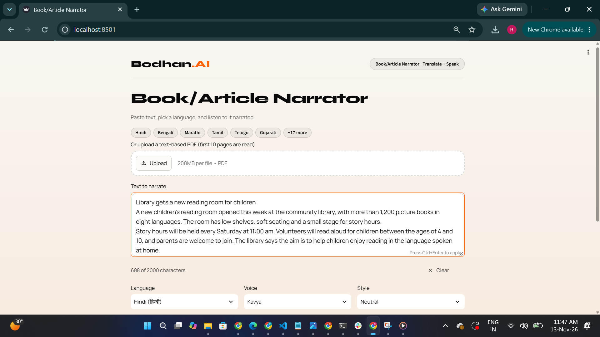
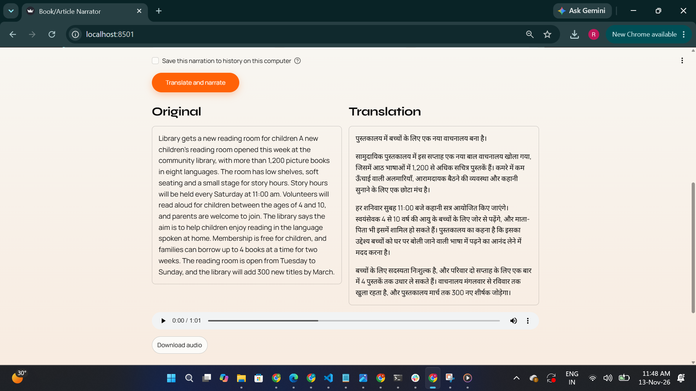
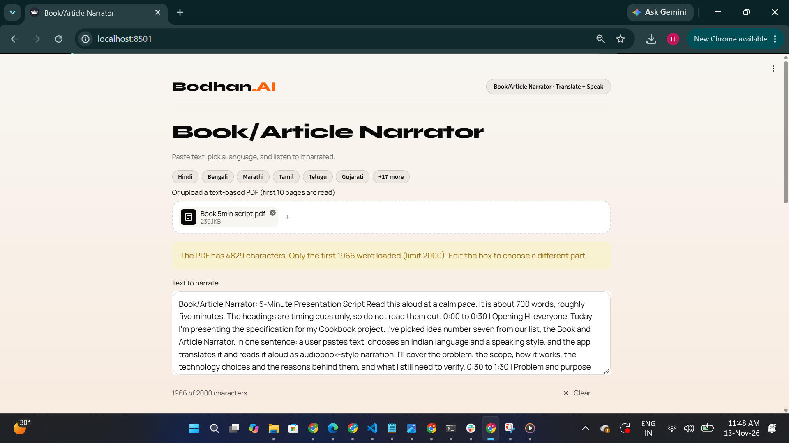
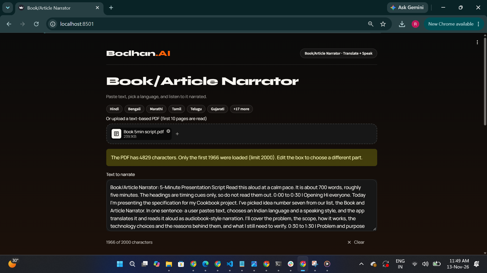

# Book/Article Narrator

Paste text, or upload a text PDF, and hear it translated and read aloud in any of 22 Indian
languages (or English). The original and the translation are shown side by side, the narration can be
downloaded as a WAV file, and an optional local history lets you reopen earlier narrations without
paying for them again.

Built with two Bodhan models: `indic-translate` (translation) and `indic-speak` (text to speech).

| | |
| --- | --- |
| Type | Streamlit app (Python 3.10+) |
| Models | `indic-translate`, `indic-speak` |
| Input | Pasted text or a text PDF, up to 2,000 characters |
| Output | Side-by-side text, an audio player and a WAV download |
| Specification | [SOFTWARE_SPECIFICATION.md](SOFTWARE_SPECIFICATION.md) |
| Architecture | [ARCHITECTURE.md](ARCHITECTURE.md) |
## Demo

▶ [Watch the demo video](https://drive.google.com/file/d/13slg7QJenL5rM3-Ib0AaegCR2fqSMivg/view?usp=sharing)

| | |
| --- | --- |
|  |  |
|  |  |

## What it does

1. You paste text (or upload a PDF), pick a language, a voice and a speaking style.
2. The app translates the text paragraph by paragraph and checks that no translation was cut off.
3. It shows the original next to the translation straight away.
4. It cleans the text for speech, reads it sentence by sentence, joins the clips into one narration and plays it.

Supported languages (the same list Bodhan's speech and translation models support):
Hindi, Bengali, Marathi, Tamil, Telugu, Gujarati, Kannada, Malayalam, Punjabi, Odia, Assamese, Urdu,
Nepali, Sanskrit, Konkani, Maithili, Dogri, Bodo, Santali, Manipuri, Kashmiri, Sindhi and English.
Each language has its own Bodhan voices (see `narrator/config.py`).

## Setup

You need Python 3.10 or later and two Bodhan API keys from [console.bodhan.ai](https://console.bodhan.ai):
one for translation and one for speech. (Bodhan issues a key per model. If you have a single key that
works for both, put it in `BODHAN_API_KEY` instead.)

```bash
# 1. open this folder
cd examples/book_article_narrator

# 2. create and activate a virtual environment
python -m venv venv
venv\Scripts\activate          # Windows PowerShell
# source venv/bin/activate     # macOS or Linux

# 3. install the dependencies
pip install -r requirements.txt

# 4. create your settings file and add your keys
copy .env.example .env         # Windows
# cp .env.example .env         # macOS or Linux
```

Open `.env` in a text editor and replace the placeholders with your real keys. `.env` is git-ignored;
never commit it.

## Run

```bash
python -m streamlit run app.py
```

Open the address it prints (usually http://localhost:8501), then:

1. Paste a sentence or two, or upload a text PDF.
2. Click a language chip, choose a voice and a style.
3. Click **Translate and narrate** and wait. Speech is produced at about real time, so a long
   text takes a couple of minutes. The status line shows where it is.

Try it with no keys and no cost: set `NARRATOR_DEMO=1` (PowerShell: `$env:NARRATOR_DEMO="1"`) before
running. Demo mode uses a pretend Bodhan that returns a fixed translation and a short beep.

Sample text to try (synthetic):

> The school library will be closed on Friday, 14 November, for stock-taking. Students who have borrowed books must return them by Thursday, 13 November. The library will reopen on Monday at 9:00 am. Thank you for your cooperation.

To try the PDF upload, put the same text in any document and save or print it as a PDF. This repository ignores sample files by design, so none are included.

## How it works

```
text or PDF -> split into paragraphs -> translate each (indic-translate)
            -> stop if any translation was cut off
            -> clean emoji and links, split into sentences of at most 250 characters
            -> speak each sentence, 3 at a time (indic-speak)
            -> join the clips in order with pauses -> player and download
```

| File | Job |
| --- | --- |
| `app.py` | The page: inputs, theme, progress, results, history. The only file that uses Streamlit |
| `narrator/pipeline.py` | The whole flow, with no UI, so it can be reused |
| `narrator/bodhan_client.py` | The two API calls, with retries and friendly errors |
| `narrator/text_utils.py` | Splitting, speech clean-up, Hindi digits |
| `narrator/extract.py` | Text from PDFs |
| `narrator/audio_utils.py` | Joins WAV clips |
| `narrator/storage.py` | Optional SQLite history |
| `narrator/config.py` | Keys, languages, voices, limits |

Choices worth knowing about:

- **Chunking.** Bodhan speech handles about 30 seconds per request and does not split text for you, so
  the app splits translations into sentences, and any sentence over 250 characters at spaces.
- **Truncation check.** A cut-off translation reads fluently and just stops. If Bodhan does not report
  a normal finish, the app stops and names the paragraph instead of narrating it.
- **Translate route.** The app calls `POST /v1/chat/completions` with `indic-translate`, because the
  documented `/translate` returned 404 for the keys used while building this.
- **Emoji and links** are removed from the speech only; the shown text keeps them.
- **Numbers.** In Hindi, digits are converted to Devanagari so the voice reads them in Hindi.
- **Retries.** At most 3 attempts on 429, 5xx and network errors, honouring `retry-after`.

## Limits and known issues

- Text is capped at 2,000 characters (PDF text is trimmed to that, with a notice). Only the first
  10 pages of a PDF are read.
- **Text PDFs only.** Scanned or photographed pages have no text to read, and the app says so. OCR
  with `indic-ocr` is planned for V1.
- Some PDFs scramble the vowel signs of Indian-language text. The app warns when it sees this.
- Speech takes about as long as the audio it produces. A 2,000-character text takes roughly 2 to 3 minutes.
- Audio quality was reviewed in Hindi. Other languages were checked to produce working audio, but not
  by native speakers. Please check dates, numbers and names before relying on a translation.
- Numbers are converted to native digits for Hindi only.
- Bodhan's voices can sound slightly different between runs of the same text.

## Privacy

- Your text is sent to Bodhan (`api.bodhan.ai`) for translation and speech, and nowhere else.
- Keys stay on the server and are never shown or logged. The app never logs your text.
- History is **off by default**. If you tick "Save this narration to history on this computer", the text
  and audio are stored unencrypted in a local file (`narrator.db`, git-ignored). The newest 20 are kept.
  Delete one or all from the History section, or delete the file.
- History belongs to the computer, not to a person. Do not save sensitive text on a shared computer,
  and do not host this app publicly with history on.
- You are responsible for having the right to translate and narrate the text you use. Do not paste a
  child's personal data.

## Tests

```bash
pip install pytest ruff
python -m pytest -q       # offline; no API calls
ruff check .
python smoke_test.py      # live test, one sentence in every language, about Rs 1-2 of credit
```

`smoke_test.py` saves a results table to `outputs/smoke_results.md` and the audio to `outputs/smoke/`.

## Troubleshooting

| You see | Try |
| --- | --- |
| "No Bodhan API key found" | Fill in `.env` with real keys, then restart the app |
| "Check that your API key is correct" | The key is wrong, or you used the speech key for translation (or the reverse) |
| "Could not reach Bodhan" | Check your internet connection and try again |
| Keys in `.env` are ignored | A value set in your terminal wins over `.env`; close and reopen the terminal |
| Slow narration | Normal. Speech runs at about real time |

## Ideas for V1

OCR for scanned PDFs and photos, streaming playback, chapters for long documents, native digits in
more languages, bring-your-own-key hosting, and native-speaker review of every language.

Made with the [Bodhan](https://bodhan.ai) APIs.
