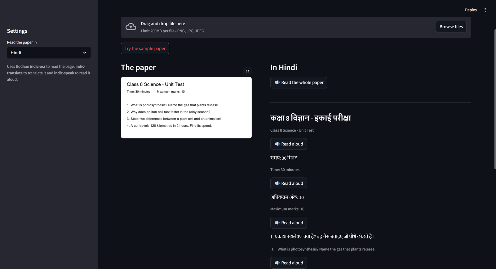
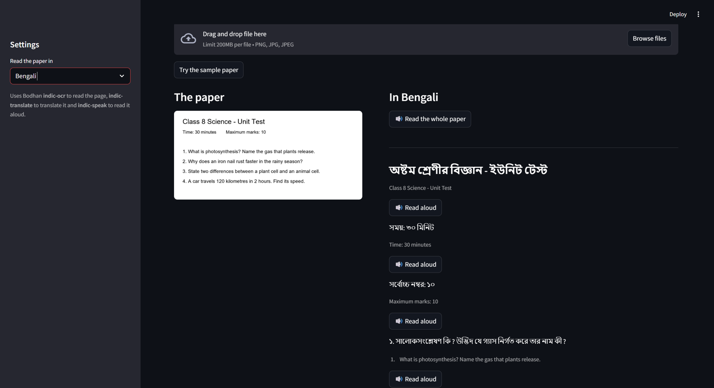

# Exam paper reader

> Photograph a question paper, then read and hear every question in your own language.

**Bodhan models:** indic-ocr, indic-translate, indic-speak
**Languages shown:** English and Hindi papers in; Hindi, Bengali, Tamil or English out
**Format:** Streamlit app, plus a command-line script

## What it does

Many students study in one language and sit exams set in another, and visually impaired students often need someone to read a paper to them. This app takes a photo or scan of one page of a question paper, reads the text with `indic-ocr`, translates every line with `indic-translate`, and reads any question aloud with `indic-speak`. The original line stays under each translation so the student can check it against the paper.

The included sample paper, read in Hindi and in Bengali:





Sample output for the included paper (`sample_data/sample_paper.png`), translated into Hindi:

| On the paper | Hindi |
|---|---|
| Time: 30 minutes | समय: 30 मिनट |
| Maximum marks: 10 | अधिकतम अंक: 10 |
| 1. What is photosynthesis? Name the gas that plants release. | 1. प्रकाश संश्लेषण क्या है? वह गैस बताइए जो पौधे छोड़ते हैं। |
| 2. Why does an iron nail rust faster in the rainy season? | 2. बारिश के मौसम में लोहे की कील जल्दी क्यों जंग खा जाती है? |

## Setup

Needs Python 3.11 or newer, because the pinned Pillow release with current security fixes does not support 3.10.

```bash
cd examples/exam_paper_reader
python -m venv .venv && source .venv/bin/activate   # Windows: .venv\Scripts\activate
pip install -r requirements.txt
cp .env.example .env   # then paste your key from https://console.bodhan.ai
```

One key with access to `indic-ocr`, `indic-translate` and `indic-speak` is enough. If your console keys are each limited to one model, fill in `BODHAN_OCR_KEY`, `BODHAN_TRANSLATE_KEY` and `BODHAN_SPEAK_KEY` instead; each one takes priority over `BODHAN_API_KEY` for its model.

## Run

The app:

```bash
streamlit run app.py
```

Open http://localhost:8501, then upload a photo or click **Try the sample paper**. Pick the language in the sidebar. Audio is generated only when you press a **Read aloud** button.

The app is served on your own computer only (`.streamlit/config.toml` sets `address = "localhost"`). Keep it that way unless you add a login: anyone who can open the page can spend your API credits.

The same pipeline from the command line, without a browser:

```bash
python pipeline.py sample_data/sample_paper.png --lang hi             # prints translations, saves outputs/paper_hi.wav
python pipeline.py sample_data/sample_paper.png --lang ta --no-audio  # text only
```

The tests need no API key and make no network calls:

```bash
pytest test_pipeline.py
```

## How it works

`pipeline.py` makes every API call; `app.py` is only the screen.

1. **Prepare the photo.** Phones often save photos sideways and note the turn in EXIF metadata, so the image is rotated upright. Photos larger than 2000 px are shrunk.
2. **Read the page** with `indic-ocr` (`POST /v1/chat/completions`, the image as a base64 data URL). The Markdown result is cached in `outputs/ocr_cache/`, named by a hash of the image, so the same page is never billed twice.
3. **Group the text into parts**: a heading, a paragraph or a question each. The OCR response's layout `blocks` label each piece of the page, so a `Chapter-title` or `Section-title` is shown as a heading. Markdown marks are removed, so they are not translated or spoken. Three rules came from testing:
   - Inside a block, a single line break is only where the printed line wrapped, so wrapped lines are joined back into one paragraph. Translated one printed line at a time, a sentence came out as broken fragments. A line that starts with a number or bullet begins a new part.
   - A wide gap between two fields on one printed line, such as `Time: 30 minutes      Maximum marks: 10`, splits them into two parts. Sent as one phrase, the translator mixed the two fields up.
   - Overlapping layout blocks sometimes return the same text twice in a row; the repeat is dropped.
4. **Translate each part** with `indic-translate`. Part by part keeps every question paired with its translation and lets the student play one question at a time. The source language is detected automatically. Text already written in the target language's script is not sent at all: asked to translate Hindi into Hindi, the model reworded the text and introduced mistakes.
5. **Read aloud** with `indic-speak`. A request should hold about 30 seconds of speech, so text is cut at sentence ends (`.`, `?`, `!` and the Devanagari `।`) into pieces of at most 250 characters. Each piece is spoken and the WAV pieces are joined into one file.

Streamlit reruns the whole script on every click, so the app keeps translations and audio in `st.session_state`. Changing language or pressing play never repeats a paid call.

Translation uses `POST /v1/chat/completions` with `"model": "indic-translate"` and a `target_language` field. The plain `POST /translate` route used elsewhere in this cookbook returned 404 during development (see issue #34).

## Cost

At the console's listed prices, the sample paper costs about ₹0.20 to read, under ₹0.01 to translate, and about ₹0.25 to read aloud in full. A new account's ₹10 credit covers about 20 complete runs. Reading a paper again costs nothing, thanks to the cache.

## Limitations

These come from testing with the API, not from guesses.

- **One page per request, images only.** Convert a PDF to one image per page first.
- **Fields printed close together can merge.** On a blurred photo, OCR returned `Time: 30 minutes Maximum marks: 10` with a single space, so the gap rule above could not split it, and the translation reordered the fields. Check headers and marks against the paper.
- **No per-line confidence warnings.** The OCR response includes a `conf` score per layout block, but in testing it barely changed between a sharp image, a blurred one and a misread one (0.62 to 0.87 throughout). It appears to describe layout detection, not text accuracy, so the app does not use it to flag doubtful lines.
- **Synthetic Hindi samples need a shaping-aware renderer.** Pillow without `libraqm` draws Devanagari vowel signs in the wrong place (`मिनट` comes out as `मनिट`), and OCR then faithfully reads the broken text. `make_sample_paper.py` therefore draws an English paper only.
- **The same-language check looks at the script, not the language.** A Marathi or Nepali page is also in Devanagari, so with Hindi selected it is shown untranslated.
- **Words with two meanings can go wrong.** On a Hindi textbook page, `लाख की गोलियाँ` (marbles made of lac) was translated into English as "lakh pills".
- **Text cut off by the edge of the photo is translated as it stands**, so a half sentence gives a half-right translation. Photograph the whole page.
- **Numbers and formulas.** The sample's numbers survived translation, but maths notation, chemical formulas and diagrams have not been tested.
- **Handwriting** has not been tested.
- **The translation is a machine translation.** It is a study aid, not a replacement for an official paper in the student's language.
