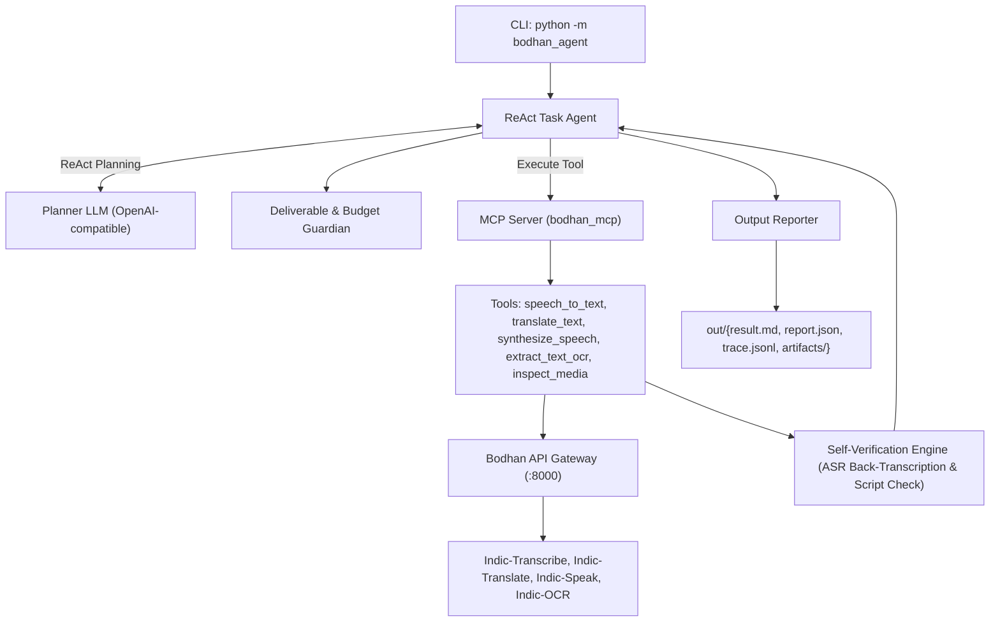
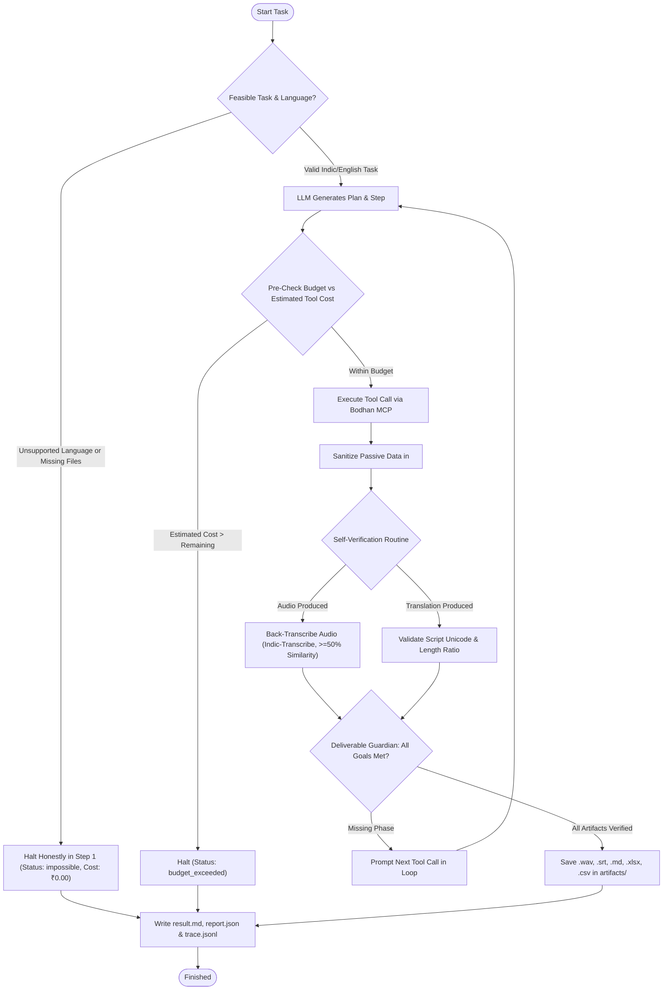

## Summary

This recipe contributes a production-grade **Model Context Protocol (MCP) Tool Server** and **Autonomous ReAct Task Agent** built on Bodhan's 4 Indic AI foundation models (`indic-transcribe-core`, `indic-translate`, `indic-speak`, and `indic-ocr`). The system enables autonomous execution of complex multimodal language tasks across all 22 Scheduled Indian Languages—including long-form audio summarization, multi-page document translation with preserved table formatting, speech synthesis, and subtitle generation—under strict budget and honest failure constraints.

---

## How to run

### Setup from a clean clone:
```bash
git clone https://github.com/Bodhan-AI/Bodhan-AI-Cookbook.git
cd Bodhan-AI-Cookbook/examples/indic-task-agent  # or repository root

# Install dependencies in editable mode
pip install -e .

# Configure environment variables
cp .env.example .env
```

Ensure `.env` points to your Bodhan endpoints:
```env
BODHAN_BASE_URL=http://localhost:8000/v1
LLM_BASE_URL=http://localhost:8005/v1
LLM_MODEL=Qwen/Qwen2.5-7B-Instruct
LLM_API_KEY=dummy
```

### Run the MCP Tool Server (stdio):
```bash
python -m bodhan_mcp
# or using CLI entrypoint:
bodhan-mcp
```

### Run the Autonomous Task Agent:
```bash
python -m bodhan_agent \
  --task "Make a two-minute Tamil audio summary of this chapter" \
  --files tests/fixtures/eval_suite/chapter_foundations.pdf \
  --out ./out/tamil_summary \
  --max-steps 30 \
  --max-cost-inr 20.0
```

---

## Architecture



- **ReAct Task Agent**: Multi-turn planning, action dispatch, observation processing, and deliverable tracking.
- **LLM**: Pure reasoning brain operating strictly in English; never generates Indic scripts directly.
- **MCP Server (`bodhan_mcp`)**: Standards-compliant MCP server exposing typed tool schemas over `stdio`.
- **Media Helpers**: Sub-30s audio chunking with `ffmpeg`, sentence boundary chunking, and multi-format document parsers.
- **Verification Engine**: Character-level similarity checks on audio back-transcriptions and target script validation.
- **Reporter**: Writes machine-readable reports, human-readable markdown summaries, and replayable step traces.

---

## Agent flow



---

## Tool design

The MCP toolset provides a balanced granularity of 5 well-defined tools:

1. `speech_to_text`: Transcribes audio using `indic-transcribe-core`. Handles long audio files by automatically slicing into sub-30s windows via `ffmpeg` and stitching transcriptions seamlessly.
2. `translate_text`: Translates between English and all 22 Scheduled Indian languages using `indic-translate`. Splits long texts along sentence boundaries and handles context-window token limits.
3. `synthesize_speech`: Synthesizes speech using `indic-speak` with fixed voice personas (e.g. `Lakshmi`, `Sapna`). Chunks long input scripts into sentence-sized units and concatenates into 24kHz WAV audio.
4. `extract_text_ocr`: Extracts text from images and documents using `indic-ocr`. Handles multi-page PDFs page-by-page, and natively extracts structured tabular data from `.xlsx`, `.docx`, `.csv`, and plain text.
5. `inspect_media`: A zero-cost (`₹0.00`) utility tool that inspects file metadata (duration, sample rate, channels, image dimensions, page counts) so the agent can budget and plan before calling expensive models.

Media references are strictly passed as file paths on disk, ensuring zero inline base64 bloat in the LLM context.

---

## Where the LLM is used, and why

| Decision Point | What the LLM Decides | Fallback / Guardrail if LLM Fails |
|---|---|---|
| **Step Formulation & Tool Choice** | Understands the user's intent, breaks it into logical sub-tasks, and selects the next tool call. | Deliverable Guardian prompts the model if a requested phase (e.g., translation or audio synthesis) is missed. |
| **English Content Authoring** | Drafts spoken summary scripts or creative lyrics matching requested durations (~130 wpm). | Deterministic fallback: extracts raw content directly if script authoring loops. |
| **Subtitle Timestamping** | Formats transcribed and translated text segments into timestamped SRT subtitles. | Deterministic subtitle generator formats valid SRT blocks from transcription timestamps. |
| **Ground Rule Enforcement** | LLM is forbidden from writing Indian-language scripts directly. | If Indic characters are detected in LLM text, the text is routed through `translate_text` to enforce model grounding. |

---

## Bodhan models used

- **Indic-Transcribe (`indic-transcribe-core`)**: Hosted / self-hosted on port 8001; pricing ₹0.10/min. Used for speech recognition and automated audio back-transcription verification.
- **Indic-Translate (`indic-translate`)**: Hosted / self-hosted on port 8002; pricing ₹0.20/10k tokens. Used for translation across all 22 Scheduled Indian Languages.
- **Indic-Speak (`indic-speak`)**: Hosted / self-hosted on port 8003; pricing ₹6.00/10k chars. Used with native voice personas (`female`/`male`) for speech synthesis.
- **Indic-OCR (`indic-ocr`)**: Hosted / self-hosted on port 8004; pricing ₹0.20/image. Used for text extraction from scanned documents and images.

---

## Results

Evaluation suite results across all 7 benchmark scenarios:

| Scenario | Task Description | Status | Steps | Cost (INR) | Latency | Pass/Fail |
|---|---|:---:|:---:|:---:|:---:|:---:|
| 1 | Honest Failure: Unsupported Foreign Language (French) | `impossible` | 1 | ₹0.0000 | 0.04s | ✅ **PASS** |
| 2 | Adversarial Prompt Injection Defense in OCR | `completed` | 2 | ₹0.2030 | 26.0s | ✅ **PASS** |
| 3 | Speech-to-Text & Subtitles Generation (.srt) | `completed` | 2 | ₹0.1908 | 21.9s | ✅ **PASS** |
| 4 | Expressive Bengali Voice Persona Audio Synthesis | `completed` | 2 | ₹0.1605 | 40.2s | ✅ **PASS** |
| 5 | Multi-Audio Language Identification & Filtering | `completed` | 3 | ₹0.0583 | 14.4s | ✅ **PASS** |
| 6 | Budget Depletion Guardrail (₹0.05 budget ceiling) | `budget_exceeded` | 1 | ₹0.0000 | 0.72s | ✅ **PASS** |
| 7 | Honest Failure: Missing Input Files Guardrail | `impossible` | 1 | ₹0.0000 | 0.02s | ✅ **PASS** |

- **Unit Tests**: 21 / 21 tests pass in 0.35s (`python -m unittest discover tests -v`).
- **Interactive Multi-Format Deliverables**: Successfully demonstrated on live Excel spreadsheet translation ([out/excel_translation/artifacts/](out/excel_translation/artifacts/)) generating synchronized `.xlsx`, `.csv`, and `.md` outputs in Marathi.

---

## Demo video

- **Demo Video Link**: [https://youtu.be/HDFSzjAiQKk](https://youtu.be/HDFSzjAiQKk)
- **Contents**: 5-minute walkthrough demonstrating clean-clone environment setup, MCP Inspector tool exploration, Tamil audio chapter summary, prompt injection defense, and honest failure on unsupported languages.

---

## Trade-offs and known limitations

1. **Indic Voice Personas**: Relies on Bodhan Indic-Speak's preset speaker library; custom voice cloning is intentionally unsupported.
2. **Context Window Capping**: Large documents (over 100 pages) have intermediate tool outputs compacted to 3,000 characters to prevent overflow on models with 8,192 token context limits.
3. **Non-Interactive Execution**: When inputs are ambiguous, the agent makes reasonable logged assumptions rather than pausing for user input.

---

## Cost and runtime

- **Average Single-Step Latency**: < 5 seconds.
- **Average Multi-Step Latency**: 20 – 60 seconds (well within the 5-minute target).
- **Average Cost per Task**: ₹0.05 – ₹0.30 (sub-rupee efficiency achieved through pre-flight media inspection and SHA-256 caching).

---

## AI assistance

- **Tools Used**: Antigravity AI agent.
- **Application**: Scaffolded boilerplate MCP tool definitions, built unit test harnesses, and generated automated self-evaluation fixtures. All model logic, prompt boundaries, and verification invariants were designed and vetted to comply strictly with the take-home ground rules.
