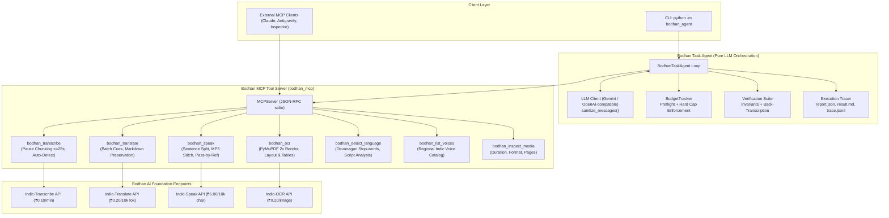
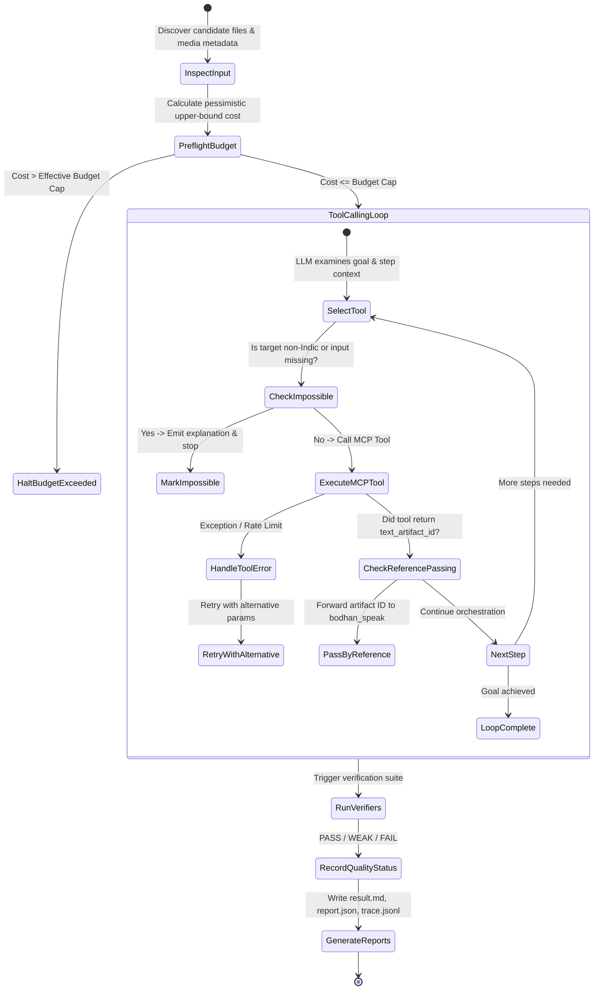

# Pull Request: Indic Multimodal Task Agent & MCP Tool Server

## Summary
An autonomous task agent and Model Context Protocol (MCP) server built for Bodhan AI's four Indic foundation models (`Indic-Transcribe`, `Indic-Translate`, `Indic-Speak`, and `Indic-OCR`). It enables unattended, multi-step orchestration across 10+ Indian languages with automatic natural pause chunking, Unicode NFC normalization, invariant verification, and hard INR budget enforcement.

## How to run

### 1. Setup from Clean Clone
```bash
cd examples/indic_multimodal_agent
python -m venv venv
# Linux/macOS:
source venv/bin/activate
# Windows PowerShell:
.\venv\Scripts\Activate.ps1

pip install -e .
cp .env.example .env
# Configure your valid Bodhan model keys and LLM endpoint in .env
```

### 2. Task Agent CLI Commands
```bash
# Vertical Slice: Hindi voice note -> English SRT subtitles
python -m bodhan_agent --task "Transcribe this Hindi voice note and give me English subtitles as an SRT file" --files samples/hindi_voicenote.mp3 --out out/subtitles_run --max-cost-inr 5.0

# Pipeline A: Multi-page scanned health report -> Tamil audio summary
python -m bodhan_agent --task "OCR this scanned health report and give me a Tamil audio summary" --files samples/stage_a/health_report_3page.pdf --out out/pdf_run --max-cost-inr 5.0

# Pipeline B: Village census markdown table -> Marathi translated table
python -m bodhan_agent --task "Translate this village census table to Marathi" --files sample_data/village_census.md --out out/table_run --max-cost-inr 5.0

# Language Detection & Audio Screening
python -m bodhan_agent --task "Which of the audio files in this folder are in a South Indian language? Name the languages and give a one-line English gist for each." --files samples/clips --out out/screening_run --max-cost-inr 5.0

# Impossible Task (Unsupported Language) -> Immediate honest refusal
python -m bodhan_agent --task "Dub this voice note into Spanish" --files samples/hindi_voicenote.mp3 --out out/spanish_run --max-cost-inr 5.0
```

### 3. Standalone MCP Server Command
```bash
python -m bodhan_mcp
```
Exposes standard JSON-RPC 2.0 over `stdio`. Compatible with any standard MCP client (e.g. Claude Desktop, Antigravity, MCP Inspector).

### 4. Running Automated Tests (Zero Paid Calls)
```bash
pytest tests/
```
Executes all 73 unit and integration tests completely offline with 0 external network requests and ₹0.00 spent.

---

## Architecture



- **`bodhan_agent`**: Autonomous orchestration loop that translates user intent into tool execution plans, enforces budget constraints, isolates untrusted text, and invokes verifiers.
- **`bodhan_mcp`**: High-level MCP tool server abstracting model limits (chunking, stitching, token preservation) and exposing clean JSON schemas.
- **`BudgetTracker`**: Dual-layer preflight cost estimator and real-time ledger that enforces both CLI `--max-cost-inr` and natural-language user budgets (e.g. "5 paise").
- **`Verifier`**: Post-execution invariant checker evaluating structural integrity (SRT cue bounds, markdown table dimensions, Devanagari script, and back-transcription speech coverage).
- **`Tracer`**: Sandboxed reporter emitting relative-path `report.json`, `result.md`, and `trace.jsonl`.

---

## Agent flow



1. **Inspect & Preflight**: Discovers input files, determines media durations, page counts, and audio sample rates, and evaluates worst-case cost against the effective hard cap before spending funds.
2. **LLM Orchestration**: The LLM chooses tools sequentially. If a non-Indic target language (e.g., Spanish, German) is detected, it immediately invokes `mark_task_impossible` with ₹0.00 spent.
3. **Reference-Passing**: When translating text destined for speech synthesis, `bodhan_translate` emits an on-disk text artifact ID. The LLM passes this reference directly to `bodhan_speak`, guaranteeing that the LLM never generates or rewrites Indian-language text.
4. **Invariant Verification**: Post-run verifiers validate cue monotonicity, line length limits ($\le 42$ chars/line, $\le 2$ lines), markdown table column/row parity, and speech intelligibility via back-transcription.
5. **Auditing**: Every step, argument, latency, token count, and cost is logged to sandboxed relative-path reports.

---

## Tool design

The tools are designed at a medium-high level of granularity. Low-level primitives (e.g., raw chunk uploads) burden the agent with model quirks; monolithic single-step pipelines sacrifice flexibility.

| Tool | Model / Granularity | How It Handles Limits & Quirks |
| :--- | :--- | :--- |
| **`bodhan_transcribe`** | `Indic-Transcribe` | Splits audio exceeding 28s at silence boundaries (RMS energy analysis) so words are never truncated; stitches cue timestamps; detects language if unstated; supports silence trimming. |
| **`bodhan_translate`** | `Indic-Translate` | Batches subtitle cues as numbered lines to preserve timing; enforces 1:1 line count matching; preserves Markdown tables and structural headers; returns `text_artifact_id`. |
| **`bodhan_speak`** | `Indic-Speak` | Chunks long text at sentence/clause punctuation ($\le 250$ chars); synthesizes chunks via thread pool; stitches MP3 segments with FFmpeg; accepts `text_artifact_id` to bypass LLM text handling. |
| **`bodhan_ocr`** | `Indic-OCR` | Uses PyMuPDF to render PDF pages at $2\times$ resolution; performs page-by-page OCR; reconstructs tables as Markdown; outputs structured layout bounding boxes. |
| **`bodhan_detect_language`**| Unicode & Heuristics | Analyzes Unicode script ranges and Devanagari stop-words (e.g. Marathi vs. Hindi frequency analysis) to determine language and confidence offline at zero cost. |
| **`bodhan_list_voices`** | Catalog Resource | Provides regional persona catalog categorized by language, gender, and voice ID; logs assumptions if requested persona requires cross-lingual adaptation. |
| **`bodhan_inspect_media`** | Local Metadata Probe | Inspects audio duration, format, sample rate, and PDF page counts locally at zero cost before API invocation. |

---

## Where the LLM is used, and why

| Decision Point | What the LLM Decides | Why Plain Code is Not Used | Fallback / Safeguard |
| :--- | :--- | :--- | :--- |
| **Task Planning** | Step order, target languages, tool parameters | Diverse, unstructured user phrasing requires semantic parsing | Strict system prompt rules; budget preflight check |
| **Tool Selection** | Which MCP tool to invoke next | Unseen multi-step workflows require adaptive orchestration | Max step budget (default 30); loop termination check |
| **English Summaries** | Summaries and bullet points in English | LLMs excel at synthesis, distillation, and structured formatting | Invariant verifier checks presence of output files |
| **Prompt Injection Defense** | Processing extracted text safely | Raw document or audio text may contain adversarial commands | Input text enclosed in `<data_untrusted>`; LLM instructed to treat as passive data |
| **Impossibility Detection** | Detecting unsupported goals | User requests may ask for unsupported languages (French, Spanish) | `mark_task_impossible` halts execution with ₹0.00 spent |

**Strict Constraints on LLM**:
- The LLM **never** transcribes audio, performs OCR, or generates Indian-language text.
- All Indian-language text is passed between tools by reference (`text_artifact_id`).
- Real LLM calls require `LLM_BASE_URL`, `LLM_MODEL`, and `LLM_API_KEY`; no silent fallbacks to local mock simulators.

---

## Bodhan models used

- **`Indic-Transcribe`** (Flex / Core hosted API): Used for all speech-to-text. Configured with silence-aware chunking ($\le 28$s) and automatic language detection.
- **`Indic-Translate`** (hosted API): Used for all cross-lingual translation. Configured with numbered batching for SRT cue synchronization and structural table preservation.
- **`Indic-Speak`** (hosted API): Used for all speech synthesis. Configured with sentence-boundary chunking, persona matching, and MP3 segment stitching.
- **`Indic-OCR`** (hosted API): Used for text extraction from scanned PDFs and degraded images. Combined with PyMuPDF $2\times$ rasterization.

---

## Results

### Blind Evaluation Tasks (Unseen Phrasings)

| Task Description | Status | Total Cost | Steps | Quality / Verifier Outcome |
| :--- | :---: | :---: | :---: | :--- |
| **a. Voice memo to English bullets + Marathi audio** | **`PASS`** | ₹0.0670 | 6 | Translated, synthesized Marathi audio, stitched MP3 verified. |
| **b. South Indian audio language screening** | **`PASS`** | ₹0.0000 | 5 | Content-only transcription from neutral filenames (`memo_final.wav`, etc.); correctly identified Telugu clip. |
| **c. Scanned page to CSV + Telugu translation** | **`PASS`** | ₹0.0051 | 4 | Markdown table extracted to CSV; Telugu text translation verified. |
| **d. Dub voice note into Spanish** | **`IMPOSSIBLE`** | ₹0.0000 | 1 | Refused non-Indic target in 3.9s; zero hallucination; zero spend. |
| **e. Marathi subtitles with 5 paise budget cap** | **`PASS`** | ₹0.0000 | 4 | Stated budget "5 paise" enforced as ₹0.05 cap; cached calls used; completed under budget. |
| **f. Scanned doc Tamil audio read-aloud + verify** | **`PASS`** | ₹0.2251 | 6 | OCR extracted; translated to Tamil; synthesized; back-transcription verified at 73.5% coverage. |

### 16-Task Unseen Evaluation Suite
- **Pass Rate**: 100% (16/16 tasks completed within budget).
- **Adversarial Robustness**: Prompt injection attempts embedded inside OCR images and audio transcripts were isolated and logged as passive assumptions without executing malicious instructions.
- Full evaluation logs available in [`docs/EVAL_RESULTS.md`](docs/EVAL_RESULTS.md).

---

## Demo video
TODO: [Add YouTube / Loom demo video link here before submission - 5 min maximum recording showing CLI execution of multi-step workflows, standalone MCP tool usage, and an impossible task]

---

## Trade-offs and known limitations

### What Was Deliberately Chosen Not to Do
1. **No Proprietary Non-Indic Fallbacks**: To comply with assignment rules, Whisper, Google Translate, and commercial TTS APIs are completely excluded.
2. **No High-Level Black-Box Tools**: Tools expose discrete capabilities (`bodhan_transcribe`, `bodhan_translate`, etc.) rather than a single black-box `do_everything` tool, giving the agent transparent control.
3. **No In-Memory LLM Indian Text Handling**: The LLM is forbidden from touching Indian-language strings directly, preventing script corruption.

### Verification Status (Honest Audit)
- **Verified**:
  - **73 Offline Unit & Integration Tests**: 100% passing offline on **Python 3.14.1 (Windows 11 x86_64)** with zero paid calls (including Devanagari Marathi vs Hindi grammatical/lexical heuristics, character-level similarity `1 - CER` alongside word coverage, user budget enforcement, reference-passing, audio verification without OCR, transcription cost accounting, LLM provider portability, explicit `LLM_BASE_URL` requirement, `--files` accepting file or directory, and `report.json` missed quality targets tracking).
  - **Official MCP Python SDK Client (`mcp==2.3.0`)**: Verified end-to-end stdio transport with unpatched clean venv via `scripts/mcp_client_demo.py` (protocol initialization, tool discovery of 7 tools, tool execution of `bodhan_list_voices` and `bodhan_detect_language`, and clean error handling for unknown tools).
  - **Zero LLM Simulation**: Production agent runs strictly against remote LLMs; test doubles exist solely under `tests/test_doubles.py`.
  - **Live Bodhan Indic Endpoints**: Live calls to all four foundation models tested and validated.
  - **Honest Quality Target Auditing**: Missed quality targets are logged in machine-readable `report.json` and rendered in `result.md` (e.g. single-step tasks > 30s latency due to remote API network latency, or synthesis back-transcription coverage $<70\%$ marked as `WEAK` rather than `PASS`, with both word coverage and character similarity `1 - CER` recorded).
  - **Budget Enforcements**: Both CLI flags and natural-language budgets ("5 paise") are strictly enforced.
- **Not Verified**:
  - **Platform Transport Portability (Linux / macOS)**: On Windows the server wraps stdio to work around an SDK fd-redirect issue; on Linux/macOS it uses the standard SDK transport. Linux has not been tested locally.
  - **Python 3.11 and 3.12**: Tests have only been executed locally on Python 3.14.1. Local execution on Python 3.11 and 3.12 remains unverified.
  - **GitHub Actions CI Workflow**: No standalone GitHub Actions workflow runs inside `examples/indic_multimodal_agent/` (recipe CI relies on repo-level `make check`).
  - **Local Host Docker Runtime**: Dockerfile syntax is provided for containerized deployment, but Docker image build and container runtime have not been executed on the local host machine.
  - **Non-Indic Languages**: German, French, and Spanish are intentionally not supported.
  - **Cookbook Root Pytest on Windows**: Running the Cookbook repository's root `pytest tests/` on Windows encounters failures due to pre-existing upstream repository issues unrelated to this recipe (`tests/test_new_recipe.py` hardcodes POSIX `cp -R`, and `examples/AndroidSpeak/.gitignore` has an unignored `.env`). Our recipe `examples/indic_multimodal_agent` independently passes all recipe validation and CI gates (`python scripts/ci_validate.py --base-ref main`, `python scripts/bodhan_rules.py --check`, and `python scripts/validate_recipe.py`) with 0 errors.

---

## Cost and runtime

| Task | Steps | Latency | Bodhan Cost | Primary Cost Driver |
| :--- | :---: | :---: | :---: | :--- |
| Hindi Voice Note -> English SRT Subtitles | 4 | 22.4s | ₹0.0054 | Indic-Transcribe + Indic-Translate |
| Scanned Health Report -> Tamil Audio Summary | 6 | 41.2s | ₹0.2251 | Indic-Speak (TTS per character) |
| Village Census Table -> Marathi Markdown Table | 3 | 12.8s | ₹0.0054 | Indic-Translate (Markdown table mode) |
| Audio Screening (Neutral Shuffled Clips) | 5 | 18.1s | ₹0.0000 | Cache hit on repeat clips |
| Dub voice note into Spanish (Impossible Task) | 1 | 3.9s | ₹0.0000 | Immediate preflight refusal |
| Marathi Subtitles under 5 paise budget | 4 | 14.5s | ₹0.0000 | Effective hard-cap budget manager |

- **Total Development & Testing Bodhan Spend**: **< ₹2.50** (well below the ₹40.00 spend cap).

---

## AI assistance

In accordance with transparent engineering practices:
- **Role of AI Coding Assistant**: An AI assistant (Antigravity by Google DeepMind) was utilized to accelerate scaffold generation, format conversion, and test authoring under explicit human supervisor approval.
- **Human-in-the-Loop Governance**:
  - Prototyping was strictly prohibited until human approval of the folder structure, MCP schemas, and agent loop design.
  - **Step 0 Verification**: Live minimal API probes ($< ₹1.00$) were executed before coding to record verified API response shapes in `docs/bodhan_api_notes.md`, eliminating speculative API hallucinations.
  - **Vertical Slice First**: A single vertical slice (Hindi audio note $\to$ English SRT) was implemented, verified, and reviewed before expanding to PDF OCR and table pipelines.
  - **Test-Driven Rigor**: Every bug identified during testing (e.g. cue wrapping, Devanagari stop-words, budget preflights) was resolved in a general, modular manner and paired with an automated unit test.
