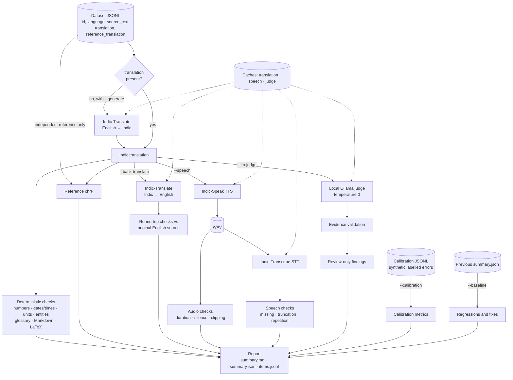

# Indic Translation and Speech Quality Harness

> A command-line harness that checks English → Hindi, Tamil and Bengali translations, and the speech generated from them, for errors it can point to: changed numbers, units, dates and names, broken Markdown and LaTeX, and missing, repeated or truncated spoken words. Every finding carries evidence and is marked **fail**, **review** or **pass**.

**Bodhan models:** indic-translate, indic-speak, indic-transcribe (plus an optional local Ollama model as a review-only judge)
**Languages shown:** Hindi (`hi`), Tamil (`ta`), Bengali (`bn`)
**Format:** CLI (Python package) with a walkthrough notebook

## Problem statement

Machine translation into Indic languages often fails in small, costly ways. A price changes from 500 to 300. "6 PM" becomes "morning". An e-mail address gets transliterated into Devanagari. A Markdown link or a LaTeX formula breaks. In speech, a word is dropped or the audio is cut short. A single quality score hides these errors. And when no human reference translation exists, there is nothing to compare against.

This harness looks for those concrete errors, reports the evidence for each one, and is explicit about how confident it is. It also measures its own detectors on labelled synthetic errors, so reviewers can see what each check can and cannot catch.

## What it does

Key features:

- **Deterministic translation checks** for numbers (order-independent, aware of lakh, crore and million), clock times, AM/PM, months, weekdays, units, e-mails, URLs, Latin-script names, places, per-record glossary terms, Markdown structure and LaTeX.
- **Reference-based comparison** using chrF, but only against an independent `reference_translation` supplied in the dataset. A generated translation is never used as a reference.
- **Reference-free comparison** by back-translation. Indic-Translate translates the output back to English, and the result is compared with the original source.
- **Speech evaluation**: Indic-Speak (TTS) → WAV → Indic-Transcribe (STT). Checks missing content, truncation, repetition, transcript mismatch, duration, silence, clipping and sample rate.
- **Optional LLM judge**: a local Ollama model at temperature 0. Its findings are validated against the text and are review-only.
- **Calibration** on labelled synthetic errors, with precision, recall and clean-case false alarms reported separately for each detector family.
- **Baseline comparison** between runs: regressions and fixes per record and category.
- **Persistent caches, a cost budget and rate-limit handling**, so re-runs are free and API limits are respected.
- **Optional generation** (`--generate`) of missing translations with Indic-Translate.

## How it works

### Architecture and workflow

1. **Load** the JSONL dataset and filter it by `--langs`.
2. **Generate** (optional, `--generate`): translate records that have no `translation`.
3. **Deterministic checks** run on every record that has a translation.
4. **Back-translate** (optional): Indic → English, compared with the English source.
5. **Speech** (optional): TTS → STT and audio checks, for `--speech-limit` records chosen round-robin across languages.
6. **LLM judge** (optional): evidence-validated, review-only findings.
7. **Report**: Markdown and JSON reports, then optional calibration and baseline comparison.

If one stage fails for one record (for example an API error), the error is recorded on that record and the run continues. Clients are created only for the stages you enable, so an offline run needs no API key and no Ollama.

### Architecture diagram



## Requirements

- Python 3.10 or newer
- A Bodhan API key from [console.bodhan.ai](https://console.bodhan.ai). Needed only for `--generate`, `--back-translate` and `--speech`
- Optional, for `--llm-judge`: [Ollama](https://ollama.com) running locally with `llama3.2:3b` pulled
- Dependencies (pinned in `requirements.txt`): `requests`, `python-dotenv`, `pydantic`. Tests also need `pytest`

## Setup

```bash
cd examples/indic_quality_harness
python -m venv .venv && source .venv/bin/activate
pip install -r requirements.txt
pip install -e .               # makes `python -m bodhan_eval` importable
cp .env.example .env           # then add your key (see below)
```

If you prefer not to install the package, run `export PYTHONPATH=src` in each shell instead of `pip install -e .`.

Optional, for the LLM judge:

```bash
ollama pull llama3.2:3b
```

## Environment configuration

`.env.example` lists every variable with placeholder values. Copy it to `.env` and fill in your own values. `.env` is git-ignored and must never be committed.

| Variable | Purpose |
|---|---|
| `BODHAN_API_KEY` | One key for all Bodhan services |
| `BODHAN_TRANSLATE_API_KEY`, `BODHAN_SPEAK_API_KEY`, `BODHAN_TRANSCRIBE_API_KEY` | Optional per-service keys. A service-specific key takes precedence over `BODHAN_API_KEY` |
| `BODHAN_BASE_URL` | API base URL (default `https://api.bodhan.ai`) |
| `BODHAN_TRANSLATE_INR_PER_1K_OUTPUT_TOKENS`, `BODHAN_SPEAK_INR_PER_1K_CHARS`, `BODHAN_TRANSCRIBE_INR_PER_MINUTE` | Per-unit prices used for cost estimates and `--max-cost-inr`. The built-in defaults are **placeholders, not Bodhan pricing**. Set them from your console |

The Ollama judge needs no key. Its model and URL are CLI flags (`--judge-model`, `--ollama-url`).

## Run

All commands run from `examples/indic_quality_harness` after Setup. Each run writes its reports to the `--out` directory.

**Basic evaluation**: deterministic checks only, offline, no key needed:

```bash
python -m bodhan_eval --dataset sample_data/demo_100.jsonl --langs hi,ta,bn \
  --out outputs/basic
```

**Back-translation** (reference-free; calls Indic-Translate):

```bash
python -m bodhan_eval --dataset sample_data/demo_100.jsonl --langs hi,ta,bn \
  --out outputs/backtranslation --back-translate --max-cost-inr 50
```

**Speech evaluation** (Indic-Speak + Indic-Transcribe for 10 records, round-robin across languages):

```bash
python -m bodhan_eval --dataset sample_data/demo_100.jsonl --langs hi,ta,bn \
  --out outputs/speech --speech --speech-limit 10 --max-cost-inr 50
```

**Calibration** (offline):

```bash
python -m bodhan_eval --dataset sample_data/demo_100.jsonl --langs hi,ta,bn \
  --out outputs/calibration --calibration sample_data/calibration.jsonl
```

**Baseline comparison** (compare a new run with an earlier `summary.json`):

```bash
python -m bodhan_eval --dataset sample_data/demo_100.jsonl --langs hi,ta,bn \
  --out outputs/compare --baseline outputs/basic/summary.json
```

**LLM judge** (local Ollama, no Bodhan cost):

```bash
python -m bodhan_eval --dataset sample_data/demo_100.jsonl --langs hi,ta,bn \
  --out outputs/judge --llm-judge
```

**Everything in one run:**

```bash
python -m bodhan_eval --dataset sample_data/demo_100.jsonl --langs hi,ta,bn \
  --out outputs/final --calibration sample_data/calibration.jsonl \
  --back-translate --speech --speech-limit 3 --llm-judge \
  --baseline outputs/basic/summary.json --max-cost-inr 50
```

Other useful flags (`python -m bodhan_eval --help` lists them all):

| Flag | Meaning |
|---|---|
| `--generate` | Translate records that have no `translation` (existing translations are never overwritten) |
| `--voice` | Use one Indic-Speak voice for all languages (default: one voice per language) |
| `--request-interval` | Minimum seconds between paid Bodhan calls (default 1) |
| `--cache-dir` | Where caches and audio are stored (default: the `--out` directory) |
| `--max-cost-inr 0` | Use caches only. No paid call is made |

To build a new calibration set from any dataset that has translations:

```bash
python -m bodhan_eval.build_calibration --dataset sample_data/demo_100.jsonl \
  --out outputs/my_calibration.jsonl --per-category 9 --clean 15
```

A step-by-step walkthrough is in `indic_quality_harness.ipynb`.

## Dataset

`sample_data/demo_100.jsonl` contains **100 records**: 34 Hindi, 33 Tamil and 33 Bengali. Each record is a short English sentence (`source_text`) and its translation (`translation`) produced with Bodhan Indic-Translate by `generate_dataset.py`. The sentences are synthetic and chosen to exercise the checks: prices, percentages, distances, dates, clock times, file sizes, product names (Android, iOS, PDF, UPI), places and an e-mail address.

| Field | Required | Meaning |
|---|---|---|
| `id` | yes | Unique id, for example `hi-001` |
| `language` | yes | Target language code |
| `source_text` | yes | English source |
| `translation` | no | Translation to evaluate. Use `--generate` to create missing ones |
| `reference_translation` | no | An independent human reference. Enables the chrF check. It is `null` for every demo record |
| `glossary` | no | `{"source term": ["allowed target forms"]}`. Forms match as substrings, so list stems for agglutinative languages |

Other sample files:

- `sample_data/calibration.jsonl`: 92 synthetic calibration cases (see below).
- `sample_data/formatting_demo.jsonl`: 30 source-only records with Markdown, LaTeX, e-mails and dates (10 per language), for use with `--generate`.
- `sample_data/formatting_demo.generated.jsonl`: the same records with their generated translations.

## Evaluation methodology

Every check returns one of three statuses:

| Status | Meaning | Counted as |
|---|---|---|
| `pass` | The property was verified | passed |
| `fail` | The check can show the error (a number missing, a URL changed, km replaced by m) | failed |
| `review` | A signal the check cannot settle: a transliterated name, a paraphrase, a low similarity score, any LLM finding | review, never failed |

### Reference-based checks

- **chrF** (character n-gram F-score) between the translation and an **independent** `reference_translation`. A low score is a review signal, because a correct translation can be phrased differently from the reference.
- **Token diff against a known clean translation**, used only in calibration, where the clean version of each mutated text is known.

The harness never treats its own output as a reference. `--generate` fills `translation`, never `reference_translation`.

### Reference-free checks

- **Numbers**: compared as multisets after normalising native digits, so word order does not matter. Indian (`1,00,000`) and Western digit grouping are handled, and scale words are applied (`1 million` = `10 लाख`). A number written as a word ("दस") is a review, not a failure.
- **Dates and times**: clock times must survive. A *different* AM/PM, month or weekday fails. An unrecognised one is a review.
- **Units**: a different unit of the same dimension (km → m, MB → GB) fails. A missing unit is a review.
- **Entities**: e-mails and URLs must be copied exactly. A known place or Latin-script name replaced by another fails. A name that is probably transliterated is a review.
- **Glossary, Markdown and LaTeX**: required terms, heading, list and table structure, link URLs, code, and math copied verbatim.
- **Back-translation** (`--back-translate`): the English back-translation is compared with the source for numbers, chrF similarity, content-word coverage and names. Apart from numbers these are review signals, because either translation direction can introduce a difference.

### Speech evaluation

The translation is spoken with Indic-Speak (a voice per language: Amit for Hindi, Arun for Tamil, Sourav for Bengali) and transcribed with Indic-Transcribe. Spoken numbers are normalised ("पच्चीस" → 25), then the harness checks:

- **Missing content**: deleted words. Fails at 25 % or more, or at two or more consecutive words.
- **Truncation**: missing words at the end.
- **Repetition**: words or word pairs repeated in the transcript that are not repeated in the text.
- **Transcript mismatch**: any other difference, usually a spelling variant, is a review.
- **Audio checks**: duration, frame-level silence, clipping, sample rate, and seconds of audio per word.

### LLM judge and evidence validation

With `--llm-judge`, a local Ollama model (default `llama3.2:3b`, temperature 0, JSON-schema output) labels errors as `omission`, `addition`, `mistranslation`, `number_unit`, `term_entity`, `format` or `wrong_language_script`, with severity `low`, `medium` or `high`.

- **Judge only.** The judge never writes or corrects a translation. Extra fields such as a "corrected translation" are discarded.
- **Evidence is validated per finding.** Omissions must quote the English source. All other categories must quote the translation, and the quoted span must actually exist there. A finding that breaks these rules is rejected without discarding the valid findings next to it.
- **Failures are handled.** If Ollama is unavailable, times out or returns malformed output, the problem is recorded and the run continues.
- **Results are cached.** The cache key covers model, prompt version and hash, source, translation and language, so identical inputs are never re-inferred.
- **Findings are review-only.** In testing the judge produced many false positives (see below), so its findings are never counted as failures.

## Calibration results

> **These are synthetic results.** Calibration injects one controlled error into otherwise clean translations. Synthetic single edits are easier to detect than real translation errors. These numbers measure the detectors on known cases and are **not** a measure of production translation accuracy.

`sample_data/calibration.jsonl` has **92 cases**: **76 injected errors** across eight types (number, unit, omission, addition, repetition, mistranslation, entity, formatting) and **16 clean cases**. Five cases come from the original hand-written set and have no English source, so the two reference-free modes score 87 cases.

| Detector mode | Cases | Precision | Recall | Clean cases falsely flagged |
|---|---:|---:|---:|---:|
| Reference-based (clean translation as reference) | 92 | 100 % | 100 % | 0 / 16 |
| Reference-free deterministic | 87 | 94.44 % | 47.22 % | 0 / 15 |
| LLM judge (`llama3.2:3b`)* | 87 | 19.39 % | 26.39 % | 14 / 15 |

\* Measured in an earlier full run with `--llm-judge`, from the same calibration file.

How to read this:

- **Reference-based** detection is an upper bound. It needs the clean translation, which production data usually does not have.
- **Reference-free** checks are precise on what they can see (numbers, units, entities, formatting) but are **blind to omission, addition, repetition and mistranslation**, because they do not understand meaning. Its two false positives are AM/PM swaps injected as mistranslations: the change was detected but labelled as a time error.
- **The LLM judge** flagged 14 of 15 clean translations and has low precision. That is why its output is review-only.

### Measured runs on `demo_100`

| Run | Records | Failed | Review | Estimated spend† |
|---|---:|---:|---:|---:|
| Basic (deterministic only) | 100 | 0 | 9 | ₹0 |
| Back-translation | 100 | 0 | 19 | ₹2.228 |
| Speech (`--speech-limit 10`) | 10 speech, 100 total | 0 | 14 | ₹1.3096 |

† Estimates at the **placeholder** rates in `.env.example`, not actual Bodhan charges.

The 9 basic reviews are 8 product names that were transliterated (for example PDF → `पीडीएफ़`) and 1 number written as a word. Back-translation adds 9 low-similarity round trips and 1 round-trip number difference. Speech adds 5 transcripts whose spelling differs from the text. All speech audio checks passed.

## Reports and output files

Each run writes the following to `--out`:

| File | Content |
|---|---|
| `summary.md` | Readable report: totals, per-language and per-category tables, failed items with evidence, reviews, cost, caches, back-translation, speech, LLM judge, baseline and calibration sections |
| `summary.json` | The same data, machine-readable, including the run configuration (CLI options only, no secrets) |
| `items.jsonl` | One line per record with every check and stage output |
| `calibration.json` | With `--calibration`: per-mode metrics and per-case predictions |
| `baseline_comparison.json` | With `--baseline`: regressions, fixes and category deltas |
| `generated_dataset.jsonl` | With `--generate`: the dataset including the generated translations |
| `translation_cache.json`, `speech_cache.json`, `llm_judge_cache.json`, `audio/` | Caches (in `--cache-dir`, default `--out`) |

## Caching, retries, rate limiting and cost estimation

- **Caching.**
  - Translations are keyed on model, endpoint, text, target language and script.
  - Speech is keyed on TTS and STT models, text, language, voice, speak instructions and VAD setting, and the WAV file must still exist.
  - LLM judge results are keyed as described above.
  - Caches are written atomically, and a corrupt cache file is moved aside rather than crashing the run.
  - A repeat run is served entirely from cache: ₹0 and no new model calls.
- **Retries and rate limiting.**
  - Paid calls are paced at least `--request-interval` seconds apart (default 1 s).
  - On HTTP 429 the harness waits 10 s, 30 s and then 60 s. If the limit persists, it stops calling that service for the rest of the run and records the skipped records.
  - Other API errors are not retried. They are recorded on the record and the run continues.
  - In the measured back-translation run, 18 rate-limit responses were recovered by back-off.
- **Cost estimation.**
  - Before each paid call the harness reserves an estimated cost and refuses the call if it would exceed `--max-cost-inr`. Afterwards it records the actual usage (output tokens, audio seconds).
  - Cache hits cost nothing. `--max-cost-inr 0` means caches only.
  - Figures are estimates from the configured rates, which default to placeholders.

## Testing

```bash
python -m pytest -q    # 131 passed
ruff check .           # All checks passed!
```

The tests run offline. Bodhan clients and the Ollama HTTP session are replaced with fakes, so no API calls or costs are involved. The tests cover the checks, injectors, calibration, speech and audio, cache, budget, rate limiting, baseline, the full pipeline and CLI, and the LLM-judge requirements: valid and clean output, invalid categories and spans, wrong evidence source, cache hit and miss, Ollama unavailable, and malformed output. One live test (`tests/test_llm_judge_integration.py`) runs only when a local Ollama with `llama3.2:3b` is available, and skips otherwise.

## Limitations

- **Reference-free semantic detection is limited.** Deterministic checks cannot detect omissions, additions or mistranslations. Back-translation and the LLM judge provide review signals only.
- **The LLM judge produces false positives.** It is review-only, and passing schema validation does not make a finding correct.
- **Lexicons are small.** Units, months, weekdays, AM/PM, number words and places cover Hindi, Tamil and Bengali only. Unknown forms become reviews, not failures.
- **Back-translation uses the same model family in both directions**, so consistent model errors can cancel out.
- **Speech checks compare words.** They cannot judge pronunciation or naturalness. Audio thresholds are heuristics tuned on a small number of samples, and long texts are not split into chunks of about 30 seconds.
- **Cost figures are estimates**, at placeholder rates unless you configure them.
- **Translate endpoint.** `bodhan.py` calls Indic-Translate through `/v1/chat/completions` (verified working). The Cookbook API rules list `POST /translate`.
- **Sample data is git-ignored.** The repository's root `.gitignore` ignores `examples/*/sample_data/*`, so sample files must be force-added to be committed.

### Future improvements

- Add independent human reference translations to measure reference-based quality on real data.
- Calibrate the LLM judge, or try a larger multilingual judge model, and add confidence thresholds.
- Extend the lexicons to more Bodhan languages, possibly using Indic-Transliterate to verify transliterated names.
- Split long texts into chunks for speech, and calibrate the audio thresholds on more samples.
- Add a regression-gating option for CI.

Deeper documentation: [`docs/TECHNICAL_GUIDE.md`](docs/TECHNICAL_GUIDE.md) (internals) and [`docs/AUDIT.md`](docs/AUDIT.md) (requirement-by-requirement audit).

## Demo video

[\[Demo video \]](https://www.loom.com/share/82ca63fb4bce4f0eab51e0e199ada3b0)
