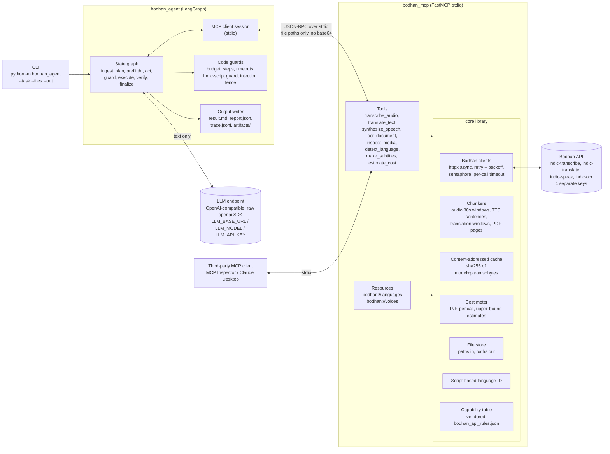
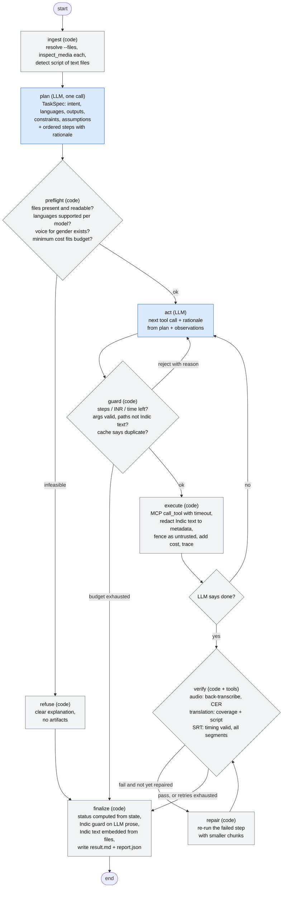
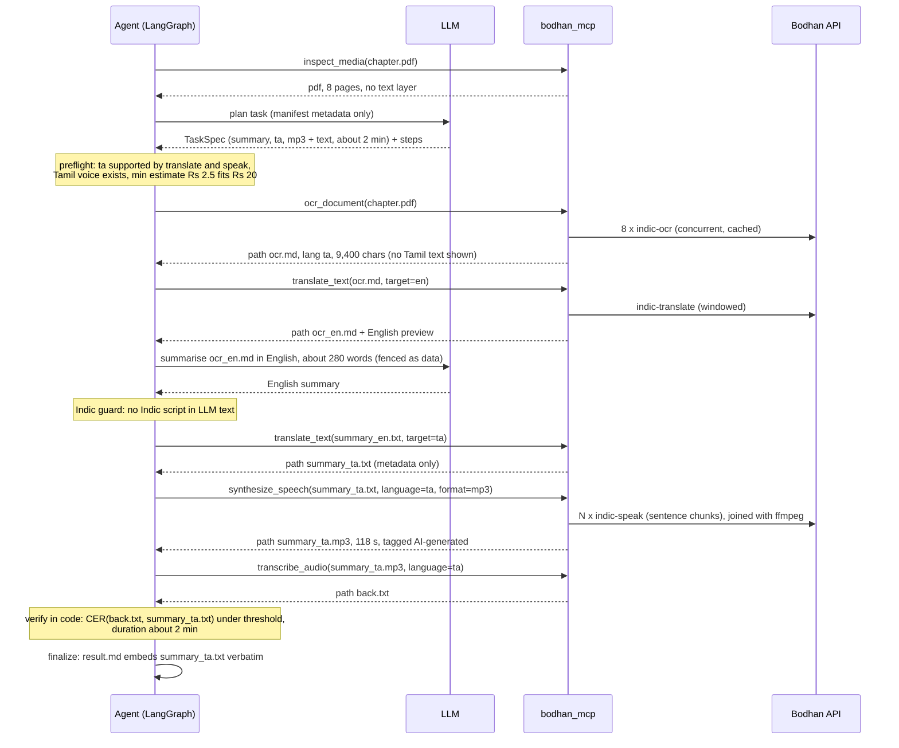

# Architecture

Two deliverables share one core library:

- **`bodhan_mcp`**: a standalone MCP server over stdio that wraps the four Bodhan models as tools.
- **`bodhan_agent`**: a LangGraph agent that connects to that same server as an ordinary MCP client.

Model limits, caching, retries and cost accounting live inside the server. Budgets, safety checks, verification and the final status live in agent code. The LLM only understands the task, plans, picks tools and writes English. It never sees Indian-language text, images or audio.

---

## 1. System overview



| Part | One line |
|---|---|
| CLI | Parses the required flags (plus optional extras) and starts the graph, which spawns the server as a subprocess. |
| LangGraph state graph | Explicit nodes: LLM nodes decide, code nodes check and enforce. |
| MCP client session | The agent uses the same tool descriptions any third-party client sees, so the tool docs get exercised on every run. |
| Code guards | Hard limits the LLM cannot talk its way around. |
| FastMCP server | Typed Pydantic inputs and outputs. Never raises to the client; always returns `{code, message, hint}`. Logs go to stderr only (stdout carries the protocol). |
| core | All Bodhan I/O, chunking, caching, cost. The only module that talks to `api.bodhan.ai`. |

---

## 2. Agent graph (LangGraph)

Blue nodes call the LLM. Grey nodes are plain code. The LLM never decides whether the run succeeded.



Understanding and planning are **one LLM call**, so a single-step task costs about three LLM round trips (plan, act, done) and stays under the 30-second target.

**State carried through the graph** (one `TypedDict`): `task`, `manifest`, `spec`, `plan`, `messages`, `artifacts`, `cost_inr`, `steps`, `llm_turns`, `deadline`, `verifications`, `assumptions`, `status`.

Repair is deliberately code-driven: a failed speech check re-synthesises with smaller requests (re-split, so it is new input, never a resend); a failed translation check re-translates with smaller windows. One repair per output, budget permitting.

---

## 3. Example flow: "Two-minute Tamil audio summary of this 8-page scanned PDF"

Everything pivots through English. The LLM never reads or writes Tamil.



---

## 4. Tool list (MCP server)

| Tool | Wraps | Limit handled inside |
|---|---|---|
| `transcribe_audio(path, language?)` | indic-transcribe | Any length or format (wav, mp3, m4a, mp4 audio track): ffmpeg converts to 16 kHz mono, cuts windows of at most 30 s at silences, stitches the text, returns timed segments and the detected script |
| `translate_text(path or text, target_language, source_language?, script="native", format="auto")` | indic-translate | One tool; `script="roman"` gives romanised output. Windows of about 600 input tokens; a `finish_reason` of `length` triggers a re-split. `format` is `auto`, `plain` or `markdown`. In markdown mode, code parses the document and translates only text runs (paragraphs, headings, list items, table cells) in batched windows, then reassembles it, so tables and pipes survive |
| `synthesize_speech(path or text, language, gender?, voice?, style?, format="mp3")` | indic-speak | Splits by sentence into requests of at most about 200 characters (the API silently cuts audio at about 30 s), concatenates, converts to mp3 or wav, writes `AI-generated (Bodhan Indic-Speak)` into the file metadata |
| `ocr_document(path, pages?)` | indic-ocr | PDF rendered page by page to PNG with pypdfium2 (render only, the text layer is never read); images resized to API limits; pages run concurrently; returns Markdown |
| `transliterate_text(path or text, language, target_script)` *(optional key)* | indic-transliterate | Same language, different script (native to roman or back). Documented params `target_language_code` / `target_script`. Without `BODHAN_TRANSLITERATE_KEY` it returns `MISSING_API_KEY` |
| `inspect_media(path)` | ffprobe / pypdfium2 | Type, duration, pages, size, codec |
| `detect_language(path or text)` | Unicode script ranges | Script plus candidate languages; flags ambiguity (Devanagari: hi, mr, ne, ...) |
| `make_subtitles(segments_path, translate_to?)` | code, plus indic-translate | The API returns no timestamps, so cue times come from our own silence-based segmentation in `transcribe_audio` (each window's start and end are known). Translation per segment keeps the timings |
| `estimate_cost(operation, path or chars or seconds)` | code | Upper-bound INR estimate so callers can budget before spending |

**Contract:** every tool returns `{ok, result_path?, preview, meta, cost_inr, cached}` or `{ok: false, error: {code, message, hint}}`. Error codes: `FILE_NOT_FOUND`, `UNSUPPORTED_FORMAT`, `UNSUPPORTED_LANGUAGE`, `INPUT_TOO_LARGE`, `BUDGET_EXCEEDED`, `UPSTREAM_RATE_LIMIT`, `UPSTREAM_ERROR`, `TIMEOUT`, `MISSING_API_KEY`. Descriptions state accepted formats, language codes, limits and cost so a third-party client needs nothing else. Relative paths resolve against the server's working directory; outputs go to `BODHAN_MCP_WORKDIR` (default `./bodhan_mcp_out`).

**Why this granularity:** one tool per *capability*, not per raw endpoint, because the brief requires limits to be handled inside tools. The tools are not task-level macros, because those would hide control and edge toward demo-specific logic. Helpers exist only where the LLM would otherwise guess (language, duration, cost).

---

## 5. Cross-cutting decisions

| Concern | Decision |
|---|---|
| API facts | Measured, not assumed: see [`probes/FINDINGS.md`](probes/FINDINGS.md). Translate, transliterate and OCR use `/v1/chat/completions` (translate: `target_language_code`, `target_script`); the Cookbook's `/translate` route is gone. No timestamps from transcribe. Silent truncation in transcribe (over 30 s), speak (over 30 s) and translate (`finish_reason: "length"`). Bad voice or style returns 500. |
| Input validation | Every tool validates language, voice, style, voice-language match, image decodability and non-empty text **before** calling, because the API either ignores bad values or answers with a 500. |
| Retries | `tenacity`, exponential backoff with jitter, max 4 attempts on 429, 502, 503, 504 and timeouts. A 500 is retried once at most (validation already passed). Never retries 400, 401 or 422, or a 429 meaning out of credit. The API sends no rate-limit headers. A 200 with an empty or `null` body counts as an error. Each attempt is traced. |
| Concurrency | `asyncio.Semaphore` per model (default 4). |
| Caching | Local content-addressed SQLite cache under `.cache/`. Survives reruns and doubles as test fixtures. A verification retry changes the chunking, so it is a new key; the same input never goes to the same model twice. |
| Budget | `--max-cost-inr` caps **Bodhan spend**. Before every call the guard checks an upper-bound estimate (translation output tokens bounded from the input), so the cap can't be crossed. LLM tokens are reported separately; this assumption is written into `report.json`. Preflight refuses if even the minimum plan cost exceeds the budget; running out mid-run stops cleanly with partial results. |
| Steps and time | One step = one tool call (`--max-steps`, default 30). LLM turns are capped at 2 × max steps to prevent loops. Per-call timeout `--call-timeout` (default 60 s) and wall clock `--max-seconds` (default 300). |
| LLM isolation | Messages to the LLM are text only (asserted in code). Indian-language text is replaced by metadata (`{lang, chars, path}`), so the LLM reasons only over English produced by Bodhan. Summarising Hindi straight into English would be the LLM translating, which is banned. |
| Indic guard | Rejects Indic Unicode in any LLM-authored string: tool arguments (Indic content must be passed by path), the summary, `result.md` prose. Indian-language text in outputs is copied verbatim from artifact files by code. |
| Untrusted content | OCR and transcript text reach the LLM only inside `<untrusted_data>` fences under a fixed system rule; injected text cannot change budget, tools or status. |
| Language ID | Script and character set only (the only kind allowed). Audio language comes from transcribing then checking the script. Ambiguous cases (Hindi vs Marathi) become recorded assumptions. No ML language-ID libraries. |
| Supported languages | Checked per model against the vendored `bodhan_api_rules.json` (a test keeps it in sync with the Cookbook copy). Never hard-coded per task. |
| Banned systems | No other ASR, MT, TTS or OCR anywhere, even as a fallback. Never use FFmpeg's `whisper` filter; pypdfium2 is used for rendering only. A test fails the build if a banned package (whisper, pytesseract, easyocr, indictrans, cloud speech or vision SDKs) appears in the dependencies or imports. |
| Secrets | Required: `BODHAN_TRANSCRIBE_KEY`, `BODHAN_TRANSLATE_KEY`, `BODHAN_SPEAK_KEY`, `BODHAN_OCR_KEY`, `LLM_BASE_URL`, `LLM_MODEL`, `LLM_API_KEY`. Optional: `BODHAN_TRANSLITERATE_KEY`, `LLM_EXTRA_BODY`. A missing required variable fails fast with a message naming it. The trace redacts headers and env. `.env.example` mentions `BODHAN_API_KEY` in a comment only, for the Cookbook validator. |
| LLM portability | One code path: the `openai` SDK, Chat Completions, `base_url=LLM_BASE_URL`, `model=LLM_MODEL`, `api_key=LLM_API_KEY`. Any OpenAI-compatible provider works (OpenAI, Anthropic's compatibility endpoint, OpenRouter, a local vLLM or Ollama). Only portable fields are sent: `messages`, `tools`, `tool_choice="auto"`. No `temperature`/`top_p` (Claude 4.7+ rejects non-defaults), no forced `tool_choice` (Sonnet/Opus 5.5 reject it), no `response_format`, no `strict` (Anthropic ignores it, so we validate arguments with Pydantic ourselves). Provider-specific knobs go in an optional `LLM_EXTRA_BODY` JSON (for example `{"reasoning_effort": "none"}`, which gpt-6-luna needs for function calling on Chat Completions). Structured output (the plan) is a tool call validated in code and re-asked once. Tested with `gpt-6-luna` and `claude-sonnet-5-5`. |
| AI-generated label | Audio metadata tag, plus a line in `result.md` and `report.json`. |

---

## 6. Output contract

```
out/
  result.md      what was done, final answer, assumptions, links (Indic text embedded from files)
  artifacts/     mp3/wav, srt, md, txt
  trace.jsonl    one line per event: run_start, plan, llm_call, tool_call (args, result summary,
                 latency_ms, cost_inr, cached, attempt, rationale), verify, guard_reject, final summary
  report.json    status (completed | partial | refused | budget_exhausted | failed), steps,
                 verification results, cost per model and total, latency, assumptions,
                 quality_targets (each target: met or missed, and why), duplicate_calls
```

---

## 7. Recipe folder layout

```
examples/indic_task_agent/
  README.md (## Setup, ## Run), ARCHITECTURE.md, DESIGN_NOTES.md
  pyproject.toml, requirements.txt (pinned, ends with "-e ."), .env.example, .gitignore, Dockerfile
  src/bodhan_mcp/      the MCP server (python -m bodhan_mcp)
    server.py            the 10 tools and 2 resources, typed and described; errors become JSON, never crashes
    tools.py             tool logic: windows, chunks, pages, re-splits, verification metadata
    client.py            Bodhan HTTP client: keys, error codes, redaction, retries, cache
    catalog.py           supported languages, voices and prices (data/bodhan_api_rules.json)
    files.py             file store, ffmpeg audio, PDF/image pages
    text.py              chunking, Markdown tables, script detection, similarity
  src/bodhan_agent/    the task agent (python -m bodhan_agent)
    __main__.py          CLI
    graph.py             the LangGraph loop and run_task
    checks.py            guards (Indian-language text, injection) and output verification
    llm.py               configuration, LLM client, MCP tool client
    prompts.py           system prompts, plan schema, agent-local tools
    report.py            trace.jsonl, report.json, result.md
  tests/               tools, client, server, agent end-to-end, compliance (banned deps, secrets)
  probes/              probe_api.py (live API probes) and FINDINGS.md
  evals/               self-eval task suite with pass rate
  demo/                committed traces, result.md and report.json per demo task (no media)
  sample_data/ outputs/   git-ignored, .gitkeep; media linked from the README
```

Setup is one command: `pip install -r requirements.txt`. The validator skips lines starting with `-`, so `-e .` is allowed.

---

## 8. Compliance checklist (brief to design)

| Brief requirement | Where it's handled |
|---|---|
| Tools for STT, translation, TTS, OCR plus helpers | Section 4 |
| Model limits handled inside tools | Section 4, Limit column |
| Typed I/O, clear descriptions, actionable errors, media by reference | Section 4 Contract; file store |
| `--task --files --out [--max-steps] [--max-cost-inr]` | CLI; extra flags are optional |
| Verify outputs before finishing | verify node |
| Budgets: steps, INR, per-call timeouts; stop cleanly | guard node, Section 5 Budget and Steps |
| Trace of every step plus final summary | Section 6 |
| Server runs alone over stdio | `python -m bodhan_mcp` |
| Unknown language detected, assumptions recorded | detect_language, Language ID, `assumptions` |
| Recovery: rate limits, timeouts, partial failures, Speak repeat/omit | Retries, verify-then-repair, partial status |
| Cost control and caching | Cache, Budget |
| Untrusted content treated as data | Untrusted content, LLM isolation |
| Impossible tasks end in an explanation | preflight and refuse |
| All ASR/MT/TTS/OCR via Bodhan | core is the only caller; banned-deps test |
| LLM never writes Indic text or reads images/audio | LLM isolation, Indic guard |
| LLM from `LLM_BASE_URL`, `LLM_MODEL`, `LLM_API_KEY` | LLM portability |
| Keys only from the four `BODHAN_*_KEY` | Secrets |
| Generated audio labelled AI-generated | AI-generated label |
| No demo-specific logic | Generic tools plus TaskSpec; no task branches |
| Pinned one-command setup, ffmpeg documented, Dockerfile | Section 7 |
| Structured errors, never crash the client | Contract; handler wrapper |
| Retries with backoff, concurrency limit | Section 5 |
| Replayable trace | `rationale` on every step |
| Unit tests per tool plus one e2e test | tests/ |
| Architecture diagram, flow chart, design notes, video, at least 6 demo tasks | this file, DESIGN_NOTES.md, README |
