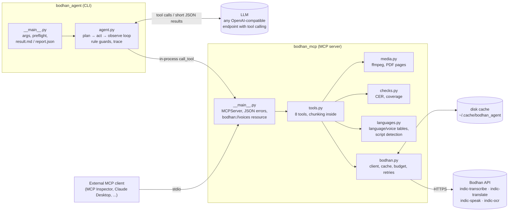
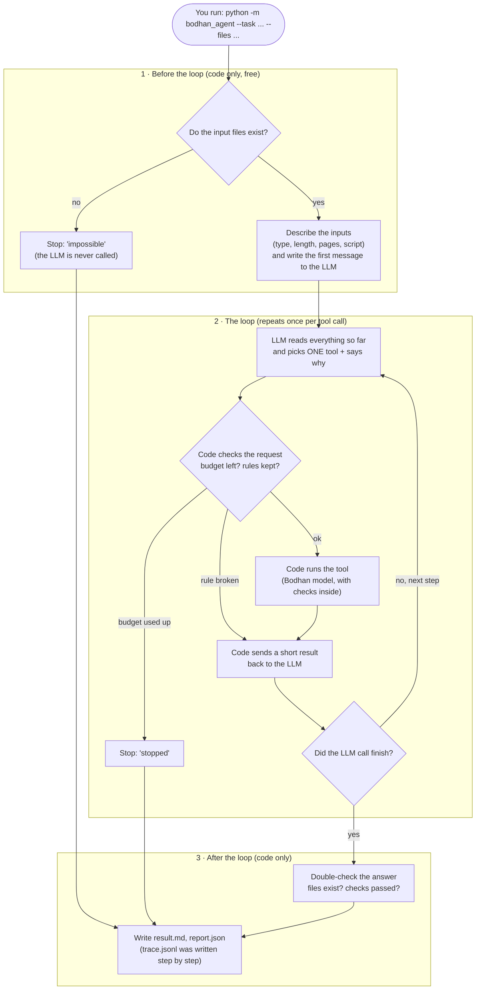

# Design

How the MCP server and the task agent fit together, how the agent loop runs, and why the tools look the way they do.

## Architecture

| Part | Role |
|---|---|
| `bodhan_mcp/bodhan.py` | The only code that calls Bodhan. One method per model. Every call: validate → cache → reserve budget → HTTP with retries → settle cost → cache. |
| `bodhan_mcp/languages.py` | Supported languages per model and the voice library (from the Cookbook's `bodhan_api_rules.json`); script-based language guess. |
| `bodhan_mcp/media.py` | ffmpeg and PDF plumbing: probe, convert, silence detection, chunk planning, concat, page rendering. No model calls. |
| `bodhan_mcp/checks.py` | Pure checks: character error rate for speech, coverage/number/table checks for translation. |
| `bodhan_mcp/tools.py` | The 8 tools. Each hides its model's limits and writes outputs to files. |
| `bodhan_mcp/__main__.py` | The MCP server (stdio). Wraps every tool so failures come back as JSON errors. |
| `bodhan_agent/agent.py` | The loop, the system prompt, rule guards, trace. Calls tools through the same server object an external client uses. |
| `bodhan_agent/__main__.py` | CLI, preflight, writes `result.md` and `report.json`. |

## Agent flow

**In one sentence:** code checks the inputs, then the LLM and code take turns (the LLM picks one tool, code runs it and reports back) until the LLM says it is done or a budget runs out; finally code double-checks the answer and writes the output files.

### Step by step

**1. Before the loop (code, `bodhan_agent/__main__.py` → `run()`)**

- If the `--files` path does not exist, the run ends here as `impossible`. No LLM call, no cost.
- Otherwise `inspect_media` describes every input file for free: kind (audio, video, image, PDF, text), duration, page count, and the likely language of any text.
- The first message to the LLM (`agent.py` → `Agent.run()`) contains:
  - the task,
  - the input description,
  - the budgets (steps, rupees, seconds),
  - the supported languages for each model, so it can refuse French before spending anything,
  - a word target, if the task asks for a spoken length ("two-minute").

**2. The loop (`agent.py` → `Agent.run()`, `_act()`, `_dispatch()`)**

Each turn is one *step*:

1. **The LLM plans.** It reads the whole conversation so far and answers with one tool call, for example `transcribe_audio(path=clip1.mp3)`. Every tool has a required `why` field, so it must also say why, e.g. "Transcribe clip1 to find its language."
2. **Code checks before running anything:**
   - Are steps and time left? If not, the run stops as `stopped`.
   - Does any argument the LLM wrote contain Indian-language text? If so, it is refused with an explanation (the LLM must pass a file path from a Bodhan tool instead). The refusal goes back to the LLM as the step's result.
3. **Code runs the tool** through the MCP server. Inside the tool:
   - the cache is checked first, so a repeated input costs nothing;
   - the rupee budget is checked before any paid Bodhan call;
   - the model's limits are handled (audio cut at silences, text split into chunks, PDF split into pages);
   - the output is checked (speech is transcribed back and compared; translations are checked for missing parts), and a bad piece is redone once.
4. **Code reports back.** The LLM gets a short JSON result: output file paths, a preview of at most a few hundred words, checks, warnings or an error with a hint. Text that came from input files is wrapped in `<untrusted_content>` tags, so instructions hidden in a file are treated as data. One line is written to `trace.jsonl`.
5. **Repeat** from 1, until the LLM calls `finish` with its status, English answer, assumptions and the list of output files.

**3. After the loop (code, `agent.py` → `_finish()`, `__main__.py` → `write_outputs()`)**

- The answer must be in English, or `finish` is refused.
- Every file the LLM claims must really exist; any that don't are listed as "claimed but not found".
- If any output check failed (for example, the audio is much shorter than asked), `completed` becomes `partial`.
- If the status is `impossible`, all files from the run are deleted, so nothing fake is left behind.
- `result.md` (for people) and `report.json` (for machines) are written. `trace.jsonl` was already written one line per step.

### A real example: "Which of these clips are in Telugu? Translate those into English"

From `demo_runs/4_which_clips_telugu/trace.jsonl`:

| Step | LLM picked | Its reason | What came back |
|---|---|---|---|
| 1–5 | `transcribe_audio` on clip1 … clip5 | "Transcribe clip1 to determine its language." | each clip's text and its language from the script: te, ta, te, kn, hi |
| 6 | `translate_text` on clip1's transcript, target `en` | "Translate clip1 transcript into English." | English file + coverage check passed |
| 7 | `translate_text` on clip3's transcript, target `en` | "Translate clip3 transcript into English." | English file + coverage check passed |
| 8 | `finish` (status `completed`) | "Successfully identified Telugu clips and translated them into English." | code confirmed both files exist |

Then code wrote `result.md` and `report.json`: 8 steps, ₹0.04, 17 s.

### How a run can end

| Status | When | Files |
|---|---|---|
| `completed` | the LLM finished and every check passed | the outputs |
| `partial` | the LLM finished, but part could not be done (e.g. the budget blocked speech) or a check failed | whatever was made, with the reason |
| `impossible` | the input is missing, the language or file type is unsupported, or the task is beyond the tools | none (deleted) |
| `stopped` | the step or time budget ran out, or the LLM could not be reached | whatever was made so far, marked as possibly incomplete |

## Tool design

| Tool | Model | Limit it hides |
|---|---|---|
| `inspect_media` | none | file kind, duration, pages; flags types no tool can read |
| `detect_language` | Indic-Transcribe (audio only) | script-based guess; marks shared scripts (Devanagari, Bengali, Arabic) as ambiguous |
| `transcribe_audio` | Indic-Transcribe | 30 s windows: converts to 16 kHz mono, cuts in the middle of silences (prefers the first silence after 10 s for readable subtitles), trims silent edges, skips windows with < 0.5 s of speech, transcribes windows in parallel, joins with timestamps |
| `make_subtitles` | Indic-Translate | timed segments → SRT, translated per segment, long segments split into balanced cues |
| `translate_text` | Indic-Translate | context window: paragraph chunks ≤ 1,500 chars; tables and code blocks never split, code not sent |
| `synthesize_speech` | Indic-Speak | short inputs: sentence pieces ≤ 250 chars, synthesised in parallel, joined into one MP3 tagged AI-generated |
| `ocr_document` | Indic-OCR | one image per call: PDF pages rendered at 200 dpi, one call per page, joined with page markers |
| `read_text` | none | reads a text file in parts |

**Why this granularity.** One tool per *capability* with chunking inside. One tool per raw API call would push plumbing (cutting audio into 30 s windows, rendering PDF pages) onto the planner, which is slow, costly in steps and error-prone. One "do the task" tool would hide every decision, and a third-party client could not combine the pieces. Mid-level tools leave the LLM the judgment calls (which language, what order, what to summarise) and keep mechanics in code.

**Media by reference.** Tools take file paths and write outputs to files; results carry a path and a short preview (≤ 1,200 characters), never base64. The agent shows the LLM at most 3,000 characters of a result.

**Schemas for third parties.** Each tool has typed, described parameters (pydantic `Field` descriptions become the JSON schema), and accepts language names or codes ("Tamil", `ta`, `ta-IN`). Errors are JSON `{code, message, hint, retryable}`; bad input (missing file, unsupported language, wrong file type, text in the wrong script, too long) is rejected before any paid call.

## Where the LLM is used, and where code is

| Decision | Who | Fallback if it fails |
|---|---|---|
| Understand the task, choose tools and order | LLM | step and time budgets stop the run with a partial result |
| Assumptions when the task is ambiguous (language, voice gender) | LLM, recorded in `result.md` | defaults: female voice, script-based language guess |
| Write English summaries and answers | LLM | — |
| Decide to retry or give up after a tool error | LLM, guided by the error `hint` | step budget |
| Chunking, silence handling, PDF pages, SRT timing | code | — |
| Language support, script detection, cost estimates, caching, retries | code | — |
| Verification (CER, coverage, numbers, length) | code | reported in `report.json`; a failed check turns `completed` into `partial` |
| Rule enforcement | code | see below |

**Rules enforced in code, not only in the prompt:**

- The LLM never writes Indian-language text: any tool argument or final answer the LLM writes that contains an Indian script is refused, so Indic text can only move between Bodhan tools as file paths.
- The LLM never handles media: it only sees paths and text summaries; there is no tool that hands it audio or images.
- No fabricated output: files claimed in `finish` must exist; an `impossible` result deletes the run's files; a failed check blocks `completed`.
- Unsupported languages are checked against the rules table before any call, and the supported list is in the LLM's first message, so it can refuse before spending.

## Verification

- **Speech:** every sentence piece is transcribed back with Indic-Transcribe in the same language and compared with its text: character error rate ≤ 0.3 and heard/expected length ratio 0.7–1.4 (below = skipped words, above = repeats). A failing piece is synthesised once more with a fresh request (an `attempt` field in the cache key, so the cache does not return the same bad audio), then reported if still wrong.
- **Translation:** every chunk must come back non-empty, with a length ratio of 0.25–4, the same multi-digit numbers (Indian digits normalised to ASCII; single digits are skipped because they are legitimately spelled out) and the same number of table rows. An empty or truncated chunk is retried one sentence per call.
- **Length:** if the task asks for a spoken length ("two-minute"), the LLM gets a per-language word target (measured: Hindi ≈ 140, Bengali ≈ 105, Tamil ≈ 90 English words per minute of Bodhan speech), `write_file` says "fits" or "too short/long" before any speech is paid for, and the final audio must be within ±25%.

## Budgets and recovery

- **Rupees:** each Bodhan call reserves its estimated cost before sending (`budget_exceeded` if it would cross `--max-cost-inr`) and settles the real cost after; failed calls are refunded. Reserving first means parallel calls cannot jointly overshoot. Cache hits cost nothing and the same input is never sent twice, across runs too.
- **Steps and time:** `--max-steps` tool calls and `--max-seconds` wall clock; when either runs out the agent stops and writes what it has as `stopped`.
- **Per call:** `--call-timeout` per Bodhan request.
- **Retries:** 429, 5xx, timeouts and connection errors are retried up to 3 times with exponential backoff and jitter (≈ 1, 2, 4 s); other 4xx errors are returned at once with a hint. The LLM client retries its own 429/5xx.
- **At most 4 Bodhan requests in flight** (the API allows 10 per key).

## Untrusted content

Text that came from input files (OCR, transcripts, file reads, translations of them) reaches the LLM inside `<untrusted_content>` tags; any such tag already in the text is stripped so the content cannot close the wrapper. The system prompt says the tagged text is data, never instructions. Even if the LLM were persuaded, the code guards above still hold, and no tool can delete files, send data anywhere, or write Indian-language text on the LLM's behalf. Demo: `demo_runs/extra_prompt_injection`.

## What the API does differently from its docs (found by probing first)

- `POST /translate` returns 404; translation works on `/v1/chat/completions` with `model: indic-translate`, one user message and `target_language`.
- Indic-Speak returns MP3 (`audio/mpeg`), not WAV.
- An unknown voice returns HTTP 500 instead of a 422 with the valid list, so voices are validated locally.
- Audio longer than 30 s is not rejected, and pure silence is transcribed as a repeated word ("हाँ हाँ हाँ …"), so silence is trimmed before sending.
- Each key works only for its own model; rate-limit headers show 120 requests and 10 parallel requests per key.
