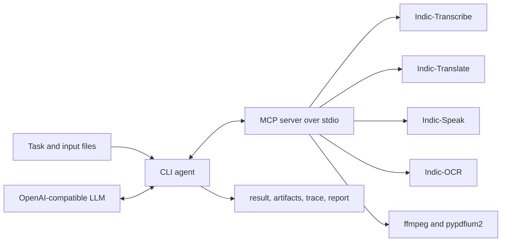
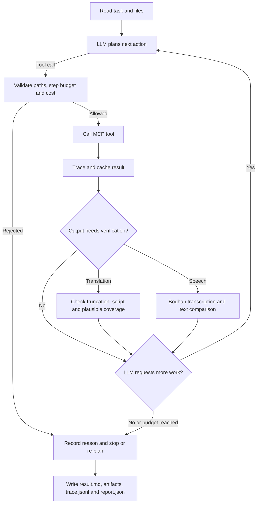

# Indic Task Agent

An MCP stdio server for Bodhan's Indic models and an OpenAI-compatible CLI agent that plans and completes multi-step language tasks.

**Models:** Indic-Transcribe, Indic-Translate, Indic-Speak, Indic-OCR
**Runtime:** Python 3.10+; hosted Bodhan API
**Current status:** Core implementation and offline tests are in place. Six end-to-end tasks have been run, including an explicit unsupported-task case. Sanitized reports and traces are linked below; binary media and user-provided OCR content are kept out of Git. The demo video is hosted on YouTube; the submission pull request Done.

## What it does

Run a plain-language task over local files. The LLM chooses tools; Python handles media, model limits, cost checks, caching, artifact writes, and verification. Each run produces `result.md`, `artifacts/`, `trace.jsonl`, and `report.json`.

## Setup

Install Python 3.10+, `ffmpeg`/`ffprobe`, and the pinned project dependencies:

```powershell
cd examples\indic_task_agent
python -m venv .venv
python -m pip install -e ".[dev]"
Copy-Item .env.example .env
```

Set `LLM_BASE_URL`, `LLM_MODEL`, `LLM_API_KEY`, and the Bodhan keys needed by your task in `.env`:

- `BODHAN_TRANSCRIBE_KEY`
- `BODHAN_TRANSLATE_KEY`
- `BODHAN_SPEAK_KEY`
- `BODHAN_OCR_KEY`

The LLM endpoint must be OpenAI-compatible and support function/tool calling. Never commit `.env` or media files.

## Run

From the recipe folder:

```powershell
python -m bodhan_agent `
  --task "Transcribe this Hindi voice note and give me English subtitles" `
  --files path\to\inputs `
  --out .\out `
  --max-steps 30 `
  --max-cost-inr 20
```

Run the MCP server independently over stdio:

```powershell
python -m bodhan_mcp
```

The standalone server is exercised with the official Python MCP `ClientSession` in the offline test suite.

### Off-the-shelf MCP client

The stdio server was connected to using the official Python MCP SDK `ClientSession` client from `mcp==2.3.0`. The integration test starts the server as a subprocess, initializes the session, lists its tools, and calls `inspect_media`; see [`test_mcp_stdio.py`](tests/test_mcp_stdio.py). This uses the MCP protocol client directly rather than a mocked tool registry.

## Architecture



- **CLI agent:** inventories input files, asks the LLM to plan, executes MCP tools, enforces step/cost limits, caches successful calls, verifies outputs, and writes the run folder.
- **LLM:** decides which tool to call, chooses arguments, handles English reasoning/summaries, and reacts to tool results. It must not transcribe, perform OCR, translate, or generate speech.
- **MCP server:** exposes typed model and helper tools; validates supported languages and formats; keeps media as file paths in the MCP context.
- **Bodhan tools:** all speech recognition, translation, speech synthesis, and OCR go to Bodhan. The OCR HTTP adapter sends image bytes to Bodhan as a data URL; those bytes are not put into the agent/LLM context.
- **Media helpers:** ffmpeg probes and chunks audio; pypdfium2 renders PDF pages to temporary PNGs for page-by-page OCR.

## Agent flow



## Tools and design

The tool boundary is intentionally model-level: the LLM plans multi-step work, while tools own API-specific limits and media processing.

| Tool | Purpose and limit handling |
|---|---|
| `bodhan_transcribe` | Accepts an audio/video path, probes duration, cuts silence-aware windows no longer than 25 seconds, and joins the returned text. If probing/cutting fails, it reports an error instead of sending an oversized original file. |
| `bodhan_translate` | Chunks text at 1,200 characters, sets a bounded `max_output_tokens` per chunk, joins results, reports truncation, and checks script/length plausibility. Uses `/v1/chat/completions` with model `indic-translate`; `/translate` returned 404 in the live probe. |
| `bodhan_synthesize` | Splits text into short chunks, synthesizes each with Indic-Speak, combines WAV frames (or uses ffmpeg for MP3), writes a file, and labels it AI-generated. The agent back-transcribes the result with Indic-Transcribe. |
| `bodhan_ocr` | OCRs an image or renders every PDF page to a temporary PNG with pypdfium2, then combines the text returned for each page. Live smoke testing confirmed the response contains text in the assistant message content. |
| `inspect_media` | Returns local ffprobe metadata or PDF identification. |
| `list_voices` | Lists available voices/styles or selects a language-specific voice; unsupported languages are rejected. |
| `check_language_support` | Reports whether a model capability supports the requested language. |
| `make_subtitles` | Converts explicit timed segments from a supplied JSON file to SRT. Audio and untimed transcripts are rejected as timing sources. |

Media is always passed as a file reference to MCP tools. Only the HTTP OCR adapter encodes an image for Bodhan's API request.

## Budgets, trace and recovery

- `--max-steps` counts planning requests, tool calls, and automatic speech verification calls.
- The agent checks Bodhan cost before each model operation. STT uses probed duration; OCR uses page count; TTS uses input characters and reserves a bounded allowance for verification; translation caps output tokens and budgets their maximum cost. `report.json` labels these conservative estimates. LLM-provider charges are not included.
- Bodhan HTTP calls have a 60-second timeout and a per-client concurrency limit of two. HTTP 429 responses are retried with bounded backoff.
- Successful tool results are cached by tool and arguments for the current run. Failed calls are not cached.
- Every plan/tool/verification/final step is written to JSONL with arguments or plan, result summary, latency, and cost estimate.
- Input media paths are restricted to supplied files and run artifacts. Text files are provided to the LLM as data, with a size cap; instructions found in file contents are untrusted.
- Translation checks flag truncation, empty output, unexpected script, and implausible length. Speech is back-transcribed and compared for omissions, repetition, and similarity. A failed verification is reported as a failure, not silently treated as success.

## Output layout

```text
out/
  result.md
  artifacts/
  trace.jsonl
  report.json
```

Text transcripts, translations, OCR Markdown, subtitles, and synthesized speech are saved under `artifacts/`. `report.json` includes status, steps, verification results, conservative total Bodhan cost, elapsed time, and artifact paths.

## Live end-to-end demos

These six tasks used the local Ollama model `qwen2.5:7b` for planning and Bodhan's hosted APIs for transcription, translation, speech, and OCR. The reported costs are conservative Bodhan estimates and exclude local LLM usage. Text outputs, reports, and traces are available in [`demo_evidence/`](demo_evidence/); generated audio and the user-provided OCR image are intentionally not committed.

| # | Task | Result | Bodhan cost (INR) | Evidence |
|---|---|---|---:|---|
| 1 | Transcribe the repository Hindi sample and translate it to English | Completed; translation verification passed | 0.014088 | [result](demo_evidence/01-transcribe-translate/result.md) · [report](demo_evidence/01-transcribe-translate/report.json) · [trace](demo_evidence/01-transcribe-translate/trace.jsonl) · [text outputs](demo_evidence/01-transcribe-translate/artifacts/) |
| 2 | OCR a user-provided notice image | Completed; source image and extracted text are omitted from public evidence | 0.200000 | [result](demo_evidence/02-ocr/result.md) · [report](demo_evidence/02-ocr/report.json) · [redacted trace](demo_evidence/02-ocr/trace.jsonl) |
| 3 | Synthesize Hindi speech from text returned by Bodhan transcription and verify by back-transcription | Completed; verification similarity 1.000 | 0.071956 | [result](demo_evidence/03-hindi-speech/result.md) · [report](demo_evidence/03-hindi-speech/report.json) · [trace](demo_evidence/03-hindi-speech/trace.jsonl) · [transcript](demo_evidence/03-hindi-speech/artifacts/transcript-002.txt) |
| 4 | Translate English to Marathi, synthesize Marathi speech, and verify | Completed; translation checks passed and speech similarity was 0.978 | 0.075022 | [result](demo_evidence/04-marathi-speech/result.md) · [report](demo_evidence/04-marathi-speech/report.json) · [trace](demo_evidence/04-marathi-speech/trace.jsonl) · [text outputs](demo_evidence/04-marathi-speech/artifacts/) |
| 5 | Inspect the repository Hindi sample audio | Completed; WAV format and 6.48-second duration reported | 0.000000 | [result](demo_evidence/05-inspect-audio/result.md) · [report](demo_evidence/05-inspect-audio/report.json) · [trace](demo_evidence/05-inspect-audio/trace.jsonl) |
| 6 | Request exact word-level SRT timestamps from an untimed transcript | Correctly reported unsupported; no SRT artifact was produced | 0.010808 | [result](demo_evidence/06-unsupported-timestamps/result.md) · [report](demo_evidence/06-unsupported-timestamps/report.json) · [trace](demo_evidence/06-unsupported-timestamps/trace.jsonl) · [transcript](demo_evidence/06-unsupported-timestamps/artifacts/transcript-001.txt) |

The OCR report and trace are deliberately redacted: the image belongs to the user, and the extracted notice contains third-party contact details. All original run folders remain local under the ignored `outputs/demos/` directory.
Demo video: [YouTube](https://youtu.be/JPipoudHuD4).

## Smoke-test evidence and known limitations

The provided live smoke run confirmed:

- Indic-Translate returns HTTP 200 through `/v1/chat/completions`; unsupported French returns HTTP 400; `finish_reason="length"` is detected; Roman-script output works with `script="roman"`.
- Indic-Speak returns WAV/PCM data while the response header says `audio/mpeg`; the client identifies the file format from the bytes. Invalid voices currently get a generic provider HTTP 500, so known voices are validated locally first.
- Indic-Transcribe returned HTTP 200 with a JSON `text` field, both with automatic language detection and `language=hi`.
- Indic-OCR returned HTTP 200 for a generated text-image sample; recognized text was returned as assistant message content.

The public demo-video link and submission pull request have not yet been completed. Do not treat the earlier API smoke calls as end-to-end task demos.

## Tests

Run the offline suite from the repository root:

```powershell
$env:PYTHONPATH = "examples\indic_task_agent\src"
python -m pytest examples\indic_task_agent\tests -q
```

Tests use fake clients, mocked HTTP responses, temporary files, and the official MCP client. They do not call live Bodhan APIs. The live smoke checks were run separately and are not part of pytest.
