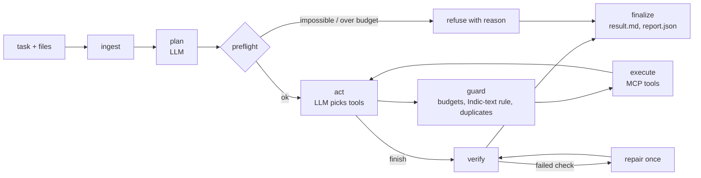

# Indic task agent

> An MCP tool server for Bodhan's Indic speech, translation and OCR models, plus a task agent that plans, calls those tools, checks its own work and writes the results.

**Bodhan models:** indic-transcribe, indic-translate, indic-speak, indic-ocr (+ optional indic-transliterate)
**Languages shown:** Tamil, Hindi, Marathi, Telugu, Bengali (all 22 supported languages work without code changes)
**Format:** CLI app (`python -m bodhan_agent`) + MCP server (`python -m bodhan_mcp`)

**Contents:** [What it does](#what-it-does) · [Setup](#setup) · [Run](#run) · [Tools](#tools) · [How it works](#how-it-works) · [Demo tasks and results](#demo-tasks-and-results) · [Demo video](#demo-video) · [Test inputs](#test-inputs) · [Limitations](#limitations) · [Documentation](#documentation)

## What it does

Give it a plain-language task and some files: a scanned PDF, a voice note, a photo of a worksheet, audio clips or a text file. For example: *"Make a two-minute Tamil audio summary of this chapter"*, or *"Transcribe this Hindi voice note and give me English subtitles"*. The agent plans with any OpenAI-compatible LLM and calls Bodhan's models through the MCP server. It then verifies the outputs (for example, it transcribes generated speech back to text and compares) and writes `result.md`, the output files, a step-by-step `trace.jsonl` and a `report.json`. Tasks it cannot do, such as unsupported languages, missing files or too small a budget, end with a clear explanation and no made-up output.

The MCP server also runs on its own, so any MCP client can use the tools without this agent.

Every speech-recognition, translation, speech-synthesis and OCR step goes to a Bodhan model. The LLM only plans, picks tools and writes English. It never reads or writes Indian-language text, and never transcribes audio or reads images.

## Setup

Needs Python 3.11+ and **ffmpeg** (with ffprobe) on your PATH: `winget install ffmpeg`, `brew install ffmpeg` or `apt install ffmpeg`.

```bash
# macOS / Linux
cd examples/indic_task_agent
python -m venv .venv
source .venv/bin/activate
pip install -r requirements.txt     # pinned deps + this package (-e .)
cp .env.example .env                # then fill in the keys
```

```bat
:: Windows (Command Prompt). In PowerShell use .venv\Scripts\Activate.ps1 and `Copy-Item` instead of `copy`.
cd examples\indic_task_agent
python -m venv .venv
.venv\Scripts\activate
pip install -r requirements.txt
copy .env.example .env
```

`.env` needs one Bodhan key per model, from [console.bodhan.ai](https://console.bodhan.ai): `BODHAN_TRANSCRIBE_KEY`, `BODHAN_TRANSLATE_KEY`, `BODHAN_SPEAK_KEY` and `BODHAN_OCR_KEY` (`BODHAN_TRANSLITERATE_KEY` is optional). It also needs an OpenAI-compatible LLM endpoint: `LLM_BASE_URL`, `LLM_MODEL`, `LLM_API_KEY`, plus the optional `LLM_EXTRA_BODY`. `.env.example` shows OpenAI (`gpt-6-luna`) and Anthropic (`claude-sonnet-5-5`) settings. No other secrets are read.

Optional settings: `BODHAN_CONCURRENCY` (parallel requests per model, default 4) and `BODHAN_CACHE_DIR` (response cache, default `.cache/bodhan_mcp`).

Or with Docker: `docker build -t indic-task-agent .` (usage is in the comments at the top of the [Dockerfile](Dockerfile)).

## Run

The agent:

```bash
python -m bodhan_agent \
  --task "Make a two-minute Tamil audio summary of this chapter" \
  --files sample_data/chapter_scanned.pdf \
  --out ./out \
  --max-steps 30 --max-cost-inr 20
```

`--files` takes files and/or folders (folders are read recursively). Optional extra flags: `--call-timeout` (seconds per tool call, default 180), `--max-seconds` (wall clock, default 600) and `--verbose`. Each run writes:

```
out/
  result.md      what was done, the answer, outputs (Indian-language text embedded from the files), assumptions
  artifacts/     audio, subtitles, Markdown, text
  trace.jsonl    one line per step: plan, LLM call, tool call (arguments, result summary, latency, cost, rationale), verification
  report.json    status, steps, verification results, cost per tool and total, quality targets met/missed
  work/          intermediate files from the tools
```

Statuses are `completed`, `completed_with_warnings`, `partial`, `refused`, `budget_exhausted` and `failed`. Code computes them from what actually happened; the LLM's own claims never set the status. The exit code is 1 only for `failed`.

The MCP server on its own (stdio):

```bash
python -m bodhan_mcp
```

Tested with **MCP Inspector**, an off-the-shelf MCP client. Run it with the virtual environment activated, so `python` is the one that has this package installed (otherwise the server exits with `No module named bodhan_mcp`):

```bash
npx @modelcontextprotocol/inspector python -m bodhan_mcp                               # web UI
npx @modelcontextprotocol/inspector --cli python -m bodhan_mcp --method tools/list     # lists the 10 tools
```

For Claude Desktop or Claude Code, add it as a stdio server. Use the full path to the virtual environment's `python` (`.venv/Scripts/python.exe` on Windows, `.venv/bin/python` elsewhere):

```json
{"mcpServers": {"bodhan": {"command": "/full/path/to/.venv/bin/python", "args": ["-m", "bodhan_mcp"],
  "env": {"BODHAN_TRANSCRIBE_KEY": "...", "BODHAN_TRANSLATE_KEY": "...", "BODHAN_SPEAK_KEY": "...", "BODHAN_OCR_KEY": "..."}}}}
```

Tests and self-evaluation:

```bash
pytest                          # 100 tests, no network: Bodhan and the LLM are faked
python evals/run_evals.py       # run every task in evals/tasks.json on your files in sample_data/ and report a pass rate
python probes/probe_api.py translate   # re-run a live API probe (see probes/FINDINGS.md)
```

## Tools

| Tool                                                                     | Model               | Handles inside the tool                                                                                                                                                                                                   |
| ------------------------------------------------------------------------ | ------------------- | ------------------------------------------------------------------------------------------------------------------------------------------------------------------------------------------------------------------------- |
| `transcribe_audio`                                                     | indic-transcribe    | Any length or format (video too): converts to 16 kHz mono, cuts at silences into windows of 25 s or less, writes the transcript and timed segments                                                                        |
| `translate_text`                                                       | indic-translate     | Windows of about 1,500 characters; re-splits a window the model truncates; `format=markdown` keeps headings and tables; `script` native/roman/codemix; skips the call when the text is already in the target language |
| `synthesize_speech`                                                    | indic-speak         | Sentence groups of 200 characters or less; re-splits if the ~30 s cap is hit; checks the voice and language; mp3/wav tagged as AI-generated                                                                               |
| `ocr_document`                                                         | indic-ocr           | Images and multi-page PDFs (rendered page by page, pages in parallel); Markdown with tables, plus layout blocks                                                                                                           |
| `make_subtitles`                                                       | indic-translate     | SRT from timed segments, translated per segment so the timings are kept                                                                                                                                                   |
| `transliterate_text`                                                   | indic-transliterate | Same language, different script (optional key)                                                                                                                                                                            |
| `inspect_media`, `detect_language`, `read_text`, `estimate_cost` | none (free)         | File facts, script-based language guess, paged text reading, upper-bound cost                                                                                                                                             |

Every tool takes file paths, never inline base64, and returns `result_path`, a short `preview`, `meta`, `cost_inr`, `cached` and `warnings`. Inputs are validated, and errors come back as `{"error": {"code", "message", "hint"}}` without crashing the server. Resources: `bodhan://languages` and `bodhan://voices`.

**Why this granularity:** one tool per capability, with the model's limits handled inside. Raw endpoints would push 30-second windows and page rendering onto the planner. Task-level macros would hide control and drift toward special-casing the demo tasks. Details: [DESIGN_NOTES.md](DESIGN_NOTES.md#tool-granularity).

## How it works



1. **Ingest** (code): lists the input files and describes each with `inspect_media`. Any Indian-language text inside the task itself is moved into a file.
2. **Plan** (LLM): one call turns the task into a structured plan: intent, languages, expected outputs, assumptions and steps. Ambiguities become recorded assumptions; runs never stop to ask.
3. **Preflight** (code): refuses before spending anything when a language is unsupported, files are missing or the minimum cost is over budget.
4. **Act → guard → execute** (LLM chooses, code enforces): the step, cost and time budgets are checked before every call. Indian-language text written by the LLM is rejected, identical calls are reused, and every tool result is fenced as untrusted data. Independent tool calls run in parallel.
5. **Verify → repair** (code): generated speech is transcribed back and compared with its source text. Translations are checked for truncation, script and table structure, and subtitles for valid timings. A failed check is repaired once, with smaller chunks.
6. **Finalize** (code): computes the status and writes `result.md`, `report.json` and the trace. Generated audio is delivered with the text it speaks.

Full diagrams (system overview, agent graph, an example run as a sequence diagram): [ARCHITECTURE.md](ARCHITECTURE.md).

### Where the LLM is used

| Decision point | What it decides                                                               | Fallback if it fails                                                                                      |
| -------------- | ----------------------------------------------------------------------------- | --------------------------------------------------------------------------------------------------------- |
| plan           | The task as structured data: intent, languages, expected outputs, assumptions | Re-ask once; then continue with an empty plan and record that                                             |
| act (loop)     | Which tool next, with which arguments; English summaries and explanations     | No tool call: nudge twice, then treat its text as the answer. LLM unreachable: stop and report the reason |
| finish         | The English answer in `result.md`                                           | Indian-language text in it is rejected once, then stripped                                                |

Tested with `gpt-6-luna` (OpenAI, Chat Completions, `reasoning_effort: none`). Only portable Chat Completions fields are used (`tools`, `tool_choice: "auto"`), so any OpenAI-compatible endpoint with tool calling works.

## Demo tasks and results

Each linked folder has `result.md` (what was done, the answer, assumptions, the outputs), `report.json` (status, steps, verification, cost, quality targets) and `trace.jsonl` (one line per step). Audio files are not committed (no media in git); `result.md` shows the text each audio file speaks. All runs used `gpt-6-luna` as the LLM and the hosted Bodhan API, with the default budgets (30 steps, Rs 20).

| Task | Input | Status | Cost (Rs) | Time (s) | What happened | Outputs and trace |
|---|---|---|---|---|---|---|
| Make a two-minute Tamil audio summary of this chapter | scanned PDF, 8 pages | completed | 1.20* | 144 | OCR → English summary written by the LLM → translated to Tamil → 132 s of Tamil speech; 84% match when transcribed back | [demo/tamil_audio_summary](demo/tamil_audio_summary/result.md) |
| Transcribe this Hindi voice note and give me English subtitles | 3-minute WAV | completed | 0.32 | 52 | Hindi transcript + English SRT covering the whole 184 s; SRT structure checked | [demo/hindi_voice_note_english_srt](demo/hindi_voice_note_english_srt/result.md) |
| Which of these clips are in Telugu? Translate those into English | 5 short clips, languages not stated | completed | 0.13 | 76 | Transcribed all 5 without language hints; found clip2 and clip4 as Telugu (matches the answer key) and translated both; clip3 (Marathi) reported as Hindi, see Limitations | [demo/telugu_clips](demo/telugu_clips/result.md) |
| Translate this video into French | MP4 | refused | 0.00 | 4 | French is not supported by Bodhan's models; refused before any paid call, no output files | [demo/impossible_french_video](demo/impossible_french_video/result.md) |
| Read this paragraph aloud in Bengali with a female voice, with `--max-cost-inr 0.01` | text file | refused | 0.00 | 3 | Needs at least about Rs 0.29; refused before any paid call, no output files | [demo/impossible_tiny_budget](demo/impossible_tiny_budget/result.md) |
| *My own task, not in the brief:* What is this video about? Give me a short English summary and read it aloud in Telugu | MP4, language not stated | completed | 0.39 | 47 | Transcribed without a language hint → English summary → Telugu speech; 99% match when transcribed back | [demo/custom_video_summary](demo/custom_video_summary/result.md) |

\* The 8 OCR pages were served from the cache of an earlier run of the same file, so they show Rs 0 here. A first run adds 8 × Rs 0.20 = Rs 1.60 for OCR.


Costs are Bodhan spend only; LLM token usage is reported separately in each `report.json`.

An earlier run of the Telugu task showed why verification matters. For two clips, indic-transcribe returned one Odia vowel sign repeated 193 times instead of words, and the agent reported them as Odia. Garbled transcripts are now detected, retried with a fresh call, never cached, and reported as unreadable if they are garbled again (see [DESIGN_NOTES.md](DESIGN_NOTES.md#error-recovery)). The run above is after that fix.

The other tasks in [evals/tasks.json](evals/tasks.json) (the brief's worksheet and Bengali reading tasks, plus a missing-file task) run with `python evals/run_evals.py`, which reports a pass rate.


## Demo video

**[Watch the demo video (Google Drive, 6 min 28 s)](https://drive.google.com/file/d/1GJSlkhpxW_YQDbTFk7FZU5XQOb9sNPy9/view?usp=sharing)**

The video is 6 min 28 s, longer than the 5 minutes the brief asks for. The tasks run live, so the real speed of the models stays visible: speech synthesis and transcription run at about one second per second of audio, and the Tamil summary alone takes over two minutes. Cutting the waits would have hidden that.

## Test inputs

Media is kept out of git (`sample_data/` holds only `.gitkeep`). To rerun the demo, put these files in `sample_data/`. The clips were cut to 10–18 s and converted to 16 kHz mono WAV with ffmpeg; they are linked here, not redistributed.

| File | Brief's input | What it is | Source |
|---|---|---|---|
| `chapter_scanned.pdf` | Scanned PDF, 8 pages | an 8-page scanned textbook chapter (English) | my college study material (not shared; any scanned chapter works) |
| `hindi_voice_note.wav` | 3-minute WAV | 3 min 4 s of Hindi speech, cut from a longer recording | [YouTube video](https://www.youtube.com/watch?v=esFOByvN2eE&t=63s) |
| `worksheet_photo.jpg` | Photo of a worksheet | a 960×1280 photo of a worksheet with a table | my college mid-semester question paper (not shared; any worksheet photo with a table works) |
| `clips/clip1.wav` | Five short audio clips | Bengali, 16 s | [YouTube short](https://youtube.com/shorts/o1PmsMO9Ubw) |
| `clips/clip2.wav` | | Telugu, 18 s | [YouTube short](https://www.youtube.com/shorts/_A6axb0Z_uE) |
| `clips/clip3.wav` | | Marathi, 10 s | [YouTube short](https://youtube.com/shorts/5jSGd8nLp2Y) |
| `clips/clip4.wav` | | Telugu, 16 s | [YouTube short](https://youtube.com/shorts/Xd0IIk_2E9I) |
| `clips/clip5.wav` | | Hindi, 15 s | [YouTube short](https://youtube.com/shorts/WpM34fhif7g) |
| `paragraph.txt` | Text file | an English paragraph | my college study material (not shared; any English paragraph works) |
| `video.mp4` | MP4 | a 59 s video, spoken in a mix of English and Hindi | [YouTube short](https://youtube.com/shorts/XkfJbowy934) |

The expected language of each clip is in `clips_answer_key.json` (`{"clip1": "bn", "clip2": "te", "clip3": "mr", "clip4": "te", "clip5": "hi"}`); it is used only by `evals/run_evals.py` to grade the result, never by the agent.

## Limitations

- **The LLM never reads or writes Indian-language text.** It summarises the English translation of a document, and Bodhan translates its English back. Quality depends on that round trip.
- **Speech verification uses Bodhan's own ASR**, so the similarity score includes recognition noise (the threshold is 60%). Duration is checked against about 12 characters per second.
- **Language detection is by script only**, as the brief allows. Hindi, Marathi and Nepali (all Devanagari) can't be told apart from text alone; the agent records an assumption. In the demo, the Marathi clip is correctly left out of the Telugu list, but it is reported as Hindi.
- **Mixed-language speech** (for example English mixed with Hindi) can come back from indic-transcribe in one script, here Devanagari. Translating it to English still works, as in the custom video demo.
- **No timestamps come back from indic-transcribe.** Subtitle timings come from our own silence-based cut points and are shared across sentences in proportion to their length.
- **`--max-cost-inr` covers Bodhan spend only.** LLM tokens are reported separately in `report.json`.
- **Speed:** speech synthesis and transcription run at roughly one second per second of audio, so long audio tasks approach the 5-minute target.
- **The LLM sometimes saves extra English drafts** next to the final outputs. They are labelled in `result.md` and checked to be English only.
- **Not done:** self-hosting, streamable-HTTP transport, resumable runs and a web UI. See [DESIGN_NOTES.md](DESIGN_NOTES.md#what-i-chose-not-to-do).
- Generated audio is AI-generated speech from Bodhan's fixed voice library, labelled as such in `result.md` and in the file metadata.

**Stretch goals included:** a self-evaluation script ([evals/run_evals.py](evals/run_evals.py)), MCP resources (`bodhan://languages`, `bodhan://voices`) and parallel tool calls when steps are independent.

## Documentation

- [ARCHITECTURE.md](ARCHITECTURE.md): architecture diagram (server, tools, agent and how they connect), the agent-loop flow chart (plan, act, verify, retry, stop), an example run and the output contract.
- [DESIGN_NOTES.md](DESIGN_NOTES.md): tool list and granularity, where the LLM is used, the Indian-language rule, verification, budgets, error recovery, untrusted content.
- [probes/FINDINGS.md](probes/FINDINGS.md): measured API behaviour that shaped the tools (30-second limits, silent truncation, error codes).

## AI assistance

I used ChatGPT to understand the four assignment briefs and choose the one to work on. For the implementation, I used Claude Code as my coding assistant. I planned the design myself (the architecture, the MCP tools and how the agent calls them, the folder structure, caching, budgets and verification), and Claude Code helped me write the code, tests and documentation to that plan, run the API probes and evaluations, and review the work against the brief. I then tested the agent myself on my own inputs and recorded the demo video from real, unedited runs.
