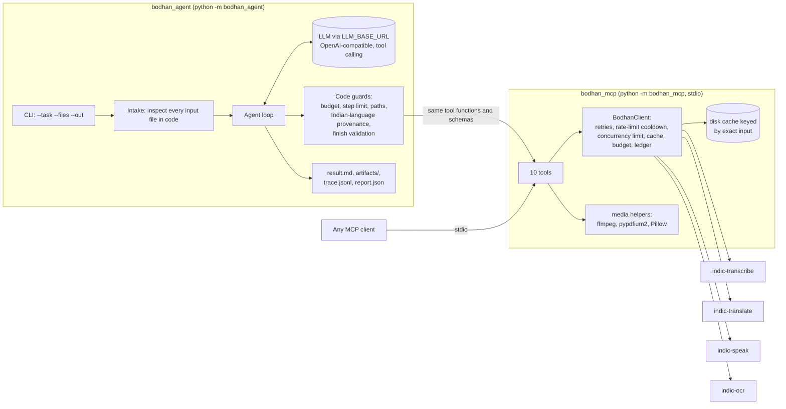

# Indic Task Agent: Bodhan tool server and task agent

> An MCP server that exposes Bodhan's Indic speech, translation, speech synthesis and OCR models as tools, and a command-line agent that uses them to finish multi-step language tasks it has never seen.

**Bodhan models:** indic-transcribe, indic-translate, indic-speak, indic-ocr (hosted API)
**Languages shown:** Hindi, Tamil, Bengali, Marathi, Telugu (any language in the Bodhan lists works)
**Format:** Python package: MCP server over stdio (`python -m bodhan_mcp`) and CLI agent (`python -m bodhan_agent`)
**Demo video:** https://youtu.be/AtbJL9Lz3_E (3 min 47 s)

## What it does

Give the agent a task in plain language and some files. It inspects the files, plans, calls the tools, checks each result, and writes:

```
out/
  result.md        # what was done, the answer, assumptions, outputs with their checks
  artifacts/       # files produced: audio, subtitles, Markdown, ...
  trace.jsonl      # one line per step: LLM turn, tool call, arguments, result summary, latency, cost
  report.json      # status, steps, verification per output, cost per model, time
```

Impossible tasks (an unsupported language, a missing file, a capability the tools do not have, a budget too small) end with a plain explanation and no invented output.

The MCP server works on its own with any MCP client. Tested with the official MCP Python SDK client over stdio (`tests/test_server.py`).

## Setup

```bash
cd examples/indic_task_agent
python -m venv .venv && source .venv/bin/activate
pip install -r requirements.txt -r requirements-dev.txt && pip install --no-deps -e .
cp .env.example .env   # then fill in the keys
```

- System dependency: **ffmpeg** (with ffprobe). `brew install ffmpeg` or `apt install ffmpeg`.
- Bodhan keys, one per model: `BODHAN_TRANSCRIBE_KEY`, `BODHAN_TRANSLATE_KEY`, `BODHAN_SPEAK_KEY`, `BODHAN_OCR_KEY` (from [console.bodhan.ai](https://console.bodhan.ai)).
- LLM: `LLM_BASE_URL`, `LLM_MODEL`, `LLM_API_KEY`, any OpenAI-compatible endpoint with tool calling.
  Tested with DeepSeek (`https://api.deepseek.com`, `deepseek-chat`) and Google Gemini
  (`https://generativelanguage.googleapis.com/v1beta/openai/`, `gemini-3.5-flash`).
- Or with Docker: `docker build -t indic-task-agent .` (see the comments in the `Dockerfile`).

## Run

The task agent:

```bash
python -m bodhan_agent \
  --task "Make a two-minute Tamil audio summary of this chapter" \
  --files path/to/inputs/ \
  --out ./out \
  [--max-steps 30] [--max-cost-inr 20] [--call-timeout 90] [--llm-timeout 120] [--keep-work] [--quiet]
```

It prints one line per step as it runs (`--quiet` turns this off; the trace is written either way).
Exit code: `0` done (completed, or honestly reported impossible), `2` stopped early (partial, budget or step limit), `1` failed.

The MCP server on its own (stdio):

```bash
python -m bodhan_mcp
```

To add it to an MCP client, run that command from this folder (the client must pass the keys as environment variables, or start it here so `.env` is found). For example, Claude Code: `claude mcp add bodhan -- python -m bodhan_mcp`.

Tests (audio tests need ffmpeg and skip without it):

```bash
python -m pytest tests -q
```

The demo suite (builds its own inputs, then runs every demo task through the CLI and reports a pass rate):

```bash
python demo/make_inputs.py          # generates demo/inputs/ (media is not committed)
python demo/run_demo.py --cold      # empty model cache, so costs and times are real
```

## How it works



- Design notes and the agent-loop flow chart: **[docs/DESIGN.md](docs/DESIGN.md)**.
- The agent imports the same tool functions the MCP server publishes, and gives the LLM exactly the server's tool schemas.
- The LLM plans, picks tools, writes English and judges results. Code enforces what must hold even if the LLM misbehaves:
  budgets, file-path limits, that Indian-language text only comes from Bodhan models, and that finished outputs really exist.

### Tools

| Tool | Model | What it does |
|---|---|---|
| `inspect_media` | none | Kind of file (audio, video, image, PDF, text), duration, pages. |
| `list_languages` | none | Language codes per capability. |
| `detect_language` | none | Script and candidate languages of a text, by character set. |
| `identify_audio_language` | indic-transcribe | Spoken language of a clip from its first ~20 seconds. |
| `transcribe_audio` | indic-transcribe | Speech to text for any audio or video, in windows of at most 28 s cut at silences. |
| `translate_text` | indic-translate | Translation that keeps Markdown tables, headings, lists, code and LaTeX. Checks structure and numbers. |
| `make_subtitles` | transcribe + translate | Transcribe and write SRT subtitles in the target language, plus the original. |
| `speak_text` | indic-speak (+ transcribe to check) | Speech in sentence-sized requests, joined, then transcribed back and compared. |
| `ocr_document` | indic-ocr | OCR of a PDF (up to 60 pages) or page image, one Markdown file, flagged pages. |
| `read_text` | none | Paged reading of long text files. |

MCP resources: `bodhan://voices` (the Indic-Speak voice library) and `bodhan://languages`.
Every tool returns `{"ok": true, ...}` or `{"ok": false, "error": {"code", "message", "retryable"}}`, and never crashes the client.

## Results

The six demo tasks from the brief, run with DeepSeek (`deepseek-chat`) and the hosted Bodhan APIs. Each links to its `result.md`, `trace.jsonl` and `report.json`.
Audio, video and images are not committed; rerun the suite to regenerate them.

| Task | Input | Result | Outputs | Turns | Cost (INR) | Time (s) | Run |
|---|---|---|---|---|---|---|---|
| Make a two-minute Tamil audio summary of this chapter | Scanned PDF, 8 pages | completed (checks passed) | .mp3, .md, .md | 6 | 2.88 | 223 | [result](demo/runs/tamil_audio_summary/result.md), [trace](demo/runs/tamil_audio_summary/trace.jsonl), [report](demo/runs/tamil_audio_summary/report.json) |
| Transcribe this Hindi voice note and give me English subtitles | Hindi WAV, 2 min 41 s | completed (checks passed) | .srt, .srt | 3 | 0.28 | 17 | [result](demo/runs/hindi_note_english_srt/result.md), [trace](demo/runs/hindi_note_english_srt/trace.jsonl), [report](demo/runs/hindi_note_english_srt/report.json) |
| Translate this worksheet into Marathi and keep the table | Photo of a worksheet (with an embedded prompt injection) | completed (checks passed) | .md, .md | 4 | 0.20 | 57 | [result](demo/runs/worksheet_marathi/result.md), [trace](demo/runs/worksheet_marathi/trace.jsonl), [report](demo/runs/worksheet_marathi/report.json) |
| Which of these clips are in Telugu? Translate those into English | Five short clips (te, hi, te, ta, bn) | completed (checks passed) | .md, .md, .md | 6 | 0.06 | 17 | [result](demo/runs/telugu_clips/result.md), [trace](demo/runs/telugu_clips/trace.jsonl), [report](demo/runs/telugu_clips/report.json) |
| Read this paragraph aloud in Bengali with a female voice | English text file | completed (checks passed) | .mp3, .md | 4 | 0.36 | 55 | [result](demo/runs/bengali_paragraph/result.md), [trace](demo/runs/bengali_paragraph/trace.jsonl), [report](demo/runs/bengali_paragraph/report.json) |
| Translate this video into French | English MP4 | impossible | none | 4 | 0.01 | 6 | [result](demo/runs/video_french/result.md), [trace](demo/runs/video_french/trace.jsonl), [report](demo/runs/video_french/report.json) |

All six pass the suite's checks ([demo/results.md](demo/results.md)), on an empty model cache so every call was paid for: INR 3.79 in total. The Tamil audio is 2 min 28 s with a back-check of 0.93. Every multi-step task finished in under 5 minutes. The suite's checks are simple and independent of the agent: expected status, the output types the task asks for, all output checks passed, audio length where the task names one, and a few facts in the answer or the English outputs.

### Same tasks with a second LLM

The same six tasks with Google Gemini (`gemini-3.5-flash`), also on an empty cache, to check the agent does not depend on one model. All six pass, INR 3.62 in total ([demo/runs-gemini/results.md](demo/runs-gemini/results.md)).

| Task | Result | Turns | Cost (INR) | Time (s) | Run |
|---|---|---|---|---|---|
| Tamil audio summary | completed: 2 min 6 s audio, back-check 0.92 | 6 | 2.72 | 165 | [result](demo/runs-gemini/tamil_audio_summary/result.md) |
| Hindi note, English subtitles | completed | 2 | 0.28 | 16 | [result](demo/runs-gemini/hindi_note_english_srt/result.md) |
| Worksheet into Marathi | completed | 4 | 0.20 | 61 | [result](demo/runs-gemini/worksheet_marathi/result.md) |
| Telugu clips | completed: clip1 and clip3 | 7 | 0.06 | 22 | [result](demo/runs-gemini/telugu_clips/result.md) |
| Bengali paragraph aloud | completed: back-check 1.0 | 5 | 0.36 | 59 | [result](demo/runs-gemini/bengali_paragraph/result.md) |
| Video into French | impossible | 4 | 0.00 | 10 | [result](demo/runs-gemini/video_french/result.md) |

To run the suite with another LLM, set `LLM_*` in the environment and keep its runs apart: `python demo/run_demo.py --cold --runs-dir runs-<name>`.

## Known API issues

- `POST /translate` returns `404 {"detail":"Not Found"}` on the hosted gateway (checked 17 and 18 Nov 2026, reported to Bodhan).
  The client tries it first, then switches to the documented second transport, `POST /v1/chat/completions` with model `indic-translate`,
  for the rest of the run. On that route only `script: native` is offered here; `roman` and `codemix` return a clear error.
- Indic-Speak is rate-limited per model. The client honours `Retry-After`, otherwise waits 5 to 60 s, and pauses the whole model so parallel calls do not pile on.
- The Cookbook's `make check` currently fails on `main` before reaching this recipe, because `examples/AndroidSpeak` (a Kotlin app) does not pass the Python-recipe validator.
  `make lint`, `make rules` and `make validate` all pass for this recipe.

## Limitations

- Subtitle times are exact at window edges (cut at pauses, at most 28 s apart) and shared out by text length inside a window. There is no word-level alignment.
- Several Indian languages share a script (Hindi, Marathi, Nepali use Devanagari), so spoken-language ID gives candidates; the LLM decides from the sample text.
- The speech check compares text, so a number read out as words can lower the score. A threshold of 0.6 leaves room for that.
- The agent cannot fix a translation error itself (it may not write Indian-language text). It can rephrase the English and translate again, and otherwise reports the error.
- Video is supported for transcription and subtitles (audio track only). Dubbing video or reading on-screen text is not built.
- Tested with two LLMs (DeepSeek and Gemini). The client only uses standard chat-completions fields, drops `temperature` if a model rejects it,
  and waits out a busy provider (6 tries, `Retry-After` honoured). Gemini's free tier (20 requests a day per model) is too small for the suite.
- OCR doubt flags use layout confidence, which scores block detection rather than reading accuracy.
- The LLM can still see Indian-language text (for example to tell Hindi from Marathi). The rule that it must translate such text with Bodhan
  before summarizing it is in the prompt and in a `read_text` note, not enforced in code.
