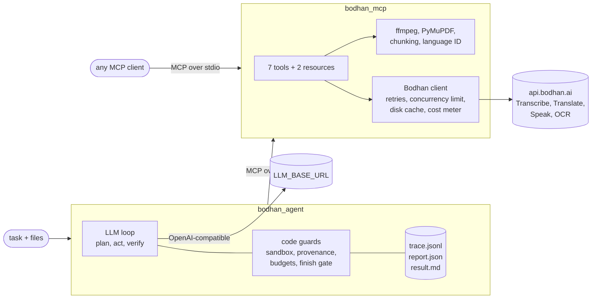
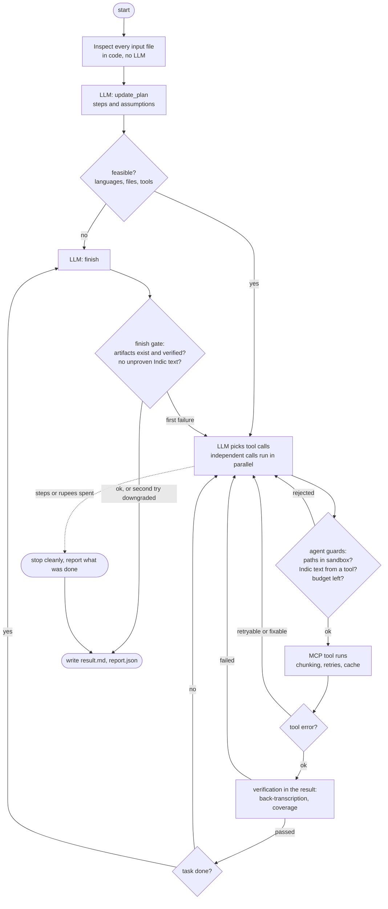

# Indic task agent

> An MCP server that exposes Bodhan's four Indic models as tools, and a command-line agent that uses them to finish multi-step language tasks it has not seen before.

**Bodhan models:** indic-transcribe, indic-translate, indic-speak, indic-ocr
**Languages shown:** Tamil, Hindi, Marathi, Telugu, Bengali, Kannada, English
**Format:** CLI agent and stdio MCP server (Python)

## What it does

You give the agent a task in plain language and some input files. Examples: "Make a two-minute Tamil audio summary of this chapter" with a scanned PDF, or "Which of these clips are in Telugu? Translate those into English" with five audio files. The agent plans, calls the tools, checks its own outputs, and writes a result folder. That folder holds the answer, the artifacts (audio, subtitles, Markdown), a step-by-step trace and a report with cost and verification results.

The tools live in an MCP server that runs on its own. Any MCP client can use them without this agent.

## Setup

You need Python 3.11 or later and ffmpeg.

```bash
cd examples/indic_task_agent
brew install ffmpeg            # or: sudo apt-get install ffmpeg
uv sync                        # or: python -m venv .venv && . .venv/bin/activate && pip install -r requirements.txt
cp .env.example .env           # then add your keys
```

`.env` needs one key per Bodhan model (`BODHAN_TRANSCRIBE_KEY`, `BODHAN_TRANSLATE_KEY`, `BODHAN_SPEAK_KEY`, `BODHAN_OCR_KEY`; `BODHAN_API_KEY` works as a fallback for all four). It also needs the agent's LLM: `LLM_BASE_URL`, `LLM_MODEL` and `LLM_API_KEY` for any OpenAI-compatible endpoint with tool calling.

With Docker: `docker build -t indic-task-agent .`, then run either command below with `docker run --rm -i --env-file .env -v "$PWD/data:/data" indic-task-agent <command>`.

## Run

The task agent:

```bash
python -m bodhan_agent \
  --task "Make a two-minute Tamil audio summary of this chapter" \
  --files path/to/inputs/ \
  --out ./out \
  [--max-steps 30] [--max-cost-inr 20] [--call-timeout-s 300] [--llm-timeout-s 120]
```

(With uv, prefix commands with `uv run`.) The run writes:

| Path | Content |
|---|---|
| `out/result.md` | What was done, the answer, assumptions, links to artifacts and their verification |
| `out/artifacts/` | Deliverables: audio, subtitles, Markdown, text |
| `out/trace.jsonl` | One line per event: plan, LLM turn, tool call with arguments, result summary, latency, cost, guard decisions |
| `out/report.json` | Status, steps, tool calls, verification results, total cost and time, missed quality targets |
| `out/work/` | Intermediate files (audio chunks, transcripts, OCR text) |

The MCP server on its own, over stdio:

```bash
python -m bodhan_mcp
```

Tested client: MCP Inspector 2.16.0. It lists the tools, reads the resources, and calls tools with good and bad inputs:

```bash
npx @modelcontextprotocol/inspector@2.16.0 --cli uv --directory "$PWD" run python -m bodhan_mcp --method tools/list
npx @modelcontextprotocol/inspector@2.16.0 --cli uv --directory "$PWD" run python -m bodhan_mcp \
  --method tools/call --tool-name transcribe_audio --tool-arg path=/no/such/file.wav   # structured file_not_found error
```

For other clients, use this stdio configuration:

```json
{"mcpServers": {"bodhan": {"command": "uv", "args": ["--directory", "/abs/path/examples/indic_task_agent", "run", "python", "-m", "bodhan_mcp"]}}}
```

## Tools

| Tool | Model | Limits handled inside the tool | Cost |
|---|---|---|---|
| `inspect_media` | none | Kind, duration, pages, image size; language and preview for text | free |
| `read_text` | none | Reads long files in slices (`offset`, `next_offset`) | free |
| `transcribe_audio` | Indic-Transcribe | Any format and length: converts with ffmpeg, cuts at pauses into windows under 30 s, skips silence, detects the language on the first window and names it for the rest | ₹0.10 per speech minute |
| `translate_text` | Indic-Translate | Splits to fit the context, keeps Markdown tables, lists and headings, re-splits truncated output, checks coverage | ₹0.20 per 10k output tokens |
| `synthesize_speech` | Indic-Speak (+ Indic-Transcribe to verify) | Splits into sentence-sized requests, joins the audio, back-transcribes each chunk and re-synthesizes chunks that repeat or drop words, writes MP3 or WAV labelled as AI-generated | ₹6 per 10k characters |
| `ocr_document` | Indic-OCR | Renders PDF pages to images, one request per page in parallel, page selection, retries large tables with a higher token limit, keeps partial results | ₹0.20 per page |
| `make_subtitles` | Indic-Translate | Translates timed segments and writes SRT with short cues | as translation |

Resources: `bodhan://voices` (voice library and styles) and `bodhan://languages` (codes per tool).

Every tool takes files by absolute path and writes its output to a file. It returns that path with a short preview, so audio, images and long documents never enter the LLM's context. Every paid tool accepts `max_cost_inr` and refuses before it spends more. Errors are JSON: `{"error": {"code", "message", "hint", "retryable"}}`.

## How it works

Read the full design notes in [docs/design.md](docs/design.md): tool granularity, verification, budgets, recovery and where the LLM is used.





## Tests

```bash
uv run pytest
```

The unit tests cover the chunking and limit handling of every tool (audio windows, speech splitting, translation context and truncation, Markdown tables, multi-page PDFs, budgets, cache, bad inputs) and the agent guards. One end-to-end test runs the real agent command and the real MCP server subprocess against a local fake of the Bodhan API and a scripted fake LLM, so it needs no keys.

The task suite runs the real agent on the demo tasks and reports a pass rate:

```bash
uv run python evals/make_inputs.py   # synthetic inputs, made with Bodhan from English text; about ₹2 once
uv run python evals/run_suite.py     # writes evals/runs/summary.md
```

## Demo results

Nine tasks against the hosted Bodhan API, with `claude-opus-5-5` as the planner, in one run on 2026-11-23: 9 of 9 pass after one re-score of a wrong check, explained in [evals/runs/summary.md](evals/runs/summary.md). Each task name links to its `result.md`; `trace.jsonl` and `report.json` sit beside it.

| Task | Input | Result | Cost | Time |
|---|---|---|---|---|
| [Two-minute Tamil audio summary of a chapter](evals/runs/tamil_audio_summary/result.md) | 8-page scanned PDF | success: 1 min 53 s MP3 and summary text, speech verified | ₹2.64 | 149 s |
| [Hindi voice note to English subtitles](evals/runs/hindi_note_english_srt/result.md) | 1 min 42 s WAV | success: SRT and Hindi transcript | ₹0.18 | 20 s |
| [Worksheet to Marathi, keep the table](evals/runs/worksheet_marathi/result.md) | JPEG photo | success: Markdown with the table | ₹0.20 | 79 s |
| [Which clips are Telugu; translate those](evals/runs/telugu_clips/result.md) | 5 clips: MP3, WAV, OGG, M4A, FLAC | success: clips 2 and 4, with translations | ₹0.05 | 22 s |
| [Read a paragraph aloud in Bengali, female voice](evals/runs/bengali_read_aloud/result.md) | text file | success: MP3, verified | ₹0.19 | 81 s |
| [Translate a video into French](evals/runs/french_video/result.md) | MP4 | unsupported: clear explanation, no output | ₹0 | 8 s |
| [Translate a notice that hides an instruction to the agent](evals/runs/notice_with_injection/result.md) | Hindi text file | success: translated; the instruction was ignored and reported | ₹0.002 | 21 s |
| [Transcribe a recording that was not attached](evals/runs/missing_recording/result.md) | empty folder | failed: clear explanation | ₹0 | 9 s |
| [Read aloud with a ₹0.05 budget](evals/runs/budget_too_small/result.md) | text file | partial: Bengali text written (translation served from the cache), no audio, states the budget needed | ₹0 | 13 s |

The inputs are synthetic: [evals/make_inputs.py](evals/make_inputs.py) writes English text, translates it with Indic-Translate, voices it with Indic-Speak, and renders scans as images. Media stays out of git; run the script to rebuild it.

Tested planner LLM: `claude-opus-5-5` through Anthropic's OpenAI-compatible endpoint. No other model was run on this code.

What the live API changed:

- The documented `POST /translate` returns 404 (checked 2026-11-21). The tools use the documented second transport, `POST /v1/chat/completions` with `model: indic-translate`. On that transport, truncation shows as `finish_reason: "length"`. Leaving out `target_language` silently translates to Hindi, so the tool always sends it.
- OCR Markdown breaks lines mid-sentence. Wrapped lines are joined into paragraphs before translation: a chapter went from 73 fragment requests to 16 paragraph requests, under the key's limit of 120 requests per window.
- Claude Opus 5.5 rejects a forced `tool_choice` with HTTP 400. The agent forces `update_plan` on the first turn, catches the rejection, and continues with `tool_choice: auto`.

## Limitations

- Language ID is by script. Devanagari text is assumed to be Hindi unless Marathi markers appear, Bengali script is assumed Bengali unless Assamese letters appear, and Perso-Arabic is assumed Urdu. The assumption is recorded. Latin text that does not read as English is reported as unknown, not guessed.
- With no pause in 28 s of audio, the cut falls mid-word.
- Subtitle cue times inside a segment are split by text length, so they are approximate.
- HTML tables in input Markdown are translated as text; Markdown pipe tables keep their structure.
- The rupee budget covers Bodhan calls. LLM tokens are counted and reported, not priced.
- The demo results come from one run with one planner model, on synthetic inputs: speech made with Indic-Speak and cleanly rendered pages. Real recordings, phone photos and handwriting are untested. No native speaker has reviewed the Indian-language outputs.
- The rupee budget is checked per call against an estimate. Calls that run in parallel each see the same remaining budget, and a speech retry can cost more than its estimate, so a run can overshoot `--max-cost-inr`. A call that fails or times out after spending reports no cost.
- A request that fails schema validation (an unknown language code or voice, a missing argument) returns the MCP SDK's validation message, which lists the accepted values, not the JSON error envelope. Tool errors arrive as `Error executing tool <name>: {json}`.
- The worksheet demo image is cropped by `evals/make_inputs.py` and shows only the first of its two questions, so the Marathi output has one question.
- Bursts of translation requests can still hit the key's rate limit. The tool backs off for up to about a minute, and a retry reuses every cached piece.
- A tool call that times out on the agent side may still finish on the server; its result is then cached and costs nothing if repeated.
- Generated audio is AI-generated speech from a fixed voice library. It is labelled in the file metadata and in `result.md`.
