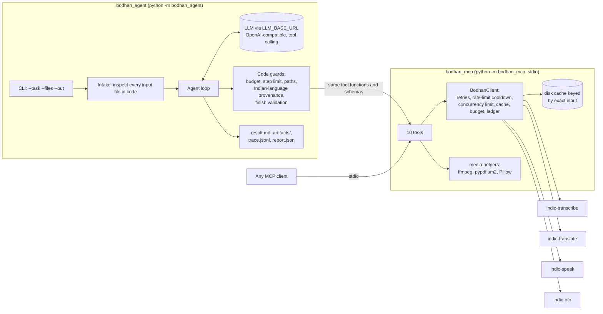
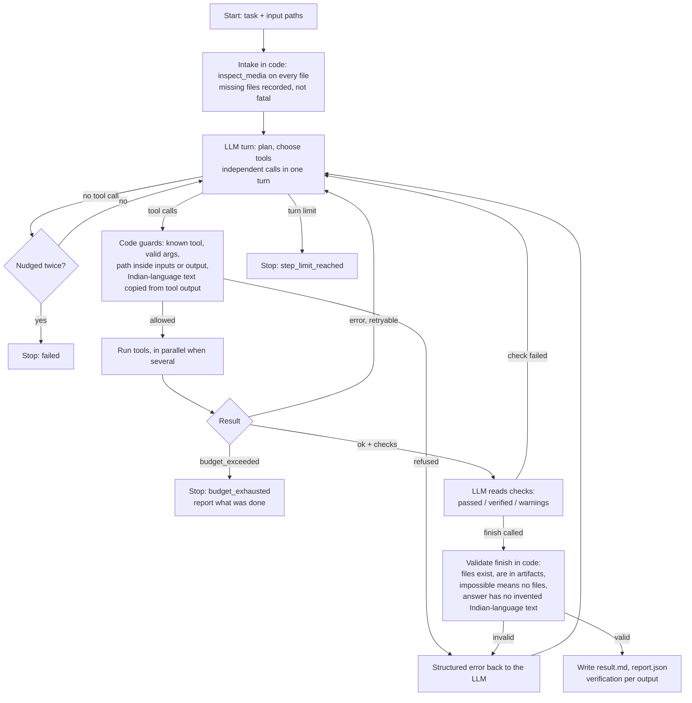

# Design notes

## Architecture

- **bodhan_mcp** is a standalone MCP server. Any MCP client can use it over stdio without the agent.
- **bodhan_agent** imports the same tool functions directly (the brief allows this) and gives the LLM exactly the schemas the MCP server publishes, so the agent and a third-party client see the same tools.
- **BodhanClient** is the only code that talks to Bodhan. Every paid call passes through its cache, budget and ledger.

## Agent loop

## Tools and why this granularity

| Tool | What it hides from the caller |
|---|---|
| `inspect_media` | File type, duration, page count, whether a video has audio. |
| `list_languages` | The per-model language lists and their differences (for example `bho` can be transcribed but not translated). |
| `detect_language` | Script detection by character set. No model call. |
| `identify_audio_language` | Transcribes only the first ~20 s without a language hint, then reads the script. Cheap language ID for clips. |
| `transcribe_audio` | Converts any format to 16 kHz WAV, cuts at silences into windows of at most 28 s, transcribes each, joins with timestamps, flags repetition. |
| `translate_text` | Splits Markdown by structure: tables cell by cell, headings, list items, paragraphs. Code and LaTeX are copied. Checks structure, numbers and sentence count. |
| `make_subtitles` | Transcribe, split into readable cues (sentences, then at most 84 characters), translate each cue, write two SRT files. |
| `speak_text` | Cleans Markdown for speech, splits into sentence-sized requests, joins WAVs, optional MP3, then back-transcribes and compares. Writes an AI-generated label. |
| `ocr_document` | Renders PDF pages to PNG, one OCR call per page, flags cut-off, empty or low-confidence pages, writes one Markdown file. |
| `read_text` | Paged reading of text the tools wrote, so long documents never flood the context. |

One tool per model would push chunking, format conversion and checking onto the planner, where it costs steps and goes wrong.
One tool per task ("summarise this chapter into Tamil audio") would hide the decisions the LLM is good at.
The middle ground: each tool owns one capability *and its limits*. Two tools (`make_subtitles`, `identify_audio_language`)
bundle a fixed sequence, because the order never changes and doing it in code is cheaper and safer than asking the planner every time.

Every tool takes paths or short text, returns `{"ok": true, ...}` or `{"ok": false, "error": {"code", "message", "retryable"}}`,
and never raises to the client. Media never passes through the LLM context as base64.

## Where the LLM decides, and where code decides

| Decision | Who | Why |
|---|---|---|
| What the task asks for, which tools, in what order | LLM | Needs language understanding. |
| Spoken language when the script is shared (Hindi vs Marathi) | LLM, from a text sample | Character sets cannot tell them apart. |
| Writing English (summaries, answers) | LLM | Allowed by the brief; translated afterwards by Indic-Translate. |
| Whether a failed check is worth a retry | LLM | Judgement call; the tool supplies the evidence. |
| File type, duration, page count | Code | Facts, not judgement. |
| Chunking, windows, format conversion | Code | Deterministic and testable. |
| Structure, number and length checks | Code | Deterministic; no point paying an LLM. |
| Budget, step limit, file-path limits | Code | Must hold even if the LLM misbehaves. |
| Indian-language text in tool arguments or the answer | Code | Refused unless copied from tool output (the LLM may never write it). |
| Whether `finish` is valid | Code | Listed files must exist in `artifacts/`; "impossible" must list none. |

If the LLM fails (network, rate limit, bad response) after retries, the run stops with status `failed` and still writes the report and any outputs made so far.

## Verification

- **Speech:** every `speak_text` output is transcribed back with Indic-Transcribe. Similarity below 0.6, a length ratio outside 0.7 to 1.4, or a repeated sentence marks it unverified. A preview of the back-transcript is kept as evidence.
- **Translation:** headings, tables, table rows, list items, code blocks and LaTeX blocks are counted in source and translation and must match. Every number in the source (in any script's digits) must appear in the translation. Fewer than half the source sentences, or a truncated response, is flagged.
- **OCR:** pages that were cut off, came back empty, or have low-confidence layout blocks are flagged by page.
- **Subtitles:** empty cues, truncated cues and missing numbers are flagged.
- `report.json` lists every output with the tool that made it, whether its check passed, and the warnings.

## Budgets and cost

- `--max-cost-inr`: every paid call reserves its estimated cost first. If it would go over, the call is not made, the tool returns `budget_exceeded`, and the runtime stops with status `budget_exhausted`.
- `--max-steps`: LLM turns. Reaching it stops with status `step_limit_reached`.
- Per-call timeouts: `--call-timeout` for Bodhan, `--llm-timeout` for the LLM.
- The disk cache is keyed by model, endpoint and exact input (audio bytes hash, image hash, full request body). The same input is never paid for twice, in a run or across runs.
- Speech is the expensive model (₹6 per 10,000 characters), so text is cleaned before synthesis and speech is never re-made for a check.

## Error recovery

- 5xx and network errors: up to 4 attempts with exponential backoff.
- Rate limits (429, or a "rate limit" message): `Retry-After` is honoured, otherwise 5, 10, 20, 40, 60 s, and the whole model pauses so parallel calls do not pile on.
- `POST /translate` returning 404: the client switches to the documented chat-completions transport for the rest of the run (see README, Known API issues).
- Structured, actionable errors go back to the LLM, which can re-plan: wrong file type, unsupported language with the supported list, missing key, file not found.

## Untrusted content

Text from OCR, transcripts and input files is data. The system prompt says so, but the protections do not depend on the LLM obeying it:
the tools cannot do anything outside their job, file access is limited to the inputs and the output folder, and the only things the
LLM can write are English files in `artifacts/` and its final answer. The demo worksheet carries an embedded instruction to test this.
