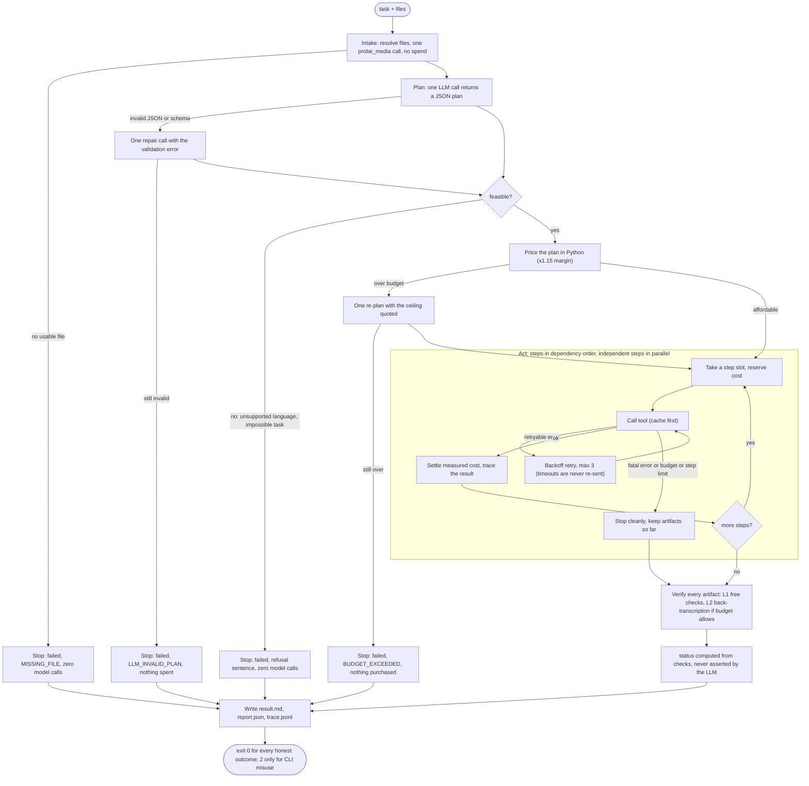

# Agent flow

## What the LLM decides, and what Python decides

| Decision | Who | Fallback if it fails |
|---|---|---|
| Understand the task, choose tools, write the plan | LLM, one call + one repair | `LLM_INVALID_PLAN`, run ends, nothing spent |
| Estimate generated-text length (`expected_chars`) | LLM | Python caps it at 12,000 chars; missing value is a schema error |
| Write the English draft (`write_text`) | LLM | Output with any Indic character is rejected and fails the step |
| Price, reserve, settle, stop | Python | n/a |
| Chunking, retries, caching, verification, status | Python | n/a |
