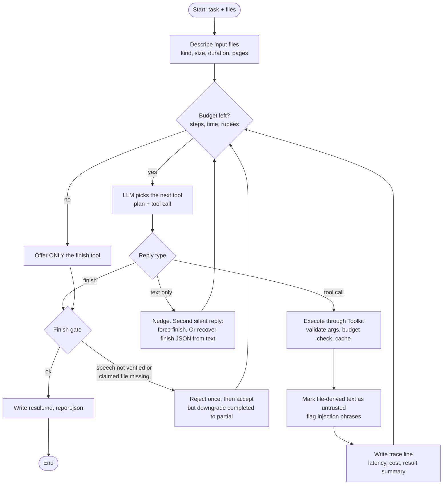

# Agent flow

## What is enforced in code (not just in the prompt)

| Rule | Where | What happens if the model ignores it |
|---|---|---|
| Step, time and rupee budgets | `loop.py`, `client.py` | Last step offers only `finish`; any other tool is refused. Paid calls over budget raise `budget_exceeded` before any request is sent. |
| Speech must be verified | `_finish_gate` | `completed` is rejected until `verify_speech` passed; a second attempt is accepted only as `partial`. |
| Claimed outputs must exist | `_finish_gate` | Same: rejected once, then downgraded. |
| Unsupported language | tools + `language_support` | Tools refuse before any API call, with a hint. The agent finishes as `impossible` and produces no files. |
| Output stays inside the workspace | `Toolkit._out` | `../../x` raises `path_outside_workspace`. |
| Bad tool calls | `_execute` | Invalid JSON, unknown tool, wrong parameters and repeated identical failures become tool errors, never crashes. |
| LLM outage | `llm.py`, `loop.py` | Retries with backoff; if it still fails the run ends with an honest `failed` report. |

## Stop reasons in `report.json`

`finished` (the model called `finish`), `step_budget`, `time_budget`, `no_finish`, `llm_error:<code>`.
When the model never finishes, the report is built by code and lists only what can be proven
(the files that exist), never what the model claimed.