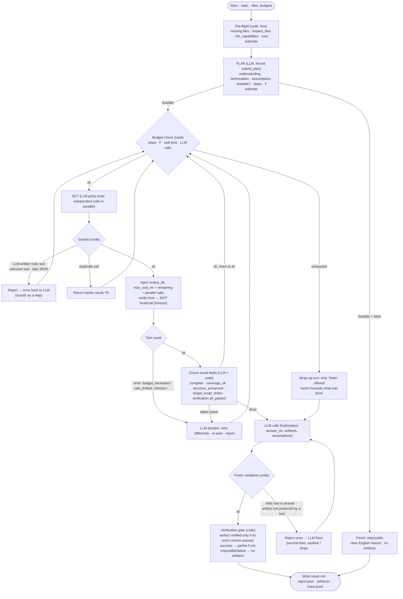

# Agent flow

Retries happen at two levels:

1. **Transport** (inside the server): 429, 5xx, timeouts and dropped connections are retried with exponential backoff and jitter, honouring `Retry-After`. Other 4xx errors fail fast with a structured error.
2. **Content** (inside the tools): a truncated translation is re-sent as two smaller pieces; a TTS clip that fails back-transcription is re-synthesised as two smaller pieces; an OCR page that returns 502 is retried with a larger `max_tokens`. Each retry sends a *different* input, so the cache never hands back the same bad answer and no identical request is paid for twice.

Anything still failing goes back to the LLM as a structured error with a `hint`. The LLM can then take another route, re-plan, or finish with `partial`/`failed` and an honest explanation.
