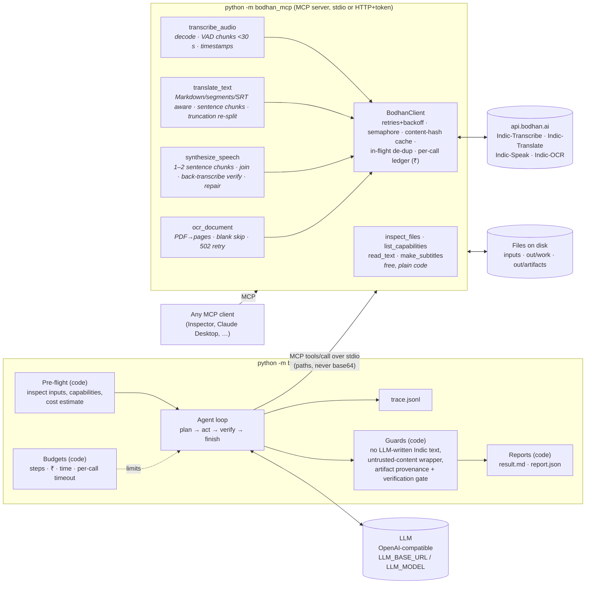

# Architecture

| Part | One line |
|---|---|
| `bodhan_mcp.server` | Registers 8 tools, 3 resources and 1 prompt on an MCP server; stdio by default, streamable HTTP with a bearer token as an option. |
| `bodhan_mcp.tools.*` | One module per capability. Each hides its model's limits and returns typed results with file paths, previews, checks and cost. |
| `bodhan_mcp.client` | The only code that calls Bodhan: retries, backoff, concurrency limit, cache, de-duplication, budget ledger. |
| `bodhan_mcp.media` / `text` | Plain-code plumbing: ffmpeg decode, voice-activity chunking, WAV joins, PDF rendering, script detection, Markdown structure. |
| `bodhan_agent.mcp_bridge` | A real MCP client: the agent uses the server exactly like a third party would. |
| `bodhan_agent.agent` | The loop, budgets, argument injection, guards, verification gate, finish validation. |
| `bodhan_agent.llm` | Portable OpenAI-compatible tool calling with fallbacks for providers that lack named `tool_choice`. |
| `bodhan_agent.report` / `trace` | `result.md`, `report.json`, and a flushed-per-step `trace.jsonl`. |
