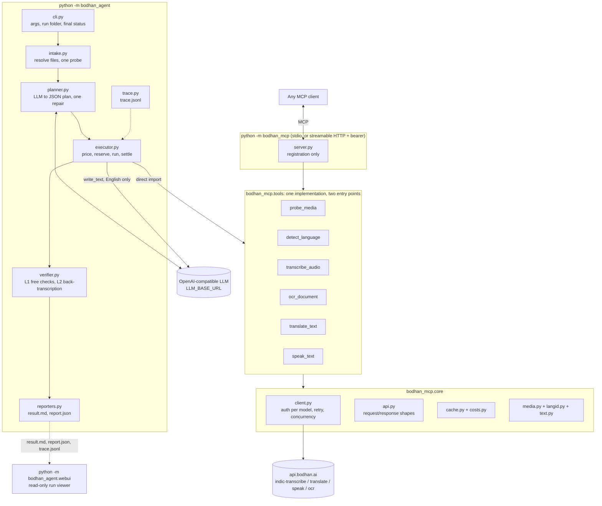

# Architecture

| Part | Responsibility |
|---|---|
| `bodhan_mcp.server` | Registers the six tools and three resources (`bodhan://languages`, `voices`, `pricing`). No behaviour. |
| `bodhan_mcp.tools` | The only implementation of each capability. Validates input, absorbs model limits, raises structured errors. |
| `bodhan_mcp.core` | HTTP path, per-model keys, retries, cache, price estimators, ffmpeg/PDF helpers, script-based language ID. |
| `bodhan_agent` | Plans with an LLM, then executes in Python under a step, cost and timeout budget; verifies; writes the run folder. |

The agent imports the tool functions directly. The server runs on its own and
is what an external MCP client sees. Because both use the same functions, they
cannot drift apart.

## The one invariant

Indian-language text is never a string the agent holds. Every tool takes and
returns file paths; the LLM sees paths, counts, language codes, durations and
costs. Prompt injection inside a scanned page is therefore inert: the text is
transcribed or translated into a file and never reaches a prompt.
