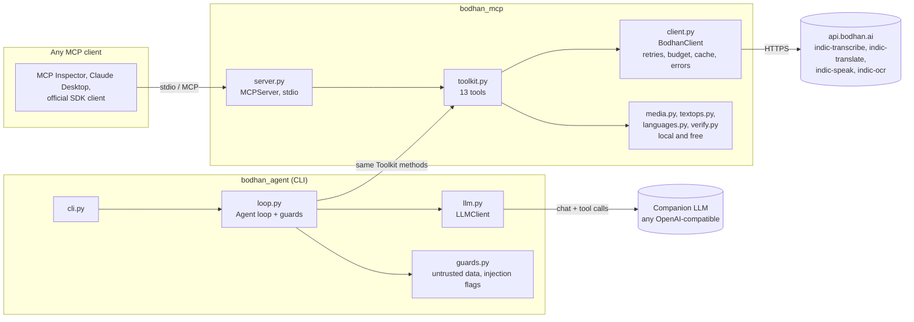

# Architecture

Two things live in this recipe: an **MCP tool server** that wraps Bodhan's four models, and a
**task agent** that uses those tools to carry out plain-language tasks. They share one
implementation (`Toolkit`), so the agent and any other MCP client see exactly the same tools.

## Modules

| Module | Responsibility |
|---|---|
| `bodhan_mcp/server.py` | Registers the toolkit methods as MCP tools (stdio). Turns failures into structured tool errors. |
| `bodhan_mcp/toolkit.py` | The 13 tools. Takes file paths, returns small dicts, saves long text to files. Enforces the workspace boundary. |
| `bodhan_mcp/client.py` | The only code that talks to Bodhan: retries with backoff, one error type, rupee budget check, disk cache, response validation. |
| `bodhan_mcp/media.py` | ffmpeg helpers: convert audio, cut at silences into chunks of 28 s or less, join speech, MP3 output. |
| `bodhan_mcp/languages.py` | Which model supports which language, voices, script-based language detection. |
| `bodhan_mcp/textops.py`, `verify.py` | Sentence splitting, markup cleaning, comparing spoken audio with the source text. |
| `bodhan_agent/loop.py` | The agent loop, budgets, finish gate, trace and report writing. |
| `bodhan_agent/llm.py` | OpenAI-compatible chat client with tool calling (plain `httpx`, no vendor SDK). |
| `bodhan_agent/guards.py` | Marks file-derived text as untrusted, flags injection phrases, shortens results for the model. |

## Where the LLM is used, and where it is not

The LLM only **plans and chooses tools** and writes **English** (plans, summaries, the final report).
It never writes, corrects, translates or transcribes Indian-language text, never reads images and
never makes speech. Text moves between tools as file paths (`text_file`, `segments_file`), so the
model never has the chance to retype, and corrupt, Indic text.

## Data flow for one task

1. The CLI describes the input files (kind, size, duration, pages) and gives them to the model.
2. The model calls tools; each call is checked, executed, logged (latency, rupees) and summarised back.
3. Paid calls are checked against the budget first and cached by content hash.
4. The model calls `finish`; the loop checks the claim (files exist, speech verified) before accepting it.
5. `result.md`, `report.json` and `trace.jsonl` are written to the output folder.