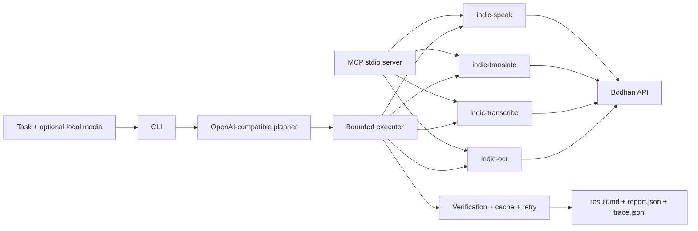

# Architecture

The CLI imports the shared Bodhan functions directly. The independent MCP stdio server exposes those same functions to MCP clients. The planner sees only the four allowlisted tools; media contents remain in local files and are passed by path. Tool outputs are cached by tool name and canonical arguments to avoid repeating identical Bodhan requests in one run.
