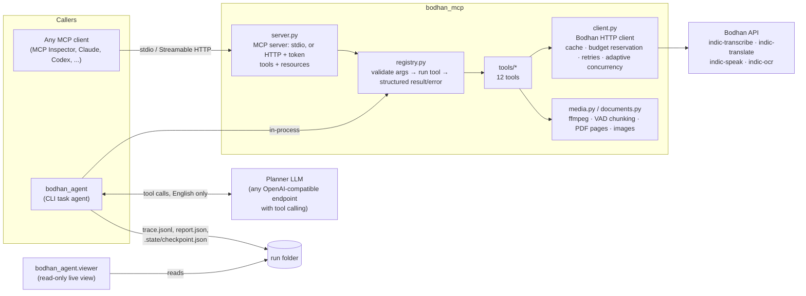
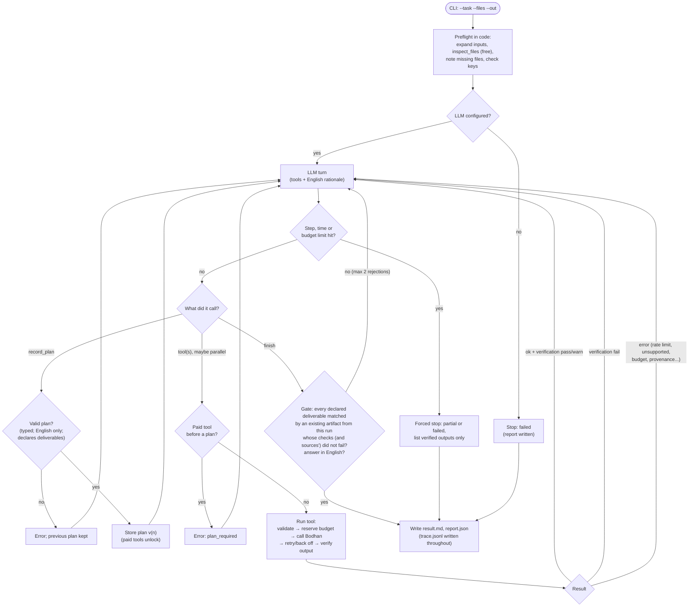

# Design notes

This page explains how the recipe is built and why. For setup and commands, see the [README](../README.md). For the API behaviour these choices rest on, see [api_notes.md](api_notes.md).

## Architecture

Both programs import one tool layer. The MCP server exposes it over stdio, or over Streamable HTTP with a bearer token. The agent calls the same functions in-process, which the brief allows ("import the same tool code directly"), and which lets one run share one budget, one cache and one trace.

| Part | Job |
|---|---|
| `bodhan_mcp/server.py` | MCP stdio server. Lists tools with JSON schemas, returns `structuredContent` plus the same JSON as text, maps every failure to `isError: true` with `{code, message, hint, retryable}`. Resources: `bodhan://voices`, `bodhan://languages`, `bodhan://pricing`. |
| `bodhan_mcp/registry.py` | One `invoke()` for both callers: pydantic validation, the handler, and a last-resort guard, so bad input never crashes a client. |
| `bodhan_mcp/tools/` | The tools. Each one handles its model's limits and verifies its own output. |
| `bodhan_mcp/client.py` | The only code that talks to Bodhan. Cache lookup, budget reservation, per-model adaptive concurrency, bounded retries, billing classification and trace events. |
| `bodhan_mcp/runtime.py` | Cost ledger, result cache, artifact registry, run context. |
| `bodhan_agent/loop.py` | Plan, act, verify, retry, stop. Typed control calls and code-enforced gates around the LLM's decisions. |
| `bodhan_agent/state.py` | Checkpoints for `--resume`: atomic JSON in `out/.state/`, input fingerprints, no keys. |
| `bodhan_agent/report.py` | `result.md` and `report.json`. |
| `bodhan_agent/viewer.py` | Read-only local page that follows a run's trace and report. |

## Agent loop

The LLM picks the next step. Code decides what is allowed and what counts as done. A few rules hold throughout:

- **Steps.** Every planner call is one step, `record_plan` and `finish` included. A turn can't use more steps than remain: extra calls are refused, not run. When one step is left, only `finish` is offered.
- **Deadline.** `--max-seconds` starts when the command starts, and covers preflight, planner calls, tools, rate-limit waits and ffmpeg subprocesses.
- **Checkpoints.** A checkpoint is written before and after each turn's tool calls, so `--resume` can continue the same run.

Each "retry" in the chart is one of three kinds:

- **Transport retry** inside `client.py`: 429, 5xx, timeouts and dropped connections, with backoff. The planner never sees these unless they keep failing.
- **Repair** inside a tool, with a *different* input: a truncated translation is split in half, a reflowed table is translated cell by cell, a TTS segment that fails back-transcription is re-synthesised split in two or with the other voice of the same gender.
- **Re-plan** by the LLM after a structured error or a failing verification. The prompt allows one different repair, then an honest report.

## Tool granularity

The tools sit one level above the raw models. Each tool owns everything needed to use its model correctly on any input size. The planner owns the task.

| Tool | Model | What the tool hides from the caller |
|---|---|---|
| `transcribe_audio` | indic-transcribe | Decoding any container (also video), 16 kHz mono, pause-aware cutting into ≤28 s pieces, trimming silence so it is not billed, language detection from the first piece. |
| `create_subtitles` | transcribe + translate | Short cue-sized pieces with times, cue-by-cue translation, back-translation, both `.srt` files. |
| `translate_text` | indic-translate | Paragraph units, tables kept (cell-by-cell fallback), same-language passages kept as they are, truncation split, SRT timing kept, back-translation verification. |
| `synthesize_speech` | indic-speak | Sentence-sized requests (≤220 chars), voice and style validation before spending, back-transcription of every segment with one repair, MP3/WAV, AI-generated label. |
| `ocr_document` | indic-ocr | Images (EXIF rotation, downscaling) and PDFs page by page, free use of clean PDF text layers, page markers, retry with a larger `max_tokens`. |
| `verify_translation`, `verify_speech` | translate / transcribe | The same checks, for outputs made elsewhere. |
| `inspect_files`, `detect_language`, `read_text`, `write_text`, `list_voices` | none (free) | Planning metadata, script-based language ID, paging through artifacts, saving English text. |

I rejected two other shapes:

- **One thin tool per model.** Then the planner must chunk audio, split text and stitch results, which costs many LLM turns, floods its context and gets limits wrong. The 30 s audio limit, for example, is a fact about the model, not about the task.
- **Task-level tools** such as `summarize_chapter_to_audio`. These hide decisions the brief wants the agent to make, such as what length, which language and whether to summarise or translate, and they do not generalise to unseen tasks.

`create_subtitles` is the one composite tool. Subtitles need cue-sized audio pieces from the start. Building them by chaining `transcribe_audio` and `translate_text` would mean transcribing the same audio twice at two chunk sizes, or making the planner manage cue timing by hand.

## Media never enters the LLM context

Tools take file paths and return artifact paths plus short previews. Audio and images are only read by code and sent to Bodhan. An OCR request base64-encodes the page inside the HTTP body, as the API requires, and that encoding never appears in a planner message or the trace. A planner that needs a long text reads it page by page with `read_text`.

## Where the LLM is used

| Decision point | What the LLM decides | If it fails |
|---|---|---|
| Plan (`record_plan`) | Steps, assumptions for ambiguous wording, deliverables | Paid tools stay locked until a plan exists. |
| Tool choice and arguments | Which tool, which language, voice, length, file | Tools validate everything. Errors carry a `hint` naming the fix. |
| English writing (`write_text`) | Summaries, answers, lists of results | Indian-language text is refused. It must come from `translate_text`. |
| Judging results | Reads `verification` and decides to repair, re-plan or report | The finish gate re-checks the same facts in code. |
| Final answer (`finish`) | Status and an English explanation | Gate rejects unverified, failing or invented deliverables (including failures inherited through embedded or source artifacts), non-English answers, and `completed` with no evidence of work. An answer-only task may finish without files after tools did real work. After two rejections, the run is accepted and downgraded to `partial` or `failed`, with the gate's reasons listed. |

LLM failure (network, outage, misconfiguration) after three attempts stops the run with status `failed` and a full report. A model that writes a JSON tool call as plain text instead of using `tool_calls` is still understood (`llm.py` fallback). The endpoint needs only `chat.completions` with `tools` and `tool_choice="auto"`, with no provider-specific features.

## Indian-language text never comes from the LLM

The prompt states the rule. Code also enforces it in three places:

1. **`ProvenanceGuard`** (`tools/common.py`). In agent runs, every run of Indian-language words that the planner passes inline must be a verbatim quote, or a selection of whole sentences, from the task, an input file or a Bodhan output. The check works span by span, so English padding cannot dilute it. Otherwise the call fails with `provenance_violation`, and the planner must pass text by artifact path.
2. **`write_text`** refuses any Indian-language letter written by the caller, including unicode escapes inside JSON. Existing artifacts can be embedded by reference: `{{artifact:<path>}}`. The new file records what it embeds, so it inherits their verification.
3. **The finish gate** never accepts planner-written Indian-language text in the answer, assumptions or limitations. If the planner insists, the text is replaced by a code-written English note.
4. **`create_subtitles`** reuses only transcripts that `transcribe_audio` produced in the same session, so planner-written JSON cannot pass as Indic-Transcribe output.

## Verification

Every translation and every generated audio file is checked before the run can finish. Each check costs a little money, and the budget reservation accounts for it.

**Translation** (`verify_units`):

- The share of letters in the target script. Below 50 % fails.
- Numbers preserved, after converting Indic digits. Missing numbers only warn, because the model may spell them out.
- Table shapes are identical. A changed shape fails.
- Repetition is not much higher than in the source.
- Back-translation into the source language with Indic-Translate, then chrF against the source. A passage whose back-translation is under 60 % of the source length, or whose chrF is under 0.15, fails as "incomplete or wrong". This is how silent omissions show up.
- Sentence coverage per paragraph: a paragraph that comes back with fewer sentences warns.
- A paragraph already in the target language is kept as it is, without a model call. For scripts that several languages share (Devanagari, Bengali, Perso-Arabic), the script proves nothing, so this happens only when the caller states the source language.

**Speech** (`synthesize_speech`): every segment is back-transcribed with Indic-Transcribe, in ≤28 s pieces if the audio is long, and compared letter by letter. Numbers that the ASR writes as digits are compared separately, because letter similarity ignores them. Under 0.5 similarity fails, and 0.5–0.72 warns. Segments whose speaking rate is far from the median (a sign of repetition or skipping) are flagged too. A failing segment is re-synthesised once with a different input. If a target length was requested, the duration is checked against it (±25 % warns).

The LLM never sees audio and never judges Indian-language text. It reads English back-translation previews and the numeric checks.

## Budgets, cost and caching

- **Bodhan prices are the published ones; usage is metered per request.** The four unit prices in `runtime.py` match [console.bodhan.ai](https://console.bodhan.ai/) as checked on 19 November 2026: ₹0.10 per audio minute, ₹0.20 per 10,000 output tokens, ₹6 per 10,000 input characters and ₹0.20 per image. Each request is priced from what was sent or returned. Audio seconds are rounded up per request, because the provider bills per second but does not publish how fractions round, so this side is conservative rather than exact. Translation uses the reply's `completion_tokens`; a reply without usage is priced at its token cap and reported as `bodhan_billed_estimated_inr`. Verification and repair calls are paid calls and are counted. Cache hits make no model call and cost nothing. The ledger is the recipe's own account: the Bodhan dashboard is the authority for actual debits, and a timed-out request stays `uncertain`.
- **The planner is different.** Its provider, model and billing mode are chosen by whoever runs the agent (a subscription gateway is not per-token retail billing), so no planner price is built in. The open question for the planner is its usage before a call, not its unit price, which is why priced planner calls are admitted on an upper bound (below).
- **Reservation before sending.** `CostLedger.reserve()` takes the worst-case cost of a request before it is sent: exact for audio seconds, characters and images, and `max_output_tokens` for translation. Concurrent calls can therefore never push the total over `--max-cost-inr`. Long jobs (`synthesize_speech`, multi-page `ocr_document`) check the whole job's cost first, so they fail cleanly instead of stopping halfway through.
- **Billing classes.** `billed` covers success, with cost computed from the response. `uncertain` covers timeouts, 5xx and unreadable bodies after the request was sent. It is counted against the budget, because the request may have been billed. `none` covers 4xx and 429, which are not billed.
- **LLM spend.** The brief's budget is in rupees and the planner's price is unknown, so LLM tokens are always reported. They are converted into rupees and counted only when you pass `--llm-input-inr-per-1m` and `--llm-output-inr-per-1m`. `report.json` states which applies. When priced, each planner call is checked against the remaining budget first, using an upper bound rather than an average: prompt tokens ≤ the request's UTF-8 bytes plus per-message and tool-formatting margins, and output ≤ `max_tokens`. A characters-per-token average is not a bound, since one Indic character is 3 bytes and may be 3 tokens. Any reply that exceeds its bound is reported. Each retry is checked again, and attempts that failed after sending are charged at the bound (`llm_uncertain` / `llm_error` in the trace), because they may have been billed.
- **No repeated paid input.** Results are cached by (model, exact input bytes, settings). Within a run, an identical request is served from memory, and two identical requests in flight share one HTTP call. The only repeats are retries of a failed or timed-out attempt, which `report.json` counts as `retried_attempts`. Only complete results are written to the disk cache (`~/.cache/bodhan_tool_agent`, plus the run's own `.state/cache`), so reruns are free and a truncated result is retried next time. Repairs always change the input, for example by splitting text or switching voice.
- **Step, time and call limits.** `--max-steps` counts tool calls. The last step offers only `finish`. `--max-seconds` bounds the whole run: tool calls, planner calls and rate-limit waits are all cut off at the deadline. `--call-timeout` bounds each request.
- **Cancellation.** A request takes its budget reservation only once it holds a concurrency slot. If it is cancelled before it is sent, the reservation is released. If it was already sent, its cost counts as uncertain.
- **Concurrent duplicates.** Two identical requests in flight at the same time share one HTTP call.

## Recovery

| Failure | Handling |
|---|---|
| 429 rate limit | Not billed. The model's shared gate halves its concurrency and starts a cooldown that every request to that model waits out. Up to 7 attempts, honouring `retry-after` (capped at 60 s and at the run deadline). Three successes in a row raise the concurrency again. |
| 429 out of credit | `credit_exhausted`, no retry. |
| Timeout, 5xx, dropped connection | Up to 3 attempts with exponential backoff. Cost counted as `uncertain`. |
| Truncated translation (`finish_reason=length`) | Split and translate the halves, up to depth 3. Then `truncated_output`, never a partial result presented as complete. |
| Model merged or dropped paragraphs | Paragraph-count check, then paragraph-by-paragraph translation. |
| Table reflowed | Cell-by-cell translation, table rebuilt in code. |
| TTS repeats or skips words | Back-transcription catches it. One re-synthesis with different input. A remaining failure is reported. |
| OCR block exceeds `max_tokens` (502) | Retry the page with `max_tokens=4096`. |
| Unsupported language, voice or file type | Structured error before any spending. The planner reports it and makes no substitute output. |
| Missing files | Listed in the preflight inventory and in `report.json`. |
| Budget too small | `budget_exceeded` with the needed and remaining amounts. The run finishes cleanly. |

## Untrusted content

OCR text, transcripts, translations and text files come back wrapped as `{"content_kind": "untrusted_data", "note": ...}`. A heuristic flags instruction-like phrases (`injection_warning`), and the report repeats them under limitations. The real defence is structural. The planner prompt says data is never instruction. The only tools are media tools and writes inside `out/artifacts`, with no shell, no network and no deletion. Reads are confined to the input paths and the run's artifacts folder. The injection test (`h1_notice_injection`) keeps the injected line as translated content and does not follow it.

## What "completed" means

The plan declares the deliverables the task asks for, each with a kind (`audio`, `translation`, `subtitles`, `text`, `transcript`) and an optional language. The kind `answer` means the reply itself is the output, as in "which of these clips are Telugu?". `finish(status="completed")` is accepted only if each declared deliverable is matched by an artifact that meets three conditions:

- It is one of the finish deliverables and exists on disk.
- A tool made it in this run.
- Its kind and language fit the declaration.
- Its own checks, and those of everything it was made from or embeds, did not fail.

An `answer` deliverable needs at least one successful tool call behind it. These rules are generic: they check consistency with the plan, not the meaning of the task. A wrong plan can still be wrong, which is why the plan, the deliverables and every check are in the trace.

Verification results are kept as a history on each artifact. A later check never improves an earlier failure, and a translation can be re-checked only against the source it was made from. To repair an output, the agent makes a new artifact.

## Input boundaries

- **Files.** The agent reads only its input files and its own artifacts. A folder input never includes the run's output folder or hidden folders. An input placed inside `--out` is rejected before anything moves.
- **Media.** Audio and video are treated as self-contained files. The container is identified from its first bytes and passed to ffmpeg explicitly, with only the `file` and `pipe` protocols allowed. A playlist or concat manifest renamed to `.wav` therefore can't make the decoder read other files.
- **Documents.** PDF pages and the frames of a multi-page TIFF are pages. A clean PDF text layer is used without OCR unless images cover 15% or more of the page; then the page is OCRed, because a scanned body can sit under a digital header. Page ranges are clipped before they are expanded, and file types are sniffed from a few bytes.

## Resume

`--resume` continues the same run rather than starting a new one from cached results. The checkpoint (`out/.state/checkpoint.json`, replaced atomically) stores the following:

- the task and the SHA-256 of every input;
- the limits;
- the conversation and any turn whose tool calls were in progress;
- the plan and the step counter;
- the settled spend;
- the artifact records with their SHA-256;
- the provenance record.

It stores no keys. On resume, changed or missing inputs stop the resume with a clear error. Artifacts whose files changed since the checkpoint are dropped. An interrupted turn's calls run again, and finished paid work comes back from the run's own cache for free. The time and step limits carry over from the first session.

## HTTP transport

`--transport http` serves the same server through the MCP SDK's Streamable HTTP app at `/mcp`, so protocol negotiation and sessions are the SDK's. A small ASGI wrapper requires `Authorization: Bearer <token>` on every HTTP request and compares it in constant time. The token comes from a file and is generated if missing. It is never one of the seven provider variables. The server binds to loopback by default, and the SDK adds Host and Origin checks against DNS rebinding.

## Choices I did not make

- **No agent framework.** The loop is about 300 lines. A framework would add dependencies and hide the gates that matter here.
- **No word-level timestamps.** `indic-transcribe` returns text only. Cue boundaries are the pause-based cuts, or a proportional split when an earlier transcript is reused. The speech inside a cue is not aligned. The README says so.
- **No LLM-written corrections of Indian-language text**, even when a back-translation looks wrong. The agent reports the problem instead.
- **The agent calls the tools in-process rather than through its own MCP client.** It gets one budget across tool calls and simpler tracing. MCP compatibility is tested separately with an independent client process (`tests/test_mcp_stdio.py`) and with MCP Inspector.
