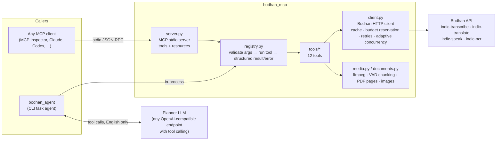
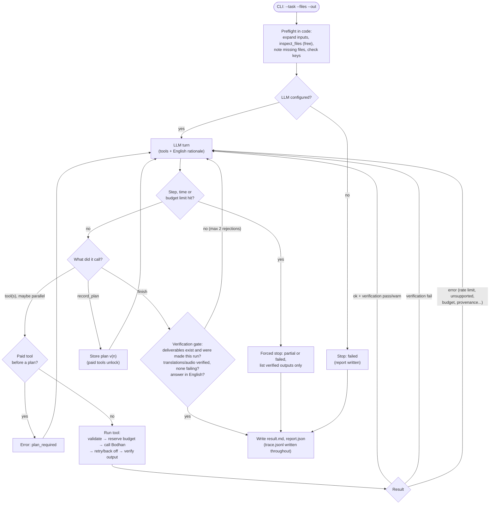

# Design notes

This page explains how the recipe is built and why. For setup and commands, see the [README](../README.md). For the API behaviour these choices rest on, see [api_notes.md](api_notes.md).

## Architecture

Both programs import one tool layer. The MCP server exposes it over stdio. The agent calls the same functions in-process, which the brief allows ("import the same tool code directly"), and which lets one run share one budget, one cache and one trace.

| Part | Job |
|---|---|
| `bodhan_mcp/server.py` | MCP stdio server. Lists tools with JSON schemas, returns `structuredContent` plus the same JSON as text, maps every failure to `isError: true` with `{code, message, hint, retryable}`. Resources: `bodhan://voices`, `bodhan://languages`, `bodhan://pricing`. |
| `bodhan_mcp/registry.py` | One `invoke()` for both callers: pydantic validation, the handler, and a last-resort guard, so bad input never crashes a client. |
| `bodhan_mcp/tools/` | The tools. Each one handles its model's limits and verifies its own output. |
| `bodhan_mcp/client.py` | The only code that talks to Bodhan. Cache lookup, budget reservation, per-model adaptive concurrency, bounded retries, billing classification and trace events. |
| `bodhan_mcp/runtime.py` | Cost ledger, result cache, artifact registry, run context. |
| `bodhan_agent/loop.py` | Plan, act, verify, retry, stop. Code-enforced gates around the LLM's decisions. |
| `bodhan_agent/report.py` | `result.md` and `report.json`. |

## Agent loop

The LLM picks the next step. Code decides what is allowed and what counts as done. Each "retry" in the chart is one of three kinds:

- **Transport retry** inside `client.py`: 429, 5xx, timeouts and dropped connections, with backoff. The planner never sees these unless they keep failing.
- **Repair** inside a tool, with a *different* input: a truncated translation is split in half, a reflowed table is translated cell by cell, a TTS segment that fails back-transcription is re-synthesised split in two or with the other voice of the same gender.
- **Re-plan** by the LLM after a structured error or a failing verification. The prompt allows one different repair, then an honest report.

## Tool granularity

The tools sit one level above the raw models. Each tool owns everything needed to use its model correctly on any input size. The planner owns the task.

| Tool | Model | What the tool hides from the caller |
|---|---|---|
| `transcribe_audio` | indic-transcribe | Decoding any container (also video), 16 kHz mono, pause-aware cutting into ≤28 s pieces, trimming silence so it is not billed, language detection from the first piece. |
| `create_subtitles` | transcribe + translate | Short cue-sized pieces with times, cue-by-cue translation, back-translation, both `.srt` files. |
| `translate_text` | indic-translate | Paragraph units, tables kept (cell-by-cell fallback), same-language passages kept as they are, truncation split, SRT timing kept, back-translation verification. |
| `synthesize_speech` | indic-speak | Sentence-sized requests (≤220 chars), voice and style validation before spending, back-transcription of every segment with one repair, MP3/WAV, AI-generated label. |
| `ocr_document` | indic-ocr | Images (EXIF rotation, downscaling) and PDFs page by page, free use of clean PDF text layers, page markers, retry with a larger `max_tokens`. |
| `verify_translation`, `verify_speech` | translate / transcribe | The same checks, for outputs made elsewhere. |
| `inspect_files`, `detect_language`, `read_text`, `write_text`, `list_voices` | none (free) | Planning metadata, script-based language ID, paging through artifacts, saving English text. |

I rejected two other shapes:

- **One thin tool per model.** Then the planner must chunk audio, split text and stitch results, which costs many LLM turns, floods its context and gets limits wrong. The 30 s audio limit, for example, is a fact about the model, not about the task.
- **Task-level tools** such as `summarize_chapter_to_audio`. These hide decisions the brief wants the agent to make, such as what length, which language and whether to summarise or translate, and they do not generalise to unseen tasks.

`create_subtitles` is the one composite tool. Subtitles need cue-sized audio pieces from the start. Building them by chaining `transcribe_audio` and `translate_text` would mean transcribing the same audio twice at two chunk sizes, or making the planner manage cue timing by hand.

## Media never enters the LLM context

Tools take file paths and return artifact paths plus short previews. Audio and images are only read by code and sent to Bodhan. An OCR request base64-encodes the page inside the HTTP body, as the API requires, and that encoding never appears in a planner message or the trace. A planner that needs a long text reads it page by page with `read_text`.

## Where the LLM is used

| Decision point | What the LLM decides | If it fails |
|---|---|---|
| Plan (`record_plan`) | Steps, assumptions for ambiguous wording, deliverables | Paid tools stay locked until a plan exists. |
| Tool choice and arguments | Which tool, which language, voice, length, file | Tools validate everything. Errors carry a `hint` naming the fix. |
| English writing (`write_text`) | Summaries, answers, lists of results | Indian-language text is refused. It must come from `translate_text`. |
| Judging results | Reads `verification` and decides to repair, re-plan or report | The finish gate re-checks the same facts in code. |
| Final answer (`finish`) | Status and an English explanation | Gate rejects unverified, failing or invented deliverables and non-English answers. After two rejections, the run is accepted and downgraded to `partial`, with the gate's reasons listed. |

LLM failure (network, outage, misconfiguration) after three attempts stops the run with status `failed` and a full report. A model that writes a JSON tool call as plain text instead of using `tool_calls` is still understood (`llm.py` fallback). The endpoint needs only `chat.completions` with `tools` and `tool_choice="auto"`, with no provider-specific features.

## Indian-language text never comes from the LLM

The prompt states the rule. Code also enforces it in three places:

1. **`ProvenanceGuard`** (`tools/common.py`). In agent runs, inline Indian-language text passed to a tool must already exist in the task, an input file or a Bodhan output. Otherwise the call fails with `provenance_violation`, and the planner must pass text by artifact path.
2. **`write_text`** refuses Indian-language content. Existing artifacts can be embedded by reference: `{{artifact:<path>}}`.
3. **The finish gate** refuses a final answer that contains Indian-language text.

## Verification

Every translation and every generated audio file is checked before the run can finish. Each check costs a little money, and the budget reservation accounts for it.

**Translation** (`verify_units`):

- The share of letters in the target script. Below 50 % fails.
- Numbers preserved, after converting Indic digits. Missing numbers only warn, because the model may spell them out.
- Table shapes are identical. A changed shape fails.
- Repetition is not much higher than in the source.
- Back-translation into the source language with Indic-Translate, then chrF against the source. A passage whose back-translation is under 45 % of the source length, or whose chrF is under 0.15, fails as "incomplete or wrong". This is how silent omissions show up.

**Speech** (`synthesize_speech`): every segment is back-transcribed with Indic-Transcribe and compared letter by letter. Under 0.5 similarity fails, and 0.5–0.72 warns. Segments whose speaking rate is far from the median (a sign of repetition or skipping) are flagged too. A failing segment is re-synthesised once with a different input. If a target length was requested, the duration is checked against it (±25 % warns).

The LLM never sees audio and never judges Indian-language text. It reads English back-translation previews and the numeric checks.

## Budgets, cost and caching

- **Reservation before sending.** `CostLedger.reserve()` takes the worst-case cost of a request before it is sent: exact for audio seconds, characters and images, and `max_output_tokens` for translation. Concurrent calls can therefore never push the total over `--max-cost-inr`. Long jobs (`synthesize_speech`, multi-page `ocr_document`) check the whole job's cost first, so they fail cleanly instead of stopping halfway through.
- **Billing classes.** `billed` covers success, with cost computed from the response. `uncertain` covers timeouts, 5xx and unreadable bodies after the request was sent. It is counted against the budget, because the request may have been billed. `none` covers 4xx and 429, which are not billed.
- **LLM spend.** The brief's budget is in rupees and the planner's price is unknown, so LLM tokens are always reported. They are converted into rupees and counted only when you pass `--llm-input-inr-per-1m` and `--llm-output-inr-per-1m`. `report.json` states which applies.
- **No repeated paid input.** Results are cached by (model, exact input bytes, settings). Within a run, the same input is never sent twice. Across runs, a disk cache (`~/.cache/bodhan_tool_agent`) makes reruns free. Repairs always change the input, for example by splitting text or switching voice. `report.json` shows the cache hits.
- **Step, time and call limits.** `--max-steps` counts tool calls. The last step offers only `finish`. `--max-seconds` bounds the whole run, and `--call-timeout` bounds each request.

## Recovery

| Failure | Handling |
|---|---|
| 429 rate limit | Not billed. The model's shared gate halves its concurrency and starts a cooldown that every request to that model waits out. Up to 7 attempts, honouring `retry-after`. Three successes in a row raise the concurrency again. |
| 429 out of credit | `credit_exhausted`, no retry. |
| Timeout, 5xx, dropped connection | Up to 3 attempts with exponential backoff. Cost counted as `uncertain`. |
| Truncated translation (`finish_reason=length`) | Split and translate the halves, up to depth 3. Then `truncated_output`, never a partial result presented as complete. |
| Model merged or dropped paragraphs | Paragraph-count check, then paragraph-by-paragraph translation. |
| Table reflowed | Cell-by-cell translation, table rebuilt in code. |
| TTS repeats or skips words | Back-transcription catches it. One re-synthesis with different input. A remaining failure is reported. |
| OCR block exceeds `max_tokens` (502) | Retry the page with `max_tokens=4096`. |
| Unsupported language, voice or file type | Structured error before any spending. The planner reports it and makes no substitute output. |
| Missing files | Listed in the preflight inventory and in `report.json`. |
| Budget too small | `budget_exceeded` with the needed and remaining amounts. The run finishes cleanly. |

## Untrusted content

OCR text, transcripts, translations and text files come back wrapped as `{"content_kind": "untrusted_data", "note": ...}`. A heuristic flags instruction-like phrases (`injection_warning`), and the report repeats them under limitations. The real defence is structural. The planner prompt says data is never instruction. The only tools are media tools and writes inside `out/artifacts`, with no shell, no network and no deletion. Reads are confined to the input paths and the run's artifacts folder. The injection test (`h1_notice_injection`) keeps the injected line as translated content and does not follow it.

## Choices I did not make

- **No agent framework.** The loop is about 300 lines. A framework would add dependencies and hide the gates that matter here.
- **No word-level timestamps.** `indic-transcribe` returns text only. Cue times come from the pause-based cuts, which are accurate to about 0.3 s. The README says so.
- **No LLM-written corrections of Indian-language text**, even when a back-translation looks wrong. The agent reports the problem instead.
- **The agent calls the tools in-process rather than through its own MCP client.** It gets one budget across tool calls and simpler tracing. MCP compatibility is tested separately with an independent client process (`tests/test_mcp_stdio.py`) and with MCP Inspector.
