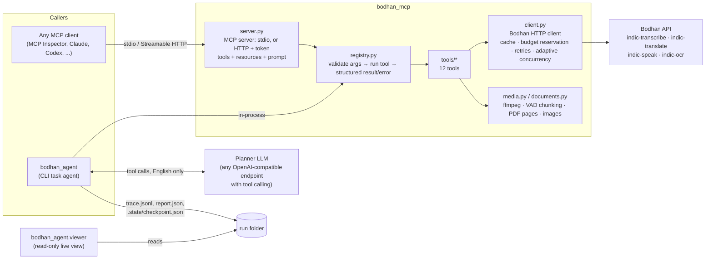
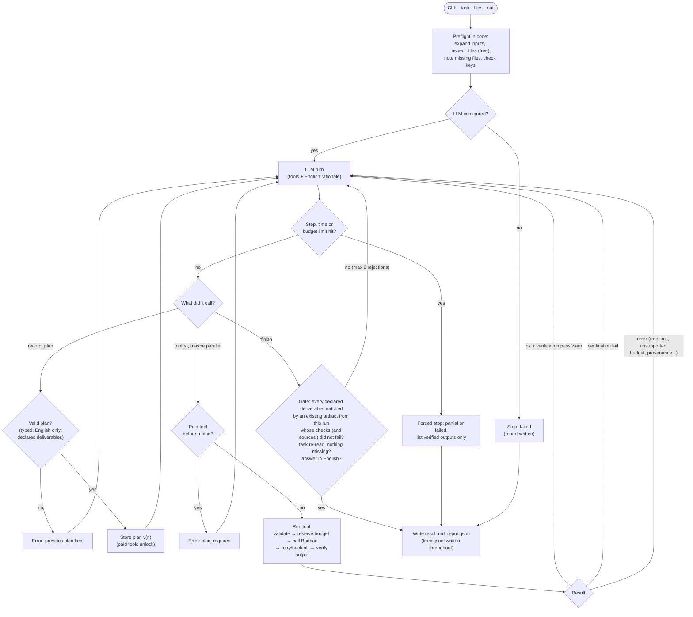

# Design notes

How the recipe is built and why. Setup and commands are in the [README](../README.md); the API behaviour these choices rest on is in [api_notes.md](api_notes.md).

> **The design in 10 minutes**
>
> - **One tool layer, two programs.** `bodhan_mcp` (MCP server, stdio or HTTP with a token) and `bodhan_agent` (CLI agent) call the same `registry.invoke()`. The agent calls it in-process, so a run has one budget, one cache and one trace.
> - **12 tools, one level above the models.** Each tool owns its model's limits (≤28 s audio pieces, ≤220-character speech requests, one OCR page per request, paragraph-sized translation) and verifies its own output. The planner owns the task.
> - **The LLM decides, code permits.** Paid tools stay locked until a typed plan declares its deliverables. Each request reserves its worst-case cost first. `finish` passes only if every declared deliverable matches a verified artifact from this run, and a fresh reading of the task finds nothing missing.
> - **No Indian-language text from the LLM.** A provenance guard, `write_text` and the finish gate enforce it in code.
> - **Every output is checked.** Translations are back-translated (chrF), and every speech segment is back-transcribed. A failure is repaired with a different input (a speech segment once, a truncated translation by splitting up to three levels), or reported.
> - **Any OpenAI-compatible planner.** Provider differences are adapted in `llm.py` and listed in `report.json`.
> - **A report at every checkpoint.** Each checkpoint writes a provisional report, and `--resume` continues the same run.

## Architecture

The brief allows the agent to "import the same tool code directly", which is what it does.

| Part | Job |
|---|---|
| `bodhan_mcp/server.py` | Lists tools with input and output schemas, returns `structuredContent` plus the same JSON as text, maps every failure to `isError: true` with `{code, message, retryable, hint?, details?}`. Resources `bodhan://voices`, `bodhan://languages`, `bodhan://pricing`, `bodhan://errors`; prompt `plan_media_task`. |
| `bodhan_mcp/registry.py` | One `invoke()` for both callers: pydantic validation, the handler, and a last-resort guard, so bad input never crashes a client. |
| `bodhan_mcp/tools/` | The tools. Each handles its model's limits and verifies its own output. |
| `bodhan_mcp/client.py` | The only code that talks to Bodhan: cache, budget reservation, per-model adaptive concurrency, bounded retries, billing classification, trace events. |
| `bodhan_mcp/runtime.py` | Cost ledger, result cache, artifact registry, run context. |
| `bodhan_agent/loop.py` | Plan, act, verify, retry, stop: typed control calls and code-enforced gates around the LLM's decisions. |
| `bodhan_agent/llm.py` | The planner client and its provider adaptations. |
| `bodhan_agent/state.py` | Checkpoints for `--resume`: atomic JSON in `out/.state/`, input fingerprints, no keys. |
| `bodhan_agent/report.py`, `viewer.py` | `result.md` and `report.json`; a read-only local page that follows a run. |

## Agent loop

- **Steps.** Every planner call is one step, `record_plan` and `finish` included. A turn can't use more steps than remain: extra calls are refused, not run. When one step is left, only `finish` is offered.
- **Deadline.** `--max-seconds` starts with the command and covers preflight, planner calls, tools, rate-limit waits and ffmpeg. `--call-timeout` bounds each request.
- **Checkpoints.** Written before and after each turn's tool calls (see [Resume](#resume)).

"Retry" in the chart means one of three things:

- **Transport retry** inside `client.py`: 429, 5xx, timeouts and dropped connections, with backoff. The planner sees these only if they keep failing.
- **Repair** inside a tool, with a *different* input: a truncated translation is split in half, a reflowed table is translated cell by cell, a TTS segment that fails back-transcription is re-synthesised split in two or with the other voice of the same gender.
- **Re-plan** by the LLM after a structured error or a failing check. The prompt allows one different repair, then an honest report.

## Tool granularity

| Tool | Model | What the tool hides from the caller |
|---|---|---|
| `transcribe_audio` | indic-transcribe | Common audio and video containers up to 60 minutes (WAV, MP3, M4A/MP4, OGG/Opus, FLAC, WebM, AAC, AMR and others; playlists and manifests refused), 16 kHz mono, pause-aware cuts into ≤28 s pieces, silence trimmed so it is not billed, language detected from the script of the first piece, segment times. |
| `create_subtitles` | transcribe + translate | Cue-sized pieces with times, cue-by-cue translation, back-translation, both `.srt` files. |
| `translate_text` | indic-translate | Paragraph units, tables kept (cell-by-cell fallback), same-language passages kept, truncation split, SRT timing kept, back-translation. |
| `synthesize_speech` | indic-speak | ≤220-character requests, voice and style validated before spending, every segment back-transcribed with one repair, MP3/WAV, AI-generated label. |
| `ocr_document` | indic-ocr | Images including HEIC/HEIF (EXIF rotation, downscaling), multi-page TIFFs and PDFs page by page, clean text layers used for free (see [Input boundaries](#input-boundaries)), page markers, retry with a larger `max_tokens`, then an incomplete page is reported. |
| `verify_translation`, `verify_speech` | translate / transcribe | The same checks, for outputs made elsewhere. |
| `inspect_files`, `detect_language`, `read_text`, `write_text`, `list_voices` | none (free) | Planning metadata, script-based language ID, paging through artifacts, saving English text. `write_text` records the files a text was based on (`source_paths`); each must first be read in full with `read_text`, and again after `--resume`. |

**Why 12 tools.** Five do the work: the four models plus subtitles. Seven serve the planner: two verifiers for outputs made elsewhere, and five free helpers to look before spending, page through long artifacts and write English through a tool that refuses Indic text. Folding the helpers into the model tools would hide those steps from the trace and make each schema harder to fill.

Two other shapes were rejected:

- **One thin tool per model.** The planner would have to chunk audio, split text and stitch results. That costs many LLM turns, floods its context and gets limits wrong: the 30 s audio limit is a fact about the model, not the task.
- **Task-level tools** such as `summarize_chapter_to_audio`. They hide decisions the brief wants the agent to make (length, language, summarise or translate) and do not generalise to unseen tasks.

`create_subtitles` is the one composite tool. Subtitles need cue-sized audio pieces from the start; chaining `transcribe_audio` and `translate_text` would transcribe the same audio twice, or make the planner manage cue timing.

**Media never enters the LLM context.** Tools take file paths and return artifact paths plus short previews. Audio and images are read only by code and sent to Bodhan; an OCR page is base64-encoded inside the HTTP body, never in a planner message or the trace. A planner reads a long text page by page with `read_text`.

## Where the LLM is used

| Decision point | What the LLM decides | If it fails |
|---|---|---|
| Plan (`record_plan`) | Steps, assumptions for ambiguous wording, deliverables | Paid tools stay locked until a plan exists. |
| Tool choice and arguments | Which tool, language, voice, length, file | Tools validate everything. Errors carry a `hint` naming the fix. |
| English writing (`write_text`) | Summaries, answers, lists of results | Indian-language text is refused; it must come from `translate_text`. |
| Judging results | Reads `verification` and decides to repair, re-plan or report | The finish gate re-checks the same facts in code. |
| Final answer (`finish`) | Status and an English explanation | The gate rejects unverified, failing or invented deliverables (including failures inherited from embedded or source artifacts), non-English answers, and `completed` with no work behind it. After two rejections the run is downgraded to `partial` or `failed`, with the reasons listed. |

A planner request that hits a rate limit gets up to six attempts, waiting as long as the provider asks (`Retry-After` or "try again in N s"), at most 90 s per wait and never past the deadline. Other transient planner errors get three attempts. Bodhan rate limits are handled separately in `client.py` (see [Recovery](#recovery)). If the planner still fails (network, outage, misconfiguration), the run stops with a full report: `partial` when usable checked artifacts exist, otherwise `failed`. The report includes what code checked itself, such as missing files.

## Planner portability

The graders bring their own planner, so `llm.py` assumes only `chat.completions` with `tools` and adapts when a provider differs. Each adaptation used is listed in `report.json` under `llm.adaptations`.

| Provider behaviour | What the client does |
|---|---|
| Extra fields on the reply that must come back next turn (Gemini thought signatures in `extra_content`, `reasoning_content`) | Sent back unchanged. OpenAI-only fields such as `refusal` are not echoed, because other providers reject them. Tool-call messages carry `content: null`. |
| `tool_choice` rejected | Dropped for the rest of the run. |
| `tools` rejected | Tools described in the system message; replies parsed as JSON (text protocol). |
| A tool call written as text: `{"name": ..., "arguments": ...}`, `<function=NAME>{...}`, bare arguments that fit exactly one tool's schema, arguments as JSON inside a string, names wrapped in `functions.` or `<\|channel\|>` | Parsed into a normal tool call. |
| Groq `400 tool_use_failed` with a `failed_generation` | The failed generation is parsed as above. |
| `null` for an optional argument | Treated as not given. |
| Context-length rejection or `413` (for example Groq's on-demand tier, which refuses any request over 8,000 tokens) | Older tool results are shortened in steps (keep the last two; keep the last one shortened; shorten every result and the planner's own long arguments) until the request is accepted. Artifacts stay on disk, so `read_text` can reopen anything. Conversations over about 90 kB are shortened before sending. |
| Too long before any conversation (system prompt, tool list and inputs over the cap, as with `gpt-oss-20b` on Groq's on-demand tier) | The short tool list (names, types, each tool's first sentence; about half the size) is sent from then on. |
| A plain-text final answer after two reminders to call `finish` | Passed to the gate as `finish` with status `partial` (plain text never claims completion). |

Live results per planner are in [evaluation.md](evaluation.md#other-planner-models).

## Indian-language text never comes from the LLM

The prompt states the rule, and code enforces it in four places:

1. **`ProvenanceGuard`** (`tools/common.py`). In agent runs, any Indian-language text the planner passes inline must be copied unchanged from the task, an input file or a Bodhan output, either as one passage or as whole sentences. Each Indic passage is checked on its own, so surrounding English cannot hide an invented one. The planner may choose which Bodhan sentences to use; it cannot change a word. Otherwise the call fails with `provenance_violation`, and the planner must pass the text by artifact path.
2. **`write_text`** refuses any Indian-language letter written by the caller, including unicode escapes inside JSON. Existing artifacts are embedded by reference, `{{artifact:<path>}}`, and the new file inherits their verification.
3. **The finish gate** never accepts planner-written Indian-language text in the answer, assumptions or limitations. Only that text is removed, replaced by a code-written note; the English stays.
4. **`create_subtitles`** reuses only transcripts that `transcribe_audio` produced in the same session, so planner-written JSON cannot pass as Indic-Transcribe output.

Text is compared as a reader sees it: character references decoded, one Unicode normal form (a precomposed and a combining nukta are the same letter), no zero-width joiners or soft hyphens. Input file and folder names count as known text, so an answer may name an Indian-language file.

The checks look for Indic-script letters. Indian-language text written in Latin script (romanized Hindi, for example) is not caught; the prompt rule is the only defence there.

## Verification

Every translation and every generated audio file is checked before the run can finish. Checks are paid calls, and the budget reservation includes them.

**Translation** (`verify_units`):

- Share of letters in the target script: below 50 % fails.
- Numbers preserved, after converting Indic digits. Missing numbers only warn, because the model may spell them out.
- Table shapes identical; a changed shape fails.
- Repetition not much higher than in the source.
- Back-translation with Indic-Translate, then chrF against the source. Under 60 % of the source length, or chrF under 0.15, fails as "incomplete or wrong". This is how silent omissions show up.
- A paragraph that comes back with fewer sentences warns.
- A paragraph already in the target language is kept without a model call. For scripts several languages share (Devanagari, Bengali, Perso-Arabic) this happens only when the caller states the source language.

**Speech** (`synthesize_speech`): every segment is back-transcribed (in ≤28 s pieces if long) and compared letter by letter. Numbers the ASR writes as digits are compared separately. Under 0.5 similarity fails; 0.5–0.72 warns. Segments whose speaking rate is far from the median (repetition or skipping) are flagged. A failing segment is re-synthesised once with a different input. A requested length is checked against the duration (±25 % warns).

The LLM never sees audio and never judges Indian-language text. It reads English back-translation previews and the numeric checks.

## Budgets, cost and caching

- **Bodhan prices are the published ones; usage is metered per request.** The unit prices in `runtime.py` match [console.bodhan.ai](https://console.bodhan.ai/) as checked on 19 November 2026: ₹0.10 per audio minute, ₹0.20 per 10,000 output tokens, ₹6 per 10,000 input characters, ₹0.20 per image. Audio seconds are rounded up per request (the provider bills per second but does not publish how fractions round), so this side is conservative. Translation uses the reply's `completion_tokens`; a reply without usage is priced at its token cap and reported as `bodhan_billed_estimated_inr`. Verification and repair calls are counted; cache hits cost nothing. The Bodhan dashboard is the authority for actual debits.
- **Reservation before sending.** `CostLedger.reserve()` takes a request's worst-case cost before it is sent: exact for audio seconds, characters and images, `max_output_tokens` for translation. A request reserves only once it holds a concurrency slot, and a cancelled one releases it. Concurrent calls can never push the total over `--max-cost-inr`. Long jobs (`synthesize_speech`, multi-page `ocr_document`) check the whole job's cost first, so they fail cleanly instead of stopping halfway.
- **Billing classes.** `billed`: success, cost from the response. `uncertain`: timeout, 5xx or unreadable body after sending; counted against the budget because it may have been billed. `none`: 4xx and 429, not billed.
- **Planner spend.** The runner chooses the planner's provider and billing (a gateway on a flat-rate plan is not billed per token), so no planner price is built in. Tokens are always reported. They count in rupees only with `--llm-input-inr-per-1m` and `--llm-output-inr-per-1m`.
- **Priced planner calls use an upper bound.** A call is sent only if the budget covers prompt tokens ≤ the request's UTF-8 bytes plus per-message and tool margins, and output ≤ `max_tokens`. No byte-level tokenizer makes a token smaller than a byte, while one Indic character is 3 bytes and may be 3 tokens, so a characters-per-token average is no bound. On 14 recorded runs the bound was 4.9–5.4× the provider's reported prompt tokens, so a priced planner stops earlier than needed. The bound assumes the provider honours `max_tokens` (reasoning tokens included) and adds no large hidden prompt. A reply that still costs more is reported as `llm_over_pre_call_bound_inr` and an `llm_estimate_exceeded` trace event. Retries are checked again, and attempts that failed after sending are charged at the bound (`llm_uncertain`, `llm_error`).
- **No repeated paid input.** Results are cached by model, exact input bytes and settings. An identical request is served from the cache, and two in flight share one HTTP call. The only repeats are retries of a failed or timed-out attempt, counted as `retried_attempts` and charged as uncertain. Only complete results go to the disk cache (`~/.cache/bodhan_tool_agent` and the run's `.state/cache`). The cache holds transcripts and translations as plain files with default permissions, so use `--no-cache` for private material. Repairs always change the input.

## Recovery

| Failure | Handling |
|---|---|
| 429 rate limit | Not billed. The model's shared gate halves its concurrency and starts a cooldown that every request to that model waits out. Up to 7 attempts, honouring `retry-after` (capped at 60 s and at the deadline). Three successes in a row raise the concurrency again. |
| 429 out of credit | `credit_exhausted`, no retry. |
| Timeout, 5xx, dropped connection | Up to 3 attempts with exponential backoff; cost counted as `uncertain`. |
| Truncated translation (`finish_reason=length`) | Split and translate the halves, up to depth 3, then `truncated_output`. Never a partial result presented as complete. |
| Paragraphs merged or dropped | Paragraph-count check, then paragraph-by-paragraph translation. |
| Table reflowed | Cell-by-cell translation, table rebuilt in code. |
| TTS repeats or skips words | Caught by back-transcription; one re-synthesis with different input; a remaining failure is reported. |
| OCR block exceeds `max_tokens` (502) | Retry the page with `max_tokens=4096`. |
| Unsupported language, voice or file type | Structured error before any spending; no substitute output. |
| Missing files | Listed in the preflight inventory and `report.json`. |
| Budget too small | `budget_exceeded` with the needed and remaining amounts; the run finishes cleanly. |

## Language identification

`detect_language` and `inspect_files` identify languages from the script. Single-language scripts such as Telugu, Tamil and Bengali are reliable. Devanagari languages (Hindi, Marathi, Nepali and others) are told apart with function words, suffixes and letters such as ळ. Latin script counts as English only with English function words, at least one of which is not shared with French or romanized Hindi ("a", "on", "as" and "to" are shared). A short English line made only of shared words is left unidentified, so it is translated or flagged rather than passed through. A European-language source is refused only on strong evidence: three distinct function words, or two plus accented letters. Short or unusual texts may be mislabelled, and the result says so with a confidence value.

## Untrusted content

OCR text, transcripts, translations and text files come back wrapped as `{"content_kind": "untrusted_data", "note": ...}`. A heuristic flags instruction-like phrases (`injection_warning`), and the report repeats them under limitations. The real defence is structural: the prompt says data is never instruction, and the only tools are media tools and writes inside `out/artifacts`, with no shell, network or deletion. In agent mode, reads are confined to the input paths and the run's artifacts. The standalone server reads only below its starting folder (none when that is `/` or the home folder) unless you pass `--allow-dir` or `--allow-any-path`. In both modes, hidden files and folders (`.env`, `.git`) are refused, and network paths and URLs are refused before any filesystem call, so a Windows UNC path never opens an SMB connection. The held-out injection task (`h1_notice_injection`) keeps the injected line as translated content and does not follow it.

## What "completed" means

The plan declares the deliverables the task asks for, each with a kind (`audio`, `translation`, `subtitles`, `text`, `transcript`) and an optional language. The kind `answer` means the reply itself is the output, as in "which of these clips are Telugu?". `finish(status="completed")` is accepted only if each declared deliverable is matched by an artifact that:

- is one of the finish deliverables and exists on disk;
- was made by a tool in this run (the user's own input files count as trusted sources);
- fits the declared kind and language;
- did not fail its own checks, nor did anything it was made from or embeds.

An `answer` needs at least one successful tool call behind it.

The plan alone is not trusted to describe the task, for two reasons:

- **A revised plan cannot erase an output.** Every required output of an earlier plan stays an obligation. A new plan must keep it (a deliverable an artifact for it would also satisfy) or list it under `dropped` with a reason; otherwise the plan is refused and the old one stays. Dropped outputs appear under limitations, and the run is at best `completed_with_warnings`.
- **The task is checked, not only the plan.** Before `completed` is accepted, one more call to the planner model gets only the original task and the delivered items (no plan, no conversation) and names the delivered item that provides each requested output. An output with no listed item refuses `completed`, and so does a check that cannot confirm coverage: an empty or malformed reply, a failed call, or no budget for it. After two refusals the run ends `partial` with its usable outputs.

This check is the same model reading the task again with fresh context. It catches an output the plan never declared, but it can miss a gap or invent one, and it does not judge quality. The plan, the deliverables, every check and the coverage reply are in the trace.

Verification results are a history on each artifact. A later check never improves an earlier failure, and a translation can be re-checked only against its own source. To repair an output, the agent makes a new artifact.

## Input boundaries

- **Files.** The agent reads only its inputs and its own artifacts. A folder input never includes the output folder or hidden folders; an input inside `--out` is rejected before anything moves.
- **Media.** The container is identified from its first bytes and passed to ffmpeg explicitly, with only the `file` and `pipe` protocols allowed, so a playlist or concat manifest renamed to `.wav` can't make the decoder read other files.
- **Documents.** PDF pages and multi-page TIFF frames are pages. A clean PDF text layer is used without OCR unless images cover 15 % or more of the page (a scanned body can sit under a digital header), or the layer looks like a legacy Hindi font. Page ranges are clipped before they are expanded, and file types are sniffed from a few bytes.
- **File types.** Types are recognised from the extension or the first bytes, so a HEIC photo or a PDF without its extension is still read. Word, Excel and PowerPoint files and archives are refused by every tool with a hint (export to PDF or text; extract the archive).
- **Size limits.** Each is refused before any request: text files over 5 MB, more than 60 PDF pages in one `ocr_document` call (pass a page range and call again), and audio over 60 minutes. The audio limit needs a duration from the probe; a file whose duration the probe cannot read is bounded only by the ffmpeg timeout and the run deadline.
- **Run state.** `--resume` trusts `out/.state/checkpoint.json` (plain JSON, no pickle): anyone who can write there already has local write access.

## Resume

`--resume` continues the same run rather than starting a new one from cached results. The checkpoint (`out/.state/checkpoint.json`, replaced atomically) holds the task and the SHA-256 of every input, the limits, the conversation and any turn whose tool calls were in progress, the plan and step counter, the settled spend, the artifact records with their SHA-256, and the provenance record. It holds no keys.

On resume, a changed or missing input stops with a clear error, and artifacts whose files changed are dropped. An interrupted turn's calls run again. Finished paid work comes back from the run's own cache for free; a request that was in flight at the interruption may be sent again, because its first attempt can't be confirmed. Time and step limits carry over.

Each checkpoint also writes the report an interruption at that moment would leave: `"provisional": true`, stop reason `interrupted`, the artifacts that passed their checks, and the resume command. Ctrl-C and SIGTERM keep the checkpoint written before the turn and refresh only that report; a hard kill leaves the last checkpoint and its report. Tests cover all three, the kill and the interrupt in a real child process.

## HTTP transport

`--transport http` serves the same server through the MCP SDK's Streamable HTTP app at `/mcp`, so protocol negotiation and sessions are the SDK's. A small ASGI wrapper requires `Authorization: Bearer <token>` on every request and compares it in constant time. The token comes from a file (generated if missing) and is never a provider key. The server binds to loopback unless you pass `--allow-remote`, and the SDK adds Host and Origin checks against DNS rebinding (the live viewer checks Host the same way). If the token file is missing, a random token is written there, by default `bodhan_mcp/http_token` in the user config folder (`%APPDATA%` or `~/.config`), outside the artifacts folder that tools read and users share. The server speaks plain HTTP, so with `--allow-remote` put it behind a TLS-terminating proxy so the token is never sent in clear text. The token check covers HTTP requests; the app has no WebSocket route and no WebSocket library is installed, so no other request type reaches it.

## Worked trace: d1

One real run, the cold demo d1 ("Make a two-minute Tamil audio summary of this chapter", an 8-page scanned Tamil PDF, planner `gpt-6.1-sol`). Each row is one planner step from [its trace](../evaluation/runs/sol_demos_cold/d1_chapter_tamil_audio/trace.jsonl); "why" quotes the planner's own rationale.

| Step | Planner chose | Why (planner) | What came back | s | ₹ |
|---|---|---|---|---|---|
| 1 | `record_plan` | five steps; deliverables: the Tamil audio and the Tamil text it reads | plan recorded; paid tools unlocked | – | 0 |
| 2 | `ocr_document` | "extract all eight pages so the summary reflects the whole chapter" | 8 pages OCR'd, 3,814 characters, detected Tamil (0.99) | 26.7 | 1.60 |
| 3 | `translate_text` → en | "translate the extracted chapter into English to accurately identify its main points" | English translation, check **warn**: two passages have fewer sentences than the source | 96.9 | 0.034 |
| 4 | `read_text` | "read the full English translation; its verification flagged two passages" | the whole translation, as untrusted data | 0 | 0 |
| 5 | `write_text` | "draft a concise summary covering the water cycle, its importance, and practical ways to conserve water" | 1,295-character English summary (the guard accepts it: no Indic text) | 0 | 0 |
| 6 | `translate_text` → ta | "translate the final summary into Tamil and verify it before narration" | Tamil summary, check **pass** | 10.9 | 0.014 |
| 7 | `synthesize_speech` | "generate the audio with a 120-second target and check it" | 9 segments, 125.8 s (+5 %), every segment back-transcribed, mean similarity 0.998, **pass** | 76.1 | 1.15 |
| 8 | `finish` | `completed` with the MP3 and the Tamil text | gate: both deliverables exist and passed; the warned translation they depend on makes it **completed_with_warnings** | – | 0 |

Total 258 s and ₹2.7972 of Bodhan spend. Code made two decisions the planner did not: it held paid tools until step 1, and it downgraded the result because a source of the deliverables carried a warning.

## Choices I did not make

- **No agent framework.** The loop is one file (`loop.py`). A framework would add dependencies and hide the gates that matter here.
- **No word-level timestamps.** `indic-transcribe` returns text only, so cue boundaries are the pause-based cuts, or a proportional split when an earlier transcript is reused.
- **No LLM-written corrections of Indian-language text**, even when a back-translation looks wrong. The agent reports the problem instead.
- **No special cases for the demo tasks.** No code branches on task wording. Examples in the prompt and the field descriptions (French video, Telugu clips, a two-minute Tamil summary) are illustrative.
- **No MCP client inside the agent.** In-process calls give one budget across tools and simpler tracing. MCP compatibility is tested separately with an independent client process (`tests/test_mcp_stdio.py`) and with MCP Inspector.
