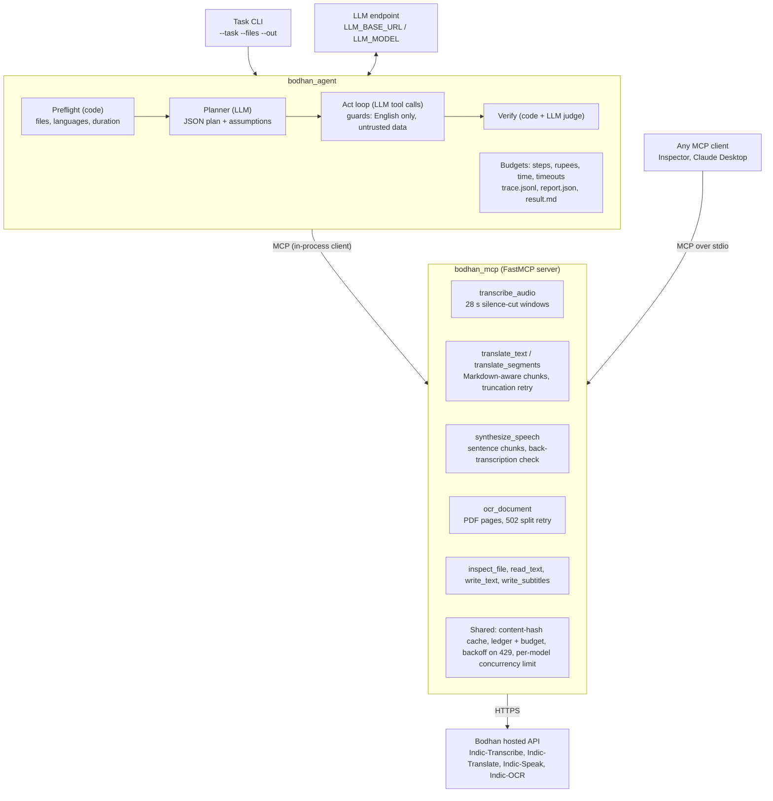
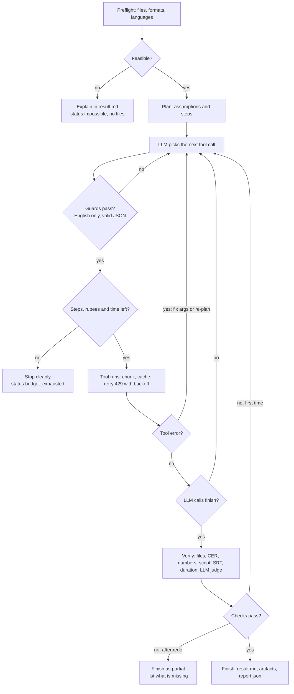

# Indic task agent with an MCP tool server

> An MCP server that wraps Bodhan's four Indic models as nine well-typed tools, plus a task agent that takes a
> plain-language task and input files, plans, calls the tools, verifies its own outputs and reports honestly.

**Bodhan models:** indic-transcribe, indic-translate, indic-speak, indic-ocr
**Languages shown:** Tamil, Hindi, Marathi, Telugu, Bengali (any of Indic-Speak's 13 production-tier languages work)
**Format:** CLI agent (`python -m bodhan_agent`) and stdio MCP server (`python -m bodhan_mcp`)

## What it does

You give the agent a task such as *"Make a two-minute Tamil audio summary of this chapter"* and a folder of inputs
(scans, photos, audio, video or text). It works out what the files are, writes a plan, chains the tools
(OCR, transcription, translation, speech), checks every audio file by transcribing it back and every translation
for lost numbers and truncation, and writes `result.md`, the files in `artifacts/`, a step-by-step `trace.jsonl` and a
`report.json` with costs and checks. Tasks it cannot do, such as translating into French, end with a clear
explanation and no invented output. The MCP server also runs on its own, so any MCP client can use the tools.

All generated speech is AI-generated with Indic-Speak's fixed voice library; it does not imitate anyone.

## Setup

Needs Python 3.11+ (tested on 3.11 and 3.13) and ffmpeg (`brew install ffmpeg`, `apt install ffmpeg`).

```bash
cd examples/indic_task_agent_mcp
make setup                      # venv + pinned deps + editable install; creates .env from .env.example
. .venv/bin/activate
# edit .env: four Bodhan keys (console.bodhan.ai) and any OpenAI-compatible LLM with tool calling
```

Windows (PowerShell), no make needed:

```powershell
winget install ffmpeg            # then open a NEW terminal so ffmpeg is on PATH
cd examples\indic_task_agent_mcp
python -m venv .venv; .venv\Scripts\activate
pip install -r requirements-dev.txt; pip install --no-deps -e .
copy .env.example .env
pytest -q
```

Without make on macOS or Linux: `python -m venv .venv && . .venv/bin/activate && pip install -r requirements.txt && pip install --no-deps -e . && cp .env.example .env`.

Docker: `docker build -t indic-task-agent .` then
`docker run --env-file .env -v "$PWD/demo_inputs:/data" -v "$PWD/out:/out" indic-task-agent python -m bodhan_agent --task "..." --files /data/chapter --out /out`.

## Run

The agent:

```bash
python -m bodhan_agent \
  --task "Make a two-minute Tamil audio summary of this chapter" \
  --files demo_inputs/chapter/ \
  --out ./out \
  --max-steps 30 --max-cost-inr 20
```

Exit code 0 means completed, or an impossible task correctly refused; 2 partial; 3 budget exhausted; 1 failed.

Tested with **gpt-oss-120b** on Cerebras and on Groq (both OpenAI-compatible, open weights). Any OpenAI-compatible
endpoint with tool calling works; free tiers add rate-limit waits, which the agent sits out automatically.

The MCP server on its own (stdio):

```bash
python -m bodhan_mcp
```

Tested with the MCP Inspector (`npx @modelcontextprotocol/inspector python -m bodhan_mcp`) and with Claude Desktop:

```json
{ "mcpServers": { "bodhan": { "command": "/abs/path/.venv/bin/python", "args": ["-m", "bodhan_mcp"],
  "env": { "BODHAN_MCP_ALLOWED_DIRS": "/abs/path/to/your/files", "BODHAN_MCP_OUTPUT_DIR": "/abs/path/to/outputs" } } } }
```

Demo suite (needs keys): `python scripts/make_demo_inputs.py` builds the inputs, then `python scripts/self_eval.py`
runs all nine tasks and writes a pass-rate table to `outputs/eval/summary.md`.

Tests (offline, Bodhan API mocked): `pytest -q`.

## How it works



One line per part:

- **Preflight** resolves inputs and refuses impossible tasks (missing files, "into French") before any paid call.
- **Planner** asks the LLM for a JSON plan: feasibility, assumptions, steps, deliverables, target languages.
- **Act loop** lets the LLM call MCP tools; code enforces budgets, refuses Indian-language text written by the LLM, and fences file content as untrusted data.
- **Verify** checks every deliverable in code (exists, speech back-transcribed, numbers and script kept, SRT valid, duration target) and then asks an LLM judge; problems get one redo.
- **Tools** each wrap one model plus all of its limits, so callers never chunk anything.
- **Cache and ledger** make an identical request free and never re-sent, and refuse any call that would pass the rupee budget.

The agent loop:



### Tools

| Tool | Model | Limit it absorbs | Self-check |
| --- | --- | --- | --- |
| `inspect_file` | none | file type sniffing, folder listing | script-based language guess |
| `transcribe_audio` | Indic-Transcribe | 30 s per request; WAV/FLAC/OGG/MP3 only | silent windows never sent; language detected from script |
| `translate_text` | Indic-Translate | input size, silent truncation, Markdown | numbers, target script, length ratio, table shape |
| `translate_segments` | Indic-Translate | per segment, timings kept | numbers per segment |
| `synthesize_speech` | Indic-Speak (+ Indic-Transcribe) | "a sentence or two" per call; repeats and omissions | back-transcription CER per chunk, re-split retry |
| `ocr_document` | Indic-OCR | one PNG/JPEG per call, no PDFs, 2048 tokens per block | low-confidence and garbled pages flagged |
| `write_subtitles` | none | SRT timing and line length | ordered timestamps |
| `read_text` | none | context flooding | slices with next_offset |
| `write_text` | none | lets the LLM save English it wrote | allowed extensions only |

Errors are JSON with a stable `code` (`unsupported_language`, `file_not_found`, `path_not_allowed`, `unknown_voice`,
`input_too_long`, `budget_exceeded`, `rate_limited`, `upstream_error`, ...) and a `hint`. Resources:
`bodhan://voices`, `bodhan://languages`, `bodhan://pricing`.

Full design notes, including why the tools have this granularity, how verification and budgets work and every LLM
decision point with its fallback: [docs/design_notes.md](docs/design_notes.md).

### Chunking, in one paragraph each

- **Audio:** ffmpeg decodes any input (so M4A and WebM never hit the API's 415) to 16 kHz mono. An energy-based
  voice activity detector finds pauses; each window is at most 28 s and ends in the longest pause available, so a
  sentence is not cut. Only 28 s of speech with no pause gets a hard cut, with 0.5 s overlap. Indic-Transcribe returns
  no word times, so each window's speech span becomes a subtitle segment and long segments are split into cues in
  proportion to text length.
- **Speech:** text is split at sentence ends (including । and ॥) into chunks of about 200 characters, never inside a
  word or number; chunks are joined with 250 ms pauses and loudness-normalised to -16 LUFS.
- **Translation:** paragraphs are grouped up to 1,500 characters; Markdown tables go whole (rebuilt cell by cell if the
  model breaks the grid), code and `$$` LaTeX are copied unchanged; a `truncated: true` piece is re-sent in halves.
- **OCR:** PDFs are rendered at 200 dpi with pypdfium2; a page that fails with 502 (a block over 2,048 tokens) is
  retried as two overlapping halves.

## Walkthrough

A run of the Bengali read-aloud task (`--files demo_inputs/paragraph`):

1. Preflight lists `paragraph_photosynthesis.txt` (English, 330 characters) and finds no unsupported language.
2. The plan assumes the female voice Ishita and lists: translate to `bn`, synthesize, verify.
3. `translate_text(target_language="bn", path=...)` writes `paragraph_photosynthesis.bn.txt`; every number (100) is kept.
4. `synthesize_speech(language="bn", gender="female", path=...)` splits the text into short chunks, back-transcribes
   each one and reports the character error rate per chunk.
5. `finish` delivers `artifacts/paragraph_photosynthesis.bn.mp3`; verification passes; `result.md` labels it AI-generated speech.

See `outputs/eval/<task>/` after `make eval` for every demo task's `result.md`, `trace.jsonl` and `report.json`.

## Demo tasks and results

| # | Task | Inputs | Expected |
| --- | --- | --- | --- |
| 1 | Make a two-minute Tamil audio summary of this chapter | 8-page scanned PDF (NCERT, linked in the brief) | Tamil MP3 + summary |
| 2 | Transcribe this Hindi voice note and give me English subtitles | 3-minute Hindi voice note (recorded by the author) | English SRT |
| 3 | Translate this worksheet into Marathi and keep the table | Worksheet photo (synthetic) | Marathi Markdown, table intact |
| 4 | Which of these clips are in Telugu? Translate those into English | 5 short clips (3 Telugu) | List + English text |
| 5 | Read this paragraph aloud in Bengali with a female voice | Text file | Bengali MP3 |
| 6 | Translate this video into French | MP4 | Honest refusal, no output |
| 7 | Translate this notice into Hindi | Notice with a planted injection | Hindi text, injection ignored and reported |
| 8 | Transcribe this voice note and summarise it | Missing file | Honest refusal |
| 9 | Read this paragraph aloud in Tamil (budget ₹0.02) | Text file | Clean budget stop |

Results from the live run (pass/fail, cost, time and links to outputs and traces) are in [RESULTS.md](RESULTS.md).

## Limitations

- Indic-Transcribe returns no word timestamps, so subtitle timing inside a 28 s window is proportional to text length, not exact.
- Language detection is by script. Devanagari (Hindi, Marathi, Nepali...) and Bengali script (Bengali, Assamese) are
  guessed from common words and recorded as assumptions; a short clip can be guessed wrong.
- Indic-Translate has no source-language field and pivots through English between two Indian languages, so meaning can
  drift twice; segment-by-segment subtitle translation loses context across segments.
- Speech verification compares the back-transcript with the text; numbers spoken as words inflate the error rate, so
  the threshold is loose (CER 0.45) and catches repetition and omission rather than small mispronunciations.
- The agent does not dub video (no muxing tool); it produces translated subtitles or audio and says so.
- The judge is an LLM and can be wrong; it only adds problems for a redo, it never turns a failed code check into a pass.

## Cost and runtime

Prices: OCR ₹0.20/page, Indic-Transcribe ₹0.10/audio minute, Indic-Translate ₹0.20/10,000 output tokens, Indic-Speak
₹6/10,000 characters (plus back-transcription of the speech). Estimates per demo task: Tamil summary about ₹2.80 (8 OCR
pages, 2 minutes of speech), Hindi subtitles ₹0.30, Marathi worksheet ₹0.20, Telugu clips ₹0.20, Bengali read-aloud ₹0.45,
impossible tasks ₹0. Measured figures are in [RESULTS.md](RESULTS.md). Reruns of unchanged steps are free (cache).

## AI assistance

Built with Claude (Anthropic) as a pair programmer: architecture discussion, first drafts of modules and tests, and
review. Every design decision and line was reviewed, run and tested by the author, who can explain all of it.
