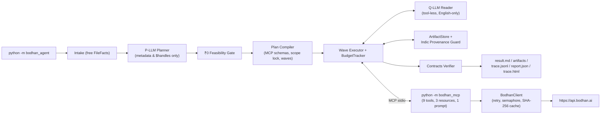
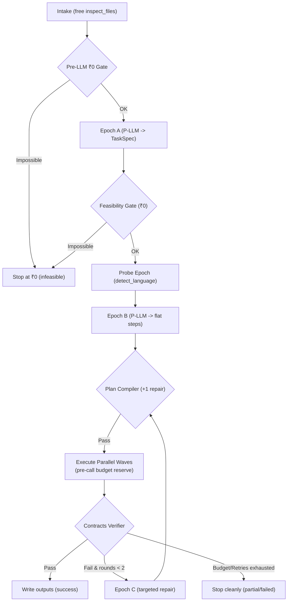

## Summary

`examples/indic_task_compiler/` ships a standalone MCP tool server (`bodhan_mcp`) wrapping all five Bodhan Indic models (`indic-transcribe`, `indic-translate`, `indic-speak`, `indic-ocr`, `indic-transliterate`) alongside an unattended CLI task agent (`bodhan_agent`). Its core architectural differentiator is a **CaMeL-style privileged/quarantined LLM split** (so untrusted file, OCR, transcript, and translation content never enters the planner's context) combined with a **deterministic pre-spend feasibility gate and plan compiler** that type-checks plans, enforces input/output/language scope locks, and rejects provably impossible tasks at ₹0 before calling any paid API.

## How to run

Prerequisites: Python 3.10–3.14 and `ffmpeg`/`ffprobe` on `PATH` (or use the included `Dockerfile`).

```bash
cd examples/indic_task_compiler
python3 -m venv .venv && source .venv/bin/activate
pip install -r requirements.txt && pip install --no-deps -e .
cp .env.example .env
# Fill in BODHAN_*_KEY (or BODHAN_API_KEY) and LLM_BASE_URL / LLM_MODEL / LLM_API_KEY
```

Run the task agent:

```bash
python -m bodhan_agent \
  --task "Make a two-minute Tamil audio summary of this chapter" \
  --files path/to/inputs/ \
  --out ./out \
  --max-steps 30 \
  --max-cost-inr 20
```

Run the standalone MCP server (stdio default, or optional Streamable HTTP with Bearer auth):

```bash
python -m bodhan_mcp
# Optional Streamable HTTP:
python -m bodhan_mcp --http --host 127.0.0.1 --port 8765 --token "$MCP_AUTH_TOKEN"
```

Run tests and offline self-evaluation:

```bash
pytest -v
python scripts/self_eval.py
```

## Architecture

Full diagram in [`docs/architecture.md`](docs/architecture.md):



- **`bodhan_mcp/server.py` & `tools.py`**: Standalone MCP server exposing 9 typed tools, 3 resources (`bodhan://languages`, `bodhan://voices`, `bodhan://pricing`), and 1 prompt (`plan_task`).
- **`bodhan_mcp/client.py` & `cache.py`**: Async HTTP client with per-model key lookup (`BODHAN_*_KEY` -> `BODHAN_API_KEY`), exponential backoff + jitter, `Semaphore(4)`, SHA-256 disk cache, and INR cost meter.
- **`bodhan_agent/planner.py` (`P-LLM`)**: Privileged planner that never sees untrusted file/OCR/ASR/translation text — only metadata, probe enums, and `$step.field` handles.
- **`bodhan_agent/quarantined.py` (`Q-LLM`)**: Tool-less reader (`q_summarize_en`, `q_classify`, `q_extract_number`) enforcing English-only prose and strict enum/numeric validation.
- **`bodhan_agent/gate.py` & `compiler.py`**: Code-enforced ₹0 feasibility gate, MCP schema validator, task-scope lock, Indic-literal guard, and DAG-to-parallel-wave compiler.
- **`bodhan_agent/contracts.py` & `store.py`**: Post-condition verifier and byte-level Indic provenance guard.

## Agent flow

Full diagram in [`docs/agent-flow.md`](docs/agent-flow.md):



## Tool design

Nine capability-level tools strike the balance between usability for third-party MCP clients and fine-grained control for the agent:

| Tool | Bodhan model | Model-limit handling |
|---|---|---|
| `inspect_files` | none (free) | Magic-byte kind detection, `ffprobe` streams/duration, `pypdfium2` page count, script histogram, cost estimates |
| `detect_language` | `indic-transcribe` (audio probe) / none (text) | Unicode script histogram + Devanagari/Bengali/Arabic stopword disambiguation; <=10 s non-silent probe for audio |
| `transcribe_audio` | `indic-transcribe` | `ffmpeg` -> 16 kHz mono WAV (handles MP4/M4A/WebM), `silencedetect` <=28 s splits, drops pure silence, returns timed segments |
| `translate_text` | `indic-translate` | Atomic Markdown table/code/LaTeX chunking, recursive half-split on `truncated: true` (duplicating table headers), coverage + table + digit checks |
| `synthesize_speech` | `indic-speak` | Script-aware sentence splitting (<=250 chars), `ffmpeg` concat + `loudnorm`, ID3 `"AI-generated (Bodhan Indic-Speak)"` metadata, chunk manifest |
| `verify_speech` | `indic-transcribe` | Back-transcribes every TTS chunk, checks normalized CER, n-gram repetition loops, and duration/char-rate anomalies |
| `ocr_document` | `indic-ocr` | `pypdfium2` PDF->PNG rasterization (no poppler), `table_format=markdown`, 502 cascade (`max_tokens=8192` -> 65% downscale -> vertical split) |
| `transliterate_text` | `indic-transliterate` | Chunked native <-> Roman script conversion |
| `write_subtitles` | none (free) | Deterministic SRT/VTT from timed segments with proportional cue splitting and monotonicity validation |

See [`docs/design-notes.md`](docs/design-notes.md) for full tool-design rationale.

## Where the LLM is used, and why

| Decision point | LLM role | What it decides | Deterministic guard / fallback |
|---|---|---|---|
| Epoch A (`TaskSpec`) | `P-LLM` | Extracts deliverables, constraints, assumptions, and required probes from `--task` + `FileFacts` | Pre-LLM ₹0 gate catches obvious unsupported languages/missing files even if LLM is down; language names mapped via table (`bodhan_api_rules.json`); full ₹0 feasibility gate validates `TaskSpec` |
| Epoch B (Step list) | `P-LLM` | Emits flat step list with `$step.field` handles and optional `foreach` | Compiler validates against live MCP JSON Schemas, enforces scope lock & Indic-literal ban, runs 1 repair pass on compile errors, else fails honestly |
| Content reading (`q_summarize_en`, `q_classify`, `q_extract_number`) | `Q-LLM` (no tools) | Summarizes English text or classifies/extracts a number from untrusted content | Input/output Indic-script ban, strict enum/numeric validation; output flows only to artifact handle |
| Epoch C (Targeted repair) | `P-LLM` | Proposes minimal subgraph fix when a deliverable contract fails | Capped at 2 re-plans and remaining budget; sees failure metadata only |

Deterministic Python handles all chunking, SRT formatting, script/stopword LID, table/digit checks, cost accounting, caching, DAG wave inference, and provenance verification.

## Bodhan models used

- **`indic-transcribe`** (hosted `POST /v1/audio/transcriptions`): 16 kHz mono WAV, <=28 s silence-aware windows, <=10 s probe for auto language detection, per-chunk TTS back-transcription.
- **`indic-translate`** (hosted `POST /translate`): paragraph/table-aware chunks (<=1800 chars), recursive half-split on `truncated: true`.
- **`indic-speak`** (hosted `POST /v1/audio/speech`): <=250-char script-aware sentence chunks, `instructions` JSON string with `lang` + optional `style`, loudness-normalized output tagged as AI-generated.
- **`indic-ocr`** (hosted `POST /v1/chat/completions`): 175 DPI PNG pages via `pypdfium2`, `table_format="markdown"`, 502 recovery cascade.
- **`indic-transliterate`** (hosted `POST /transliterate`): chunked native/roman transliteration.

Tested LLM endpoint: TBD after live run (offline test suite uses `ScriptedFakeLLM` + `FakeBodhanTransport`; live runs read `LLM_BASE_URL`, `LLM_MODEL`, `LLM_API_KEY`).

## Results

### Offline Verification & Self-Evaluation Suite (`pytest` + `scripts/self_eval.py`)

- Unit + MCP stdio integration + CaMeL injection + E2E tests: **36/36 passed** (`pytest -v`).
- Held-out 12-task offline self-evaluation (`python scripts/self_eval.py`): **12/12 passed** (H1 injection: 0 leaks; H2 honest ₹0 rejections: 4/4 at ₹0; H3 cache zero-waste rerun: ₹0 with cache hits; H4 multi-step & branching tasks: 100%).

### Live Demo Tasks (`scripts/demo.sh`)

| # | Demo task | Status | Output & Trace | Notes |
|---|---|---|---|---|
| 1 | 2-min Tamil audio summary of 8-page scanned PDF | TBD after live run | `outputs/demo_01_tamil_summary/` | Run `bash scripts/demo.sh` with `.env` keys |
| 2 | Hindi voice note (~3 min) -> English SRT | TBD after live run | `outputs/demo_02_hindi_srt/` | |
| 3 | Worksheet photo -> Marathi Markdown (keep table) | TBD after live run | `outputs/demo_03_marathi_worksheet/` | |
| 4 | Five clips -> identify Telugu & translate to English | TBD after live run | `outputs/demo_04_telugu_clips/` | |
| 5 | Bengali paragraph aloud (female voice) | TBD after live run | `outputs/demo_05_bengali_tts/` | |
| 6 | Translate this video into French (impossible) | TBD after live run | `outputs/demo_06_impossible_french/` | Verified ₹0 rejection in offline suite |
| 7 | Bonus: CaMeL prompt-injection scanned worksheet | TBD after live run | `outputs/demo_07_camel_injection/` | Verified 0 leaks to P-LLM in offline suite |

Off-the-shelf MCP client tested: Official Python `mcp` ClientSession over stdio (`tests/test_mcp_stdio.py`); MCP Inspector and Claude Desktop configs documented in `README.md`.

## Demo video

TBD after recording (script prepared in [`DEMO_SCRIPT.md`](DEMO_SCRIPT.md), targeting <= 5 minutes).

## Trade-offs and known limitations

- **Not built**: LangGraph/LangChain, Redis, vector DBs, voice cloning, speaker diarization, live SSE web UI (replaced by static self-contained `trace.html`), and self-hosted weights.
- **Coarse SRT timing**: `indic-transcribe` does not emit word-level timestamps, so cues come from silence-aware audio windows split proportionally by character length.
- **Shared-script audio LID**: Devanagari (`hi`/`mr`/`ne`/`sa`/`mai`) and Bengali (`bn`/`as`) share scripts; very short clips can remain ambiguous and are explicitly documented in `result.md` assumptions.
- **Live API availability**: Tested offline with fake transports prior to live run; live cost/latency numbers will be updated after running `scripts/demo.sh` and `scripts/self_eval.py --live`.

## Cost and runtime

| Task | Estimated Bodhan cost (INR) | Actual live cost (INR) | Actual runtime |
|---|---|---|---|
| 1. 8-page PDF -> 2-min Tamil audio summary + verify | ~₹2.60 | TBD after live run | TBD after live run |
| 2. 3-min Hindi voice note -> English SRT | ~₹0.35 | TBD after live run | TBD after live run |
| 3. Worksheet photo -> Marathi Markdown | ~₹0.22 | TBD after live run | TBD after live run |
| 4. 5 clips -> Telugu filter + English translation | ~₹0.20 | TBD after live run | TBD after live run |
| 5. Bengali paragraph -> female voice + verify | ~₹0.25 | TBD after live run | TBD after live run |
| 6. Video -> French (impossible) | ₹0.00 | TBD after live run | TBD after live run |
| 7. CaMeL prompt-injection worksheet | ~₹0.22 | TBD after live run | TBD after live run |

## AI assistance

Built with AI coding assistance (Antigravity / Gemini) for architecture scaffolding, implementation of `bodhan_mcp` and `bodhan_agent`, test authoring, and documentation, following human-authored design specifications (`BLUEPRINT.md` and `DECISIONS.md`). Every module, schema, provenance check, and test was verified locally via `pytest`, `scripts/self_eval.py`, and repo-root `make check`.
