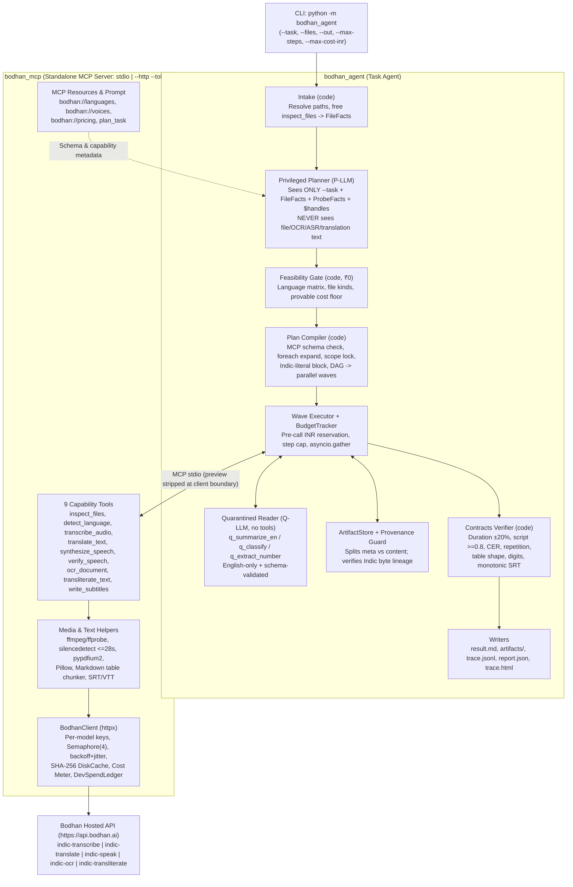

# Architecture — Indic Task Compiler

## Component responsibilities

- **`bodhan_mcp.server` (`python -m bodhan_mcp`)**: Standalone MCP server over stdio (or optional Streamable HTTP with Bearer auth). Returns bounded untrusted previews (<=300 chars) for third-party MCP clients.
- **`bodhan_mcp.tools`**: 9 capability-level tools that absorb all model limits internally (<=28 s silence-aware audio windows, table-preserving translation chunking + `truncated` recovery, <=250-char sentence TTS chunking + loudness normalization + AI-generated metadata tags, PDF rasterization via `pypdfium2` + 502 OCR recovery).
- **`bodhan_mcp.client` & `cache`**: Async `httpx` transport with per-model key resolution (`BODHAN_*_KEY` -> `BODHAN_API_KEY`), exponential backoff + jitter on 429/5xx/timeouts, single 401 retry for previously valid keys, concurrency semaphore, and SHA-256 content-addressed disk caching.
- **`bodhan_agent.planner` (`P-LLM`)**: Privileged planner operating in three epochs (Epoch A `TaskSpec`, Epoch B flat step list, Epoch C targeted recovery). Strictly isolated from untrusted file/OCR/transcript/translation text.
- **`bodhan_agent.gate` & `compiler`**: Deterministic Python checks that reject provably impossible tasks at ₹0 and statically validate tool names, MCP JSON Schemas, `$step.field` references, input/output/language scope locks, and dependency waves before spending a rupee.
- **`bodhan_agent.quarantined` (`Q-LLM`)**: Tool-less reader for untrusted English content (`q_summarize_en`, `q_classify`, `q_extract_number`). Enforces English-only input/output and strict enum/numeric validation.
- **`bodhan_agent.store` & `contracts`**: Splits tool responses into metadata vs file handles, tracks SHA-256 provenance of every Indic output so no LLM-authored Indic text can ever be published, and verifies per-deliverable contracts.
