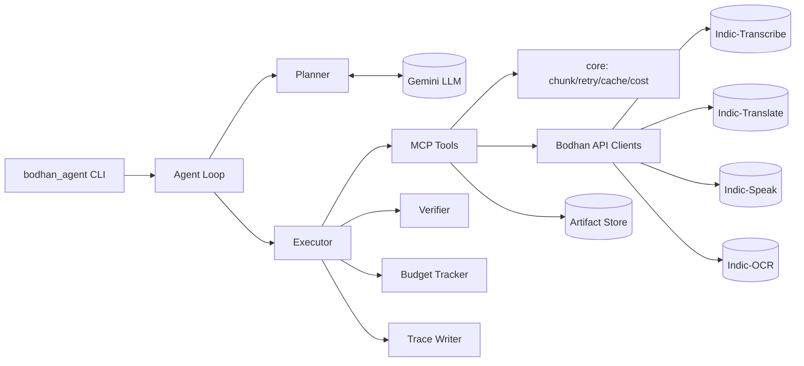
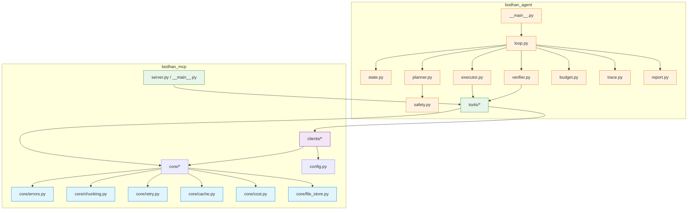

# Bodhan System Architecture

This document describes the architectural layout, component responsibilities, dependency boundaries, data flow, and design patterns of the Bodhan MCP tool server (`bodhan_mcp`) and task agent (`bodhan_agent`).

---

## 1. High-Level System Architecture



The system is strictly divided into two packages:
1. **`bodhan_mcp`**: A standard Model Context Protocol (MCP) server running over `stdio`. It exposes Bodhan's Indic AI models (`Indic-Transcribe`, `Indic-Translate`, `Indic-Speak`, `Indic-OCR`) and deterministic helper tools.
2. **`bodhan_agent`**: An autonomous CLI-driven orchestrator that reads user tasks, inspects inputs, coordinates multi-step workflows, manages budgets, enforces safety, executes tools, verifies results, and produces reproducible run traces.

---

## 2. Component Responsibility Table

| Component | Responsibility | Public Interface | Depends On |
|---|---|---|---|
| `bodhan_mcp.server` | FastMCP / standard MCP app initialization, tool registration, stdio lifecycle | `run_stdio_server()` / stdio MCP protocol | `bodhan_mcp.tools.*`, `bodhan_mcp.config` |
| `bodhan_mcp.tools.stt` | Speech-to-text tool wrapper, chunking audio >30s, stitching transcripts | `transcribe_audio(file_path, language, vad)` | `bodhan_mcp.clients.transcribe`, `bodhan_mcp.core.*` |
| `bodhan_mcp.tools.translate` | Translation wrapper, token window chunking (>32k tokens), text reassembly | `translate_text(text, target_language, target_script)` | `bodhan_mcp.clients.translate`, `bodhan_mcp.core.*` |
| `bodhan_mcp.tools.tts` | Speech synthesis wrapper, dynamic voice descriptor resolution (`resolve_voice`), upstream 500 recovery with gender fallback prioritization | `synthesize_speech(text, language, voice, instructions)` | `bodhan_mcp.clients.speak`, `bodhan_mcp.core.*` |
| `bodhan_mcp.tools.ocr` | Document OCR wrapper, PDF-to-image conversion, per-page OCR and markdown generation | `ocr_document(file_path)` | `bodhan_mcp.clients.ocr`, `bodhan_mcp.core.*` |
| `bodhan_mcp.tools.media` | Deterministic media inspection & manipulation, SRT building with optional target-language translation (`build_srt`) | `inspect_media(file_path)`, `build_srt(...)`, `chunk_audio(...)` | `pydub`, `pillow`, `pdf2image`, `bodhan_mcp.core.errors` |
| `bodhan_mcp.clients.*` | Low-level asynchronous HTTP clients with auto-conversion of non-WAV audio (`.m4a`/`.aac`/`.mp4`), token auth | `TranscribeClient`, `TranslateClient`, `SpeakClient`, `OCRClient` | `httpx`, `bodhan_mcp.config`, `bodhan_mcp.core.errors` |
| `bodhan_mcp.core.chunking` | Deterministic splitting of audio (VAD/silence/fixed), text (sentences), PDF (pages) | `split_audio()`, `split_text_by_tokens()`, `split_pdf_to_images()` | `pydub`, `tiktoken`, `pdf2image` |
| `bodhan_mcp.core.retry` | Exponential backoff with full jitter for retryable network & 429/5xx errors | `with_retry(async_fn, max_attempts, backoff_base)` | `asyncio`, `logging` |
| `bodhan_mcp.core.cache` | Content-hash (SHA-256) keyed persistent disk cache avoiding duplicate billing | `Cache.get(key)`, `Cache.set(key, val)`, `compute_hash(...)` | `hashlib`, `pathlib`, `json` |
| `bodhan_mcp.core.cost` | Exact INR pricing calculations across all 4 models and agent runs | `estimate_cost(...)`, `calculate_actual_cost(...)` | `bodhan_mcp.config` |
| `bodhan_mcp.core.errors` | Standardized error definitions, machine-readable error codes, structured payloads | `BodhanError`, `ErrorCode.*` constants | `dataclasses` |
| `bodhan_mcp.core.file_store` | Isolated directory storage and reference tracking for media artifacts | `FileStore.save_artifact()`, `FileStore.get_path()` | `pathlib`, `shutil` |
| `bodhan_agent.loop` | Core autonomous lifecycle: Inspect $\to$ Interpret $\to$ Plan $\to$ Step $\to$ Verify $\to$ Report (supports `--files` and direct `--text`) | `run(task, files_dir, text, out_dir, max_steps, max_cost)` | `bodhan_agent.*` |
| `bodhan_agent.planner` | Prompt formatting for LLM, structured plan parsing, replan decisions, feasibility check | `interpret_task()`, `make_plan()`, `replan()` | `openai` client, `bodhan_agent.safety` |
| `bodhan_agent.executor` | Step execution, dependency ordering, concurrency control, timeout & strict output artifact containment | `execute_step()`, `execute_parallel_steps()` | `bodhan_mcp.tools.*`, `asyncio` |
| `bodhan_agent.verifier` | Independent post-execution quality checks (back-transcription, length ratio) | `verify_audio_output()`, `verify_translation_output()` | `bodhan_mcp.tools.*` |
| `bodhan_agent.budget` | Pre-flight reservation & strict enforcement of max steps and max INR cost | `BudgetTracker.reserve()`, `BudgetTracker.commit()`, `BudgetTracker.is_exceeded()` | `bodhan_mcp.core.cost` |
| `bodhan_agent.trace` | Structured telemetry recording each plan, step, invocation, cost, latency, and state change | `TraceWriter.record_step()`, `TraceWriter.flush()` | `jsonlines`, `pathlib` |
| `bodhan_agent.report` | Final artifacts generation: `result.md`, `report.json`, `trace.jsonl` | `generate_result_md()`, `generate_report_json()` | `bodhan_agent.state` |
| `bodhan_agent.safety` | Delimiting untrusted content (transcripts, OCR) to prevent prompt injection | `wrap_untrusted_content()`, `sanitize_input()` | `re` |

---

## 3. Module Dependency Graph

The architecture enforces strict unidirectional dependencies. `core` has zero internal dependencies; `clients` depend only on `core` and `config`; `tools` orchestrate `clients` and `core`; `server` registers `tools`. `bodhan_agent` consumes `bodhan_mcp` tools or invokes the server without circular coupling.



---

## 4. Python vs LLM Decision Split

A foundational rule of this architecture is separating deterministic software engineering from non-deterministic reasoning. The LLM is never permitted to perform tasks that deterministic code handles reliably.

| Responsibility | Executed By | Rationale & Mechanism |
|---|---|---|
| **Input File Inspection** | Python | Validates existence, size, MIME type, audio duration via `ffprobe`/`pydub`, image dimensions via `PIL`. Fast, zero token cost, impossible to hallucinate. |
| **Language Script Detection** | Python | Unicode character range mapping (e.g., `0x0900-0x097F` for Devanagari, `0x0B80-0x0BFF` for Tamil). Deterministic, zero LLM cost, instant. |
| **Task Intent & Goal Interpretation** | LLM | Parses natural language nuances, implicit goals, multi-stage objectives, and required output formats into a structured JSON goal contract. |
| **Feasibility Assessment** | Python + LLM | Python verifies requested languages are in the Bodhan supported list; LLM assesses whether tool capabilities meet the user's requirements. |
| **Workflow Step Planning** | LLM | Formulates an acyclic directed graph (DAG) of steps specifying tool names, input arguments, and dependency step IDs. |
| **Budget Enforcement** | Python | Calculates pre-flight reservations against max INR and max steps. Terminates or aborts before executing paid API requests. Never delegated to LLM. |
| **Audio Chunking (<30s)** | Python | Deterministic audio slicing using silence detection / fixed intervals with overlap. Guarantees model input compliance without token overhead. |
| **Document/Text Chunking** | Python | Token counting via `tiktoken` and sentence splitting on punctuation. Adheres to 32k token window for translation. |
| **API Retries & Backoff** | Python | Network errors, timeouts, and HTTP 429/503 status codes trigger exponential jitter backoff in Python without waking the LLM. |
| **Output Verification** | Python + MCP | Python orchestrates back-transcription (STT of generated TTS audio) and calculates Levenshtein/word error rate (WER). LLM only evaluates semantic parity if needed. |
| **Indian-Language Text Generation** | Bodhan Models Only | **Guardrail**: LLM generates English only. All Indic text must originate from Indic-Translate, Indic-Transcribe, Indic-OCR, or Indic-Speak. |
| **Run Tracing & Artifact Writing** | Python | Generates exact `trace.jsonl`, `report.json`, and links artifacts in `result.md`. |

---

## 5. File Store & Media Plumbing Design

Passing large media objects (WAV audio, multi-page PDFs, high-resolution scans) directly through LLM context windows causes severe latency, context overflow, prompt degradation, and immense token waste.

### Media Flow Architecture:
1. **Pass-by-Reference**:
   - Tools accept local file paths (`file_path: str`) or store IDs.
   - Tools return output artifact paths (`output_file_path: str`), metadata (duration, format, token count), and status codes.
   - The LLM only receives file paths and short textual summaries in its prompt/response cycle.
2. **Internal Client Base64 Encoding**:
   - High-level tools and the agent never handle raw base64.
   - Base64 encoding occurs strictly within the private boundary of the Bodhan API client methods immediately prior to HTTP dispatch (e.g., `Indic-OCR` JSON payload or `Indic-Transcribe` multipart upload).
3. **Artifact Directory Hierarchy**:
   ```
   out/
   ├── result.md           # User-facing summary and conclusions
   ├── report.json         # Complete structured execution report
   ├── trace.jsonl         # Step-by-step chronological audit trace
   └── artifacts/          # Dedicated media output store
       ├── chunk_001.wav
       ├── page_1.png
       ├── translated_doc.md
       └── synthesized_final.mp3
   ```
4. **Content-Addressable Caching**:
   - Before any remote model call, a SHA-256 hash is computed over `(model_name, sorted_parameters, input_file_hash_or_text)`.
   - If a matching cache entry exists in `.cache/bodhan/`, the cached response and referenced artifact are returned immediately with ₹0.00 cost and <5ms latency.
