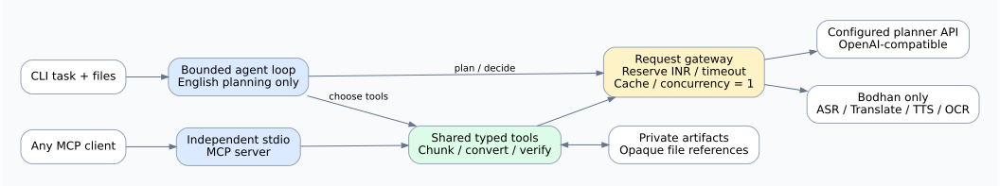

# Bodhan language task agent

A general non-interactive CLI task agent and an independently usable stdio MCP
server. A provider-neutral planner chooses tools and writes English; shared Python
code handles media, model limits, verification, budgets, cache and structured errors.
Every OCR, ASR, translation and speech operation uses Bodhan.

The six documented fixture cases have checked outputs or an honest French refusal.
The original synthetic fixtures are supplemented by a licensed natural Hindi
recording and a 115.456s Tamil summary. These are automated screens, not native-speaker
certification or a hidden-task pass rate. Candidate review and rehearsal remain pending.

[4:59 recorded execution and correction](https://github.com/BishalJena/Bodhan-AI-Cookbook/releases/download/tool-agent-live-20261121/demo_recording.mp4) · [Outputs, traces, inputs and ledger](https://github.com/BishalJena/Bodhan-AI-Cookbook/releases/tag/tool-agent-live-20261121) ·
[Results and provenance](docs/DEMOS.md) · [Design](docs/DESIGN.md) ·
[Acceptance](docs/ACCEPTANCE.md) · [Walkthrough](docs/WALKTHROUGH.md)

## Setup

Requires Python 3.10+, uv, ffmpeg and ffprobe. No GPU is needed.

```bash
uv sync --frozen
cp .env.example .env
# Set the four Bodhan model keys and the planner endpoint/model/key.
```

Required settings: `BODHAN_TRANSCRIBE_KEY`, `BODHAN_TRANSLATE_KEY`,
`BODHAN_SPEAK_KEY`, `BODHAN_OCR_KEY`, `LLM_BASE_URL`, `LLM_MODEL`, `LLM_API_KEY`.
The seven required settings are sufficient; no extra secret is required.
`uv.lock` pins dependencies. `.env`, media, outputs and the private cache stay out of git.

Set optional `LLM_INPUT_INR_PER_MILLION` and `LLM_OUTPUT_INR_PER_MILLION` to verified
conservative prices. Missing prices use disclosed INR 1000/3000-per-million input/
output accounting assumptions; they cannot guarantee an arbitrary provider's bill.
Use zero only for verified free usage. Our recorded planner was
`gemini-3.5-flash-lite` through Google's OpenAI-compatible API with explicit zero
rates and the previously verified free configuration. No billing change was made.

`LLM_TOKEN_LIMIT_FIELD` optionally selects `max_tokens` (default),
`max_completion_tokens` or `max_output_tokens`. One parameter switch is allowed only
after an explicit HTTP 400 rejecting `max_tokens`; timeouts/5xx are not retried.

`LLM_REASONING_EFFORT` optionally sends a provider-supported reasoning effort
(`none`, `minimal`, `low`, `medium`, `high`, `xhigh`); omitted by default.
`LLM_MAX_OUTPUT_TOKENS` defaults to 1500 and accepts integers 128–32768. Its full
cap is reserved before dispatch, including on a negotiated token-field switch.
Both settings are included in continuation configuration checks. For multi-step
Gemini Flash-Lite planning, the recorded correction uses medium effort and 4096
tokens on the existing free configuration. Check provider support and pricing;
unsupported options stop honestly, with no automatic model fallback.
`LLM_MIN_INTERVAL_SECONDS` optionally paces planner calls; default is zero.

## Run

```bash
uv run python -m bodhan_agent \
  --task "Make an approximately two-minute Tamil MP3 audio summary of this chapter" \
  --files path/to/chapter --out ./outputs/chapter \
  --max-steps 30 --max-cost-inr 20

BODHAN_INPUT_ROOT=./sample_data BODHAN_OUTPUT_ROOT=./outputs/mcp \
  uv run python -m bodhan_mcp
```

The required `python -m bodhan_agent --task --files --out` and
`python -m bodhan_mcp` interfaces work in an activated environment. `--files` accepts
one file, a directory or several paths. Each new `--out` must be empty. Explicit
file sets do not trigger a scan of their common parent.

A run writes `result.md`, `artifacts/`, `trace.jsonl` and `report.json`. Exit zero
means completed; two means partial, failed or invalid startup. Optional limits:
`--call-timeout 45`, `--max-seconds 300`. Reports distinguish actual accounting units
from uncertain reservations and include checks, assumptions and quality gaps.

### Docker

```bash
docker build -t language-task-agent .
docker run --rm --env-file .env -v "$PWD/sample_data:/data:ro" \
  -v "$PWD/outputs:/out" language-task-agent \
  --task "Translate this worksheet into Marathi" --files /data --out /out/worksheet
bash scripts/verify_docker.sh
```

Build, CLI help, tests and lint are verified on Linux arm64 and amd64 (the latter
under local emulation). Other platforms are untested. Python dependencies are pinned; moving base/OS package tags prevent
bit-for-bit container reproducibility claims.

## How it works



The CLI imports the same typed tools exposed independently by MCP. The planner
plans and judges; code validates references/arguments, converts/chunks media,
reserves cost, executes Bodhan calls, verifies output and validates finish.
[The design includes the complete plan/act/verify/retry/stop flow](docs/DESIGN.md).

| Tool | Responsibility |
| --- | --- |
| `list_files`, `read_text` | Approved opaque references and bounded untrusted text observations |
| `write_english` | English planner summaries/explanations; reject non-Latin writing |
| `write_translation_index` | Copy verified Bodhan translations verbatim into a source-labeled list, with no planner rewriting |
| `transcribe` | Decode to PCM, exact <=25-second windows, Bodhan ASR and coarse timestamps |
| `translate` | <=1200-byte source chunks, completeness and pivot checks, table structure |
| `synthesize` | <=500-byte source chunks, fixed voices, WAV/MP3 and mandatory back-ASR |
| `ocr` | Whole images or every rasterized PDF page through Bodhan OCR |
| `subtitles` | Verified translated windows and deterministic SRT serialization |

Small tables are translated with context in one request and checked for unchanged
row/cell/span structure. Visible text, rather than HTML tags, drives similarity.
Active generated HTML is discarded. Larger tables retain cell/text-node handling.
Explicit token-cap truncation may split the source into smaller inputs at most two
levels; source coverage remains lossless. It never resends the same billed request.

Speech synthesis does not translate. The planner inspects supplied text and translates
when needed; known English planner text is rejected for non-English TTS before billing.
Every speech chunk is measured and refused above 30 seconds. Its verification budget
covers the corresponding maximum INR 0.05 of ASR.

### Independent MCP client

The official MCP Python SDK 1.22.0 `ClientSession`/`stdio_client` connects to the real
server subprocess in `tests/test_mcp.py` and `scripts/mcp_client_demo.py`. It lists
schemas, sends unsupported/hostile inputs, then makes a valid call successfully.
This protocol check is independent of the planner and is not model-quality proof.
MCP serializes tools; cost is cumulative per process session, with step/time limits
per call. Each restart creates a fresh artifact session. Session caps do not form
an account-wide spending limit.

## Budgets, cache and safety

Requests reserve INR before dispatch, including verification and the planner.
Exact successful model/endpoint/content/parameter requests are cached across reruns
in a private sibling `.bodhan-cache`. Keep the output parent private. Cache files
are 0600; directories are 0700. Persistent pending markers block uncertain duplicates.
Never erase one merely to force another charge.

Concurrency is one per gateway. Explicit rejected 429s with Retry-After may back off
up to three attempts; timeouts/5xx retain reservations and are not blindly retried.
401/403 stop the agent. Separate processes need a separate cumulative development
ledger; [the evidence includes all failed attempts and fixture-generation costs](docs/COSTS.md).
No card, top-up, extra account or paid planner was used.

All file text, names, OCR and transcripts are untrusted data. The planner receives
references, not media/base64, and has no general shell/network capability. Roots and
symlinks are checked. Local caps: 100 files, 100 MB/file, 500 KB text, 50 PDF pages,
40-megapixel images and two-hour audio. Oversize inputs fail explicitly.

`--execution-window`/`--resume` optionally preserve private one-use JSON checkpoints
with cumulative time/cost/steps, input/config hashes and local integrity checks.
`--carry-budget-from` is one explicit post-terminal correction with identical original
inputs/config/limits and reported lineage, not a process-state resume. These do not
protect against a malicious process with the same filesystem access.

Set `BODHAN_CACHE_ONLY=1` for enforced replay: misses stop before dispatch/reservation.
The planner still follows its own configured accounting. Cached recording runs do not
replace the original real-model evidence or remove its costs.

## Verification and limits

Every generated translation/audio is checked. Non-English targets use an English
comparison pivot. English targets with distinctive-script sources are back-translated
to that source language and compared directly with the original. Ambiguous sources
use separate Hindi pivots; shared scripts are never treated as a language label.
Audio is back-transcribed through Bodhan. Scores screen likely omissions/repetition;
they do not prove meaning, pronunciation or native quality. English-script checks
cannot distinguish English from romanized Indic text.

Completion requires actual requested translation/audio/SRT artifacts for common explicit English
clauses and matching checked/passing verification. Format/duration must hold on the
same audio. The planner gets at most two finish corrections. The parser does not
prove arbitrary wording, language, voice or semantic task satisfaction.

The latest chapter MP3 measures 115.456s within the explicit 115–125s target;
the earlier 90.88s output remains historical. The latest Hindi SRT covers a natural
180s recording, replacing the earlier synthetic loop. SRT windows remain coarse
25s. Shared scripts can remain unknown. The original clip batch has a disclosed
duplicate; the later supplement uses five distinct clips. [Live completion and
all failed attempts](docs/LIVE_COMPLETION.md) are documented. Fluent assessment
belongs to the assignment's assessors; no completed native review is claimed.

## Checks and results

```bash
uv run pytest -q
uv run ruff check src tests
# From the Cookbook root:
make check
python scripts/validate_recipe.py examples/language_task_agent
```

129 local regression tests use fake model transports plus real media conversion
and actual stdio subprocesses. Live evidence is separate. Cookbook recipe validation,
lint and API rules pass. Exact `make check` fails on existing AndroidSpeak structure;
the same failure is reproduced on untouched upstream SHA
`ae51852960911cc78bd71401842308ecc5217510`. No unrelated recipe is modified.

[DEMOS.md](docs/DEMOS.md) records final and earlier attempts, costs, timing, provenance
and the cache-only subtitle replay. Native review and hidden-task accuracy remain
unmeasured. [WALKTHROUGH.md](docs/WALKTHROUGH.md) prepares the candidate's own review
and live-change rehearsal; it does not claim either has happened.

The refreshed submission has 129 tests, including four duration-range regressions
and nine planner-control cases. [Latest live evidence](docs/LIVE_COMPLETION.md)
records both completed supplements and all earlier misses. The previous 116-test
snapshot and exhausted-budget response remain historical evidence.

[EVALUATION.md](docs/EVALUATION.md) records ten additional declared compositions and
the live-discovered final-list publication bug, its regression and corrected
verbatim-index replay. It distinguishes the original public snapshot from later
development evidence; neither is a hidden-task score.
