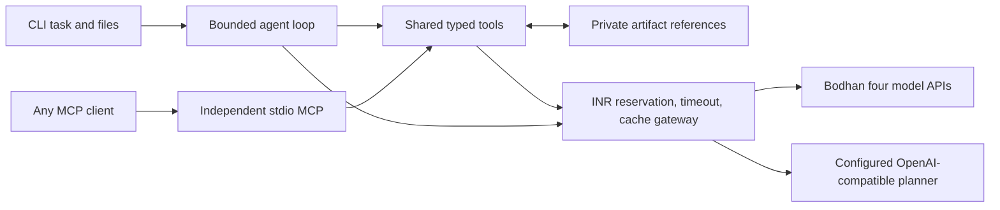
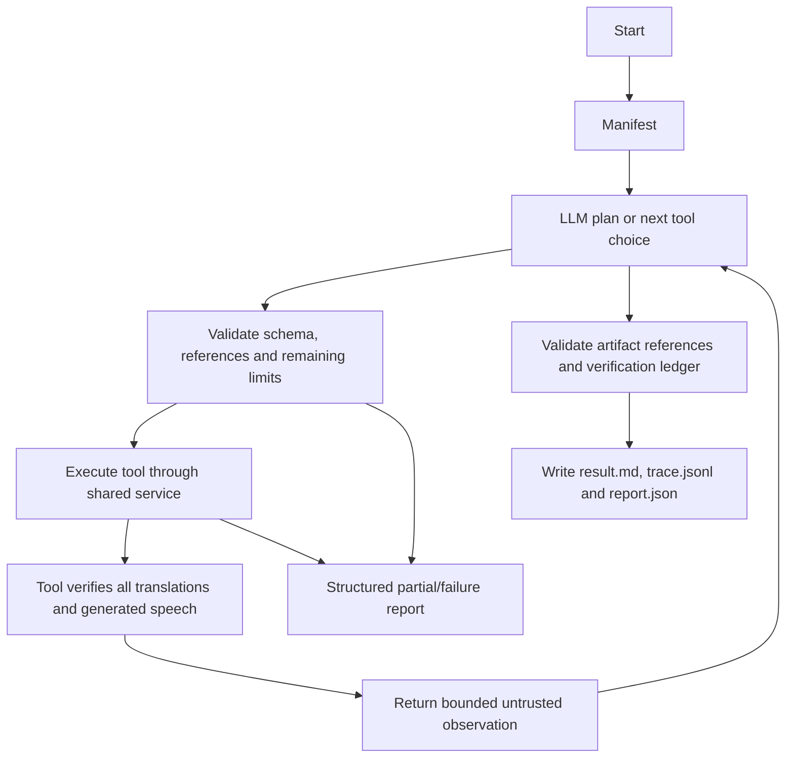

# Design and technical specification

## Acceptance contract before code

The assignment, not a demo pipeline, defines the interfaces: `python -m bodhan_agent
--task ... --files ... --out ...` and independently `python -m bodhan_mcp` over stdio.
Four model-level tools own chunking, media conversion, validation and verification.
The LLM chooses their order and writes English only. It receives file references,
never media bytes. All model operations use the documented Bodhan endpoints.

## Boundaries

The agent imports shared tools. MCP is independently usable, not a dependency for
internal dispatch. No UI, database, vector search or multi-agent framework.

## Agent state machine

## Contracts and invariants

* Media references resolve only inside the declared input root or this run's artifact
  store. Symlinks escaping the input root, URLs and arbitrary filesystem paths fail.
* Text output provenance is input, Bodhan-derived or English-only planner writing.
  The planner cannot submit Indian-language output text. Tools accept source file
  references, not planner-authored translations.
* Translation segmentation is deterministic, bounded by UTF-8 bytes. Structured
  Markdown tables and HTML table text nodes are translated without replacing markup.
* ASR converts media to mono PCM WAV, chunks at 25 seconds and retains chunk-level
  timings. These are approximate subtitle windows, not word alignments.
* OCR rasterizes every PDF page locally. Each whole page goes to Indic-OCR.
  It never uses an alternate OCR engine or LLM vision.
* TTS chunks conservatively, joins WAV and optionally encodes MP3. Every chunk is
  back-transcribed before final success. English comparisons use normalized strings;
  Indic comparisons use Unicode token/character similarity. These are screening
  signals, not a native-speaker quality guarantee.
* Every translation is checked for completeness/truncation and compared via Bodhan
  pivot translations. English targets use a Hindi comparison pivot so verification
  cannot reuse the checked English answer as its reference; other targets use English.
  Hindi is a comparison language, not a guessed source label. English output with
  non-Latin letters is conservatively flagged. Pivot scores are not semantic proof;
  extra verification calls are budgeted/cached and failure prevents verification.
* Per-call upper-bound cost is reserved before dispatch. Billed-uncertain failures
  retain reservation. No automatic retry of a possibly accepted request. A 429 may
  retry with bounded backoff only when it is explicitly a rejected rate-limit call.
* Same model plus normalized input/parameters is cached; output media hashes, not
  temporary filenames, identify duplicate audio/images. Successful cache entries
  persist across reruns in the private sibling cache. Uncertain requests are tombstoned and not re-sent.
* Planner rates are configuration, in INR. Missing rates use disclosed accounting
  assumptions rather than a verified provider-price claim. Provider billing details remain a live
  validation dependency. Limits assume published/priced API units are honored.
* Budget ledger uses Decimal, sequential dispatch and maximum response token caps.
  Concurrency is one per process. Separate MCP processes have separate budgets.
* Tool errors are data. No shell, filesystem-write, network-fetch or arbitrary URL
  tools are exposed to the planner. OCR/transcript content is untrusted data.

## Build order

1. Shared errors, artifact references, budget ledger, trace and request gateway.
2. Model adapters and media utilities with fake HTTP transport tests.
3. Independent MCP wrappers and off-the-shelf SDK protocol test.
4. Provider-neutral tool-calling loop, final report and hostile-input tests.
5. Full mock regression suite, fresh install, Cookbook validation.
6. Separately approved live capability probes, six demos, repair, video and walkthrough.

## Live assumptions to disprove early

Current ASR response documents only `text`, not language/timestamps. Distinctive
Telugu script can identify some clips; shared scripts cannot establish a language.
Return unknown when evidence is insufficient. TTS duration may differ from requested
minutes. Never force a claim of exact duration. The console homepage advertises a 32K-token translation context. The detailed endpoint
reference does not give a tokenizer or exact input allocation, so use conservative
chunks and report truncation/refusal rather than assume a character/token equivalence. API responses, provider prices,
round-trip thresholds, long-document quality and real native-speaker review need
live evidence. Six mocked task scenarios do not satisfy six real demo runs.

## Source precedence

The assignment's specific CLI, keys, branch/PR title and media rules override generic
Cookbook examples. Cookbook contribution layout/template is otherwise preserved.
Sources checked November 16, 2026:
https://console.bodhan.ai/api-docs/
https://github.com/Bodhan-AI/Bodhan-AI-Cookbook/blob/main/CONTRIBUTING.md
The original option 1 assignment is retained privately outside this contribution.

## Live transport correction

D012 records a real mismatch: native `/translate` returned 404; the signed-in reference
uses `/v1/chat/completions`, `target_language_code`, `target_script`. That route accepts
`max_output_tokens`, not `max_tokens`. The adapter now uses this live-verified Bodhan
transport and normalizes its response. OCR/TTS/ASR remain on their documented routes.

## Completion checks

Common explicit audio creation, read-aloud/narration and subtitle clauses establish
required artifact types before accepting finish. This is a bounded English parser,
not a complete task-understanding replacement. Duration constraints only come from
output creation clauses; source recording duration is not an output promise.

Finish requires a matching checked/passing verification for each selected audio,
SRT and explicitly tagged translation artifact. A check for another ref does not
qualify. All recorded checks must also be explicitly checked and passed. Audio
format and measured duration must hold on the same selected candidate. Missing
outputs/checks use the existing maximum two autonomous finish corrections, then
partial status. No new model call is added by these deterministic checks.

## Final live-driven limit handling

A speech chunk is refused above 30 seconds before verification. The pre-dispatch
headroom therefore reserves at most INR0.05 for its ASR, rather than the obsolete
INR0.20 allowance. English word count is not a duration guarantee; measured output
is authoritative. Approximate two-minute creation clauses use 90-150 seconds.

Tables fitting within one 1200-byte source window are translated with context in
one request. Row/cell/span shape must remain unchanged; otherwise a typed error
prevents output publication. Similarity strips HTML markup so common tags cannot
inflate the score. Active HTML and non-structural attributes are discarded. Larger
tables retain deterministic per-cell/text-node translation.

A definite finish_reason=length can split that source into smaller inputs at most
two levels. Successful/truncated responses stay cached, all child requests reserve
cost normally, and source coverage is retained. Unknown finish reasons, transport
errors, timeouts and 5xx do not enter this recovery. Persistent truncation still fails.

Output clauses end before common source descriptions such as covering/using/about/
for; English subtitles covering an audio recording do not require generated audio.
These are generic constraints, not execution routing by any demo task string.

## Translation publication after expanded evaluation

An English translation can be correct on disk while a planner-written list changes
its meaning. Explicit translation clauses now require an actual verified Bodhan
translation/SRT artifact or `bodhan_translation_index` at finish. The new index tool
accepts only translation refs, rejects unchecked/non-Bodhan text, traces source
filenames through tool events and copies text verbatim. The planner cannot supply
its own translated sentences to this tool. General English summaries/explanations
remain available; their semantic correctness still needs review.

English-target checks use a distinctive-script source language when identified:
compare the original source directly with Bodhan's output back-translation. Unknown
or shared scripts retain separate Hindi pivots without claiming a source language.
Planner schemas omit redundant display titles to reduce request size while keeping
types, descriptions, enums and limits. MCP retains its SDK-generated schemas.

The optional evaluation module runs declared suites through real CLI subprocesses,
retains every outcome and checks artifacts/content/cost/dispatch independently.
It does not substitute its fixtures into production or route tasks by their text.
