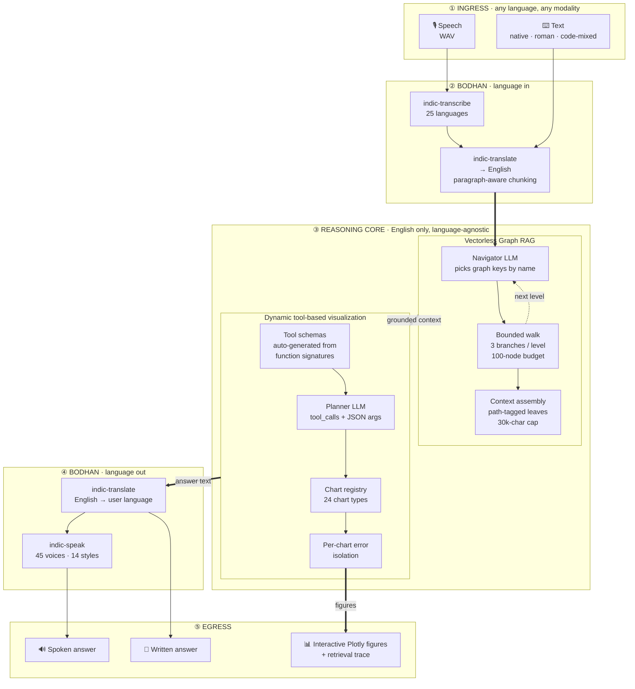
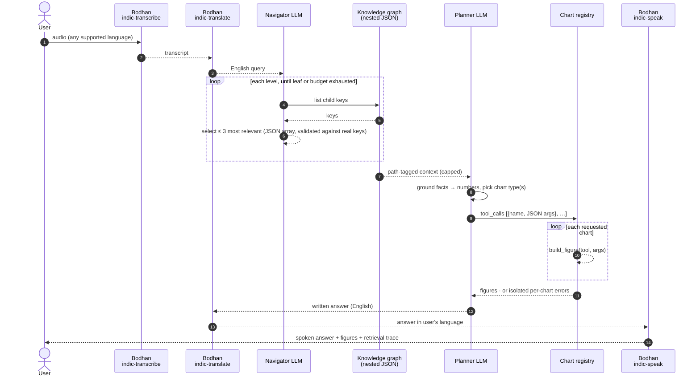
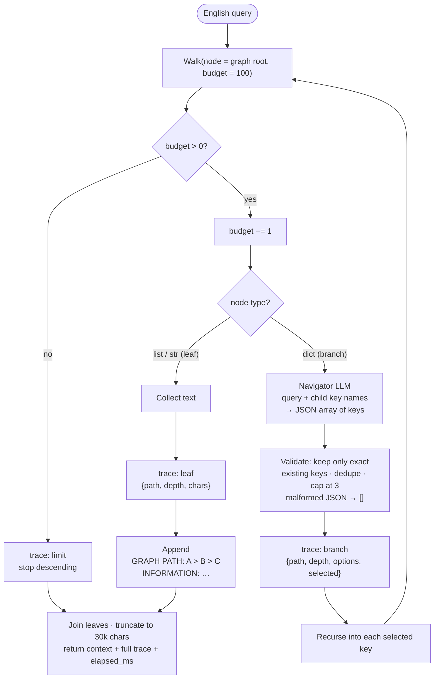
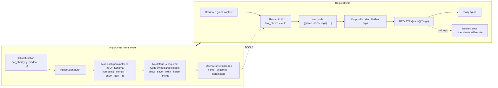
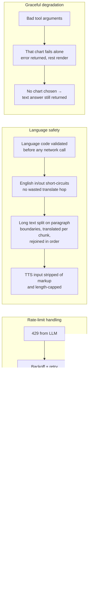
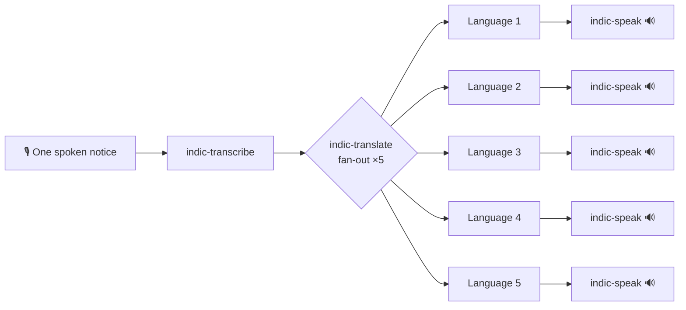
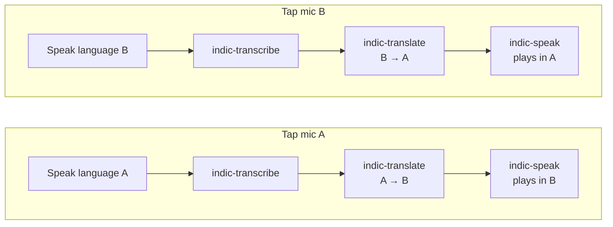
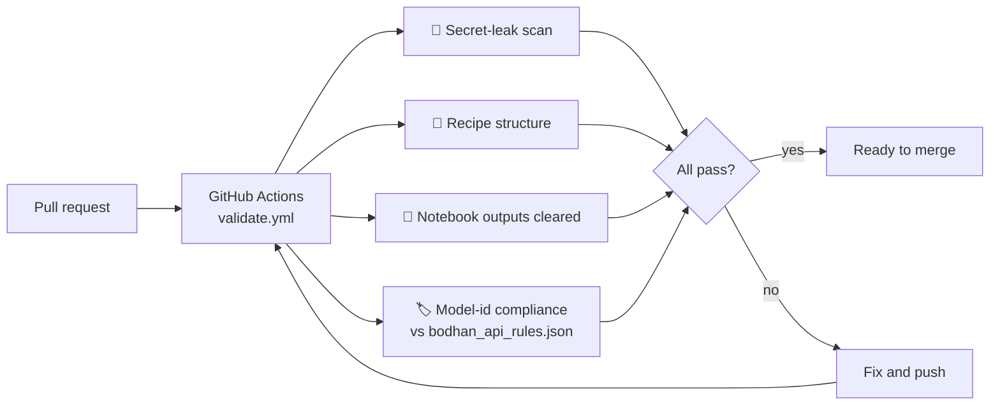

# 🚀 [▶ WATCH THE Video (Download): VOICE → REASONING → CHARTS → VOICE](https://github.com/ninth-orbit-research/Bodhan-AI-Cookbook/blob/recipe/mahabharata/examples/mahabharata/Bodhan%20API%20Project%20%282%29.mp4)

# Bodhan AI Cookbook

**Production patterns for voice-native, multilingual AI in 22 Indian languages: five APIs, one key, no glue code.**

[](LICENSE)
[](https://github.com/Bodhan-AI/Bodhan-AI-Cookbook/actions/workflows/validate.yml)
[](https://console.bodhan.ai/api-docs/)


Example code, guides, and end-to-end projects for building with the [Bodhan AI API](https://console.bodhan.ai/api-docs/): speech to text, text to speech, translation, transliteration, and document OCR, with first-class support for Indian languages.

This cookbook goes past single API calls. Its flagship example is a complete **voice → reasoning → visualization → voice** system. Ask a question out loud in Hindi or Telugu. An agent navigates a knowledge graph without a vector database, decides for itself which analytical tools to run, draws the charts, and answers back in your language.

> **Speak** in your language → **understand** → **reason** over a knowledge graph → **execute tools** → **visualize** → **speak back**. Three Bodhan models carry the language work. Everything between them is plain Python.

| | |
|---|---|
| **Languages demonstrated** | English · Hindi · Telugu (the same pipeline serves every language Bodhan supports) |
| **Language layer** | `indic-transcribe` (speech in) · `indic-translate` (into English, and back out) · `indic-speak` (speech out) |
| **Reasoning** | Groq-hosted GPT-OSS family, with LLM-driven tool calling |
| **Retrieval** | Vectorless Graph RAG: no embeddings, no vector store, no index to rebuild |
| **Execution** | 24 predefined chart tools chosen and parameterized by the model |
| **Outputs** | Spoken answer · written answer · interactive figures · full retrieval trace |

## System architecture



The design principle: **language is a boundary, not a dependency.** Translation wraps the reasoning core on both sides, so retrieval, prompts, tools and charts are written once and serve every language Bodhan supports.

### Why this is more than RAG

| Typical RAG chatbot | This pipeline |
|---|---|
| English text in, English text out | Voice in and voice out, in the user's own language |
| Embeds chunks and ranks by similarity | **Navigates a graph by reasoning**, so every answer has a path you can audit |
| Answers in prose | **Calls tools**: the model decides a sankey, a treemap or a line chart explains the answer better, and fills in the data |
| Numbers can drift in a paragraph | Figures come from retrieved context, and anything the model supplies itself is tagged `(approx.)` |
| One failure fails the request | Each chart, retry and translation chunk degrades on its own |

## Contents

- [Models at a glance](#models-at-a-glance)
- [Deep dive: the engine](#deep-dive-the-engine)
  - [Request lifecycle](#request-lifecycle)
  - [Vectorless graph RAG](#vectorless-graph-rag)
  - [Dynamic tool-based visualization](#dynamic-tool-based-visualization)
  - [Resilience by design](#resilience-by-design)
  - [Run it](#run-it)
  - [Known limitations](#known-limitations)
- [More pipelines](#more-pipelines)
- [Getting started](#getting-started)
- [Repository layout](#repository-layout)
- [API tutorials](#api-tutorials)
- [Example projects](#example-projects)
- [Integrations](#integrations)
- [Quality gates](#quality-gates)
- [Contributing](#contributing)
- [Resources](#resources)
- [License](#license)

## Models at a glance

| Model | Capability | Endpoint | Languages |
|---|---|---|---|
| `indic-transcribe` | Speech to text | `POST /v1/audio/transcriptions` | 25 Indian languages + English |
| `indic-translate` | Translation | `POST /translate` | 22 Indian languages + English, native / roman / code-mixed output |
| `indic-transliterate` | Transliteration | `POST /transliterate` | 22 Indic languages, native ⇄ roman |
| `indic-speak` | Text to speech | `POST /v1/audio/speech` | 22 Indian languages + English, 45 voices, 14 styles |
| `indic-ocr` | Document OCR | `POST /v1/chat/completions` | script-agnostic, Markdown + layout blocks |

Base URL `https://api.bodhan.ai`, header `Authorization: Bearer $BODHAN_API_KEY`. Model ids are lower-case and case-sensitive. The machine-readable version of this table, including every language code and voice, is [`scripts/bodhan_api_rules.json`](scripts/bodhan_api_rules.json).

**Drop-in compatible.** The `/v1` routes accept OpenAI-style requests, so the official [OpenAI SDKs](integrations/openai_sdk/) work after a one-line `base_url` change.

```bash
export BODHAN_API_KEY=<your API key>   # https://console.bodhan.ai

curl https://api.bodhan.ai/translate \
  -H "Authorization: Bearer $BODHAN_API_KEY" \
  -H "Content-Type: application/json" \
  -d '{"text": "The meeting has been postponed.", "target_language": "kn"}'
```

## Deep dive: the engine

Source: [`examples/mahabharata/`](examples/mahabharata/) (the directory name is the sample dataset; the engine is dataset-agnostic and ships with a second graph to prove it: a one-line env switch, `KNOWLEDGE_GRAPH`).

### Request lifecycle



### Vectorless graph RAG

Conventional RAG embeds chunks and ranks by cosine similarity. This pipeline has **no embeddings, no vector store, no index to rebuild**. The knowledge base is a nested JSON graph, and an LLM navigates it the way a person uses a table of contents: at each level it reads the child key names and chooses where to go next.



| Property | Value | Why it matters |
|---|---|---|
| Index / embeddings | none | Edit a JSON file and retrieval changes instantly; nothing to re-embed |
| Branching factor | ≤ 3 keys per level | Bounds fan-out while keeping multi-hop answers |
| Node budget | 100 nodes per question | Hard cost and latency guard |
| Context cap | 30,000 chars (12,000 for the chart call) | Keeps the downstream prompt small |
| Navigator decoding | `temperature=0`, `top_p=0.2` | Repeatable traversal |
| Key validation | LLM output filtered to exact existing keys | A hallucinated key can't derail the walk |
| Provenance | every leaf tagged `GRAPH PATH: A > B > C` | Answers are traceable to named nodes |
| Observability | full `trace` of branch / leaf / limit events | The walk is inspectable and replayable |

### Dynamic tool-based visualization

The LLM never emits chart code and never sees a chart library. It sees **function-calling schemas**, and those schemas are generated at import time by introspecting the real chart functions, so adding a chart means writing one Python function.



**24 chart tools, 6 families**, all selected by the model from the question and the retrieved data:

| Family | Tools |
|---|---|
| Trend | `line` · `area` · `band` |
| Comparison | `bar` · `lollipop` · `waterfall` · `pareto` |
| Distribution | `histogram` · `box` · `violin` |
| Relationship | `scatter` · `bubble` · `heatmap` · `correlation` |
| Composition | `pie` · `donut` · `treemap` · `sunburst` · `funnel` |
| Specialty and flow | `candlestick` · `gauge` · `radar` · `sankey` · `gantt` |

Grounding rules are enforced in the prompt contract, not left to chance:

- Use names and numbers **exactly as in the retrieved context**; never invent figures.
- Where sources differ, say so.
- If the model has to supply data from its own knowledge, the title is tagged **`(approx.)`**.
- Every request also yields a plain-language written answer, so charts never arrive without explanation.

### Resilience by design



### Run it

```bash
cd examples/mahabharata
pip install -r requirements.txt
```

Add two keys to a `.env` file in that folder (never commit it): `BODHAN_API_KEY` from the [Bodhan console](https://console.bodhan.ai), and `GROQ_API_KEY` from the [Groq console](https://console.groq.com). To spread load, add more Groq keys as a comma-separated `GROQ_API_KEYS`, and the key pool rotates through them. Then:

```bash
bash run.sh
```

To try the retrieval and tool-calling core without audio, run `python llm.py "your question"`. It prints the chosen tools, their JSON arguments, and whether each chart built.

### Known limitations

- Answer quality is bounded by the completeness and accuracy of the knowledge graph. Retrieval can only find what the graph contains.
- Translation quality varies across Indic languages. Check output in the languages you ship.
- LLM interpretations and statistics should be checked against source material. Grounding rules reduce invented figures; they don't eliminate the need to verify.
- API availability, rate limits and inference cost depend on the Bodhan and Groq plans you use.
- Multi-hop questions cost more: each graph level is an LLM call, and each chart is a tool execution.

## More pipelines

### Announce once, reach everyone

[`examples/voice_notice_translator`](examples/voice_notice_translator/) turns one spoken announcement into five spoken announcements.



### Two-way conversation on a phone

[`examples/AndroidSpeak`](examples/AndroidSpeak/) (Saathi) is a native Android app. Two microphone buttons, one per language; the same three-model chain runs in whichever direction you tap.



## Getting started

You need a Bodhan API key. Sign up at [console.bodhan.ai](https://console.bodhan.ai) to get one.

Set it as an environment variable:

```bash
export BODHAN_API_KEY=<your API key>
```

Or create a `.env` file in the recipe folder (see each recipe's `.env.example`):

```plaintext
BODHAN_API_KEY=<your API key>
```

Most recipes are Python 3.10+ notebooks, but the API is plain HTTPS: any language with an HTTP client works.

## Repository layout

| Folder | Contents |
|---|---|
| [`getting-started/`](getting-started/) | Focused, single-API tutorial notebooks: speech to text, text to speech, translation, transliteration, document OCR |
| [`examples/`](examples/) | Complete example projects and apps built on the Bodhan API. Start new recipes from [`examples/TEMPLATE/`](examples/TEMPLATE/) |
| [`integrations/`](integrations/) | Guides for using Bodhan with third-party SDKs, frameworks and platforms |
| [`sample_data/`](sample_data/) | Small shared inputs used by the tutorials |
| [`scripts/`](scripts/) | CI validation tooling and the model allowlist (`bodhan_api_rules.json`) |
| [`tests/`](tests/) | Unit tests for the validation scripts |

## API tutorials

| Capability | Notebook | Covers |
|---|---|---|
| Speech to text | [speech_to_text.ipynb](getting-started/speech-to-text/speech_to_text.ipynb) | Transcribing a clip, language hints, chunking longer audio, error handling |
| Translation | [translate.ipynb](getting-started/translate/translate.ipynb) | Translating text, choosing native / roman / code-mixed output, fanning out to many languages, long documents |
| Transliteration | [transliterate.ipynb](getting-started/transliterate/transliterate.ipynb) | Native ⇄ roman script conversion, and how it differs from translation |
| Text to speech | [text_to_speech.ipynb](getting-started/text-to-speech/text_to_speech.ipynb) | Voices per language, speaking styles, joining clips for longer text |
| Document OCR | [document_ocr.ipynb](getting-started/document-ocr/document_ocr.ipynb) | OCR of a page image, layout blocks with bounding boxes, tables, multi-page PDFs |

## Example projects

| Project | Bodhan models | What it demonstrates |
|---|---|---|
| [Voice-to-chart agent](examples/mahabharata/) | transcribe · translate · speak | Vectorless graph RAG, LLM tool calling over 24 chart types, translation as a boundary around an English-only core, key pooling and rate-limit resilience |
| [Voice Notice Translator](examples/voice_notice_translator/) | transcribe · translate · speak | Transcribes a spoken announcement, translates it into five languages, and reads each one aloud in a native voice |
| [Saathi (Android)](examples/AndroidSpeak/) | transcribe · translate · speak | Native two-way voice translator with a replayable conversation log and a typed-input fallback |
| [TEMPLATE](examples/TEMPLATE/) | n/a | Starting point for new recipes: README skeleton, notebook, pinned requirements, `.env.example` |

Ideas waiting for a contributor: exam paper reader (OCR → translate), multilingual customer-feedback analyser, WhatsApp-style roman-script input box, lecture subtitler, government-scheme summariser, IVR voice agent. Open a [recipe proposal](https://github.com/Bodhan-AI/Bodhan-AI-Cookbook/issues/new?template=recipe_proposal.md) to claim one.

## Integrations

| Integration | Description |
|---|---|
| [OpenAI SDK](integrations/openai_sdk/) | Using Bodhan's OpenAI-compatible `/v1` routes through the official `openai` Python and Node packages |

LiveKit, Pipecat, Twilio/Exotel, n8n, Vercel AI SDK and LangChain guides are open for contribution; see [`integrations/README.md`](integrations/README.md).

## Quality gates

Every recipe is machine-checked before it merges, so what you clone is what runs.



The model allowlist is a single JSON file, [`scripts/bodhan_api_rules.json`](scripts/bodhan_api_rules.json), updated from [console.bodhan.ai/api-docs](https://console.bodhan.ai/api-docs/). A recipe that calls a retired or misspelled model id fails CI instead of failing for your users.

## Contributing

We welcome new examples and fixes. Before opening a pull request:

1. Read [CONTRIBUTING.md](CONTRIBUTING.md) for the recipe layout, security requirements and API standards.
2. Scaffold from the template: `make new-recipe NAME=my_recipe`.
3. Run local validation with `make check`.

## Resources

- [Bodhan API reference](https://console.bodhan.ai/api-docs/)
- [Bodhan console](https://console.bodhan.ai): keys, usage and billing
- [Bodhan.AI](https://bodhan.ai)
- [Bodhan on GitHub](https://github.com/Bodhan-AI)

## License

This repository is licensed under the [Apache License 2.0](LICENSE).

---

<p align="center"><b>Bodhan AI × Groq × Vectorless Graph RAG × LLM tool calling</b><br/><i>Voice-native AI for every Indian language.</i></p>
