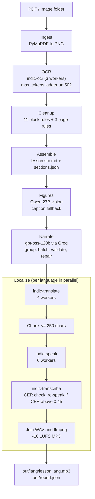
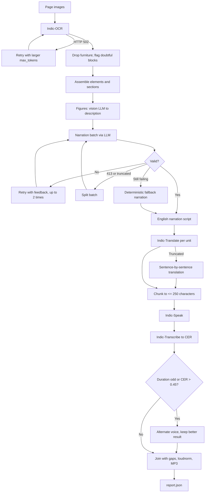

# Scanned Chapter to Translated, Narrated Audio Lesson

An automated pipeline that transforms scanned textbook chapters into structured lesson notes and teacher-style narrated MP3 audio across Indian languages. 

All OCR, translation, speech synthesis, and audio verification are handled exclusively by Bodhan models (`indic-ocr`, `indic-translate`, `indic-speak`, `indic-transcribe`). An external LLM (`gpt-oss-120b` via Groq free tier) and vision model (Qwen 27B) operate strictly in English for diagram comprehension and conversational narration, programmatically barred from generating Indian-language text. Mathematical notation is converted to natural spoken phrasing, diagrams are relocated to their point of reference, and synthesized audio is validated via automated back-transcription before mastering to loudness-normalized (-16 LUFS) MP3s.

## How to run

**Prerequisites:** Python 3.10+ and `ffmpeg` on `PATH` (used for audio mastering).

```bash
# 1. Environment setup
python -m venv .venv
source .venv/bin/activate          # Windows: .venv\Scripts\Activate.ps1
pip install -r requirements.txt && pip install -e .

# 2. Configure credentials
cp .env.example .env               # Fill in Bodhan & LLM API keys

# 3. Run the pipeline
python -m bodhan_lesson --input chapter.pdf --out out --langs hi ta bn
```

### Key Configuration (`.env`)
- **Bodhan Models**: `BODHAN_OCR_KEY`, `BODHAN_TRANSLATE_KEY`, `BODHAN_SPEAK_KEY`, `BODHAN_TRANSCRIBE_KEY`
- **LLM Narration & Vision**: `LLM_BASE_URL`, `LLM_API_KEY`, `LLM_MODEL` (`gpt-oss-120b`), `LLM_VISION_MODEL` (`Qwen 27B`)

### Useful Options
- `--pages 10`: Process only the first $N$ pages.
- `--from-script`: Skip OCR & LLM; resume directly from `narration_script.en.json` (avoids re-calling LLMs).
- `--no-llm`: Run offline with deterministic rule-based narration.
- `--no-audio`: Translate only (skips TTS and audio assembly).

### Run Tests
```bash
pip install -e .[dev] && pytest    # 179 passing tests (smoke & compliance)
```

## Architecture



| Stage | Module | What it does |
|---|---|---|
| Ingest | `stages/ingest.py` | Renders pages to PNG at 150 DPI (PyMuPDF); accepts PDF or image folder; no embedded text layer is used |
| OCR | `stages/ocr.py` | Indic-OCR with 3 concurrent workers; `max_tokens` ladder 2048→4096→8192 on HTTP 502; raw JSON cached per page |
| Cleanup | `stages/cleanup/` | 11 deterministic block rules (reclassify equations, hyphenation, table detection, doubtful flags) + 3 page rules (drop furniture, crop figures, join page-break splits) |
| Assemble | `stages/assemble/` | `build_elements → join_split_tables → build_sections → _render`; outputs `lesson.src.md`, block map, and `sections.json` |
| Figures | `stages/figures.py` | Qwen 27B vision model describes each figure crop (2 concurrent workers, 2 retries, caption fallback) |
| Narrate | `stages/narrate/` | Figure placement → grouping → 1800-char batches → `gpt-oss-120b` (Groq) → `check_batch` validator → retry/split → `repair_batch` |
| Localize | `stages/localize.py` | Per-language parallel: translate pool (4 workers) → chunk ≤250 chars → speak+CER pool (6 workers) → WAV join → ffmpeg MP3 |

## Workflow



## Where the LLM is used, and why
| Decision | Model used | Fallback |
|---|---|---|
| Describe a figure from its crop and caption | Vision LLM (Qwen 27B model) | caption only |
| Write English narration for each batch of elements | `gpt-oss-120b` (Groq free tier) | rule-based narration (`narrate/fallback.py`) |
| Exercise "how to solve" hints (separate prompt, three sentences, never states the answer) | `gpt-oss-120b` (Groq free tier) | rule-based |


## How tables, equations and figures are narrated
- **Equations** are spoken as words (`angle A O C equals angle B O D`), never as symbols.
- **Figures** are described from the crop, and placed after the first paragraph that cites them by number,
  not in sequence. Example: "Look at figure six point eight where lines A B and C D cross at O."
- **Tables** are summarised row by row from the OCR Markdown table, joined across pages where they continue.
  The demo pages contain no table; this path is covered by unit tests only.
- **Exercises:** "Problem one. Find angle B O E and reflex angle C O E. First, use vertically opposite
  angles to find angle A O C. Then use the given sum to find angle B O E, and finally use angles on a line."

## Bodhan models used

All core OCR, translation, speech synthesis, and verification calls are hosted at `https://api.bodhan.ai/v1`:

| Model | Purpose | Configuration & Tuning | Error & Edge-Case Handling |
|---|---|---|---|
| `indic-ocr` | Text and layout block extraction from 150 DPI page scans | Markdown table format, 3 concurrent worker threads | Escalates `max_tokens` (2048 -> 4096 -> 8192) on HTTP 502; cached per page |
| `indic-translate` | Translating English narration units into target Indian languages | `script: native`, `max_output_tokens: 2048`, 4 concurrent workers | Fallback to sentence-by-sentence translation if response is truncated |
| `indic-speak` | Pedagogical speech synthesis across 13 Indian languages | `style: educational lecture`, sentence chunks <= 250 chars, 6 workers | Re-speaks with secondary voice if CER > 0.45 or duration is suspect |
| `indic-transcribe` | Automated ASR back-transcription for CER audio verification | Chunks <= 30 seconds (within API input limit) | Non-fatal logging as `check_error` under 429 rate limits; cached on retry |

## Results
Demo chapter: NCERT Class 9 Maths, Lines and Angles, **first 10 pages** processed (OCR cost limited the rest).

| Metric | Hindi | Tamil | Bengali |
|---|---|---|---|
| Narration units | 72 | 72 | 72 |
| Audio chunks spoken | 117 of 117 | 141 of 141 | 118 of 118 |
| Audio length | about 27 min | about 29 min | about 30 min |
| Chunks back-transcribed (CER) | 53 of 117 | 59 of 141 | 53 of 118 |
| CER over those chunks | 0.114 | 0.082 | 0.082 |

- **Files:** `out/source/lesson.src.md`, `out/source/narration_script.en.md`; `out/<lang>/lesson.<lang>.mp3`,
  `out/<lang>/narration/<section>.<lang>.mp3`, `out/<lang>/narration_script.<lang>.json` (the exact TTS text,
  voices, durations, per-chunk transcript and CER); `out/report.json` (per-language counts, per-section CER,
  `timing_s`, `cost_estimate_inr`).
- **Per-section CER** is highest in the worked-example and exercise sections (Hindi 0.21 and 0.31, Tamil 0.31
  in the worst sections) and near zero in plain prose (0.002 to 0.03). Bengali achieved an overall CER of 0.082
  with strong fidelity across sections. I have not listened to those sections,
  so I cannot say how much is real audio error and how much is the transcriber's own noise; Indic-Speak's
  model card reports about 18% CER against its own back-transcription.
- **Why only about half the chunks have a CER:** the remaining Indic-Transcribe calls hit the API rate limit
  (HTTP 429) after five attempts. They are recorded as `check_error` per chunk, never silently skipped, and
  a rerun fills them from the cache.
- **Demo Audio Outputs (Google Drive):**
  - [Hindi Narration Audio (MP3)](https://drive.google.com/file/d/1vvCzO4k0cxnFUYbnPMjEWzeH447PJfQl/view?usp=sharing)
  - [Tamil Narration Audio (MP3)](https://drive.google.com/file/d/1ZogfqrUi37AhMQ7gSyblZpQpYHwjZKDX/view?usp=sharing)
  - [Bengali Narration Audio (MP3)](https://drive.google.com/file/d/13aPDFyOVh9CdBdKF6_Ak7pwtjbcQwp5x/view?usp=sharing)

## Demo video
[Watch Project Walkthrough & Explanation Video](https://drive.google.com/file/d/1B9DnD6PbLpDnt6r04mKb6nKAcag6tyRo/view?usp=sharing)

## Trade-offs and known limitations
Honest evaluation of current scope and production trade-offs:
- **API rate limits vs runtime target:** Processing 10 pages across 3 languages within 20 minutes is constrained primarily by upstream Bodhan rate limits and exponential backoffs. The architecture parallelizes languages and workers (4 translation, 6 TTS workers); warm-cache localization executes in ~460 seconds.
- **Scope & Source Chapter:** The first 10 pages of the NCERT chapter were processed. Indian-language source chapters (pivoting through English) are architecturally supported but were not run in the demo due to API budget.
- **Deferred features:** Handwriting extraction, terminology glossary enforcement, multi-column reading order reconstruction, and per-sentence MP3 chapter markers.

## AI assistance
Built with Claude Code (Claude Sonnet 5.5) and Antigravity for design, implementation and tests.
