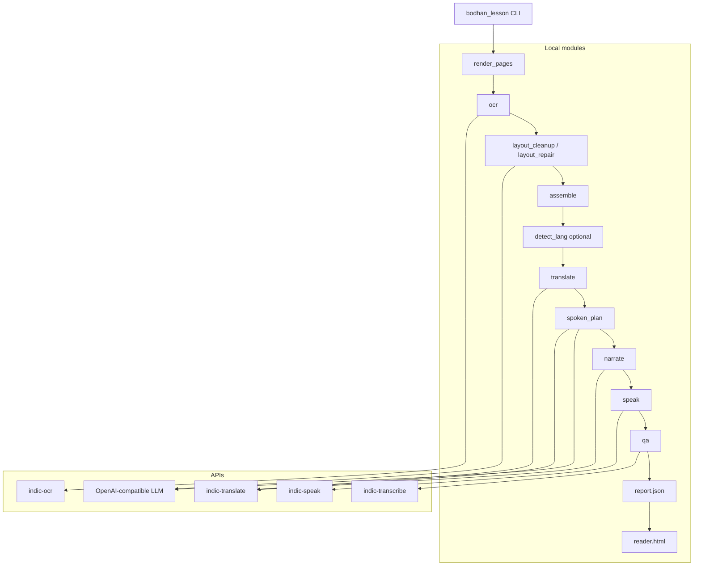
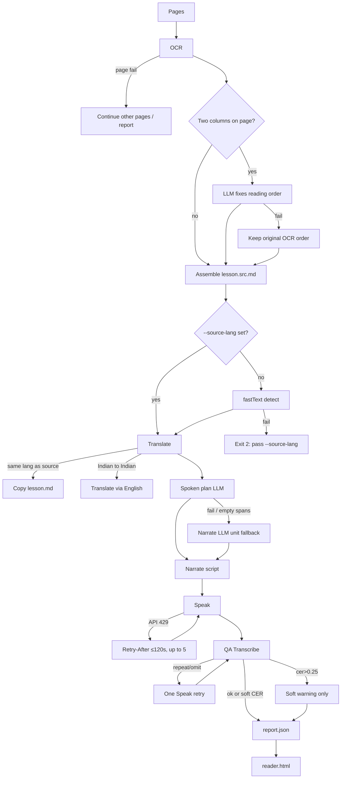

# Narrated lesson

> Turn a scanned textbook chapter into a spoken lesson in the languages your students actually use.

**Bodhan models:** indic-ocr, indic-translate, indic-speak, indic-transcribe  
**Languages shown:** Hindi, Tamil, Bengali + Indic-source demo (Hindi → Konkani)  
**Format:** CLI

## What it does

Point the CLI at a scanned PDF (or a folder of page images). The pipeline reads pages with Indic-OCR, cleans layout, builds one lesson markdown, translates it, writes a narration script, speaks each section to MP3, then back-transcribes to catch bad audio.

Per language you get: `lesson.{lang}.md`, `narration_script.{lang}.json`, section clips, `lesson.{lang}.mp3`, sync `reader.html`, plus root `report.json`.

## Contents

- [Getting started](#getting-started)
- [Run](#run)
- [Results and demo](#results-and-demo)
- [Architecture](#architecture)
- [Workflow](#workflow)
- [Where the LLM is used, and why](#where-the-llm-is-used-and-why)
- [How tables, equations and figures are narrated](#how-tables-equations-and-figures-are-narrated)
- [Bodhan models used](#bodhan-models-used)
- [Output layout](#output-layout)
- [Flags, voices, and resume](#flags-voices-and-resume)
- [Trade-offs and known limitations](#trade-offs-and-known-limitations)
- [Cost and runtime](#cost-and-runtime)
- [AI assistance](#ai-assistance)
- [Tests](#tests)


## Getting started

You need Bodhan API keys from [console.bodhan.ai](https://console.bodhan.ai) and an OpenAI-compatible LLM key (layout + spoken plan).

**ffmpeg:** local install needs ffmpeg on your `PATH`. Docker already includes ffmpeg. `pip install -e .` installs Python packages only — not ffmpeg.

### Path A — local (step by step)

1. **Clone and enter the recipe**
   ```bash
   git clone <your-fork-url>
   cd Bodhan-AI-Cookbook/examples/narrated_lesson
   ```
2. **Create a venv and install Python deps**
   ```bash
   python -m venv .venv
   source .venv/bin/activate          # Windows: .venv\Scripts\activate
   pip install -e .                   # or: uv pip install -e .
   ```
3. **Add keys**
   ```bash
   cp .env.example .env               # paste BODHAN_* and LLM_* keys
   ```
4. **Install ffmpeg on your PATH** (not installed by pip)
   ```bash
   ffmpeg -version                    # must succeed
   ```
5. **Run** — see [Run](#run) below.

`pip install -e .` loads pinned deps from `pyproject.toml` and registers the package (no `PYTHONPATH`). `requirements.txt` stays for Cookbook validation (same pins).

### Path B — Docker (step by step)

ffmpeg is already in the image (`apt-get install ffmpeg` in the `Dockerfile`).

1. **Enter the recipe and create `.env`**
   ```bash
   cd Bodhan-AI-Cookbook/examples/narrated_lesson
   cp .env.example .env               # paste keys
   ```
2. **Build the image**
   ```bash
   docker build -t narrated-lesson .
   ```
3. **Run**
   ```bash
   docker run --rm --env-file .env \
     -v "$PWD/sample_data:/data" -v "$PWD/outputs:/out" \
     narrated-lesson \
     --input /data/your_chapter.pdf --langs hi,ta,bn --out /out/demo_final --source-lang en
   ```

## Run

**Step 1 — English chapter → Hindi, Tamil, Bengali**

```bash
python -m bodhan_lesson \
  --input sample_data/9-Maths-NCERT-Book-Lines-and-Angles_2_pages.pdf \
  --langs hi,ta,bn \
  --out outputs/demo_final \
  --source-lang en
```

**Step 2 — Hindi chapter → Konkani** (male voice **Sandeep** via `voices.yml`)

```bash
python -m bodhan_lesson \
  --input sample_data/Hindi_3_pages.pdf \
  --langs kok \
  --out outputs/demo_hi_kok \
  --source-lang hi \
  --voices voices.yml
```

**Step 3 — Open a reader** when the run finishes, for example `outputs/demo_final/hi/reader.html` (keep it next to `lesson.hi.mp3`).

More flags, voices, and `--from` resume: [Flags, voices, and resume](#flags-voices-and-resume).

## Results and demo


| Demo                              | Local path             | Quality (`report.json`)                             | Hosted                                                                                                  |
| --------------------------------- | ---------------------- | --------------------------------------------------- | ------------------------------------------------------------------------------------------------------- |
| English maths 2p → **hi, ta, bn** | `outputs/demo_final/`  | `qa_ready`; mean CER ≈ **0.17**; Bodhan ≈ **₹9.07** | [demo_final.zip](https://drive.google.com/drive/folders/1m2jgwZ8DKGqxPyX0AylXthlq1SK427z3?usp=sharing)  |
| Hindi 3p → **kok** (Sandeep)      | `outputs/demo_hi_kok/` | `qa_ready`; mean CER ≈ **0.14**; Bodhan ≈ **₹3.70** | [demo_hi_kok.zip](https://drive.google.com/drive/folders/1m2jgwZ8DKGqxPyX0AylXthlq1SK427z3?usp=sharing) |


Artifacts: [Google Drive folder](https://drive.google.com/drive/folders/1m2jgwZ8DKGqxPyX0AylXthlq1SK427z3?usp=sharing).

**Demo video** (no sign-in): [Awesome Screenshot recording](https://www.awesomescreenshot.com/video/58581657?key=0c4a314287d1c014eac9f31e792bbcf8)

---

Architecture, workflow, and design notes.

## Architecture




| Stage           | Module           | Job                                                                                                                        |
| --------------- | ---------------- | -------------------------------------------------------------------------------------------------------------------------- |
| Pages           | `render_pages`   | Turn the PDF or images into page pictures (max 30 pages / 30 MB)                                                           |
| OCR             | `ocr`            | Read the text on each page with Indic-OCR                                                                                  |
| Layout          | `layout_*`       | Remove headers, footers, and page junk; if the page has two columns, the language model fixes reading order                |
| Assemble        | `assemble`       | Join pages into one lesson file (`source/lesson.src.md`)                                                                   |
| Source lang     | `detect_lang`    | If you did not pass `--source-lang`, guess the page language from the text                                                 |
| Translate       | `translate`      | Keep math and tables safe while translating; Indian language → Indian language goes via English; same language = copy      |
| Spoken plan     | `spoken_plan`    | Turn tables and equations into short spoken English (language model)                                                       |
| Narrate         | `narrate`        | Build the speech script; drop leading section numbers from what is spoken                                                  |
| Speak           | `speak`          | Turn the script into audio (section clips + full lesson MP3)                                                               |
| QA              | `qa`             | Listen back with Transcribe; warn if the text match is weak; retry Speak once if audio repeats or skips; even out loudness |
| Report / reader | `cli` / `reader` | Write `report.json`, then a sync `reader.html` per language                                                                |


## Workflow

From page images to narration — **retries, checks, decision points**:




**Parallel languages:** translate / narrate / speak / QA use a thread pool (default **3**, env `LANG_WORKERS` or `BODHAN_LANG_WORKERS`, clamped **1–8**).

## Where the LLM is used, and why


| Decision         | What it decides                                                                            | If it fails                                                                            |
| ---------------- | ------------------------------------------------------------------------------------------ | -------------------------------------------------------------------------------------- |
| Layout reorder   | When a page looks like two side-by-side columns, decide the correct reading order          | Keep the original OCR order                                                            |
| Spoken plan      | Write short, clear **English** lines for tables and dense math so they can be spoken aloud | Narrate may ask the language model again for leftover hard pieces (still English only) |
| Narrate fallback | Fill any table/math lines the plan missed                                                  | Leave that piece as translated text; normal paragraphs still come from Translate       |


The language model is **not** used to read page images, invent Hindi/Tamil/etc. wording, do normal paragraph translation, Speak, or Transcribe. A companion OpenAI-compatible model (we price as Gemini 3.5 Flash) handles the English decisions above.

## How tables, equations and figures are narrated


| Kind         | Approach                                                                                                                    | Example                                                    |
| ------------ | --------------------------------------------------------------------------------------------------------------------------- | ---------------------------------------------------------- |
| **Table**    | Leave the HTML table alone during translate; write a short English summary; translate that summary; Speak reads the summary | “The table lists angle types: acute, obtuse, right…”       |
| **Equation** | Leave `$…$` / `$$…$$` math alone during translate; turn symbols into words for speech                                       | Line over A B → “line segment A B”                         |
| **Figure**   | Speak the caption or “Fig.” text if OCR found it; we do **not** describe the picture from the image itself                  | “Fig. 6.1: Two rays…” is spoken only if that text was read |


We mainly spot tables and equations from markup in the text. If a figure has a weak or missing caption, the audio stays weak too.

## Bodhan models used


| Model              | Hosted | Settings we use                                                                                               |
| ------------------ | ------ | ------------------------------------------------------------------------------------------------------------- |
| `indic-ocr`        | yes    | One image/page; HTML tables                                                                                   |
| `indic-translate`  | yes    | Chat API; split long text; Indian→Indian via English; skip translate if source and target match               |
| `indic-speak`      | yes    | Style `educational lecture`; voices from defaults or `--voices` ([docs](https://console.bodhan.ai/api-docs/)) |
| `indic-transcribe` | yes    | 16 kHz WAV chunks ≤25s; language code set                                                                     |


Companion **LLM**: layout repair + English spoken forms only.

## Output layout

```text
out/
  report.json
  source/
    lesson.src.md
    spoken_plan.json
    pages/page_001.png + .ocr.json + .md + .clean.json
  hi/
    lesson.hi.md
    narration_script.hi.json
    narration/01-<slug>.hi.mp3
    lesson.hi.mp3
    reader.html
  ta/ …   bn/ …   kok/ …
```

After Speak + QA, sync `reader.html` is written automatically. Metrics (CER, cost, timings) come from `report.json`. Unit timing inside a long section is character-proportional.

## Flags, voices, and resume


| Flag                          | Meaning                                                                                |
| ----------------------------- | -------------------------------------------------------------------------------------- |
| `--langs hi,ta,bn`            | Target Speak codes (output languages)                                                  |
| `--source-lang en`            | Language of the page text after OCR. **Omit** to auto-detect (fastText) after assemble |
| `--from <stage>`              | First stage to run; reuse earlier artifacts under the same `--out`                     |
| `--voices file`               | Optional voice map; overrides defaults only for langs listed                           |
| `--glossary` / `--code-mixed` | Reserved stubs — recorded in `report.json` only                                        |


`--source-lang` should match the real OCR language when you pass it. Wrong values still run but mis-route translate pivot and QA. If omitted, fastText detects after assemble (≥40 chars, score ≥0.25). Low confidence → error (pass the flag).

**Voices:** defaults are female where Bodhan lists one (`hi→Kavya`, `ta→Anitha`, `bn→Ishita`, `kok→Anjali`, …). Repo `voices.yml` lists every Speak lang; `**kok: Sandeep`** for the Hindi→Konkani demo. See [API docs](https://console.bodhan.ai/api-docs/).

`**--from` resume:**


| Command            | Reused                 | Runs again          |
| ------------------ | ---------------------- | ------------------- |
| `--from ocr`       | page images            | OCR → … → QA        |
| `--from layout`    | pages + OCR            | layout → … → QA     |
| `--from translate` | … through assemble     | translate → … → QA  |
| `--from speak`     | … through narrate      | speak → QA → reader |
| `--from qa`        | … through speak (MP3s) | QA → reader         |


Also: `pages`, `assemble`, `narrate`. No separate `--from spoken_plan` (tied to narrate). Progress on **stderr**; summary on stdout. Exit `0` on success; validate / missing prereqs / hard stage failure → `2`.

Keep scans in `sample_data/` (gitignored). Prefer a short PDF while iterating.

## Trade-offs and known limitations

**Size and tools**

- Input capped at **30 pages** and **30 MB**. You need **ffmpeg** to build MP3s and even out loudness — install it on your `PATH` for local runs; the **Docker** image already includes it.

**Flags we accepted but did not finish**

- `--glossary` and `--code-mixed` can be passed on the command line, but they **do not change** translation or speech yet. We only store them in `report.json` for later work.

**Language detection**

- Auto-detect (fastText) works well for common Indian languages and English. For some Bodhan codes it may guess wrong — then pass `--source-lang` yourself (for example `hi` or `kok`).

**How we find tables and math (important trade-off)**

- We spot hard pieces mainly with **simple text patterns** (for example HTML `<table>` and `$…$` / `$$…$$` math).
- Real textbooks use many LaTeX and layout styles. We **cannot** write a regex for every possible form. Unusual markup may be missed, so it might get translated as normal text or spoken awkwardly.
- We chose “cover the common classroom cases well” over “try to parse every LaTeX variant.” A fuller math parser would be a natural follow-up.

**Quality checks**

- Character error rate above **0.25** is only a **warning** (spoken digits often differ from written digits). The run **fails** quality check if speech **repeats** or **drops** content, or if transcription itself errors.
- Under heavy Speak/Transcribe load the API may return **429** (too many requests). We wait and retry (up to about **5** times, wait capped at **120** seconds). If credits are empty, we do not keep retrying — wait and resume with `--from speak` or `--from qa`.

**Other limits**

- Figures: we speak captions if OCR found them; we do **not** look at the picture pixels.
- Default **3** languages at once (`LANG_WORKERS=3`). Use `LANG_WORKERS=1` if you hit rate limits and want one language after another.
- Most of the clock time is **Speak** (speech synthesis), not OCR or translate.


## Cost and runtime


### Which models we use (and for what)


| Job                                           | Model / service                                                                   | Role in our runs                                                  |
| --------------------------------------------- | --------------------------------------------------------------------------------- | ----------------------------------------------------------------- |
| Read page images                              | Bodhan `**indic-ocr**`                                                            | Text + layout blocks per page                                     |
| Translate lesson                              | Bodhan `**indic-translate**`                                                      | Target languages; Indian→Indian via English                       |
| Turn script into audio                        | Bodhan `**indic-speak**`                                                          | Style `educational lecture`; voices from defaults or `voices.yml` |
| Check the audio                               | Bodhan `**indic-transcribe**`                                                     | Compare spoken audio back to the script                           |
| Layout order + spoken English for tables/math | Companion **LLM** (OpenAI-compatible; we used / priced as `**gemini-3.5-flash`**) | English only — not for inventing Indic text                       |


`report.json` → `cost` is an **estimate** from published list prices (not your Bodhan invoice).


| What we meter | Rough list rate we use in code                                                          |
| ------------- | --------------------------------------------------------------------------------------- |
| OCR           | ₹0.20 per successful page                                                               |
| Translate     | ₹0.20 per 10K output tokens                                                             |
| Speak         | ₹6 per 10K characters spoken                                                            |
| Transcribe    | ₹0.10 per minute of audio                                                               |
| Companion LLM | about **$1.50 / 1M** input tokens and **$9 / 1M** output tokens (Gemini 3.5 Flash list) |


### What we observed in testing

These are from our demos (clean runs, not long rate-limit waits):


| What we ran                  | Pages | Languages             | About how long                                          | About Bodhan cost |
| ---------------------------- | ----- | --------------------- | ------------------------------------------------------- | ----------------- |
| Docker smoke (full pipeline) | 2     | Hindi only            | **~5–6 minutes** end-to-end                             | ~₹3.2             |
| English maths demo           | 2     | Hindi, Tamil, Bengali | **~6–8 minutes** with 3 languages in parallel (not 3×)  | ~₹9.07            |
| Hindi → Konkani              | 3     | Konkani (Sandeep)     | Speak + quality check ~**6–7 minutes** on a resume pass | ~₹3.70            |


**Parallel vs one-by-one**

- Default `**LANG_WORKERS=3**`: languages run together → total time stays near the **slowest** language.
- `**LANG_WORKERS=1**`: languages one after another → closer to **15–18 minutes** for the same 2-page × 3-language job, but easier on API limits.

Speak dominates cost and time; OCR and translate are comparatively small on these short demos.

## AI assistance

Developed with **Cursor** (Agent / Composer): scaffolding modules and tests, CLI/`--from`, reader, source-lang detect, docs, and debugging. Design choices (Bodhan-only ASR/MT/TTS/OCR, protect+spoken English, soft CER) and live API runs were reviewed manually.

## Tests

```bash
pip install -e ".[dev]"   # or: uv pip install -e ".[dev]"
pytest -q
```

HTTP is mocked in unit tests; live keys only for real runs.

---

*Bodhan Cookbook recipe — Assignment 2: scanned chapter → narrated lesson.*