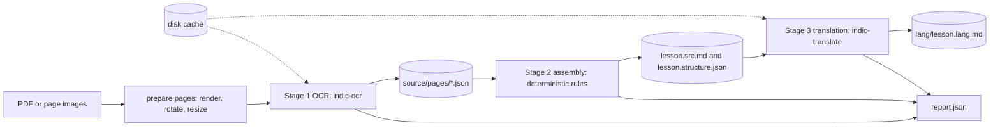
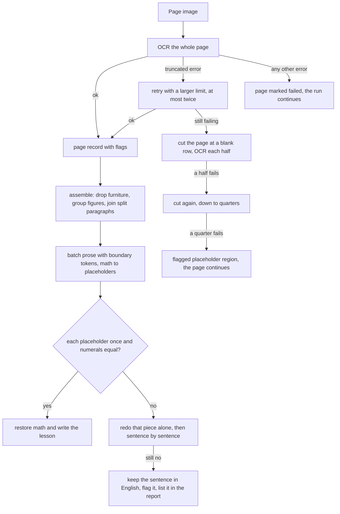

# Design notes

## Architecture

- **prepare pages:** PDF to images with poppler, EXIF rotation fixed, longest side capped at 2400 pixels.
- **OCR:** one request per page, two in parallel, with retry, split and flagged-region fallbacks.
- **assembly:** no model calls. It decides what is page furniture, what is a figure label and what continues across pages.
- **translation:** math protected, pieces batched, every result validated.
- **cache:** every response is stored under a hash of the request, so reruns and retries cost nothing.
- **report:** problems, timings and cost per stage, written on every run.

## Workflow

## Design notes

**Text from Markdown, layout from blocks.** The per-block text lost spaces at line breaks ("twoend points"), the page Markdown did not. Blocks are matched to the Markdown with whitespace removed, and the Markdown version is kept.

**Page furniture by rule, not by label.** The label `Header` also marked a real chapter title in one test, so a block is dropped only when it sits in the top or bottom band and either repeats across pages, is a page number or year, or is website text. Catalog codes such as 0962CH06 are matched by pattern. Every drop is logged with its reason.

**Figure labels.** Text blocks that lie mostly inside a diagram box belong to the figure. They are sorted by row, then left to right, and the nearest "Fig." caption is attached. This fixed a reading-order error where the fifth label came after the caption.

**Math is never sent as words.** Each `$...$` or `$$...$$` span becomes a placeholder before translation and is restored afterwards. Equation blocks are copied unchanged, and the structure check confirms they are identical to the source.

**Validation over trust.** A translation is accepted only if every placeholder appears exactly once and the numerals match the source (digits in any script count as equal). Otherwise the piece is redone smaller. Nothing is silently dropped or silently kept.

**Cost awareness.** Calls are cached, batching cut translation calls (about 195 single-piece calls for the demo chapter before batching), and failed OCR requests are retried a bounded number of times.

## Narration (planned, not built)

- **Equations:** an LLM would write a spoken English version, which indic-translate would then translate, since the LLM must not write Indian-language text.
- **Tables:** read row by row, naming the column for each value.
- **Figures:** read the caption and the labels, and say that the picture is not described.
- **Examples and exercises:** introduced by number ("Example 3", "Question 2").

## Where the LLM is used

Currently nowhere in the pipeline. The client has a plain chat-completions call for it, and the planned uses are the English narration script, reading-order repair, and fixing clear English OCR slips.

## What I would do next

1. Narration script, then speech synthesis in sentence chunks, back-transcription to measure character error rate, and loudness normalisation.
2. Run phone-photo scans, multi-column pages and an Indian-language source chapter through the pipeline.
3. A per-chapter glossary with a consistency report.
4. A reading-order check that uses the LLM on pages the position check flags.