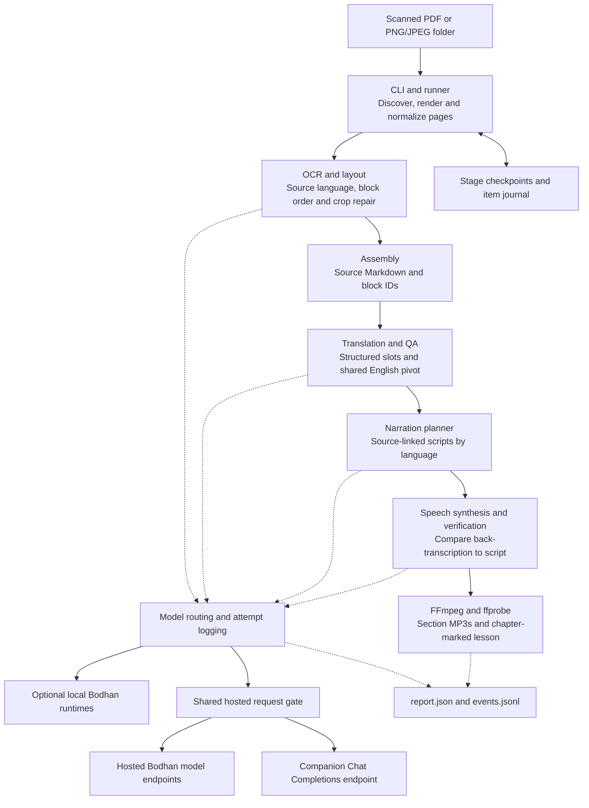

# Scanned chapter to narrated lesson

An automated pipeline that converts scanned textbook chapters (PDF or page images) into structured lesson notes and teacher-style narrated MP3 audio across Indian languages.

The CLI takes a scanned PDF or a folder of PNG/JPEG page images and produces
source Markdown, checked translations and narration scripts that link back to
the original page blocks.

Each successful language gets section MP3s and a chapter-marked lesson MP3.

The audit report records quality findings, omitted content, retries, timing and estimated provider costs.

## Setup

Use Linux or macOS with Python 3.10 or newer, Make, and FFmpeg with
`libmp3lame` and `ffprobe`.

From the Cookbook root, run:

```bash
cd examples/narrated_scripts
make setup
```

Setup creates the recipe's `.venv` and installs the editable package and test
extra. It downloads exact Python dependency versions and verifies the digest of
the Indic Normalizer source archive. The installed CLI supports hosted runs
without a GPU or downloaded model weights.

Alternatively, build the hosted container from the Cookbook root:

```bash
docker build -t bodhan-lesson examples/narrated_scripts
```

## Run

Put the keys in your environment or copy `.env.example` to an ignored `.env`
in the working directory. Exported variables take precedence.

| Setting | Use |
| --- | --- |
| `BODHAN_BACKEND` | `hosted` for GPU-free runs. The default, `local-first`, uses the optional GPU runtime and calls hosted only after confirmed local CUDA OOM. |
| `BODHAN_OCR_KEY`,`BODHAN_TRANSLATE_KEY`, `BODHAN_SPEAK_KEY`, `BODHAN_TRANSCRIBE_KEY` | Service-specific credentials for hosted calls and CUDA OOM fallbacks. |
| `LLM_BASE_URL`, `LLM_MODEL`, `LLM_API_KEY` | Separate OpenAI-compatible Chat Completions settings for language, reading order and grounded figure decisions. |
| `BODHAN_SPEECH_MAX_CHARS`, `BODHAN_SPEECH_CER_THRESHOLD` | Defaults are 300 characters per request and a CER threshold of 0.15. The planner prefers smaller Tamil chunks. |

This recipe reads the four service-specific keys above. For GPU installation and the
official weights, see the [local runtime setup](docs/reviewer/checkpoints.md#optional-local-gpu-runtime).

```bash
cd examples/narrated_scripts
source .venv/bin/activate
cp -n .env.example .env  # Fill in the service keys and companion model settings.

INPUT="$PWD/inputs/Lines-and-Angles-NCERT.pdf"
OUT="$PWD/.local/lines-and-angles"

BODHAN_BACKEND=hosted python -m bodhan_lesson --input "$INPUT" --langs hi,ta,bn --out "$OUT" </dev/null
python -m json.tool "$OUT/report.json"
```

Set `INPUT` to a local copy of the [assigned NCERT chapter](https://www.aspirationsinstitute.com/wp-content/uploads/2021/01/9-Maths-NCERT-Book-Lines-and-Angles.pdf)
or another scan you have permission to process. The CLI rasterizes PDFs before
OCR and orders image files by their names. `--source-lang` sets a known source
language. `--glossary` and `--voices` accept YAML overrides.

Use the same input, settings and output directory to resume. The CLI asks in
an interactive terminal and resumes automatically with stdin redirected.
`--until` stops at a named checkpoint. `--force` clears generated work for
the selected output directory. The full command exits nonzero when a requested
language fails and keeps usable results for the others. Quality misses and
skipped sections appear in the report.

For a container run, keep the scanned PDF and the output directory within the
mounted working directory. The container reads the service credentials from
the recipe's `.env` file through `--env-file`:

```bash
docker run --rm --user "$(id -u):$(id -g)" --env-file .env -e BODHAN_BACKEND=hosted \
  -v "$PWD:/data" bodhan-lesson --input /data/inputs/Lines-and-Angles-NCERT.pdf \
  --langs hi,ta,bn --out /data/.local/lines-and-angles
```

| Output under `--out` | Contents |
| --- | --- |
| `source/lesson.src.md`, `source/pages/`, `work/chapter.json` | OCR blocks, source sections and provenance |
| `<lang>/lesson.<lang>.md`, `<lang>/translation-qa.json` | Checked translation and structural findings |
| `<lang>/narration_script.<lang>.json`, `<lang>/speech-qa.json` | Planned speech text, candidate-specific references, character error rate (CER) and skip reasons |
| `<lang>/narration/`, `<lang>/lesson.<lang>.mp3` | Verified section audio and chapter-marked lesson |
| `report.json` | Page and language outcomes, quality findings, attempts, backend, timing and INR estimates |
| `events.jsonl` | Stage, page, section and request events for the latest full invocation |

Hosted calls share one in-flight request slot per process. Retryable transport
errors, timeouts, HTTP 408, 429 and 5xx get up to three attempts with backoff
and provider retry hints. A failed page produces a source gap. A language
that still produces usable lesson audio can finish with quality misses.

To trace narration, find the `script_chunk` event by language, section and
chunk ID. Look up that ID in `narration_script.<lang>.json` for the planned
text and its `source_block_ids`. Each ID points to a block in
`source/pages/<page_id>.json`, and a cross-page join points to both pages.
Use `speech-qa.json` for the exact text checked for each candidate, including
regenerations and splits, and follow its attempt IDs in `report.json`.

## How it works

1. Detect the source language from OCR evidence, normalize pixels, and order and repair blocks.
2. Remove repeated page furniture and assemble the source lesson with stable block IDs.
3. Translate slots with Indic-Translate and validate structure, quantities and LaTeX. Distinct Indian languages share a checked English pivot.
4. Build narration from checked text, read supported equations and tables, and link figure captions to their source blocks. Scripts spell out numeric values in the selected language, reading each digit after a decimal point.
5. Synthesize and back-transcribe chunks. Export the verified chunks through FFmpeg and report any partial sections. The script retains the text for omitted chunks.

### Architecture



The same runner drives full and checkpoint-only invocations. The stage map
links each component to its implementation and intermediate artifacts.
[Stage map](docs/reviewer/design.md#architecture) ·
[Checkpoint reference](docs/reviewer/checkpoints.md)

### Workflow

```mermaid
flowchart TD
    PAGES["Page images"] --> OVERRIDE{"Source language supplied?"}
    OVERRIDE -->|No| SAMPLE["Sample readable OCR excerpts<br/>Use later pages when samples fail"]
    OVERRIDE -->|Yes| OCR["Normalize and OCR each page"]
    SAMPLE --> OCR
    OCR --> PAGEOK{"Page OCR usable?"}
    PAGEOK -->|No| GAP["Record page gap"]
    PAGEOK -->|Yes| CHECK["Order blocks and check text and structure"]
    CHECK --> DOUBT{"Block needs repair?"}
    DOUBT -->|Yes| CROP["Try one crop OCR repair when eligible"]
    CROP --> REPAIRED{"Repair passes checks?"}
    REPAIRED -->|No| QUARANTINE["Quarantine block and record reason"]
    REPAIRED -->|Yes| ASSEMBLE["Assemble source sections and remove recurring page furniture"]
    DOUBT -->|No| ASSEMBLE
    GAP --> ASSEMBLE
    QUARANTINE --> ASSEMBLE
    ASSEMBLE --> TRANSLATE["Translate structured slots for each target<br/>Reuse checked English pivot for Indian-language pairs"]
    TRANSLATE --> VALID{"Structure and protected literals pass?"}
    VALID -->|Repairable mismatch| RETRANSLATE["Try one constrained repair and recheck"]
    VALID -->|Yes| PLAN["Write source-linked narration chunks from eligible text"]
    RETRANSLATE -->|Passes| PLAN
    RETRANSLATE -->|Fails| SKIPTEXT["Record ineligible content and continue"]
    VALID -->|Unrecoverable| SKIPTEXT
    PLAN --> SPEAK["Synthesize and back-transcribe each chunk"]
    SPEAK --> QA{"CER and content checks pass?"}
    QA -->|Yes| KEEP["Keep verified candidate"]
    QA -->|Suspect| REPAIR["Regenerate and recheck<br/>Try a safe split if eligible"]
    REPAIR -->|Whole chunk or both parts pass| KEEP
    REPAIR -->|Fails or cannot verify| SKIPAUDIO["Log omitted chunk"]
    QA -->|Verification unavailable| SKIPAUDIO
    KEEP --> SECTION{"Any verified chunks in section?"}
    SKIPAUDIO --> SECTION
    SECTION -->|Yes| EXPORT["Join in order, normalize and measure section loudness"]
    SECTION -->|No| SKIPSECTION["Record skipped section"]
    EXPORT --> PUBLISH{"Lesson MP3 and chapter metadata pass probe?"}
    SKIPSECTION --> PUBLISH
    SKIPTEXT --> PUBLISH
    PUBLISH -->|Yes| MP3["Publish chapter-marked MP3"]
    PUBLISH -->|No| FAIL["Record target failure"]
    MP3 --> REPORT["Finish remaining targets and write the final report"]
    FAIL --> REPORT
```



The shared hosted retry loop runs inside each model call above. Content
repairs in the workflow have their own limits after a response is available.
[Hosted routing and retry flowchart](docs/reviewer/design.md#workflow)

### How tables, equations and figures are narrated

- **Tables** pair checked headers with values, such as “Smaller angle, 65 degrees.” Ambiguous column spans are read in row order.
- **Equations** keep their LaTeX in Markdown. Supported formulas are read in operand and operator order, such as “65 degrees plus 115 degrees equals 180 degrees.” Unsupported forms get a speech skip reason.
- **Figures** use linked caption evidence and retain both figure and caption IDs when that evidence is available. Indic-Translate renders eligible English caption excerpts in the target language.

[Design notes and narration examples](docs/reviewer/design.md#design-notes)

### Bodhan models used

| Model | Role |
| --- | --- |
| `indic-ocr` | Extracts text and structure from page pixels and can re-read a flagged crop. |
| `indic-translate` | Translates structured text slots. Same-language targets reuse source text, direct English routes use one leg, and distinct Indian-language routes share a checked English pivot. |
| `indic-speak` | Synthesizes language-specific chunks with a configurable 300-character request limit by default. |
| `indic-transcribe` | Back-transcribes candidates so the pipeline can check text, numbers and omissions. The default CER threshold is 0.15. |

## Where the LLM is used, and why

| Decision point | What it decides and why | Validation | Fallback if it fails |
| --- | --- | --- | --- |
| Source language | Chooses the main language from readable OCR excerpts when script evidence alone cannot settle the label. The source language determines the translation route. | Accepts only a supported code consistent with the observed scripts. | If the call fails, returns `unknown`, or proposes an invalid code, the pipeline records the language as unresolved. OCR and source assembly can continue. Translation requires a known language, supplied with `--source-lang` when needed. |
| Page reading order | Proposes an order for OCR blocks when their bounding boxes make the reading sequence ambiguous. The pipeline uses that order to assemble the lesson. | Requires every existing block ID exactly once. | If the call fails or the response is invalid, the pipeline keeps the OCR provider's order and flags the fallback. |
| Figure narration | Selects a sentence from linked English caption evidence that explicitly describes a relationship in the figure. This gives the listener a grounded description. | Requires a verbatim excerpt from the cited caption block. | If no proposal passes validation, the pipeline uses the checked caption. It also uses that caption if the selected excerpt cannot produce a script chunk. Figures without an eligible caption are skipped with a recorded reason. |

## Results

The eight-page English NCERT *Lines and Angles* demo ran through audio export
in hosted mode and finished as `completed_with_misses`. The published audio is linked below. Reproducing the run writes
`source/lesson.src.md`, `report.json`, and `events.jsonl` under `--out`.
[Reproduction command](docs/reviewer/evidence.md#demo-1-ncert-lines-and-angles)

| Language | Outputs | MP3 duration | Sections within loudness target |
| --- | --- | ---: | ---: |
| Hindi | [MP3](https://drive.google.com/file/d/1sHUnNxEVExVeHJZ1t0MVF_fWz5y3p2r_/view?usp=sharing) | 8:49 | 6/7 |
| Tamil | [MP3](https://drive.google.com/file/d/1OdAsXsRjEXtZGq3I9pBYFi_hgnoyb7I8/view?usp=sharing) | 13:51 | 8/9 |
| Bengali | [MP3](https://drive.google.com/file/d/1k26U_RRDrAU2grQpPRoEPeZ1Ip98cnXB/view?usp=sharing) | 9:36 | 6/7 |

Speech QA coverage is the share of planned narration reference characters
covered by accepted audio. Sections with audio can still have omitted chunks.
The section loudness target is −16 LUFS ±1.

### Synthesis and first-pass speech audit

| Metric | Hindi | Tamil | Bengali |
| --- | ---: | ---: | ---: |
| Narration units in the script | 83 | 81 | 83 |
| Audio chunks spoken | 100 of 100 | 133 of 134 | 101 of 101 |
| Synthesized audio length | 17:05 | 19:30 | 19:06 |
| Chunks back-transcribed on the first pass | 100 of 100 | 131 of 134 | 101 of 101 |
| CER over first-pass audited chunks | 0.170 | 0.120 | 0.195 |

Narration units count distinct unit IDs referenced by the script chunks.
Synthesized audio length sums the original successful clips before QA.
First-pass CER divides the total character edits by the total normalized
reference characters across scored original clips, including clips that
failed QA. The export results above reflect the audio accepted after QA and
any recovery attempts.
The per-language synthesis logs are written to `<lang>/chunks.json`.

| Report quality target | Result |
| --- | --- |
| OCR structure capture | Met for OCR-detected structure. All 13 detected structural blocks were captured. Scan-level completeness and reading order need visual review. |
| Doubtful OCR | Met. Five doubtful blocks across four pages were quarantined and recorded as unavailable. |
| Translation structure, numbers and LaTeX | Section checks reported `met` in all three languages, with 13 of 13 structural units accepted and 84 units checked for numbers and LaTeX per language. Translation overall reported misses because some source content was unavailable. |
| Hosted runtime | Unverified. The under-20-minute target requires a fresh hosted run with 10 pages and three target languages. This run processed eight pages. |

The [Indian-language source demo](docs/reviewer/evidence.md#demo-2-indian-language-source)
documents how to exercise the shared English pivot. Its live outputs are
pending. The [PR description draft](docs/reviewer/submission.md) follows the
assignment template.

## Demo video

[Watch the narrated lesson pipeline demo](https://drive.google.com/file/d/1T9fkQ0G9roSDQvWGSaEdvv0DjKOnpm5s/view?usp=sharing)

- [Bengali Audio demo](https://drive.google.com/file/d/1k26U_RRDrAU2grQpPRoEPeZ1Ip98cnXB/view?usp=sharing)
- [Hindi Audio demo](https://drive.google.com/file/d/1sHUnNxEVExVeHJZ1t0MVF_fWz5y3p2r_/view?usp=sharing)
- [Tamil Audio demo](https://drive.google.com/file/d/1OdAsXsRjEXtZGq3I9pBYFi_hgnoyb7I8/view?usp=sharing)

[Recording checklist](docs/reviewer/evidence.md#demo-video)

## Trade-offs and known limitations

> **Hosted rate limits.** The run logged 267 HTTP 429 responses across 2,071
  model request attempts, even with one hosted request in flight at a time.
  Two Tamil chunks were omitted after all three back-transcription attempts
  were rate-limited. Rate limits and transient HTTP errors also blocked
  split recovery for one Hindi chunk and two Bengali chunks. Other chunks
  were omitted after failing the speech quality checks.
- The pipeline attempts a bounded OCR repair before quarantining doubtful
  text. Five blocks were withheld in this run. The first section consisted
  entirely of a quarantined block and was omitted in all three languages.
- Audio export keeps verified chunks in order and skips chunks that remain
  unverified after recovery. Hindi and Bengali also lost the chapter-number
  heading and Exercise 6.1. Back-transcription checks need native-speaker
  review for pronunciation, and translation structure checks need human
  review for meaning.
- Figure narration uses readable linked captions. Unsupported equations
  keep their written LaTeX and receive a speech skip reason. Code-mixed
  narration is unavailable.
- Retries and speech QA add time. Incomplete provider usage and pricing
  leave the total cost unknown.

## Cost and runtime

The fresh hosted demo took **2 h 29 min 52 s** end to end, averaging
**18 min 44 s per input page** across all three targets. The known hosted
subtotal was **₹63.05**, or **₹7.88 per input page**, with 104 of 2,071
attempts missing cost data. Speech synthesis and speech QA together took
about 2 h 6 min of wall time.

| Work | Known subtotal | Known cost per page | Request time | Request time per page | Unpriced attempts |
| --- | ---: | ---: | ---: | ---: | ---: |
| Shared OCR and companion LLM | ₹4.80 | ₹0.60 | 33.4 s | 4.2 s | 18 |
| Hindi | ₹19.33 | ₹2.42 | 2,101.4 s | 262.7 s | 32 |
| Tamil | ₹19.35 | ₹2.42 | 2,098.5 s | 262.3 s | 23 |
| Bengali | ₹19.57 | ₹2.45 | 2,325.2 s | 290.7 s | 31 |

Each target row sums its translation, synthesis and transcription attempts,
including retries. Per-page figures divide by eight. Request time sums
the recorded attempt durations. The report gives end-to-end wall time for
the run as a whole.
[10-page benchmark procedure](docs/reviewer/evidence.md#hosted-benchmark)

## Offline tests

```bash
mkdir -p .local
python -m pytest -q tests/stage6/test_smoke.py --basetemp=.local/smoke
python -m pytest -q tests/stage6/test_delivery.py
python -m pytest -q tests
```

The smoke test creates two original pages, exercises a hosted rate-limit
retry with deterministic provider responses, and exports real MP3s from
generated tones. The suite also checks page assembly, structure preservation,
and page and language failure isolation. Pytest replaces the dedicated
`.local/smoke` directory on reruns.

## AI assistance

OpenAI Codex assisted with implementation, test development, debugging from
user-run output, and documentation.
