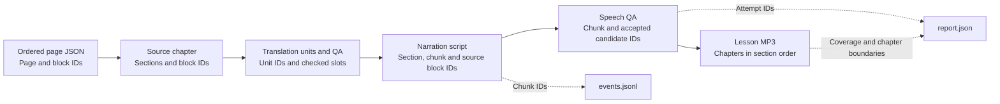
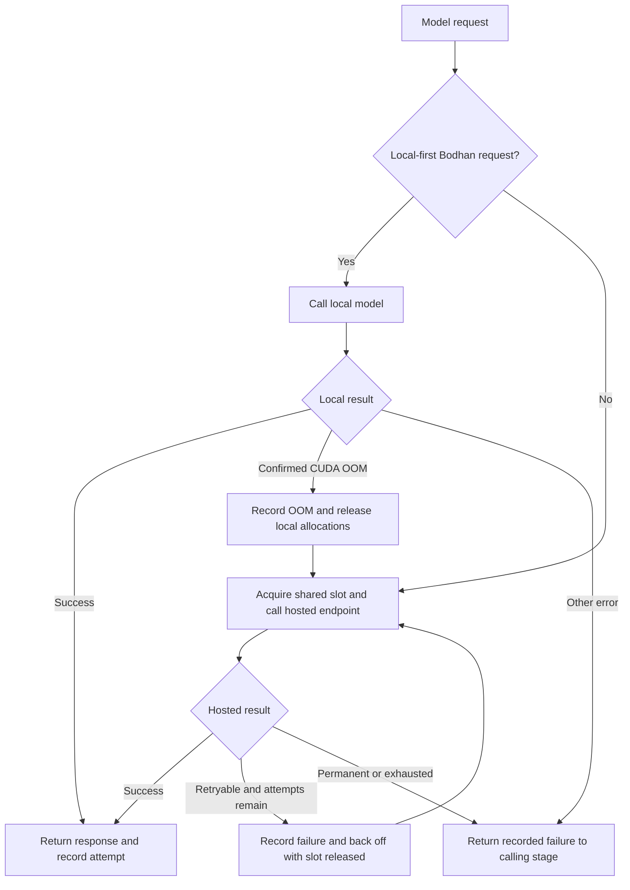

# Architecture and design

## Architecture

The [architecture diagram](../../README.md#architecture) shows the data path
and its shared inference, storage and reporting components. The
[runner](../../src/bodhan_lesson/backend/runner.py) drives the stages in this
order for both full and checkpoint-only runs.

| Stage | Implementation | Evidence under `--out` |
| --- | --- | --- |
| Input and language | [Discovery and PDF rendering](../../src/bodhan_lesson/backend/ocr/inputs.py), [language sampling](../../src/bodhan_lesson/backend/ocr/language.py), [preprocessing](../../src/bodhan_lesson/backend/ocr/preprocess.py) | `source/language.json` |
| OCR and layout | [Page extraction](../../src/bodhan_lesson/backend/ocr/extraction.py), [reading order and crop repair](../../src/bodhan_lesson/backend/ocr/layout.py) | `source/pages/<page_id>.json` |
| Source assembly | [Boundary decisions and section assembly](../../src/bodhan_lesson/backend/ocr/assembly.py) | `work/boundaries.json`, `work/chapter.json`, `source/lesson.src.md` |
| Translation and QA | [Structured text slots](../../src/bodhan_lesson/backend/translation/segments.py), [translation and validation](../../src/bodhan_lesson/backend/translation/translate.py) | `work/pivot.en.json` when needed, `<lang>/lesson.<lang>.md`, `<lang>/translation-qa.json` |
| Narration | [Block-specific speech planning and chunking](../../src/bodhan_lesson/backend/audio/narration.py) | `work/narration-plan.json`, `<lang>/narration_script.<lang>.json` |
| Speech and ASR | [Synthesis](../../src/bodhan_lesson/backend/audio/speak.py), [transcription](../../src/bodhan_lesson/backend/audio/transcribe.py), [comparison and recovery](../../src/bodhan_lesson/backend/audio/speech_qa.py) | `<lang>/speech-qa.json` records each candidate, outcome and accepted attempt IDs |
| Audio export | [Section assembly, loudness and chapter probes](../../src/bodhan_lesson/backend/audio/export.py) | `<lang>/narration/`, `<lang>/lesson.<lang>.mp3` |
| Resume and audit | [Checkpoint store](../../src/bodhan_lesson/backend/checkpoints.py), [inference routing](../../src/bodhan_lesson/backend/inference.py), [report aggregation](../../src/bodhan_lesson/backend/report.py) | `report.json`, `events.jsonl` for full runs |

## Workflow

The [page-to-narration flowchart](../../README.md#workflow) shows the content
checks. The flowchart below shows how individual calls reach their provider.

| Decision | Recovery | Outcome when recovery fails |
| --- | --- | --- |
| Source language cannot be determined from the available excerpts | Continue past unreadable pages until up to three readable excerpts are collected. Use `--source-lang` to supply a known language. | The language checkpoint records an unresolved code and a reason. OCR and source assembly can proceed. |
| Hosted request returns a timeout, transport error, HTTP 408, 429 or 5xx | Up to three total attempts with exponential backoff and provider retry hints. The process-wide request slot is released before the delay. HTTP 429 can also trigger a cooldown after the last attempt. | The calling stage handles the item failure and the attempt remains in the report. |
| Local Bodhan inference hits a confirmed CUDA OOM | Release local allocations and try the hosted adapter for that request. The next local-first request starts locally again. | Provider failure is recorded for the item. Other local errors are recorded directly. |
| A page fails OCR or a block fails content checks | A flagged block with usable crop geometry can get one re-read from the original raster. An accepted repair keeps the same block ID. | A failed page leaves a source gap. A rejected or unavailable block repair leaves quarantined content. |
| A translation fails a repairable check | Try one constrained repair for the affected unit and recheck structure and protected values. | The unit is ineligible for narration and its findings remain in translation QA. |
| Back-transcription makes a chunk suspect | Regenerate with the selected voice and recheck. If eligible, try a two-part split and accept it only when both parts pass. | Omit the chunk and keep its text and QA reason. If back-transcription is unavailable on the first candidate, record the unavailable result directly. |
| Section audio or final lesson fails export checks | Keep publishable sections in order. Probe the lesson MP3 and its chapter markers before publishing. | Record the section skip or target failure. Other target languages continue. A failed target yields exit code 1. |

## Design notes

### Companion LLM decisions

| Decision | Accepted response | Fallback |
| --- | --- | --- |
| Source language from bounded OCR excerpts | One allowed code supported by the excerpt’s script evidence | Leave the language unresolved with a reason. Supply `--source-lang` when known. |
| Reading order where geometry is ambiguous | An exact permutation of existing block IDs | Keep the provider order and flag the fallback. Geometry-free pages use provider order directly. |
| Figure speech from linked English caption evidence | A verbatim sentence from one cited caption ID | Use the checked caption when available. A figure without usable caption evidence gets a skip reason. |

Prompts frame OCR excerpts and captions as evidence. Validators constrain the
response shape and provenance. Indic-OCR provides extracted page text and
Indic-Translate supplies the Indian-language text for translation and derived
speech, including figure sentences and supported math readings. ASR transcripts
are evidence for the comparison and the script text remains source-linked.

### Tables, equations and figures

- **Table.** In the synthetic example, the first row introduces “Smaller angle”
  and “Larger angle.” A data row pairs those labels with `65°` and `115°`.
  When spans make column association ambiguous, the planner reads checked
  cells in row order. Edit [plan_table_narration](../../src/bodhan_lesson/backend/audio/narration.py)
  to change this policy.
- **Equation.** The synthetic sum keeps its exact LaTeX in Markdown. The
  narration planner reads the operators in `65^\circ + 115^\circ = 180^\circ`
  and checks quantity preservation and operand order through translation.
  Unsupported notation retains its Markdown and gets a script skip reason.
- **Figure.** The synthetic ray diagram links to its adjacent caption.
  The script carries the figure and caption IDs. A grounded English caption
  excerpt can be translated by Indic-Translate when the companion model
  returns a valid citation and sentence.

### Evidence and failure boundaries

A reviewer can follow a chapter marker to the script section, then use
`events.jsonl` or the script JSON to join a chunk’s source block IDs to the
ordered page JSON. Page blocks retain OCR evidence and geometry when supplied.
The report joins synthesis and transcription attempt IDs to their outcomes.
OCR checks order, confidence, malformed structure and suspect text, and
uses bounded crop OCR when geometry is available. Translation QA checks protected values, structural
slots and glossary evidence. Speech QA uses normalized character edits and
signals for omission, repetition and changed numbers. A split is accepted
when both parts pass. Unavailable verification and unrecovered chunks keep
their reasons. Section audio keeps its accepted chunks in order, with omitted
chunk IDs recorded alongside the full script text.

FFmpeg targets −16 LUFS and measures the encoded section with a ±1 LUFS
tolerance. The full track is encoded once from normalized PCM and probed for
ordered chapter boundaries and AI-generated attribution. The report records
accepted-chunk CER, speech QA coverage, and the script share in the lesson MP3.

### Model settings

| Model | Settings |
| --- | --- |
| Indic-OCR | Default HTML table format and 2,048-token page recognition budget. Layout may re-read a flagged crop at original resolution. |
| Indic-Translate | Direct English routes and one shared English pivot for distinct Indian languages. Optional local GGUF service uses a reduced context budget. |
| Indic-Speak | Per-language voice validation, configurable 300-character maximum by default and shorter Tamil chunk preferences. The default demo voices are Kavya, Anitha and Ishita. |
| Indic-Transcribe | Local Core or hosted transcription with a 30-second input limit. Default accepted CER threshold is 0.15. |
| Companion LLM | Separate configurable Chat Completions endpoint. Source language, layout and captions are the only decision points. |
