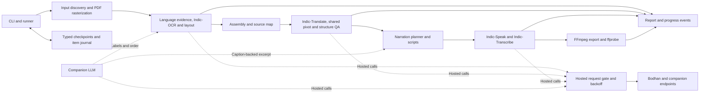
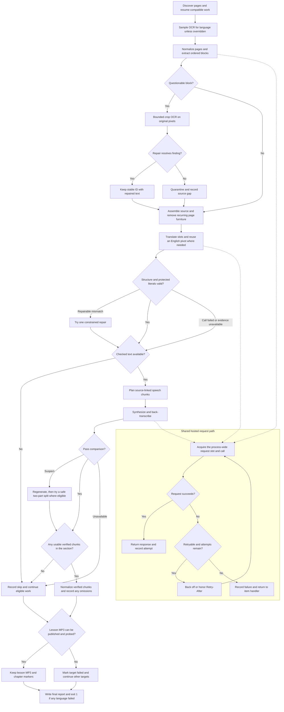

## Summary

This CLI turns a scanned chapter into checked multilingual Markdown and
source-linked narration. Each successful target gets verified section MP3s and
a chapter-marked lesson. An audit report records skips, retries, quality
findings, timings and estimated cost.

New CLI recipe at `examples/narrated_scripts/`.

## How to run

Install Python 3.10+, Make, and FFmpeg with `libmp3lame` and `ffprobe`.
Clone the assignment branch and set up the recipe.

```bash
git clone --branch assignment/narrated-lesson-SG-Akshay10 https://github.com/SG-Akshay10/Bodhan-AI-Cookbook.git
cd Bodhan-AI-Cookbook/examples/narrated_scripts
make setup
source .venv/bin/activate
cp .env.example .env
```

Fill in the four Bodhan service keys and the optional companion model settings
in `.env`, then run the assigned English chapter.

```bash
mkdir -p inputs
INPUT="$PWD/inputs/Lines-and-Angles-NCERT.pdf"
curl -fL 'https://www.aspirationsinstitute.com/wp-content/uploads/2021/01/9-Maths-NCERT-Book-Lines-and-Angles.pdf' -o "$INPUT"
OUT="$PWD/.local/lesson"
BODHAN_BACKEND=hosted python -m bodhan_lesson --input "$INPUT" --langs hi,ta,bn --out "$OUT" </dev/null
python -m json.tool "$OUT/report.json"
```

## Architecture



- **Input.** Discover images or render PDF pages and normalize their pixels.
- **OCR and layout.** Extract blocks, check order and recover doubtful text with crop OCR.
- **Assembly.** Remove recurring page furniture and join supported cross-page fragments.
- **Translation.** Translate structured slots and check numbers, units, tables and LaTeX.
- **Planning.** Build source-linked text chunks with per-block narration rules.
- **Speech QA.** Back-transcribe candidates and compare them with the exact synthesis input.
- **Export.** Normalize verified audio and probe chapter markers before publishing.
- **Audit.** Save checkpoints, structured events and a machine-readable report.

## Workflow



The shared hosted request gate allows one in-flight API call per process.
Retryable transport errors get up to three attempts. Failed pages leave source
gaps, and a failed language leaves other languages' artifacts intact. The
command returns exit code 1 if any target language fails.

## Where the LLM is used, and why

The companion model can choose an evidence-backed source-language label,
propose a permutation of known block IDs, and select a verbatim sentence from
a linked English figure caption. Invalid or unavailable answers leave the
language unresolved, retain provider order, or use the checked caption,
respectively.

## How tables, equations and figures are narrated

A table introduces checked headers and pairs labels with values, such as
“Smaller angle, 65 degrees.” The lesson keeps exact LaTeX for the synthetic
angle sum and reads it as “65 degrees plus 115 degrees equals 180 degrees.”
For the synthetic ray diagram, the script uses the linked caption describing
two rays sharing endpoint O. A validated excerpt can be translated through
Indic-Translate before synthesis.

## Bodhan models used

Indic-OCR extracts page text and structure. Indic-Translate handles direct
routes involving English. The pipeline reuses a validated English pivot
for distinct Indian languages.
Indic-Speak synthesizes language-specific voices with a default 300-character
request budget and a lower planning limit for Tamil. Indic-Transcribe back-transcribes with a default 0.15 CER
threshold and a hosted 30-second input limit. The default local-first mode
uses official weights and falls back for confirmed CUDA OOM. The GPU-free
CLI example selects hosted explicitly.

## Results

The eight-page hosted NCERT *Lines and Angles* run finished with quality
misses in all three targets. Its `report.json` records 13 of 13 OCR-detected
structural blocks captured and five doubtful blocks quarantined across four
pages. In each language, translation checks accepted all 13 structural
units and checked 84 units for numbers and LaTeX. The loudness target is
−16 LUFS ±1. Speech coverage measures reference characters covered by
accepted audio.

| Target | Exported sections | Sections within loudness target | Speech coverage | Lesson |
| --- | ---: | ---: | ---: | --- |
| Hindi | 7 | 6 of 7 | 53.1% | [8:49 MP3](https://drive.google.com/file/d/1sHUnNxEVExVeHJZ1t0MVF_fWz5y3p2r_/view?usp=sharing) |
| Tamil | 9 | 8 of 9 | 75.1% | [13:51 MP3](https://drive.google.com/file/d/1OdAsXsRjEXtZGq3I9pBYFi_hgnoyb7I8/view?usp=sharing) |
| Bengali | 7 | 6 of 7 | 54.4% | [9:36 MP3](https://drive.google.com/file/d/1k26U_RRDrAU2grQpPRoEPeZ1Ip98cnXB/view?usp=sharing) |

The offline smoke test covers a hosted 429 retry, cross-page provenance,
structure preservation, and chapter markers. Live Indian-source demo output
and a public copy of the raw NCERT report are pending.

## Demo video

[Watch the narrated lesson pipeline demo](https://drive.google.com/file/d/1T9fkQ0G9roSDQvWGSaEdvv0DjKOnpm5s/view?usp=sharing)

## Trade-offs and known limitations

A quarantined block leaves a visible gap. Sections with some verified speech
can export with omissions. Figures depend on readable
caption evidence, and unsupported math keeps its written form with an
explicit speech skip. Native-speaker review remains necessary for meaning
and pronunciation.

## Cost and runtime

The fresh eight-page hosted run took 2 h 29 min 52 s, or about 18 min 44 s
per page across all three targets. The known estimated cost was ₹63.05
(₹7.88 per page) with 104 of 2,071 attempts missing cost data. The report
marks the under-20-minute benchmark unverified because it requires a fresh
hosted run with 10 pages and three targets.

| Work | Known estimated cost | Known cost per page | Request time per page |
| --- | ---: | ---: | ---: |
| Shared OCR and companion LLM | ₹4.80 | ₹0.60 | 4.2 s |
| Hindi | ₹19.33 | ₹2.42 | 262.7 s |
| Tamil | ₹19.35 | ₹2.42 | 262.3 s |
| Bengali | ₹19.57 | ₹2.45 | 290.7 s |

Request time sums recorded attempt durations, including retries. The run
recorded 267 HTTP 429 responses.

## AI assistance

OpenAI Codex assisted with implementation, tests, debugging and
documentation. The project author performs verification and reviews the
submitted evidence.

## Validation

The assignment recipe suite, Cookbook lint and rules, and recipe validation
pass. Cookbook `make check` reports one failing test in
`test_all_shipped_recipes_pass` because the upstream `examples/AndroidSpeak`
recipe lacks files recognized by the validator. The same failure reproduces
on a clean upstream snapshot. The submission commit is available via
`git rev-parse HEAD` on the assignment branch.
