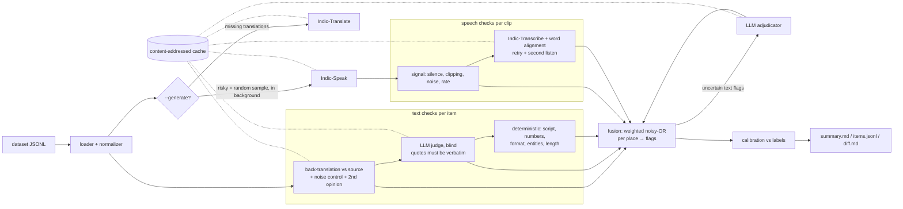
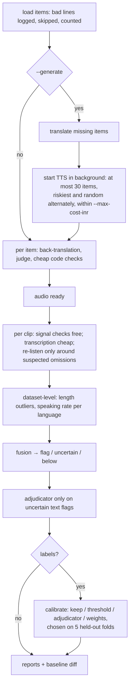

# Translation and Speech Quality Harness

Finds and explains quality problems in Bodhan **Indic-Translate** translations and **Indic-Speak** audio:
what is wrong, where (character span, and time span for audio), how bad, and the evidence. It runs
unattended on unseen datasets and languages, calibrates against human labels, and diffs two runs.
Only Bodhan models translate, synthesize and transcribe; a general LLM is the judge.

## Setup

```bash
uv sync                      # Python 3.11+, pinned deps (uv.lock); or: pip install -e .
cp .env.example .env         # Bodhan keys + any OpenAI-compatible LLM (base URL, model, key)
brew install ffmpeg          # or apt-get install ffmpeg: only needed for audio that isn't PCM WAV
uv run pytest -q             # 196 tests, no network
```

## Run

```bash
uv run python -m bodhan_eval --dataset data/demo.jsonl --langs hi,ta,bn --out ./report \
  [--generate] [--baseline ./previous_report] [--calibration labels.jsonl] [--max-cost-inr 50]
```

Extra flags: `--skip-speech`, `--max-speech-items N` (default 30 voiced with `--generate`), `--thresholds
thresholds.tuned.json`. Outputs in `--out`: `summary.md`, `summary.json`, `items.jsonl` (every flag with its
evidence and the candidates behind it), `calibration.json` + `thresholds.tuned.json` (when labels are given,
by `--calibration` or inline in the dataset), `diff.md` (with `--baseline`), `run.json` (versions, timings,
cost per model, which keys were present — never their values). Every model output is cached by its exact
input in `.bodhan_cache/`, so a rerun is free and produces byte-identical reports. Missing keys, bad lines and
failed calls never stop a run: they are counted and listed under "Not checked".

Other tools: `python -m bodhan_eval.inject` (text error injector), `python -m bodhan_eval.inject_speech`
(audio error injector), `python -m bodhan_eval.review export|import` (review queue CSV → labels, see
[docs/review_guide.md](docs/review_guide.md)), `python -m bodhan_eval.calibrate`, `python -m bodhan_eval.report`.

## Sample report

[sample_report/summary.md](sample_report/summary.md) (demo dataset, text checks),
[sample_report/speech_summary.md](sample_report/speech_summary.md) (injected speech errors),
[sample_report/diff.md](sample_report/diff.md) (baseline diff of a simulated model update).
Generated audio is not in git; `--generate` recreates it (cached by text).

## Architecture





## Checks (one line each)

| Check | Finds | Cost |
|---|---|---|
| back_translation | omission / addition / mistranslation: source sentences vs a back-translation, aligned; a fresh Bodhan translation of the source is back-translated too (noise control) and suspicious items get a sentence-by-sentence second opinion | Bodhan, ~2.5 calls/item |
| back_translation_phrase / _negation | words missing from the back-translation; negation count changed | free |
| judge (LLM) | all text categories, blind, rubric in `src/bodhan_eval/prompts/judge.md`; quotes must exist verbatim or are dropped; never writes Indic text (enforced in code) | 1 LLM call/item |
| numbers | digit/date/unit changed or missing, native digits and lakh/crore normalized | free |
| format | Markdown headings, lists, tables, bold, code, LaTeX `$…$` (Pandoc rules) | free |
| script | wrong script / untranslated stretch | free |
| entities | names/terms missing from translation and back-translation | free |
| length | translation length outliers per language | free |
| adjudicator (LLM) | second opinion on uncertain text flags only | ~0.1 calls/item |
| speech_signal | long silence, clipping, noise bursts (smoothed spectral flatness), unreadable/silent audio | free |
| speech_asr | omission/truncation (missing characters, not words), repetition, unintelligible stretches; degenerate transcripts re-transcribed; suspected omissions re-listened | ₹0.10/audio-minute |
| speech_rate | audio too short/long for its text at the language's median speaking rate | free |

**Fusion.** Candidates at the same place merge; confidence = noisy-OR of per-check weights, one vote per
check family (the back-translation checks share one); containment folds a missing number into its omitted
sentence; text and speech never merge. ≥ 0.65 flags, 0.45–0.65 goes to the adjudicator. MQM-style item
score (minor 1, major 5, critical 10). **Calibration** matches flags to labels by place and category
(label names are mapped, e.g. "Number or unit", "truncation", "garbled audio"), and picks — on 5 held-out
folds grouped by source text — between keeping the thresholds, sweeping the threshold (max recall at ≤ 10%
false alarms), adding the adjudicator, or fitting weights. Too few clean labels (< 10): nothing is tuned.
Full design notes: [docs/design_notes.md](docs/design_notes.md).

## Results on our demo data

Demo dataset [data/demo.jsonl](data/demo.jsonl): 180 base items (50 sources × hi/ta/bn from Simple English
Wikipedia, CC BY-SA, plus 15 IN22-Gen sentences with their human translations, CC BY 4.0) + 200 injected
variants (140 errors, 60 harmless changes) = 380 items. 29 Hindi items were reviewed by the author
(`annotator: "candidate-manual"`); injected labels say `annotator: "injector"`.

**Text, held-out (tuned on 4/5, measured on 1/5):** recall **94%**, precision 88%, false alarms on clean items
**9.9%**, localization 97%, category accuracy 73%. Judge consistency 91% (30 items × 3 runs).

| category | found | right category | precision |
|---|---|---|---|
| addition | 95% | 85% | 100% |
| format | 100% | 86% | 79% |
| mistranslation | 95% | 54% | 69% |
| number | 96% | 91% | 96% |
| omission | 100% | 62% | 97% |
| term | 89% | 48% | 88% |
| wrong_language | 100% | 85% | 100% |

| language | labels | found | right category | precision | false alarms (clean) |
|---|---|---|---|---|---|
| hi | 86 | 91% | 55% | 93% | 3% (31) |
| bn | 48 | 98% | 83% | 87% | 15% (20) |
| ta | 44 | 98% | 80% | 83% | 15% (20) |

On the author's Hindi labels (real errors, not injected): recall 82%, precision 89%, 0 of 11 clean items flagged.

**Speech** (26 clips voiced, 44 injected audio faults + 8 harmless edits): recall **92%**, precision 100%,
right category 100%, false alarms 0/8. Truncation 6/6, silence 6/6, noise 6/6, clipping 6/6, omission 11/12
(incl. a second set), repetition 4/6. Live finds: a **real Indic-Speak failure** (bn: a 116-character
sentence returned as 2.5 s of audio) and two transcriber failures, recovered by re-transcription.

**Unseen language:** a 12-item Telugu run worked without code changes (script, numbers, format, judge, speech).

## Bodhan models and the LLM

- Indic-Translate (hosted): generation, back-translation, noise control. Indic-Speak (hosted, voices Kavya/
  Anitha/Ishita for hi/ta/bn, default Kavya elsewhere). Indic-Transcribe (hosted; "Core"/"Flex" names are
  refused by the API, `indic-transcribe` is used). Notes from probing the API: [docs/bodhan_api.md](docs/bodhan_api.md).
- LLM (tested: NVIDIA `nemotron-3-ultra-550b-a55b`): the blind judge and the adjudicator. It only reads Indian
  languages; quotes are checked verbatim and non-Latin words it writes in explanations are removed. The LLM
  also edited English phrases for the injector (Bodhan then translated them).

## Cost and runtime

Per 100 items: text checks ≈ **₹0.3** Bodhan + ~110 LLM calls (~2k tokens each); speech ≈ **₹14** per 100
voiced items of our length (₹0.58/item synthesis+transcription), so with the default 30-item sample ≈ ₹4.3.
Runtime is bound by the rate limits we measured on our keys (Bodhan ~7–12 requests/min per model, the free
LLM ~8/min). Text needs ~3.3 Indic-Translate requests per item (back-translation, noise control, sentence-level
second opinion) and ~1.1 LLM calls, so a fresh run takes ≈ 27 min per 100 items at 12 translate requests/min
(the projection in [sample_report/summary.md](sample_report/summary.md): 54 min per 200 — the 30-minute target is
missed at these limits). Speech synthesis runs in parallel with the text checks; transcription adds ~5 min for
30 clips. Set `LIMIT_<MODEL>` in `.env` if your keys allow more; the projection uses it.

## Limitations (honest list)

- Category accuracy is the weak metric (73%; mistranslation vs term, and clause omissions called
  mistranslation). Magnitude words ("2 million" vs "2 lakh") pass the number check.
- The judge alone drives some false alarms; the adjudicator mostly agrees with it (58/64 "yes").
- Speech time spans are proportional (Indic-Transcribe gives no timestamps); speech thresholds were checked on
  31 clean clips only; 1-word repetitions in ta/bn are missed.
- Thresholds were tuned on our own labels (injected + 29 Hindi items); bn/ta false-alarm rates are measured
  on 20 clean items each.
- The 200-item, with-speech runtime target is not met on our free LLM endpoint and Bodhan rate limits; it
  depends on the reviewers' limits.
- No demo video was recorded before the deadline. Structured per-check JSON logs (planned) are not built:
  traceability comes from `items.jsonl` (every flag lists its candidates and their evidence) and `run.json`.

## AI assistance

Built with Claude Code (Anthropic) as a pair programmer: code, tests, analysis of runs and documentation,
directed and reviewed by the author, who also labelled the Hindi review set.
