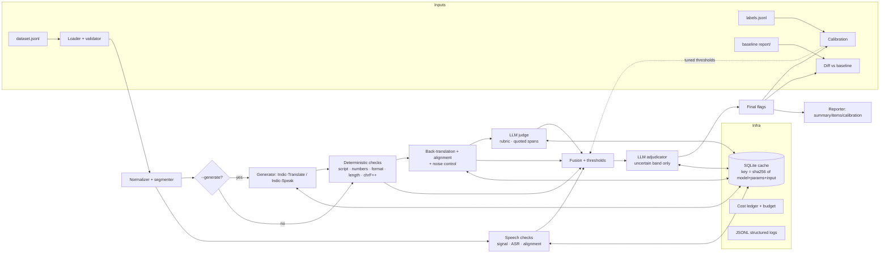

# Design notes

The working implementation plan, kept up to date while building: each section is the design, what was built (dated), measured results and the planned improvements. The README has the summary.

# Implementation Plan — Translation & Speech Quality Harness (`bodhan_eval`)

Status: draft v1 · 2026-11-18 · Deadline: ~2026-11-20 (7 days from receipt on 2026-11-13 — confirm, see Q1)

This plan covers every part of the assignment. Each part has the same three sub-sections:
**Solution** (what we build), **Details** (how), and **Scope of improvement** (what we'd do with more time — also feeds the README's "what's next"). Open questions are collected at the end, each with the default we'll proceed on if unanswered.

---

## 0. Goals, constraints, guiding principles

**Goal.** `python -m bodhan_eval --dataset d.jsonl --langs hi,ta,bn --out ./report [--generate] [--baseline dir] [--calibration labels.jsonl] [--max-cost-inr 50]` runs unattended on an unseen dataset and produces `summary.md`, `summary.json`, `items.jsonl`, `calibration.json`, `diff.md`.

**Hard constraints (auto-fail if broken).**
1. MT, TTS, ASR → Bodhan only (Indic-Translate / Indic-Speak / Indic-Transcribe). No COMET/xCOMET/MetricX/NISQA/Whisper.
2. The LLM never writes, rewrites or corrects Indian-language text — enforced in code, not just in the prompt.
3. Injector creates Indic errors programmatically, or by perturbing *English* and re-translating with Indic-Translate.
4. No thresholds special-cased to the demo set — defaults are generic, tuned only from `--calibration` at runtime.
5. No secrets / generated audio in git.

**Guiding principles.**
- **Cheap → costly ladder.** Free deterministic checks → near-free back-translation (₹0.20/10k tok) → LLM judge → speech (ASR cheap, TTS expensive).
- **No flag without evidence.** Every flag carries category, severity, exact span (side + char offsets + quoted text) and the evidence that produced it.
- **Corroborate noisy checkers.** Back-translation and ASR never flag alone on soft signals; they need a second signal or a margin over a per-item noise control.
- **Language-agnostic by construction.** No per-language code paths; language behaviour comes from Unicode properties + a data table + statistics learned from the dataset itself.
- **Few trustworthy checks > many noisy ones.**

---

## 1. Architecture



**Flow chart (order and triggers).**

```mermaid
flowchart TD
  A[Load item] -->|invalid| SKIP[log + count as skipped]
  A --> B[Normalize + segment source/target]
  B --> C{translation present?}
  C -- no, --generate --> C1[Translate with Indic-Translate] --> D
  C -- no, no --generate --> C2[mark 'no translation' · skip text checks]
  C -- yes --> D[Deterministic checks — always, free]
  D --> E[Back-translate each target segment — always, ~free]
  E --> E2[Noise control: BT of fresh MT of source]
  E2 --> F[Sentence alignment → omission/addition/number/entity candidates]
  F --> G[LLM judge — every translated item]
  G --> H[Fusion]
  H --> I{candidate in uncertain band?}
  I -- yes --> I1[LLM adjudicator yes/no with all evidence]
  I -- no --> J
  I1 --> J[Translation flags]
  B --> S{audio present?}
  S -- no, --generate, budget OK, selected by sampler --> S1[Synthesize with Indic-Speak]
  S -- no, otherwise --> S2[mark 'no audio']
  S -- yes --> S3
  S1 --> S3[Signal checks — free]
  S3 --> S4[Back-transcribe with Indic-Transcribe — cheap]
  S4 --> S5[Token alignment → omission/truncation/repetition/garble]
  S5 --> S6{borderline?}
  S6 -- yes --> S7[Corroborate with signal evidence / LLM adjudicator]
  S6 -- no --> S8
  S7 --> S8[Speech flags]
  J & S8 --> K[Item record → items.jsonl]
  K --> L[Calibration · summary · diff]
```

**Recipe folder** (adjust to Cookbook template once read — Q6):

```
examples/translation-speech-quality-harness/
  README.md  pyproject.toml  .env.example  Dockerfile  Makefile(optional)
  data/demo.jsonl  data/labels.demo.jsonl
  docs/architecture.md  docs/design.md
  sample_report/            # text-only report from the demo run
  src/bodhan_eval/
    __main__.py  cli.py  config.py  langs.py  dataset.py  normalize.py  segment.py
    clients.py  cache.py  cost.py  generate.py
    checks/  script.py  numbers.py  format.py  length.py  reference.py  backtranslate.py  judge.py  speech.py  audio.py
    fusion.py  calibrate.py  inject.py  report.py  diff.py
    prompts/judge.md  prompts/adjudicate.md
    thresholds.default.json
  tests/
```

Target: ~15 small modules, no framework. Orchestration = plain `asyncio` + semaphores.

---

## 2. CLI, configuration and run metadata

**Solution.** `argparse` CLI with the exact required interface plus optional extras; config from env vars; one `RunContext` object passed around.

**Details.**
- Required/given flags: `--dataset --langs --out --generate --baseline --calibration --max-cost-inr`.
- Extras: `--thresholds file.json` (reuse a calibration), `--judge-repeats N` (default 1; consistency study uses 3), `--speech-sample {all,risk,N}`, `--concurrency 8`, `--offline` (cache-only, fail on miss — proves determinism), `--fail-on-regression` (CI mode), `--seed`.
- Env: `BODHAN_TRANSLATE_KEY`, `BODHAN_SPEAK_KEY`, `BODHAN_TRANSCRIBE_KEY`, `LLM_BASE_URL`, `LLM_MODEL`, `LLM_API_KEY`; optional non-secret `BODHAN_BASE_URL` (default `https://api.bodhan.ai/v1`), `LLM_PRICE_IN/OUT` for LLM cost reporting.
- Missing key → the corresponding stage degrades gracefully (e.g. no transcribe key ⇒ speech ASR checks skipped, reported in summary), never a crash.
- `--langs` filters items; any language in the registry (§4) or any unknown code (handled statistically) is accepted.
- Run metadata (`run.json`: versions, args, timestamps, model IDs, cache hit rates) is written **separately** so report files stay byte-identical across cached reruns.

**Scope of improvement.**
- YAML config profiles (e.g. "fast", "thorough") instead of many flags.
- `--resume` from a partial run directory.
- Per-stage `--only/--skip` for debugging individual checks.

---

## 3. Dataset loading and validation

**Solution.** Stream JSONL line by line; validate each item; bad lines are logged with reason and counted, never fatal.

**Details.**
- Required: `id`, `source`, `lang`. Optional: `reference`, `translation`, `audio`, `labels`, plus pass-through `meta` (content type, domain).
- Validation: JSON parse error, missing required field, duplicate `id`, empty source, audio path missing/unreadable, label span out of range → item marked `skipped` or the bad optional field dropped (item still scored) with a warning.
- Audio paths resolved relative to the dataset file.
- Content type auto-detected (plain / markdown / latex / mixed) from the source — used for reporting slices and to decide which format checks apply.

**Scope of improvement.**
- Accept CSV/TSV and HF datasets.
- Multiple system outputs per item (A/B systems) — would also power the voice-comparison stretch goal.

---

## 4. Language registry (versatility for unseen languages)

**Solution.** Built 2026-11-21 in `langs.py`: a table `lang → accepted Unicode scripts`, plus script detection from Unicode character names that works for any script without code changes.

**Details.**
- Script of a character: its Unicode name's script prefix (`DEVANAGARI`, `BENGALI`, `TAMIL`, `OL CHIKI`, `MEETEI MAYEK`…), letters and marks only.
- Table covers the 22 scheduled languages + English. Codes Bodhan pairs with a script variant (`ks`/`ks-Deva`, `sd`/`sd-Arab`, `mni`/`mni-Beng`) accept both scripts when given bare, rather than risk flagging every item; an ISO 15924 subtag (`-Deva`, `-Beng`, `-Arab`…) decides when present.
- **Unknown code fallback:** expected script = majority non-Latin script over that language's translations in the dataset.
- Digits via `unicodedata.digit()` (§5); terminators in `segment.py` (§8).

**Scope of improvement.**
- Same-script language confusion (Hindi vs Marathi vs Nepali) needs a language-ID signal: character n-gram profiles learned from the dataset's own translations per language (no external model). Until then the LLM judge covers it.
- Confirm which 13 languages Indic-Speak supports (Q3) and add per-language speaking-rate priors.

---

## 5. Normalization

**Solution.** One `normalize(text, lang, purpose)` function used by every comparison, with purpose-specific options (`numbers`, `asr`, `chrf`, `format`). Heavily unit-tested.

**Details.**
1. Unicode NFC; remove ZWJ/ZWNJ/ZWSP/BOM, soft hyphens; collapse whitespace.
2. ~~`indic-nlp-library`~~ Dropped (built 2026-11-21): stdlib NFC already unifies nukta letters and multi-part vowels for every script, and the library pulls in pandas/numpy. A small table folds the remaining variants (Bengali khanda ta, Malayalam chillus); `loose` mode also folds nukta and candrabindu for ASR comparison.
3. Digits: map any `Nd` char to ASCII via `unicodedata.digit` (`२५`→`25`, `২৫`→`25`, `௨௫`→`25`).
4. Number formats: strip grouping commas between digits (`1,00,000` and `100,000` → `100000`), unify decimal point, keep sign and `%`.
5. Punctuation fold (for `asr`/`chrf`): danda→period, curly→straight quotes, dashes, remove all punctuation for ASR comparison.
6. Keep an **offset map** from normalized text back to original text, so every span reported is in original-text character offsets.

**Scope of improvement.**
- Spelled-out numbers ("पच्चीस", "twenty-five") → digits. English side is easy (small word→number parser); Indic side needs per-language number lexicons — currently handled by BT/ASR wildcarding instead (§8, §12).
- Transliteration-aware matching for Latin entities vs their Indic transliterations (e.g. "Newton" ↔ "न्यूटन") using rule-based transliteration (Aksharamukha-style) — would sharpen entity checks.

---

## 6. Model clients, cache, retries, concurrency, cost

**Solution.** Built 2026-11-21 in `clients.py`: thin wrappers over the official `openai` package (pinned) for each Bodhan model and the LLM, all going through one cache + cost ledger. The brief asks for "an OpenAI-compatible client" and runs our code against its own provider, so the official package is the safest choice.

**Details.**
- **Clients:** `translate(text, lang)` (chat completions + `extra_body={"target_language_code": lang}`; `lang="en"` is a back-translation), `speak(text, lang, voice)` → WAV path, `transcribe(wav, lang)` → text, `llm(messages)` → first JSON object in the reply. One `OpenAI` client per model, since each Bodhan model has its own key; a model without a key is simply absent and its calls raise `ModelError`.
- **Cache:** SQLite (stdlib) table `(key, model, value JSON, created)`, key = `sha256(base_url + model + canonical-JSON(params))`; audio input is keyed by its bytes' hash. Audio outputs stored as files under `.bodhan_cache/audio/<key>.wav`. Cache lives outside `--out`, so reports can be deleted freely. Keys never enter the cache.
- **Retries:** the package's `max_retries=4` (timeouts, 408/409/429, 5xx, exponential backoff, honours `retry-after`); plus our own retry on an LLM reply with no JSON (empty content from `finish_reason: length` included), max 2, then `ModelError`, so that check is marked `error` for that item, not the run.
- **Rate limits (seen 2026-11-21):** Bodhan has an unpublished per-model limit on top of the per-key one (429 "Maximum rate limit reached for the model", retry-after ≈ 55 s; ≈ 17 calls/min sustained on a 90-item run, 7 items lost). After the SDK's retries, all calls of that model pause together for the retry-after, up to 6 rounds; spacing doubles on each 429 and recovers 10% per 20 successes. Out-of-credit 429s are not waited on. Runtime risk for the 30-minute target: see §23.
- **Concurrency:** threads; a per-model limiter of 8 parallel calls and 120 calls/minute for each Bodhan model (the API's limits are 10 and 120), 4 parallel for the LLM.
- **Cost ledger:** price table (Translate ₹0.20/10k output tokens, Speak ₹6/10k input chars, Transcribe ₹0.10/audio-min; LLM tokens reported, not priced, since the provider is the evaluator's). Before every paid call: estimate → reserve against `--max-cost-inr` → if over budget, skip call and record `skipped_budget`. Cache hits cost ₹0 and are reported separately ("would have cost").
- **Determinism:** comes from the cache, not sampling settings. Send no `temperature`/`seed`/`response_format` by default: providers disagree on them (Claude's OpenAI-compatible endpoint rejects `temperature` < 1 and `json_object`; NVIDIA accepts `temperature: 0`; Indic-Translate rejects `temperature` outright). Cached responses make reruns identical regardless of provider drift.
- **LLM replies (seen with Nemotron 3 Ultra on NVIDIA, 2026-11-20):** reasoning models spend most of their output on hidden reasoning (≈ 800–1,600 reasoning tokens for one short item), so set `max_tokens` ≥ 4,096 and treat `finish_reason: length` with empty content as a retryable failure. Replies can carry trailing junk after the JSON (an extra `}` was seen), so parse the first complete object with `json.JSONDecoder().raw_decode`. Latency is ≈ 10 s per call; NVIDIA sends no rate-limit headers, so keep LLM concurrency modest and rely on 429 backoff.

**Scope of improvement.**
- Self-hosted open-weights backend (vLLM / HF) behind the same client interface for zero marginal cost.
- Batch endpoints if Bodhan offers them; adaptive concurrency on 429s.
- Content-addressed remote cache (S3) shared across team runs.

---

## 7. Generation (`--generate`)

**Solution.** Built 2026-11-21 in `generate.py` (+ `segment.py`). Fill only what's missing, never replace a supplied output: translation via Indic-Translate for every item; audio via Indic-Speak in a seeded order until the budget runs out.

**Details.**
- Translation: one call per item missing one, the whole text as is. No placeholder masking: the live probe showed Indic-Translate keeps Markdown, tables, code and `$…$` intact, and masking would mean scoring our wrapper instead of Bodhan. A cut-off output (`finish_reason` ≠ `stop`) is kept with a warning: it is a real system fault.
- Audio: TTS input = `speakable(translation)` (Markdown syntax, code, math, URLs, HTML removed; table rows read as comma-separated lines), split into sentences of ≤ 250 chars (the API takes ≈ 30 s per request). Clips are joined into `--out/audio/<id>.<lang>.wav`, and each item keeps `audio_segments` (text, start_s, end_s per sentence), the only time spans we get since Indic-Transcribe has no timestamps. Default voice per language (hi Kavya, ta Anitha, bn Ishita), else Kavya; base language code for Speak (`mni-Beng` → `mni`).
- Sampling: seeded shuffle per language, languages interleaved, cut at `--max-cost-inr` minus a small reserve for text calls, using estimated speak + transcribe cost. Depends only on the dataset and the budget, not on the cache, so reruns select the same items. The rest are `not_sampled`. Risk-weighted ordering (§12.5) deferred until calibration shows which items fail in speech.
- Every item carries `status` per output: supplied, generated, missing, error, skipped_budget, not_sampled, empty. Counts go into `run.json`.
- Note for §10: when the translation is generated, it equals the noise-control translation, so the control comparison is empty for those items.

**Scope of improvement.**
- Voice / setting sweeps (stretch: comparison mode) — `--voices a,b` generates per voice and reports per-voice metrics side by side.
- Long-text chunking for TTS with seam detection.

---

## 8. Segmentation and span alignment (backbone for localization)

**Solution.** Built 2026-11-21 in `segment.py` + `align.py`. Split source and back-translation into sentences and align them with a monotone dynamic-programming aligner. Unmatched source sentences are omission candidates, unmatched back-translated sentences are addition candidates, and weak matches go to the judge. This step builds the alignment; §10 decides what to flag.

**Details.**
- Segmenter (`segments`): Markdown blocks then sentences on terminators (`. ? ! । ॥ ؟ ۔`, line breaks); table rows kept whole; line markup (`## `, `- `, `1. `, `| `) trimmed; code blocks, display math and table rules left out (the format check covers them); segments without a letter dropped. Every segment keeps its original offsets. No abbreviation lists: "Dr." may split off, and the aligner joins it back.
- Back-translation, two modes:
  - `align_item`: the whole translation in one call (default). Live probe 2026-11-21: Indic-Translate merges newline-separated lines into one paragraph for Hindi (kept them for Tamil and Bengali), so batching lines with a line-count check would fall back on every Hindi item. One call per item plus the aligner's merge moves is cheaper and exact on the source side.
  - `align_item_by_segment`: one call per translated sentence, so `project_span` maps a source span onto the translation (an omission maps to an insertion point). Several calls per item, so only for items §10 already suspects.
- Similarity: chrF with beta = 1 (sacrebleu, pinned) on loosely normalized text (§5). Beta = 1, not chrF's usual 2, so a long back-translated sentence can't score well against a short source sentence just by containing it.
- Aligner: moves 1-1, 1-k and k-1 for k ≤ 4, 1-0, 0-1. A matched move scores (similarity − GAP) × characters covered; a skip scores 0. Length weighting stops the aligner from dropping text for free. GAP = 0.3: unrelated sentences score ≈ 0.1, faithful back-translations 0.35–1.0. A first-principles default that calibration (§14) replaces.
- Adjacent unmatched source and back-translated sentences are joined into one weak match, so reworded or mistranslated text isn't reported as an omission plus an addition. Limit: chrF can't tell a heavy paraphrase (0.11) from a mistranslation (0.08); that's what the noise control (§10) and the judge (§11) are for.
- `word_diff`: word-level diff (difflib) of source vs back-translation, giving spans of source words missing from the back-translation and extra back-translated words, as evidence.
- Live check 2026-11-21: deleting one sentence of a real Hindi translation gave exactly one omission on the right source sentence; a Tamil Markdown table aligned 1-1 at 1.0. Indic-Translate wrote numbers as Hindi words in that item ("पचास"), and the back-translation said "fifty", so the number check (§9) must read English number words in back-translations.

**Scope of improvement.**
- Word-level cross-lingual alignment (e.g. via back-translated n-gram anchors, numbers and Latin tokens as anchors) for sub-sentence spans on the target side.
- Handle reordered sentences (non-monotone) for languages/content where that happens.

---

## 9. Deterministic translation checks (free, run on every item)

Built 2026-11-21 in `checks.py`. First run on 90 clean Bodhan items (2026-11-21) raised candidates on 9; 8 were false alarms from three general causes, all fixed: numbers in the Indian system ("7 million" → "70 लाख": a translation number equal to a source number × thousand/lakh/million/crore/billion is the same quantity), capitalized words at a heading or table-cell start taken as names, and names checked as whole phrases against only the first back-translation (now word by word, vowel-insensitive for romanized names, against every back-translation). After the fixes: 1 weak false candidate left ("Earth" → "the world"), and 2 real Bodhan errors found (the `###` heading marker dropped in Hindi and Bengali). Changes from the original design: the format check uses regex structure extraction, not `markdown-it-py` (no dependency for nesting detail we don't check); cross-item term consistency is left to the judge (§11). Number words are read in back-translations, since Indic-Translate sometimes writes numbers as Indic words (§8). Live check: three clean Bodhan items raised nothing; a number changed in Hindi words (पचास → साठ), an English sentence left in, and a dropped table pipe were each caught.

Each check emits **candidates**: `{check, category, side, span, score, evidence}`. Fusion (§13) decides what becomes a flag.

### 9.1 Wrong language / script / untranslated
**Solution.** Per-segment script profile.
**Details.** Fraction of letters in the expected script (§4). Latin letters are excused if they are a name or term from the source (§9.6 extractor) or sit in code, math or a URL; ordinary source words copied over are *not* excused, since that is untranslated text. A run needs 2+ unexcused words, so a single loanword passes. Signals: (a) segment dominant script ≠ expected → `wrong_language`, span = segment; (b) excused-adjusted Latin ratio > τ → `untranslated`, span = the Latin run; (c) target ≈ source string (chrF > 0.9 vs source) → whole-item untranslated (critical).
**Scope of improvement.** Same-script language ID (§4); handle legitimate English code-mixing in conversational content with a softer threshold per content type.

### 9.2 Number, date, unit preservation
**Solution.** Extract normalized numeric tokens from source and target and compare multisets.
**Details.** Regex over normalized text: integers, decimals, percentages, ranges, times, dates (also split into components so `2023-05-01` vs `1 मई 2023` still matches on {2023, 5|05, 1}), ordinals (`1st`→1), currency. Math inside `$…$` excluded here (covered by format); a closing `$` followed by a digit is not math (Pandoc's rule), so "$3 million ($2 million)" stays currency (live IN22 false alarm, fixed). Missing-in-target / extra-in-target / changed (closest numeric pair differs) → candidate with spans on both sides. **Spelled-out guard:** if the number is missing in target but present in the back-translation, as digits or English number words (`fifty`, `two thousand and five`, `three lakh`), assume it was written in words → suppress (logged in `spelled_out_suppressed`). Number words only excuse, never require, so "one of them" in a source can't cause a false alarm. Units: canonical unit set in source (°C, km, kg, %, ₹, $, mg…) checked in target as symbol or via BT.
**Scope of improvement.** Indic number-word lexicons per language; unit-conversion awareness (e.g. "5 km" ↔ "5000 m" is fine); magnitude words (lakh/crore vs million): digits are compared without their scale word, so "$2 million" → "২ লক্ষ" (= $0.2 million) passes because both contain a 2 (a real IN22 human error the check missed; its back-translation said "$200,000").

### 9.3 Format integrity (Markdown, tables, LaTeX)
**Solution.** Compare a structural skeleton of source vs target.
**Details.** `markdown-it-py` token stream → skeleton: heading levels, list item counts/nesting, table rows × columns per row (pipe counts), code fences (content must be byte-identical), inline code (identical), links (URL identical, text may be translated), images, emphasis marker balance. LaTeX: extract `$…$`, `$$…$$`, `\(…\)`, `\[…\]` segments — multiset must be identical after whitespace normalization; `\begin{x}`/`\end{x}` matching; brace balance; `\command` multiset outside math. Each mismatch → `format` candidate with target span of the broken element (or insertion point), severity by rule (table/math broken = major; emphasis marker = minor). High precision ⇒ can flag alone.
**Scope of improvement.** Render-check (compile LaTeX/markdown to HTML and diff DOM shapes) — the LaTeXTrans "compilation success" idea; HTML/XML tag support.

### 9.4 Length / segment-count anomalies
**Solution.** Weak statistical prior for omission/addition.
**Details.** `log(len(target)/len(source))` per language; robust z-score (median/MAD, MAD floored at 0.1 so tiny or templated datasets don't make small differences extreme) over the current dataset (so it adapts to unseen languages); |z| > 3.5, at least 5 items. Segment count mismatch from §8 is a stronger, localizable variant. Never flags alone.
**Scope of improvement.** Condition the ratio on content type; persist per-language priors across runs.

### 9.5 Reference-based scores (only when `reference` exists)
**Solution.** sacrebleu chrF++ (sentence and segment level), BLEU for reporting.
**Details.** Normalized (§5) both sides. Low segment chrF vs reference while BT is fine → supporting evidence only (references can be paraphrases). Also a reference-side number/format check (reference has the number, system doesn't).
**Scope of improvement.** Use references to localize: char-level diff of system vs reference inside low-chrF segments to propose spans.

### 9.6 Term / entity consistency
**Solution.** Source entities must survive the round trip; repeated terms must be rendered consistently across the dataset.
**Details.** Source entities = capitalized sequences (leading "The", "In"… dropped; a single capitalized word at a sentence start skipped, so one-word names there are missed: the judge covers them), acronyms, CamelCase and letter-digit tokens. An entity kept verbatim in the translation counts as present. Checks: (a) entity missing from BT (fuzzy match ≥ 0.85) → `term_entity` candidate; (b) cross-item consistency — for terms that appear in ≥ 2 items of the same language, collect the target rendering (the target token(s) aligned to the term via BT anchors / Latin passthrough) and flag outliers vs the majority rendering.
**Scope of improvement.** Glossary ingestion (`--glossary terms.csv`); transliteration-based matching (§5); per-domain term banks.

---

## 10. Back-translation check + checker-noise control (near-free, every item)

**Solution.** Built 2026-11-21 in `backtrans.py`. Back-translate the whole translation (§8 `align_item`), and separate system errors from checker errors with a per-item **noise control**: Indic-Translate's own fresh translation of the same source, back-translated the same way. The control can only weaken or remove a candidate, never create one.

**Details.**
- Calls: system back-translation, control translation (the cached result `--generate` uses), control back-translation = 3 per item; plus one per translated sentence for items with candidates.
- Signals from the system alignment, each checked against the control on the same source sentence:
  - omission (source sentence unmatched): dropped as noise if the control loses that sentence too (control score < GAP);
  - addition (back-translated sentence unmatched): dropped if the control's back-translation adds at least half as much text;
  - weak pair: control score − system score > δ = 0.15 (no control: system score < GAP). Classified by the changes the control does not share (`word_diff` minus rewording the control's back-translation also shows): only deletions → omission, anything replaced → mistranslation. Evidence lists each change ("for adults" deleted; "adults" → "children");
  - missing phrase in a well-matched pair: content words (stopwords and digits removed, crude stemming) absent from the system's back-translation but present in the control's. **Requires an independent control**: without one, every paraphrase ("costs" → "fee is") looked like a missing phrase (live false alarm, fixed).
- **Second opinion** (only for items with candidates): sentence-by-sentence back-translation (§8 `align_item_by_segment`). A candidate survives only if both back-translations show it; survivors gain a translation span (`project_span`; omission → insertion point; weak pair → the translated sentence). Dropped candidates are kept in `suppressed` with the reason.
- **No independent control** (generated translation, or identical to the fresh one): `control: same_as_system`; the second opinion is the only noise check; candidate scores × 0.6.
- **Pseudo-reference caution** holds: a candidate always starts from the system's own back-translation disagreeing with the source.
- Live check 2026-11-21 (Hindi, Bengali, Tamil): 3 clean items → nothing; sentence deleted → omission on the right source sentence; "वयस्कों के लिए" deleted → omission on the right translated sentence; adults → children → mistranslation; added sentence → addition with its exact span.

**Scope of improvement.**
- Contrastive conditioning (score the translation with the source vs source-minus-span) if Indic-Translate exposes log-probs — strong reference-free omission detector.
- Multiple BT samples to estimate checker variance per item, not just a single control.

---

## 11. LLM judge (+ adjudicator)

**Solution.** GEMBA-MQM-style rubric judge that returns structured errors with **verbatim quoted spans**; code computes offsets and enforces the "never write Indic" rule. A second, narrower LLM call (adjudicator) resolves only uncertain candidates.

**Built 2026-11-22** (`judge.py`, rubric `prompts/judge.md`; adjudicator deferred to §13–14): one blind call per item, after the back-translation, before the code checks. Input: numbered source segments S1…, translation segments T1…, the back-translation ("may itself be wrong"). Categories: the brief's, minus format (deterministic check owns it). Quote located in the named segment, then anywhere on that side, then on the other side (whitespace-insensitive); not found → dropped as `invalid_quote`. Non-Latin words in an explanation not copied from the translation are replaced by […] (live: the judge did try to suggest Hindi corrections; removed). `Clients.llm(repeat=k)` bypasses the cache for consistency runs. Also added: **negation check** (`back_translation_negation`, in backtrans.py): negation-word count differs between a source sentence and its back-translation and not in the control's → mistranslation candidate, confirmed by the second opinion like the others.

**First judged run (2026-11-22, 340 injected-dataset items, Bodhan ₹0, 335 LLM calls, 41 min — the NVIDIA endpoint returned 376 × 429, ≈ 8 calls/min).** Judge alone, new vs base: caught omission 100%, addition 95%, mistranslation 95% (right kind 80%), term 95%, number 95%, wrong_language 95%, format 10% (by design); hard negatives 3/20 new judge errors. All checks + provisional rule (two checks agreeing on a category now include the judge): flagged mistranslation 0 → 45%, term 5 → 75%, omission 45 → 95%, addition 35 → 90%; hard negatives 1/20 flagged. Hindi human labels (29 items): judge raised errors on 16 items, all 16 with a real error (precision 16/16), recall 16/18, right category 12/18. 11 quotes dropped as invalid — all invented text (Korean/Spanish fragments, garbled Bengali): the substring rule is doing its job. 4 items (1%) got an unusable reply, recorded as `error` on that check. **Consistency** (`scripts/judge_consistency.py`, 30 items, 10 per language, × 3 runs): verdict (error / no error) agreement 93% pairwise (target ≥ 90%), same verdict in all 3 runs for 27/30; category-set agreement 87%. Disagreements are borderline cases (a subtle human paraphrase; a category swap mistranslation ↔ term ↔ number on the same error); one injected omission was missed in 1 of 3 runs → majority vote over repeats is worth it for the reviewers' run if time allows.

**Details.**
- **Input:** source (with segment IDs), target (with segment IDs), per-segment BT (labelled "machine back-translation, may itself be wrong"), and optionally deterministic findings. Run **blind first** (no hints) to avoid anchoring; hints are given only to the adjudicator.
- **Rubric (prompts/judge.md):** categories exactly as in the brief (omission, addition, mistranslation, number_unit, term_entity, format, wrong_language); severities: *critical* (meaning reversed/dangerous, wrong language, large omission), *major* (meaning changed, clause missing/added, number changed), *minor* (nuance, awkward term, small inconsistency). Explicit "do not penalize fluency/style", "a fluent sentence can still be wrong", "don't propose corrections", "quote, don't paraphrase".
- **Output schema:** `{errors:[{category, severity, side: "source"|"target", segment_id, quote, explanation_en, confidence: low|med|high}]}`. JSON requested in the prompt and parsed from the first JSON block of the text — no `response_format`, which providers support inconsistently.
- **Span validation:** `quote` must be an exact substring of the declared side/segment (after NFC). Else fuzzy snap (rapidfuzz partial ratio ≥ 95 within the segment) to the real substring. Else drop + log `invalid_quote`. Offsets always computed by code.
- **No-Indic-writing enforcement:** any Indic-script run in `explanation_en` that is not a substring of the target is stripped and the event logged; prompt forbids suggestions. The LLM's text is never written into any output that could be mistaken for a translation.
- **Long documents:** chunk by Markdown blocks (~1.5k tokens) with segment IDs preserved.
- **Consistency measurement:** `--judge-repeats 3` on a stratified sample (and in calibration): verdict agreement (item-level error/no-error, per category), reported as judge consistency (target ≥ 90%). Majority vote when repeats > 1. Paraphrased-prompt robustness test in the calibration report.
- **Calibration of the judge:** per-language precision/recall and Cohen's κ vs human labels; per-category confidence thresholds tuned (§14).
- **Adjudicator built 2026-11-23** (`adjudicate.py`, `prompts/adjudicate.md`): one call per item for its flags in the uncertain band [0.45, 0.65); sees texts, back-translation and each claim (category, words, `review.why` of every member — the judge's explanation included); told claims are often false and to answer "no" when unsure; yes → flagged (its category/severity win), no → below with the reason. Answers stored in `adjudication` keyed by candidate identity, so calibration can switch it on/off without calls (strategy `adjudicator+threshold`). First run: 46 calls for 45 items (64 claims), ₹0, 8 min. It mostly agrees (58 yes / 6 no). Held-out: recall 89% → **94%**, precision 89% → 88%, clean FAR 8.5% → 9.9% — chosen by calibration. At the same threshold it beats lowering the threshold to 0.45 (same recall, FAR 5.6% vs 14%). On labelled items: confirmed 9/9 real, rejected 1 of 5 claims on clean items; the 4 it confirmed look like real errors in the *base* Bodhan translations (bn "appeal to" → "apply"; ta "193 members" → "193 people", "5 m/s²" → "5 square metres"; unverified, no ta/bn reader) that the judge missed on the base run — so FAR on hard negatives is pessimistic. Risk: anchoring (it rarely says no); runtime on the hidden set ≈ 200 judge + ~25 adjudicator calls at ~8/min ≈ 28 min, close to the 30-min target.
- **Adjudicator (prompts/adjudicate.md):** for candidates in the uncertain band only: gets source segment, target segment, BT, control BT, and the candidate evidence; answers `{is_error: yes/no, category, severity, reason}` — no free spans, keeps the candidate's span. This is where "separate checker noise from system errors" becomes explicit and cheap.

**Scope of improvement.**
- Multi-judge ensemble (two different LLMs) with disagreement → review queue.
- Per-language few-shot examples taken from calibration labels (dynamic few-shot).
- Position/ordering-bias tests; judge self-consistency via sampled votes at temperature > 0.

---

## 12. Speech checks

**Built 2026-11-23** (`audio.py`, `speech.py`, `inject_speech.py`; numpy + stdlib wave, ffmpeg only for non-WAV). Signal: unreadable, silent audio, leading/trailing/internal silence (strong ≥ 1.5 s), clipping (> 0.1% of samples in runs ≥ 3), noise (spectral flatness median over 0.5 s > 0.15 for ≥ 0.3 s; silent frames count 0). Measured on clean Indic-Speak clips: no edge silence, pauses ≤ 0.25 s, peak ≤ 0.45, smoothed flatness ≤ 0.073 (noise at 0 dB: 0.31–0.52). Back-transcription: pieces ≤ 25 s cut at pauses, cached by bytes; loose-normalized word alignment (substitution = 1 − char similarity; digit/Latin words are wildcards for 1–8 transcript words). Contiguous runs only: omission/truncation by **missing characters** (≥ 10 raised, strong ≥ 12, a missing ending strong ≥ 10 — word counts penalised Tamil/Bengali, where one word ≈ 1 s), repetition (extra words repeating their neighbours, strong ≥ 8 chars), unintelligible windows, nothing recognised. Speaking rate per language (median chars/s, ≥ 5 clips, else 10): short/long audio. Checker noise: a degenerate piece (< 0.8 words/s or a character ×8) is re-transcribed in ≤ 8 s pieces; an omission whose missing share exceeds the audio shortfall by > 0.35 is downgraded ("transcriber miss"). Speech and text findings never merge in fusion; the adjudicator only sees text flags. `--skip-speech` and items without audio are listed under "Not checked".

**Results (2026-11-23).** 26 items voiced (9 hi / 8 ta / 9 bn, seeded sample, ₹3.01 TTS + ₹0.69 ASR, 9.5 min — Indic-Speak and Indic-Transcribe both rate-limit at ~8–12 requests/min, 68 HTTP 429 retried). Live findings: (1) a **real Indic-Speak error**: in22-1009-human bn, a 116-char sentence returned as 2.5 s (47 chars/s), flagged critical; (2) two **transcriber failures** (a 20 s piece → 2 words + one Odia character repeated hundreds of times; a 21 s piece → 1 word), both recovered by the retry; ASR noise floor on 31 clean clips: longest missing run 10 chars. Injected (44 variants from the 26 clips, ₹1.06): recall **89%** (truncation 6/6, silence 6/6, noise 6/6, clipping 6/6, omission 4/6, repetition 4/6), precision 100%, right category 100%, hard negatives 0/8 flagged (quieter, louder, +0.3 s end silence, hiss at −40 dB). Misses: phrases of 11 chars (below the noise floor margin) and 1-word repeats in ta/bn. Caveats: thresholds checked on 31 clean clips only; time spans are proportional (no ASR timestamps); runtime of fresh speech is rate-limit bound — sample with `--max-cost-inr`.

### 12.1 Audio signal checks (free)
**Solution.** Decode to 16 kHz mono float (soundfile; ffmpeg for non-WAV), compute frame-level features.
**Details.** Duration; expected duration from characters ÷ speaking rate where the rate is the per-language robust median over the dataset's audio (adapts to new languages) → too short = truncation candidate, too long = repetition/silence candidate. Silence: 25 ms frames, RMS below −40 dBFS relative to peak; leading/trailing > 1.0 s, internal > 1.0 s → candidate with time span. Clipping: fraction of samples |x| ≥ 0.999 in runs ≥ 3. Noise/garble: spectral flatness high + energy present over ≥ 0.5 s. Unreadable/empty audio → critical `garbled`.
**Scope of improvement.** Pitch-track/voicing ratio for robotic or noise segments; speaker-consistency across a long utterance.

### 12.2 Back-transcription (cheap)
**Solution.** Indic-Transcribe (`indic-transcribe`, the only model; the live API has no Core or Flex) on every audio, chunked to ≤ 30 s.
**Details.** The API returns no timestamps (verified, see `docs/bodhan_api.md`), so audio-time evidence comes from our own silence/energy segmentation, or is estimated in proportion to text position.

### 12.3 Alignment and detectors
**Solution.** Token-level alignment of normalized input text vs ASR hypothesis; detectors operate on the edit script.
**Details.**
- Normalization: §5 `asr` mode; **wildcards** for tokens that are numbers or Latin in the input (TTS says "पच्चीस", ASR may write `25` or the word) — a wildcard matches 0–3 hypothesis tokens without cost.
- Alignment: Levenshtein over tokens where substitution cost = 1 − char-similarity (near-miss spellings ≈ matches, i.e. ASR noise is absorbed).
- **Omission:** run of ≥ k consecutive deleted reference tokens (default k = 3 or ≥ 30% of a sentence). **Truncation:** deletion run reaching the end of the reference, ideally corroborated by short duration.
- **Repetition:** inserted run in the hypothesis that duplicates the immediately preceding hypothesis n-gram (n ≥ 2), or n-gram counts in hypothesis > counts in reference.
- **Garbled:** sliding-window CER > τ over ≥ N tokens, or ASR empty/very short while audio has energy, combined with §12.1 anomalies.
- Spans: reference-text char span (original offsets via §5 map) + audio time span.

### 12.4 Checker-noise separation for ASR
**Solution.** ASR errors look like scattered substitutions; TTS errors look like contiguous runs or signal anomalies.
**Details.** (a) Only contiguous runs and windowed metrics flag, never global WER alone; (b) per-language ASR noise floor = CER distribution on items without signal anomalies → z-score; (c) borderline → corroborate with signal evidence (a deletion run with matching silence, or a duration/speech-rate anomaly), since there is no second ASR model; (d) the adjudicator can be asked "is the missing span likely an ASR miss (e.g. a proper noun) or not spoken?" using the time-gap evidence (a deletion with no corresponding audio time = not spoken).

### 12.5 When to spend on speech (sampling)
**Solution.** Deterministic risk-based sampler under the budget.
**Details.** Supplied audio: always ASR (cheap). With `--generate`: compute a risk score per item (length, numbers, repeated tokens — known to trigger TTS repetition — Latin/entities, rare characters), then fill the TTS budget stratified by language: highest-risk first plus a random (seeded) slice for unbiased estimates. Pre-run cost estimate printed and logged. Items not synthesized are reported as `not_sampled`.

**Scope of improvement (speech overall).**
- Forced alignment via ASR timestamps for precise word-time spans.
- Voice/setting comparison mode (stretch).
- Learn per-language speaking rates from Indic-Speak documentation or a calibration pass rather than the dataset only.

---

## 13. Fusion → flags

**Built 2026-11-23** (`fuse.py`, defaults in `thresholds.default.json`). Candidates pointing at the same place merge into one flag whatever their categories (places compared on a side both know, else by relative position — ponytail until the alignment is stored); confidence = noisy-OR over check *families* (the three back-translation checks are one family, max within it) of `weights[signal][category]`; signal = check (+ judge confidence, + `:strong` for standalone). Category = most weight, others in `alt_categories`; **containment**: a group whose members all lie inside an omission is that omission, except a number that is present but *changed*. Severity = max of the checks that rate it, else major. decision flag / uncertain / below (all kept in items.jsonl, `candidates` index into the record's list); verdict flagged / uncertain / clean / skipped; MQM = Σ severity points over flagged. Format check: a missing element now spans the gap between its neighbours (was a point after the previous one, often far from the real spot).

**Solution.** Per-category rules combining candidates, with all numeric thresholds in `thresholds.default.json` (generic, documented) overridable by calibration output.

**Details.**
- Each check has a reliability weight (default from design; replaced by calibration precision). Candidates of the same category with overlapping spans are merged (span union, evidence concatenated).
- Flag if: a **high-precision check** fires (format, number mismatch not suppressed, whole-item wrong language/untranslated), **or** ≥ 2 independent signals agree (e.g. BT omission + judge omission), **or** the judge reports high confidence with a valid quote. Weighted score in the **uncertain band** → adjudicator (§11).
- **Containment:** a candidate whose source span lies inside an omitted span (e.g. a missing number in a deleted sentence) is folded into the omission as evidence, so one error is reported once.
- Conflicts on the same span across categories: keep the higher-weighted category, record the other as `alt_category`.
- Severity: rule-based for deterministic checks, judge/adjudicator severity otherwise, max over merged candidates.
- **Flag record:** `{category, severity, side, span:[s,e], text, audio_span?, confidence, sources:[checks], evidence:{…}, trace_id}`.
- Item verdict: `clean | flagged | uncertain | skipped`; MQM-style item score = Σ severity weights (minor 1, major 5, critical 10; configurable).

**Scope of improvement.**
- Replace rules with a tiny logistic-regression over check scores fit on calibration labels (still transparent; weights published).
- Per-language weights when enough labels exist.

---

## 14. Calibration (`--calibration labels.jsonl`)

**Built 2026-11-23** (`calibrate.py`; `--calibration f1 f2 …` in the CLI, or `python -m bodhan_eval.calibrate --report R --labels …`). Labels: `{id, lang, labels}`; rows with `base` are injected variants scored only on candidates their base lacks (same text *or* same evidence). Match = a flag candidate overlaps the label's place; spanless labels match a flag of their category in the item. Two strategies, each tried on 5 folds by source text, the better held-out one is used: (a) sweep the flag threshold only (max recall s.t. clean FAR ≤ 10%), (b) fit weights (signal precision, shrunk with 8 pseudo-counts) + sweep. Output `calibration.json` (default / tuned in-sample / held-out per strategy; by category, language, kind, origin; per-signal support) + `thresholds.tuned.json` (reuse with `--thresholds`); the tuned values also set this run's flags.

**First calibration (2026-11-23, report-judge: 29 Hindi-labelled items + 200 injected variants incl. 60 hard negatives = 71 clean items, 178 labels).** Chosen: threshold only, flag 0.5 → 0.65. Held-out: recall 89% (injected 93%, human 76%), precision 89%, clean FAR 8.5% (defaults: 94% / 87% / 12.7%). Fitting weights lost held-out (FAR 14%): the labelled set is 70% erroneous, so fitted precisions overstate. With only 31 clean items the threshold went *down* to 0.35 — the 40 extra hard negatives (₹0.03) reversed it, so FAR needs plenty of clean labels. The trade-off is the judge alone (0.6): it caused 10 of 13 clean false alarms at 0.5 (some are real base errors it missed on the base run — judge variability) and 7 of 8 labels lost at 0.65 (mostly mistranslation/term) → the adjudicator (§11) on the uncertain band is the next lever. Category accuracy is the weak metric: right category 64% (human labels 29%: single-sentence items, several errors per sentence, mistranslation vs term ambiguity); number 91%, format 95%, wrong_language 85%.

**Solution.** Match flags to human labels, compute per-category/per-language metrics, tune thresholds by sweep, write `calibration.json`, and apply tuned thresholds to the final flags of the same run.

**Details.**
- Labels file: items with `id` + `labels` (or full items). Clean labelled items (empty labels) are essential for false-alarm rates.
- **Matching:** a flag matches a gold label if same item, same category, and char-overlap > 0 (also report overlap-coefficient ≥ 0.5 variant). Gold spans side = target by default; if Q4 says source, project via §8. Category-agnostic match also recorded (for "detected but wrong category").
- **Metrics (per category, per language, per check, per content type):** precision, recall, localization rate (span overlap among detections), category accuracy, clean-item false-alarm rate, judge κ and consistency.
- **Tuning:** grid sweep for each threshold, objective = maximize recall subject to clean-FAR ≤ 10% (else max F2). Guardrails against overfitting a small labelled set: only move a threshold when the category has ≥ n_min labels (default 8); shrink toward defaults; report k-fold held-out metrics alongside in-sample.
- Output: `calibration.json` with before/after metrics, chosen thresholds and support counts; tuned thresholds also saved as `thresholds.tuned.json` for `--thresholds` reuse.

**Scope of improvement.**
- Review queue (stretch): export items in the uncertain band to `review_queue.csv` (id, lang, source, target, candidate span, evidence, empty label columns) → human fills → `--calibration review_queue.csv` re-calibrates.
- Bootstrap confidence intervals on every metric.
- Use public MQM data (IndicMT Eval, if license permits) as an extra calibration source for hi/ta.

---

## 15. Error injector

**Solution.** Built 2026-11-22 (translation errors only): `python -m bodhan_eval.inject --in report/items.jsonl --out data/injected.jsonl --per-category 20 --negatives 20 --seed 42` — programmatic, seeded, every injection carries an exact label. Output = every input item unchanged (the **base**) + variants `<base>~<category>` with `base`, `injection` and one `annotator: "injector"` label. Bases are kept because the "clean" translations are not clean (the Hindi review found errors in 18 of 29): a variant is scored only on what it adds over its own base (`scripts/injection_report.py`). Mistranslation/term: the LLM edits one English phrase (≤ 6 words changed, Latin script only, else rejected), Indic-Translate translates that sentence, it replaces the aligned translated sentence (needs equal segment counts on both sides); span = char diff widened to words. Wrong language: a sentence replaced by its English or by the same item's sentence in another language already in the dataset (no new calls). List-marker digits are never touched (renumbering a list is not a number error). First set: 20 per category × 7 + 20 hard negatives = 160 variants (122 from Bodhan bases, 38 from IN22 human), ₹0.03 + LLM. **Known bias:** for a Bodhan base, the noise control (§10) is the unmodified base translation itself, so detection on Bodhan-origin variants is easier than on human ones: always report by origin.

**First injected run (2026-11-22, 340 items, ₹0.16, 27 min).** Item level, new candidates vs the base: caught (any new candidate) / right category / flagged by the provisional rule — number 100/100/95%, wrong_language 100/100/100%, format 100/90/100%, addition 100/95/35%, omission 100/80/45%, term 95/75/5%, mistranslation 75/60/0%. Hard negatives: 2 of 20 got a new weak candidate (both danda→period on human bases), 0 flagged. Reading: deterministic checks decide structure errors; the back-translation layer surfaces nearly every meaning error but only as weak candidates, so fusion (§13) + judge (§11) decide recall on meaning. Misses: (1) **negation** ("equally" → "not equally"): one word barely moves chrF and the phrase check only looks for *missing* words → add a cheap polarity check (negation words in source vs back-translation vs control); (2) antonyms ("live" → "die") dropped by the second opinion or never weak → judge; (3) clause deletion in one long sentence reported as mistranslation, not omission (category only); (4) dropping a list marker is reported by the number check ("1" missing), not by format. Item-level "caught" can include coincidental new candidates (≈ 10% on hard negatives): span matching comes with calibration.

**Details (operations; all Indic edits are deletions/swaps/copies, never new LLM-written Indic text).**
| Category | Operation | Label span |
|---|---|---|
| omission | delete a target sentence or a clause (split at commas/conjunction-like punctuation) | target insertion point + source span via alignment |
| addition | insert a sentence copied from another item's (Bodhan) translation, same language | inserted span |
| mistranslation | LLM perturbs one **English** phrase (antonym / wrong sense / negation flip) → Indic-Translate re-translates → char-diff vs original translation gives the span | diff span |
| number_unit | change a digit, swap a date component, change/drop a unit symbol | changed span |
| term_entity | perturb the entity in English and re-translate; or swap the rendering of a repeated term in one occurrence with another item's rendering | changed span |
| format | drop a table pipe/row separator, unclose `$`, remove `#`, break a code fence, delete a closing `**` | broken element |
| wrong_language | replace a sentence with the English source sentence; or with the same source translated into another language | replaced span |
| speech omission/truncation | cut 20–50% from the end, or remove a middle word span (using ASR timestamps) | time span + text span |
| speech repetition | duplicate a 0.5–1.5 s segment | time span |
| speech garbled | insert 1.5–3 s silence, a noise burst at 0 dB SNR, or clip by gain ×4 | time span |
- Severity assigned by rule (size of change, category).
- **Hard negatives (labelled clean):** native↔ASCII digit swaps, NFC↔NFD, punctuation variants, harmless whitespace — measure normalization-induced false alarms.
- `annotator: "injector"` on every label; hand labels use `annotator: "candidate-manual"`.

**Scope of improvement.**
- Severity ladders per category (tiny → large edits) to plot recall vs severity.
- Compound errors (two errors in one item) and adversarial near-misses (synonym swaps that are *not* errors).

---

## 16. Reports and baseline diff

**Built 2026-11-23** (`report.py`; the CLI calls it at the end of a run, or `python -m bodhan_eval.report --report R [--baseline B]` re-renders). Built only from the report directory's files (items.jsonl, run.json, calibration.json, consistency.json — `scripts/judge_consistency.py` now writes the last). summary.md: per-language table (flagged %, MQM, MQM/100 source words), run line (₹, tokens, cache hit rate), targets table (recall, FAR, precision, localization, category accuracy from the chosen strategy's held-out metrics; judge consistency; runtime — "not measured" when > 50% of requests were cached), per-category calibration table, language × category flag matrix with severities, 10 worst items with the words and one-line reason (adjudicator/judge/check), regressions, "Not checked" (every non-ok check status counted; speech). diff.md: flags matched by category + overlapping span when that side's text is unchanged, else the same quoted text → new / resolved / persisting / severity changed; per-language/category deltas; changed words of a changed translation next to each row. Skipped: LLM narrative, HTML dashboard.

**Results.** report-judge summary: recall 94%, FAR 10% (9.9), precision 88%, localization 97%, category accuracy 73%, judge consistency 91% (30 items × 3; resampled after two judge failures were fixed, earlier sample 93%). Diff demo (`scripts/simulate_update.py`: 180 bases, 20 translations swapped for injected variants incl. 3 harmless; both runs fully cached, ~1 s, ₹0): 16 new flags, all on swapped items, none on the 160 unchanged ones, none on the 3 harmless swaps; the one error swap with no new flag is a weak injection ("a State" → "a Country", same meaning in that legal sense). "Resolved" over-counts when a translation changed (an old flag whose text changed counts as resolved); the translation-change column shows it.

**Solution.** Deterministic, sorted, text-only outputs a model team can act on in 10 minutes.

**Details.**
- `items.jsonl`: per item — checks run (with status: ok / skipped / error / not_sampled), flags (§13 record), item verdict, MQM score, costs, trace_id.
- `summary.md`:
  1. Headline: items scored / skipped / bad, % flagged, MQM score per language, Bodhan cost (₹) + LLM tokens, runtime, cache hit rate.
  2. Quality targets table (recall, FAR, localization, category accuracy, judge consistency) — achieved vs target, with a "why missed" note per miss.
  3. Language × category matrix of flag counts (and severity).
  4. Top failures: 10 worst items with quoted span, category, severity, one-line evidence.
  5. Regressions (if baseline) — top 5 with link to `diff.md`.
  6. Coverage gaps: what was not checked and why (no audio, budget, missing keys).
- `summary.json`: same numbers, machine-readable.
- `calibration.json`: §14.
- `diff.md` (`--baseline`): items matched by `id`; flags matched by (category, overlapping span) → **new / resolved / persisting / severity changed**; per-language & per-category deltas in counts and MQM; translation/audio changed between runs (text diff snippet); examples with evidence for each regression; items only in one run.
- Determinism: stable sort by id, rounded floats, no timestamps in these files (they go to `run.json`).
- LLM-written narrative (optional, English only): a short "what to fix first" paragraph in `summary.md` generated from the aggregated numbers — cached, clearly labelled.

**Scope of improvement.**
- Static HTML dashboard (stretch) — one self-contained `report/index.html` with filters by language/category/severity, rendered from `items.jsonl`.
- CI mode (stretch): `--fail-on-regression mqm=+2,recall=-5` exits non-zero.

---

## 17. Logging and traceability

**Solution.** Stdlib `logging` with a JSON formatter → `report/logs/run.jsonl`; one record per (item, check) with `trace_id`, inputs' cache keys, outputs summary, timings and decision.

**Details.** Every flag's `trace_id` lets you grep the log for the exact BT text, judge raw response, alignment and thresholds that produced it. Console shows a compact progress bar + warnings.

**Scope of improvement.** OpenTelemetry spans; per-check timing dashboard.

---

## 18. Testing

**Solution.** `pytest`, fast, offline.

**Details.**
- Unit: normalization (digits across scripts, zero-width, nukta, grouping), offset map round-trip, segmenter, aligner (omission/addition cases), each deterministic check (positive + hard-negative cases), speech alignment detectors (synthetic token sequences), signal checks (synthetic numpy audio: silence, clipping, noise), injector (span correctness), calibration matching, diff matching, judge quote validation and Indic-stripping.
- E2E: 10-item dataset with a **fixture cache** (pre-recorded model responses) → run CLI with `--offline` → assert all report files exist, schema valid, and two runs are byte-identical.
- Fake clients for failure paths: timeouts, 429s, malformed JSON, missing audio.

**Scope of improvement.** Property-based tests (hypothesis) for normalization/alignment; golden-report snapshot tests.

---

## 19. Demo dataset

**Solution.** Decided 2026-11-21: ≈ 150 items, 50 English sources × {hi, ta, bn}, openly licensed, mixed content types, built by a seeded script (`scripts/build_demo.py`).

**Details.**
- Sources: 15 from **IN22-Gen** (AI4Bharat, CC BY 4.0, professional translations into all 22 languages; gated on Hugging Face, one-time download with the author's token; picked by `scripts/select_in22.py`, seed 0: one per domain, plus one 6–10-word and one 46+-word sentence; raw files in gitignored `data/raw/`, only the 15 picked go in `data/in22.jsonl`); 35 from OpenStax (CC BY 4.0) and Simple English Wikipedia (CC BY-SA): short sentences 8, numbers/dates/units 8, names/terms 7 (some repeated across items), Markdown with tables 7, LaTeX 5. Attribution in README. FLORES+ rejected (its gate forbids re-hosting where crawlers can reach it, i.e. a public PR); PMIndia rejected (automatic sentence alignment makes "clean" pairs noisy).
- Translations: each IN22 source gives two items per language: the human translation scored, and Bodhan's translation scored with the human one as `reference`. The other 35 via `--generate`. Every item records `translation_origin: human | bodhan`, and results are reported per origin, so Bodhan checking Bodhan can't inflate the headline numbers unnoticed.
- Audio: ≈ 45–50 short items (≈ 15 per language) within the speech budget below; out of git, hosted link in README.
- Errors: injector (§15) at ≈ 50%, in both origins, balanced by category and language; speech errors by editing audio (no new synthesis); hard negatives labelled clean.
- Human labels: **Hindi only** (the author reads Hindi): a review CSV of every Hindi item the harness flags on clean data plus ≈ 10 random unflagged ones, answered real/false alarm + category/severity, converted to labels marked `annotator: "candidate-manual"`. Built 2026-11-21 as `python -m bodhan_eval.review export|import` (any language; one `item` row per item for missed errors, one row per candidate; import validates answers, adds candidate spans from the report, and merges into `labels.jsonl`). First Hindi sheet: 29 items (19 with candidates, 10 random), 48 candidate rows. **Answers (2026-11-22), `data/labels.jsonl`:** 18 of 29 items have a real error (38 errors: 12 major, 26 minor), including **all 14 IN22 human translations reviewed** (mostly minor; human references are not error-free). Complaint precision: format 1/1, numbers 1/1, back_translation 4/6, back_translation_phrase 13/29, entities 4/11. Item level, "has any candidate" catches 17 of the 18 items with errors, and 17 of the 19 items with candidates have an error, so weak candidates are informative in aggregate: fusion (§13) should count them, not drop them. The provisional `would_flag` caught only 2 of 18 (both correct). 15 errors had no complaint (5 mistranslation, 3 term, 3 omission, 3 fluency, 1 number); 1 of the 10 random no-candidate items had an error. Caveat: the reviewer saw the candidates first (anchoring), hence `candidate-manual`. This doubles as the "review queue" stretch goal. Tamil and Bengali are calibrated from injected labels only; stated in README.
- **IN22 live run (2026-11-21, 180 items, ₹0.18, 17 min):** all 4 flagged items are real errors: the 2 Bodhan heading drops (`md-bicycle` hi, bn) and 2 errors in IN22's professional translations (575 → 570 in hi, 1929 → 1923 in ta). Two more human errors were not flagged: "exports" → "imports" (hi; present as a weak back-translation candidate, for the judge) and "$2 million" → "2 lakh" (bn; the magnitude gap in §9.2). Human translations raise weak candidates on 41 of 45 items (mostly phrase-level paraphrase), against 15 of 45 for Bodhan's translations of the same sentences: the noise fusion (§13) must absorb. Bodhan vs IN22 reference: chrF++ hi 50.6, ta 51.7, bn 35.4.
- Held-out split for honest reporting: calibrate on one half, report on the other.
- **Budget: no extra credit (decided).** Plan within the starting ₹10 (≈ ₹0.31 spent by 2026-11-21). Measured translate cost ≈ ₹0.006 per 1,000 output characters. Split: speech ≈ ₹4 (≈ 30 short clips × clean + 3 audio-edited error variants, each transcribed), translation calibration ≈ ₹3, demo ≈ ₹1, reserve ≈ ₹1.7. Tuning and demo-video runs come from cache; `.bodhan_cache/` is backed up, never deleted.
- **Calibration set ≠ demo set.** Calibration uses many injected variants per clean item (≈ 450 translation variants ≈ 40 per category pooled across languages; ≈ 30 per speech category). Variants of one source share the cached control translation and its back-translation, so each costs only its own back-translation (≈ ₹0.007). Thresholds pooled across languages; per-language tuning would need ≈ ₹10 more (≈ 30 speech errors per category per language) and is stated as a limitation. The hidden run calibrates on the reviewers' own labels via `--calibration`, so our calibration sets defaults and demonstrates the method.

**Scope of improvement.** More languages (te, mr, gu) in the demo; conversational and domain-specific content (medical, legal).

---

## 20. Engineering & packaging

**Solution.** Minimal pinned dependencies, one-command setup, Dockerfile.

**Details.**
- Python 3.11; deps (pinned): `openai`, `sacrebleu`, `rapidfuzz`, `markdown-it-py`, `numpy`, `soundfile`; dev: `pytest`. System: `ffmpeg` (documented; installed in Dockerfile).
- `pip install -e .` or `uv sync`; `.env.example` with the six variables; `.gitignore` for `.env`, `.bodhan_cache/`, `report/audio/`.
- Graceful failure everywhere: per-item try/except boundaries, counts in summary.
- Cookbook `make check` passes (lint/format per their config — Q6).

**Scope of improvement.** Publish as a pip package; GitHub Action running the e2e test.

---

## 21. Documentation & submission

- `README.md`: what it does, setup, exact command, checks list, outputs, limitations, links to diagrams/design notes/sample report/video, AI-assistance note, data licenses, self-label notice.
- `docs/architecture.md` (diagram §1), `docs/design.md` (each check, rubric, calibration, fusion, noise separation, cost strategy).
- `sample_report/` from the demo run.
- Demo video ≤ 5 min: run command → progress → walk `summary.md` → open a flag in `items.jsonl` → trace it in logs → `diff.md`.
- Branch `assignment/quality-harness-<handle>`, PR title/template as specified, reply to email with PR link + final SHA.

---

## 22. Schedule (≈12 h, compressed to the deadline)

| Block | Work | Est. |
|---|---|---|
| M1 | Skeleton CLI, config, loader, language registry, normalization + tests, cache, clients (after verifying API shapes), cost ledger | 2.5 h |
| M2 | Segmenter + aligner, deterministic checks (script, numbers, format, length, reference) + tests | 2 h |
| M3 | Injector + calibration matching/metrics (so everything after is measured) | 1.5 h |
| M4 | Back-translation + noise control; LLM judge + quote validation; fusion + adjudicator | 2.5 h |
| M5 | Speech: signal checks, ASR, alignment detectors, sampler | 1.5 h |
| M6 | Reports + diff, determinism check, e2e test | 1 h |
| M7 | Demo dataset run, threshold tuning, docs, diagrams, video, PR | 1.5 h+ |

Cut order if time runs short: adjudicator → second ASR opinion → term consistency across items → stretch goals. Never cut: span validation, noise control, calibration, tests, diff.

---

## 23. Risks

| Risk | Mitigation |
|---|---|
| Bodhan's per-model rate limit (≈ 17 translate calls/min seen) makes the 30-minute runtime target hard | Shared backoff in the client; fewer calls per item (second opinion only for suspicious items); measure on the full demo run and report honestly |
| LLM endpoint rate limit: the free NVIDIA endpoint allowed ≈ 8 judge calls/min (376 × 429 in a 340-item run, 41 min) | Reviewers run their own LLM; shared 429 backoff; judge is one call per item; report LLM wall time separately in run.json; if needed, judge only items the cheap checks can't clear |
| ₹10 credit is too small for TTS + iterations | Decided: no extra credit. Speech ≤ ₹5 on short items; speech errors injected by editing audio; every rerun from cache; `.bodhan_cache/` backed up |
| Bodhan API slow/down | Cache, retries, `--offline` dev; log outage times for the PR |
| Unknown TTS/ASR API shape (timestamps, formats) | Verify first in M1; design degrades without timestamps |
| Back-translation too noisy for some languages | Noise control + corroboration rule; calibration reduces its weight |
| Judge drift on grader's LLM | Rubric with quotes, validation, measured consistency, calibration on their labels, cache for reruns |
| Overfitting thresholds to own data | Generic defaults + runtime calibration with shrinkage + held-out reporting |
| Span convention mismatch (source vs target) | Emit both sides; confirm Q4 |

---

## 24. Open questions

Each has the default we proceed with if no answer arrives.

1. **Deadline:** When exactly was the assignment received? *Default: received 2026-11-13 → submit by 2026-11-20.*
2. ~~**Bodhan API shapes**~~ **Answered 2026-11-20** by live calls; see `quality-harness/docs/bodhan_api.md`. Translate goes through chat completions with `target_language_code` (the documented `/translate` route returns 404); speech returns 24 kHz WAV; transcription has one model, no timestamps, and a 30 s limit.
3. **Indic-Speak's 13 production-tier languages:** which ones? The API docs list 23 `lang` codes and no 13-language tier. *Default: accept every code the API accepts; unknown codes handled statistically. Ask Ishvinder.*
4. **Label span convention:** Are `labels[].span` character offsets into `source` or into `translation`? (The example `[14,20]` lines up with "100 °C" in the source.) Code points or bytes? How are speech-error spans expressed (text offsets or seconds)? *Default: target-side code-point offsets for text errors, configurable; we output both sides; speech spans as input-text offsets plus `audio_span` seconds.*
5. **Credit:** ₹10 likely insufficient for TTS on 100+ items plus iterations — request more? *Default: email Ishvinder now asking for additional credit.*
6. **Cookbook template:** Does CONTRIBUTING.md define folder layout, lint tools, `make check` contents, license headers? *Default: follow the brief's layout until read.*
7. **Label category names:** Exact strings used in hidden labels (`number` vs `number_unit`, `term` vs `term_entity`, `wrong_language`, speech categories)? *Default: accept a configurable alias map; emit our canonical names plus the brief's names.*
8. **Calibration file shape:** Will `--calibration` items also appear in `--dataset`, or be a separate set with their own outputs? *Default: support both; if separate, score them too and calibrate on them.*
9. **Speech input text:** Is audio meant to speak the translation (Indic) or could the hidden set include English source audio? *Default: audio speaks the translation in `lang`.*
10. **Baseline runs:** The two runs supplied for diff — are they two `report/` directories produced by our harness, or two datasets with different outputs? *Default: `--baseline` = a previous report directory from our harness; also accept a dataset path for convenience.*
11. **LLM cost:** Should LLM cost be part of `--max-cost-inr`? *Default: no (budget = Bodhan spend); LLM tokens reported separately, priced if `LLM_PRICE_*` set.*
12. **Pseudo-reference use:** Is using Indic-Translate's own fresh translation as a noise control / supporting signal acceptable? *Default: yes, as supporting evidence only, disclosed in design notes.*
13. ~~**Which LLM to name in the PR**~~ **Decided 2026-11-20:** `nvidia/nemotron-3-ultra-550b-a55b` on NVIDIA's free OpenAI-compatible API (`https://integrate.api.nvidia.com/v1`). Picked over `nemotron-3.5-super-vl-120b-a12b` (correct but slower and twice the tokens) and `nemotron-3.5-lightning-30b-a3b` (used its whole 2,048-token budget reasoning and returned nothing) on a sample Hindi judge task.
14. **IndicMT Eval data:** Is using public MQM-labelled data (license permitting) for extra calibration OK? *Default: only if license allows; clearly separated from self-labels.*
