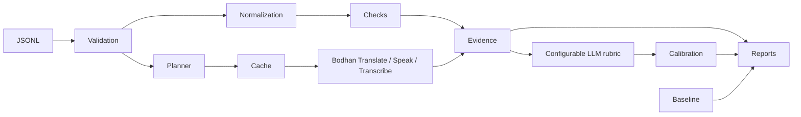
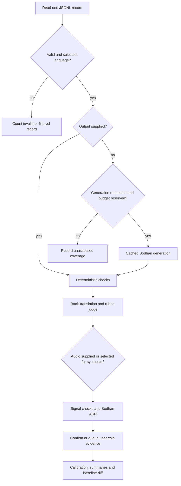

# Implementation strategy

## Architecture

## Execution flow

## Data and evidence contracts
Use original Python Unicode code-point offsets: half-open `[start,end]` plus `span_field`. Never report normalized-text offsets as original offsets. Missing source material is localized on source, speech alignment on translation/transcript, audio defects in seconds. Every flag records check, category, severity, evidence and confidence. Empty labels explicitly mean annotated clean; absent labels mean unlabelled.

## Check order and noise control
1. Validate data and record coverage. Normalize NFC and decimal digits while retaining original offsets.
2. Compare numeric multisets, protected terms explicitly supplied by the dataset, and structural markup. Script mismatch is conservative and cannot distinguish languages sharing scripts.
3. Compute reference metrics as measurements, not automatic semantic failure verdicts.
4. Use Bodhan back-translation as checker evidence. Require judge corroboration for semantic errors; retain uncertain disagreements for review.
5. Analyze audio signal and align Bodhan ASR against intended translation. Require corroboration/repeated ASR for semantic speech flags. Sample synthesis deterministically, with budget priority for suspicious items.

## Model integration plan
Implemented using the officially verified `/translate` JSON route and OpenAI-compatible `/v1/audio/*` endpoints; see [API notes](api_verification.md). Judge uses `LLM_BASE_URL`, `LLM_MODEL`, `LLM_API_KEY`; it only classifies and quotes existing spans. Schema, categories, range bounds and exact quotations are validated. Unsupported or invalid judge replies become check failures, never clean verdicts.

Responses (including usage) are stored in a content-addressed cache with model, endpoint, parameters, full rubric and input/audio hashes. Secrets are excluded. Independent ASR/judge replicates have separate cache identities with identical HTTP inputs. Runtime billing/reservations are stored outside stable reports. Unknown LLM prices disable live judging until both explicit price flags are supplied. Reservations occur before every attempt; transient retries use bounded exponential backoff. A semaphore limits active network calls. Atomic writes and per-input locks are process-local.

## Calibration and validation
Split calibration/development and held-out evaluation by original clean parent ID to avoid injection leakage. Tune thresholds per check on calibration labels only; report sample counts and unsupported categories. Match labels to predictions one-to-one by category, field and span overlap. Evaluate detection, localization and category classification separately. Measure judge consistency with independent uncached repetitions.

Use deterministic unit fixtures, mocked adapters, synthetic WAV signals and a ten-item CLI test. Then run real Bodhan smoke tests and Cookbook `make check`. Do not claim semantic quality targets, runtime or live compatibility from mocks. Preserve explicit pending work in task.md.

## Implemented calibration and remaining evidence
Calibration fits judge-confidence cutoffs from attributable human labels or externally supplied evaluator labels. It does not tune deterministic string rules. Programmatic development labels do not become human ground truth. Precision/recall matches errors one-to-one by category; localization is separately matched by overlapping fields/spans, and category accuracy uses overlap independently of category. Parent groups, including cross-language siblings, are excluded from held-out evaluation when used for development. Repeated same-prompt judge verdicts measure consistency; repeated ASR is requested only for proposed speech findings. These reduce noise without proving checker independence or accuracy.

The current sample report uses only deterministic smoke fixtures. Live calibration, representative clean-negative coverage, hosted runtime, container build and the final recorded demo remain evidence-gathering tasks.
