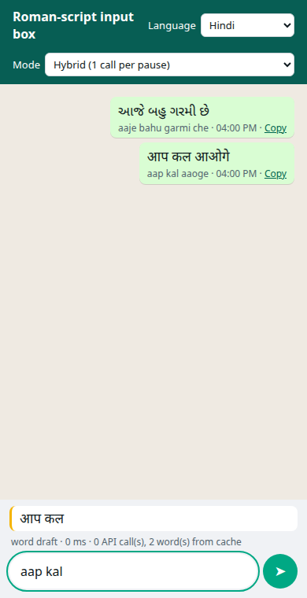

# Roman-script input box

> A chat input box where people type the way they text, in English letters ("kal meeting hai"), and the message is sent in their own script ("कल मीटिंग है").

**Bodhan models:** indic-transliterate
**Languages shown:** Hindi, Gujarati, Bengali, Tamil, with a script check across all 25 supported languages (24 pass)
**Format:** Python web app (standard-library server, one HTML page) plus evaluation scripts

## What it does

Most people in India type their own language in roman letters, because that is what a phone keyboard makes easy. This recipe is a WhatsApp-style input box. You type in roman letters, a preview line shows the text in your script, and Enter sends the native-script message, with a button to copy it.

It also answers the design question every app built on `indic-transliterate` faces: convert **word by word** as the user types, the **whole sentence**, or a **hybrid**? `eval/compare_modes.py` measures accuracy, consistency, latency and API calls for each. The raw API answers are committed, so every number below can be re-checked without a key.



## Use it in your own app

The one thing to copy is how to call the model. Today, the chat route only transliterates reliably when the target script is named in the message (see [why](#why-the-instruction)):

```python
import os, requests

def transliterate(text: str, language_name: str) -> str:
    """'tame kem cho', 'Gujarati' -> 'તમે કેમ છો'"""
    resp = requests.post(
        "https://api.bodhan.ai/v1/chat/completions",
        headers={"Authorization": f"Bearer {os.environ['BODHAN_API_KEY']}"},
        json={"model": "indic-transliterate",
              "messages": [{"role": "user", "content": f"Transliterate into {language_name} script: {text}"}]},
        timeout=30,
    )
    resp.raise_for_status()   # 429: wait for Retry-After; see "Rate limits"
    return resp.json()["choices"][0]["message"]["content"].strip()
```

`bodhan_client.py` is the production version of this. It adds a connection pool, one short retry on a 429, clear error types, and a switch to the documented `POST /transliterate` for when that route is live.

## Setup

Requires Python 3.10+.

```bash
cd examples/roman_script_input_box
python -m venv .venv && source .venv/bin/activate
pip install -r requirements.txt
cp .env.example .env   # then paste your key from https://console.bodhan.ai
```

The key must have access to `indic-transliterate`. Keys are scoped per model: a key for another model gets `403 key_model_access_denied`.

## Run

```bash
python app.py
# open http://127.0.0.1:8000
```

Pick a language and a mode at the top, type, and press Enter. `PORT=8080 python app.py` changes the port.

Re-check the results without a key, or run them again:

```bash
python eval/compare_modes.py --offline     # word vs sentence vs hybrid, from eval/results/
python eval/language_matrix.py --offline   # script check for all 25 languages
python eval/compare_modes.py               # calls the API only for answers not yet saved
```

Offline tests (no key, no network). They cover the client, the converter, the HTTP server and the eval scoring:

```bash
python -m unittest discover -s tests
```

## How it works

```
static/index.html ──POST /api/transliterate──▶ app.py ──▶ converter.py ──▶ bodhan_client.py ──▶ api.bodhan.ai
```

| File | Role |
|---|---|
| `static/index.html` | The chat page: HTML, CSS and inline JS. It never sees the API key. |
| `app.py` | Standard-library server: the page, one JSON endpoint, input checks, readable errors. |
| `converter.py` | The conversion modes and a word cache. |
| `bodhan_client.py` | The only code that talks to Bodhan: route, request body, connection pool, 429 handling. |
| `eval/` | `compare_modes.py`, `language_matrix.py`, the test set, the committed results, and the API probes. |
| `tests/test_offline.py` | 38 offline tests with a fake API. |

The modes in `converter.py`:

- **sentence**: one call for the whole line.
- **word**: one call per new word (in parallel, at most 20 per message), with spaces, digits and punctuation put back where they were.
- **draft**: word mode from the cache only. It makes no calls, and unknown words stay in roman.

**Hybrid** is the app's default:

1. Each time you finish a word, you get a free **draft**.
2. When you pause for 700 ms, or press Enter, one **sentence** call is made, and its answer is what gets sent.
3. Sentence answers that line up word for word with the input teach the cache. A word is only cached if its answer is a single word written in the target script.

## Word, sentence or hybrid?

The test set has 20 everyday sentences, 5 each in Hindi, Gujarati, Bengali and Tamil, run on 24 November 2026:

- **dev**: 12 sentences used while designing the instruction.
- **held-out**: 8 sentences written afterwards, with punctuation, digits and English words, and never used for tuning.

Word mode goes through the app's own `Converter`. CER is character error rate (0 is perfect), and word accuracy is 1 − word error rate, both against the closest accepted spelling.

| Mode | Exact match (dev · held-out) | CER | Word accuracy | p50 latency | p95 latency | API calls |
|---|---|---|---|---|---|---|
| **sentence** | **12/12 · 7/8** | **0.003** | **0.975** | **327 ms** | **2.0 s** | 20 |
| word | 6/12 · 5/8 | 0.052 | 0.859 | 680 ms | 15.0 s | 76 |
| bare (no instruction) | 6/12 · 3/8 | 0.327 | 0.599 | 357 ms | 1.6 s | 20 |

- **Consistency.** Each sentence was asked 3 times in sentence mode, and all 20 gave the same answer every time.
- **Latency.** A word-mode message waits for its slowest word, so one slow call holds up the whole message; that's why its p95 is so high. The calls were recorded one after another while the API was under varying load.
- **Hybrid.** It sends exactly what sentence mode sends, so it has the same accuracy and one call per message. Its draft is a cheap extra. Replaying each language's 5 sentences as one conversation from a cold cache, the draft showed 5 of 76 words in script before the sentence pass, and all 5 were right. It fills in as a conversation repeats words.

What the mistakes look like:

| Input | Word by word | Whole sentence | Bare |
|---|---|---|---|
| `tame kem cho` (gu) | તમે કેમ **ચો** | તમે કેમ છો | **तुम लोग कौन हो** (Hindi, a different meaning) |
| `kya tum kal free ho?` (hi) | क्या तुम कल फ्री हो? | क्या तुम कल फ्री हो? | **ਕੀ ਤੁਸੀਂ ਕੱਲ੍ਹ ਫ੍ਰੀ ਹੋ?** (Punjabi) |
| `kal meeting hai please time pe aana` (hi) | … **कृपया समय** पे आना | … प्लीज टाइम पे आना | … **कृपया समय पर** आना |
| `naan veetla irukken` (ta) | நான் **வீட்டில் இருக்கும்** | நான் வீட்ல இருக்கேன் | நான் **வீட்டில் இருக்கிறேன்** |
| `amma saapittiya?` (ta) | அம்மா சாப்பிட்டியா? | அம்மா சாப்பிட்**டீ**யா? | அம்மா சாப்பிட்**டீ**யா? |

On their own, words lose context. "ch" can be ચ or છ, English words get *translated* ("please" became कृपया), and colloquial Tamil turns into the formal written form. Sentence mode's one miss is a vowel-length slip (டீ for டி), counted as an error.

## Does it work beyond these four languages?

`eval/language_matrix.py` sends two short phrases ("ravi kal ghar aayega", "namaskar") to every language `indic-transliterate` supports, with the instruction, and checks that every letter of the answer is in that language's script.

- **Roman → native: 24 of 25 languages.** Every script passed, including Meetei Mayek (`mni`), Ol Chiki (`sat`), Odia, and the three Perso-Arabic variants. The one failure is **Kashmiri (Devanagari)** (`ks-Deva`): it returned "ravi kal ghar ayega" unchanged. The language menu marks it.
- **Native → roman: the instruction is needed both ways.** One sentence per tested language:

| Language | With the instruction | Without (`script: "roman"` only) |
|---|---|---|
| Hindi `आप कैसे हैं` | Aap kaise hain | आप कैसे हैं (unchanged) |
| Gujarati `તમે કેમ છો` | Tame kem chho | आप कैसे हैं (translated to Hindi) |
| Bengali `আমি ভালো আছি` | Ami bhalo achi. | I am fine (translated to English) |
| Tamil `நான் நாளை வருவேன்` | Naan naalai varuven | నేను రేపు వస్తాను (translated to Telugu) |

This checks the script only, not accuracy. The phrases are Hindi words, and some languages adapted them rather than transliterating them (Nepali gave आउनेछ for "aayega"). All answers are in `eval/results/language_matrix.json`.

## Why the instruction

The [API reference](https://console.bodhan.ai/api-docs/#transliteration-api) documents `POST /transliterate`. In November 2026 it returned `404 {"detail":"Not Found"}`, as also reported in issue #34. `POST /v1/chat/completions` with `"model": "indic-transliterate"` does answer, and [PR #39](https://github.com/Bodhan-AI/Bodhan-AI-Cookbook/pull/39) (government scheme summariser) first reported that on this route the `language` and `script` fields are ignored. This recipe's probes (`eval/probe.py`, `eval/probe_language.py`) confirm it: "tame kem cho" with `gu`, `hi` or `bn` all came back in Devanagari, and a made-up code `xx` still got `200`.

The fix is to name the target script in the message: `"Transliterate into Gujarati script: tame kem cho"` → `તમે કેમ છો`. It also stops the model translating English words, and it makes native → roman work. PR #39 found that direction returned the input unchanged; without the instruction it can also translate (see the table above).

`BODHAN_TRANSLIT_ROUTE` in `.env` keeps the recipe ready for the documented route:

- **`chat`** (default): the chat route, with the instruction.
- **`plain`**: the documented `POST /transliterate`, which reads its `transliteration` field. It's unit-tested, but couldn't be run live because the route is down.
- **`auto`**: tries `plain` once and falls back to `chat` on a 404. The 404 took 1–24 s, which is why it isn't the default.

## Rate limits

- **A per-key request budget.** The headers are `X-Ratelimit-Api_key-Limit-Requests: 120` and `...-Max_parallel_requests: 10`, which differ from the names in the docs. The window isn't documented, and a 404 doesn't count against it.
- **A per-model throttle.** About 15 calls a minute gets `429 throttling_error`, with `Retry-After` of up to about a minute.

That's why the typing draft is cache-only and word mode is capped. The client retries a 429 once, but only if `Retry-After` is 3 s or less. Otherwise the app shows "try again in N s" and keeps your text. The eval scripts wait out `Retry-After` and save every answer as it arrives.

## Security

- **The key stays on the server.** The browser only talks to `app.py`. The server refuses to start with the `.env.example` placeholder, or on any address other than `127.0.0.1`.
- **Only its own page can use the server.** It requires a local `Host` header (which blocks DNS rebinding) and a JSON body (so browsers must send a CORS preflight, which is never granted), and it rejects cross-site `Origin` and `Sec-Fetch-Site` headers.
- **Input is bounded and text isn't logged.** Messages are limited to 500 characters and bodies to 8 KB. The server logs only the method, path and status, never what people type.

## Limitations

- **Undocumented route.** The app relies on the chat route plus an instruction the docs don't describe. If that changes, `bodhan_client.py` is the one place to fix.
- **A sanity check, not a benchmark.** The test set is 20 sentences, and one person wrote the references (with common spelling variants allowed). The 25-language check only verifies the output script, not accuracy.
- **Word cache.** It lives in memory and is lost on restart. A misaligned sentence pair could still teach it a wrong word in the right script; the next sentence pass corrects what gets sent.
- **Message length.** Messages are capped at 500 characters, since this is a chat box.
